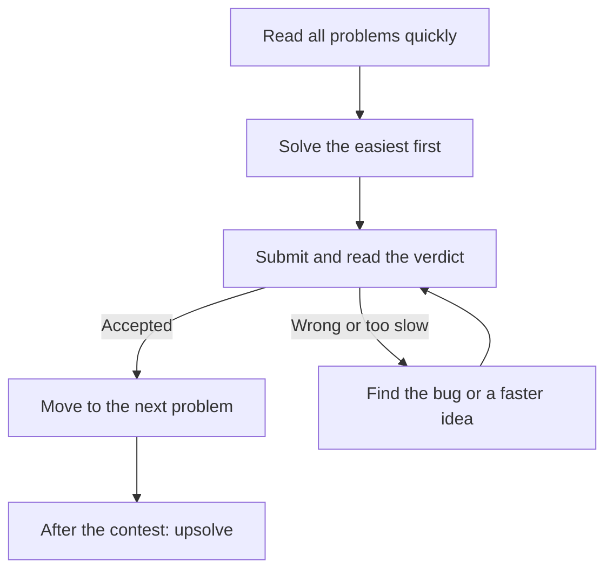

## The hook

At 8:05 pm, twenty thousand people around the world open the same six problems at the same moment. A clock starts counting down from two hours. Somewhere, a student solves problem A in four minutes, problem B in twelve, and then stares at problem C for an hour.

By 10:05 pm, every one of them has a new number next to their name. That number, their rating, will be on their CV next placement season. This is competitive programming, and it is one of the fastest ways to make a hard interview feel easy.

## The intuition

:::analogy
Think of a chess club with an Elo rating. Every game you play against someone stronger than you is a chance to gain points; every loss to someone weaker costs points. Over time, your number settles where your real strength is. Contest platforms work the same way, except your opponents are everyone who entered that day, and your "games" are problems solved against the clock.
:::

The appeal for placements is simple. Interviews ask you to solve one or two problems in 45 minutes. Contests ask you to solve several in two hours, faster, with stricter tests. Train for the harder version and the easier one feels comfortable.

## Let's build it up

### The online judge

You write a solution, submit it, and an [[online judge]] runs it on hidden tests. You never see those tests. You get back a [[verdict]]:

| Verdict | What it usually means |
|---|---|
| Accepted (AC) | Correct and fast enough on every test |
| Wrong Answer (WA) | Some test produced the wrong output |
| Time Limit Exceeded (TLE) | Too slow, usually the complexity is too high |
| Memory Limit Exceeded (MLE) | Used too much memory |
| Runtime Error (RE) | Crashed: out-of-bounds access, division by zero, stack overflow |

The samples in the problem statement are tiny. The hidden tests include the largest inputs the constraints allow, which is why your [Big-O estimate](article:dsa-big-o) matters before you write a line.

### The main platforms

- **Codeforces** runs frequent rated rounds. Contests are split by [[division]]: Div. 1 for the strongest, then Div. 2, Div. 3 and Div. 4 for progressively newer contestants. It is the most common reference point for CP ratings.
- **AtCoder** (Japan) is known for clean, well-tested problems. AtCoder Beginner Contests (ABC) are an excellent place to start; Regular and Grand contests (ARC, AGC) are harder.
- **CodeChef** runs weekly Starters contests and is popular in India.
- **CSES Problem Set** is not a contest, but a curated set of a few hundred classic problems grouped by topic. This subject links to it often.
- **LeetCode** weekly contests are closest to the interview style.

### How a round is scored

Formats differ, but two ideas recur. Solving more problems matters most, and solving them sooner, with fewer wrong attempts, breaks ties. In standard Codeforces rounds, each problem's points shrink as time passes and wrong submissions cost a penalty. Some rounds also allow a [[hack]]: you can submit a test that breaks someone else's solution.

### What the rating colours mean

On Codeforces, your [[rating]] comes with a title and a colour. Roughly: below 1200 is newbie (grey), 1200 to 1399 pupil (green), 1400 to 1599 specialist (cyan), 1600 to 1899 expert (blue), 1900 to 2099 candidate master (violet), 2100 and above master (orange), and 2400 and above grandmaster (red).

:::insight
For placements, the useful milestones are modest. Comfortably solving Div. 2 problems A to C, roughly the 1400 to 1600 range, already covers the large majority of interview DSA. Pushing toward expert and beyond builds the speed and depth that top infra companies notice.
:::

:::warning
Common misconception: "contest problems are about clever maths, not real skills." Most problems up to about 1600 are about exactly what interviews test: choosing the right pattern, getting edge cases right, and writing correct code quickly. The maths-heavy problems come later, and this subject teaches them gently.
:::

### Upsolving: where rating really comes from

Your rating changes during contests, but your skill grows after them. [[Upsolving]] means returning to the problems you could not solve, reading the editorial (the official explanation), and then coding the solution yourself without looking. Those problems sit right at the edge of your ability, which is exactly where practice pays off most.

## A tiny example

Here is what a first Codeforces Div. 4 contest might look like for a beginner.

- **Minute 3:** Problem A asks whether a number is even and greater than 2. You submit. Accepted.
- **Minute 15:** Problem B wants the maximum of some sums. You submit an O(n²) loop. Accepted, because n is only 100.
- **Minute 40:** Problem C has n up to 200,000. Your O(n²) idea gets TLE. You notice the repeated work, switch to prefix sums, and it is Accepted.
- **Minute 120:** Problem D stays unsolved.
- **Tomorrow:** you read D's editorial, learn it was binary search on the answer, and code it yourself. That is upsolving.

:::try-this
Look at problem C in the story. With n = 200,000, estimate the operations for O(n²) and O(n). Using about 10⁸ simple operations per second, how long would each take? (Roughly 4 × 10¹⁰ steps, around 400 seconds, against 2 × 10⁵ steps, effectively instant.)
:::

## Where you'll see this again

The next articles in this track set up your contest template and fast input reading, teach you to read a problem in two minutes, and lay out a rating ladder: which topics to practise at each level. Everything you learn in the DSA subject, starting with patterns like [prefix sums](article:dsa-prefix-sums), is exactly what the first few problems of every contest test.

## Key takeaways

- Contest platforms run your code on hidden tests with strict time and memory limits, and report a verdict such as AC, WA or TLE.
- Codeforces divisions separate contestants by strength, and Div. 3 and Div. 4 rounds are the friendliest starting point.
- Your rating works like a chess rating: it rises when you beat people stronger than your current number and settles near your true level.
- Comfortably solving Div. 2 A to C already covers most interview DSA, and going further builds speed and depth.
- Upsolving the problems you missed is where most of your improvement actually happens.
