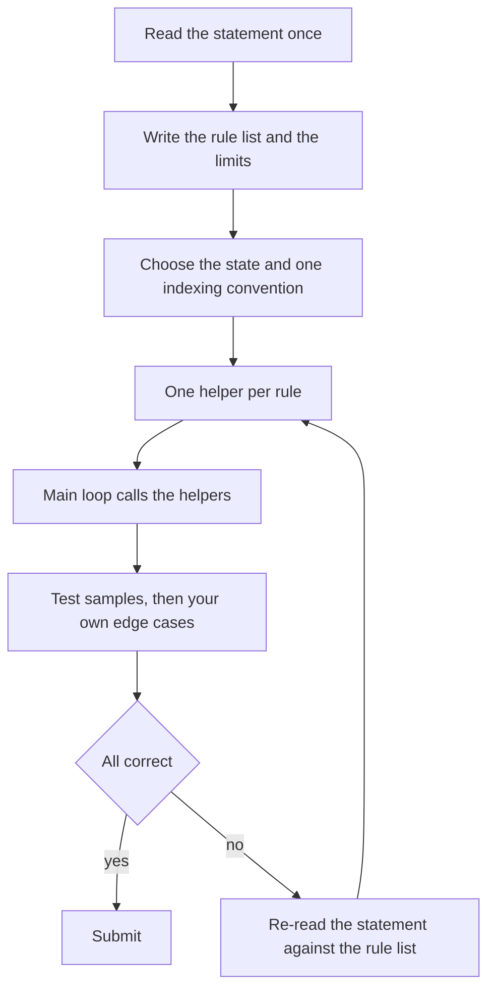

## The hook

A pastry chef follows a recipe to the gram. Not because the steps are hard, mixing and folding are easy, but because 5 grams too much baking soda ruins the whole batch, and the chef only finds out an hour later. The skill is not creativity; it is doing every simple step exactly as written.

Many problems rated 800 to 1200 on Codeforces are like that recipe. They describe a process, a board, a game or a format, and the "algorithm" is to do exactly what it says. They are where beginners lose the most time, because one swapped index or one forgotten case turns a ten-minute solve into a forty-minute debug.

## The intuition

:::analogy
A careful chef does three things before touching any ingredient. They read the whole recipe once and underline every quantity. They lay out the bowls in the order they will be used, so nothing is grabbed by mistake. And they taste at the end of each stage, not only when the cake comes out of the oven. Each habit is boring, and together they make the result reliable.
:::

For an [[implementation problem]], the same three habits become:

- **Read and underline:** extract every rule and every limit into a short list before coding.
- **Lay out the bowls:** decide the [[state]] and one [[indexing convention]], and give each rule its own [[helper function]].
- **Taste at each stage:** test the samples, then a few [[edge case]]s you write yourself, before submitting.

None of these is an algorithm. They are working habits, and they matter more here than anywhere else because the problems give no partial credit for a "nearly right" simulation.

## Let's build it up

### Step 1: turn the statement into a rule list

Read the statement once fully, then write a numbered list of rules in your own words, each one line. For a board game, that might be: the board is R by C; walls are '#'; the robot starts top-left facing east; L and R turn; F moves one cell unless blocked. Then write the limits beside it: R, C up to 100; up to 10⁵ commands. The list is your recipe; the code will follow it line by line. The habit of reading for limits is covered in [The Two-Minute Read That Saves Twenty](article:cp-reading-problems-fast).

### Step 2: pick the state and one convention

Write down exactly what describes one moment: here (row, column, direction). Then fix one convention and never mix it:

| Decision | A safe default |
|---|---|
| Row and column indices | 0-based everywhere, converting only when reading or printing |
| Directions | 0 = north, 1 = east, 2 = south, 3 = west, with arrays DR and DC |
| Turning | right = (d + 1) % 4, left = (d + 3) % 4, never (d - 1) % 4, which can be negative |
| Grid storage | `vector<string>`, so g[r][c] reads naturally |
| Answers that can grow | `long long` from the start |

The left turn is a classic trap: in C++, (-1) % 4 is -1, not 3. Adding 3 instead of subtracting 1 avoids negative remainders entirely.

### Step 3: one rule, one helper

Each rule from step 1 becomes a tiny function: inside(r, c), open(r, c), turnLeft(d), step(state, command). The main loop then reads like the statement: for each command, state = step(state, command). Helpers are easy to test alone, and when something goes wrong, only one small function is suspect.

### Step 4: test the edges before the judge does

Run the samples, then invent three or four inputs at the boundaries:

- the smallest case, such as a 1 by 1 board or n = 1;
- a case that hits each special rule: walking into a wall, walking off the board, turning a full circle;
- a maximum-size case, generated by a two-line script, to check speed and overflow.

If the problem is subtle, a brute force plus random tests, as in [Let a Robot Find Your Wrong Answer](article:cp-stress-testing), finds the bug faster than staring at the code.

### Step 5: when it still fails

Re-read the statement against your rule list, not against your memory of it. Most implementation Wrong Answers come from a rule that was misread or skipped, not from a typo. Check output format too: spaces, newlines, "YES" versus "Yes".



:::insight
Implementation problems are lost to small inconsistencies, such as one 1-based index, one negative modulus or one skipped rule. Writing the rules down, fixing one convention and giving each rule its own helper removes the places where those inconsistencies hide.
:::

## A tiny example

A robot on this board starts at the top-left, facing east:

```
. . . . #
. # . . .
. . . # .
. . . . .
```

Commands: L and R turn 90 degrees; F moves one cell forward unless the cell ahead is a wall or off the board, in which case the robot stays. Run FFFFRFFLFFRF. Where does it end, facing which way, and how many different cells did it visit?

The rule list gives the helpers; the main loop is three lines.

| Command | Position after | Facing | Note |
|---|---|---|---|
| F F F | (0, 1), (0, 2), (0, 3) | E | |
| F | (0, 3) | E | (0, 4) is a wall, stay |
| R | (0, 3) | S | |
| F | (1, 3) | S | |
| F | (1, 3) | S | (2, 3) is a wall, stay |
| L | (1, 3) | E | |
| F | (1, 4) | E | |
| F | (1, 4) | E | (1, 5) is off the board, stay |
| R | (1, 4) | S | |
| F | (2, 4) | S | |

The robot ends at (2, 4) facing south, having visited 7 different cells. Two of the twelve commands were blocked by walls and one by the edge: exactly the special cases worth testing first.

```cpp
#include <bits/stdc++.h>
using namespace std;

const int DR[] = {-1, 0, 1, 0}, DC[] = {0, 1, 0, -1};   // N, E, S, W
struct Robot { int r, c, d; };

bool inside(const vector<string>& g, int r, int c) {
    return r >= 0 && c >= 0 && r < (int)g.size() && c < (int)g[0].size();
}
bool open(const vector<string>& g, int r, int c) { return inside(g, r, c) && g[r][c] != '#'; }
int turnRight(int d) { return (d + 1) % 4; }
int turnLeft(int d) { return (d + 3) % 4; }             // never (d - 1) % 4

Robot step(const vector<string>& g, Robot b, char cmd) {
    if (cmd == 'L') b.d = turnLeft(b.d);
    else if (cmd == 'R') b.d = turnRight(b.d);
    else if (cmd == 'F' && open(g, b.r + DR[b.d], b.c + DC[b.d])) b.r += DR[b.d], b.c += DC[b.d];
    return b;
}

int main() {
    vector<string> g = {"....#", ".#...", "...#.", "....."};
    Robot b{0, 0, 1};                                    // top-left, facing east
    set<pair<int, int>> seen{{0, 0}};
    for (char cmd : string("FFFFRFFLFFRF")) b = step(g, b, cmd), seen.insert({b.r, b.c});
    cout << b.r << ' ' << b.c << ' ' << "NESW"[b.d] << ' ' << seen.size() << '\n';   // 2 4 S 7
    cout << (-1) % 4 << ' ' << turnLeft(0) << '\n';                                   // -1 3
}
```

The last line shows the negative remainder trap directly: (-1) % 4 is -1 in C++, while turnLeft(0) correctly gives 3, west.

:::try-this
Add a command B that moves the robot one cell backwards without turning, also blocked by walls and edges. Which helper changes, and where does FFFFRFFLFFRFB end? (Only step changes: B tries the cell at (r - DR[d], c - DC[d]). After the original commands the robot is at (2, 4) facing south; B tries (1, 4), which is open, so it ends at (1, 4) still facing south.)
:::

:::warning
Common misconception: "Implementation problems are easy, so I can code them straight away." They are easy to understand and easy to get slightly wrong. Skipping the rule list saves two minutes and often costs twenty in debugging; on a contest day, a careful first submission is worth far more than a fast wrong one.
:::

## Where you'll see this again

Every contest has implementation work, even in hard problems, where the algorithm is the easy part and the bookkeeping is not. Grid simulations reappear in BFS problems, where the same direction arrays and inside checks are used in [A Robot Vacuum Mapping the Room](article:dsa-grid-graph-tricks). The habits of testing edge cases and generating maximum inputs are the start of a contest routine described in [Pacing a Two-Hour Race](article:cp-contest-strategy). To practise, filter the Codeforces problem set by the "implementation" tag with ratings from 800 to 1200, and time yourself on getting each accepted on the first submission.

## Key takeaways

- Implementation problems test whether you follow detailed rules exactly, not whether you find a clever idea.
- Writing the rules and limits as a short list before coding is the single best defence against misread statements.
- Choosing one indexing convention and one direction encoding, and using it everywhere, removes most off-by-one bugs.
- Giving each rule its own small helper function keeps the main loop readable and makes each rule easy to test alone.
- Testing the smallest case, each special rule and a maximum-size input before submitting catches the bugs the samples do not.
