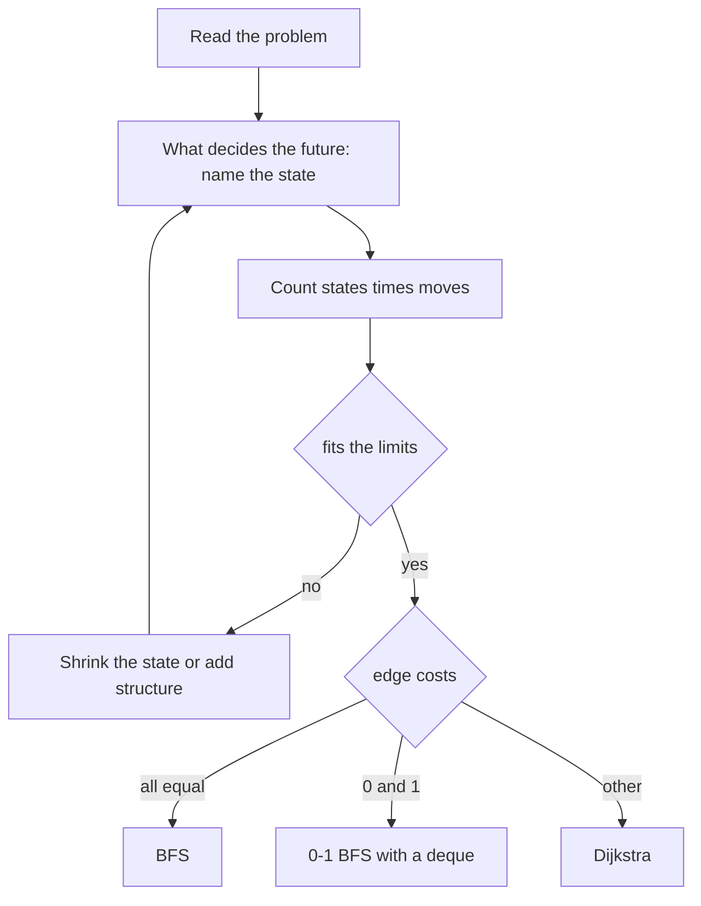

## The hook

Many contest problems never mention a graph. A sliding tile puzzle, a calculator with two buttons, a maze with monsters chasing you, an array where you may jump between equal values: each is a shortest-path problem once you decide what a vertex is and what an edge is.

That decision is the whole skill. Once the vertices and edges are named, the algorithm is almost always one you already know, BFS from [Ripples on a Pond: Breadth-First Search](article:dsa-bfs), 0-1 BFS, or Dijkstra. This article is about the naming, the counting that tells you whether a model fits, and two tricks that come up constantly: racing a rival's BFS, and adding vertices that do not exist in the problem.

## The intuition

:::analogy
Take a sliding puzzle and photograph it in every arrangement it can reach. Lay the photographs out on a huge table, and draw an arrow from one photo to another whenever a single slide turns the first into the second. The puzzle is now a map: the fewest slides to solve it is the shortest route from the starting photo to the solved photo. You never need to print every photo in advance; you can take each one as you arrive, as long as the table is big enough to hold them all.
:::

The table of photos is an [[implicit graph]]. Each photo is a [[state]], and all the photos together form the [[state space]].

## How it works

### Step 1: name the state

A state must contain everything that affects future moves and nothing else.

| Problem | State | Moves | State count |
|---|---|---|---|
| grid maze | (row, column) | 4 neighbours | rows × columns |
| maze where you may break k walls | (row, column, breaks used) | 4 neighbours | rows × columns × (k + 1) |
| 2 × 3 sliding puzzle | arrangement of 6 tiles | slide into the blank | 6! = 720 |
| calculator with ×2 and −1 | current number | 2 | bounded by about 2 × max |
| flight with one discount | (city, discount used) | flights | 2 × cities |

### Step 2: count before coding

Multiply states by moves per state and compare with the limits. A grid of 1000 × 1000 with 4 moves is 4·10⁶ transitions: fine. Add "set of 10 keys collected" and it becomes 1000 · 1000 · 2¹⁰, about 10⁹ states: too many, and the model must shrink. Noticing this before writing code saves the most time of any step.

### Step 3: bound infinite spaces

*Two Buttons* starts at n and wants m; the red button doubles, the blue one subtracts 1. Numbers can grow forever, but a shortest sequence never needs to pass about 2·max(n, m), so BFS over 1 to that bound is exact and small.

### Trick 1: racing a rival with multi-source BFS

CSES *Monsters*: you and several monsters move one square per step through a maze, and you must reach the border without ever entering a square a monster can occupy at the same time or earlier. Monsters may choose any route, so the danger at a square is the earliest time any monster could be there.

- **First,** run a [[multi-source BFS]] with every monster in the queue at time 0: mt[square] is the earliest monster arrival.
- **Then** run your own BFS, entering a square only if your time there is strictly less than mt[square]. This is the [[arrival race]].
- **Finally,** the first border square you reach ends the search; walk back along stored directions to print the path.

Why the race is safe: mt is the earliest any monster can possibly be at a square, so arriving strictly earlier at every square of your route means no monster can ever share a square with you along it.

### Trick 2: virtual nodes instead of quadratic edges

In *Jump Game IV* you may step to i − 1, i + 1, or jump to any j with the same value as i. Joining all equal values pairwise needs up to k² edges for k equal values, which for an array of 5·10⁴ identical values is over 10⁹.

Add one [[virtual node]] per distinct value instead:

- index i → hub of a[i], cost 1, which is the jump;
- hub → every index with that value, cost 0, which is the landing.

A jump costs 1 + 0 = 1, as before, but the graph has only O(n) edges. With costs 0 and 1, a deque-based 0-1 BFS finds the distances. The same trick handles "all cities in a group are connected", "teleport between any two portals", and "any two numbers sharing a prime factor".



:::insight
Most graph modelling comes down to one question: what must I remember to know which moves are possible next? That set of facts is the vertex. If it is too big, the problem wants a smaller description; if there are too many edges, the problem wants a virtual vertex.
:::

## Walk through an example

### Monsters

Maze, with A for you and M for monsters; row 0 is the top:

```
########
#M..A..#
#.#.M#.#
#M#..#..
#.######
```

The monster BFS gives these earliest arrival times, with # for walls:

| Row | col 1 | col 2 | col 3 | col 4 | col 5 | col 6 | col 7 |
|---|---|---|---|---|---|---|---|
| 1 | 0 | 1 | 2 | 1 | 2 | 3 | # |
| 2 | 1 | # | 1 | 0 | # | 4 | # |
| 3 | 0 | # | 2 | 1 | # | 5 | 6 |
| 4 | 1 | # | # | # | # | # | # |

You start at row 1, column 4, with a monster directly below. Your BFS:

| Your step | Square | Your time | Monster time | Allowed |
|---|---|---|---|---|
| R | row 1, col 5 | 1 | 2 | yes |
| R | row 1, col 6 | 2 | 3 | yes |
| D | row 2, col 6 | 3 | 4 | yes |
| D | row 3, col 6 | 4 | 5 | yes |
| R | row 3, col 7, on the border | 5 | 6 | yes: escape |

Going left is hopeless: row 1, column 3 has monster time 2, and you would need two steps to get there. The answer is the path RRDDR. If the exit at row 3, column 7 is walled up, the only other border opening, row 4, column 1, has monster time 1 and is far away, so the answer becomes NO.

### Jump Game IV with hubs

Array 5, 1, 2, 3, 4, 5, 9, 8, 7, 6, from index 0 to index 9. Walking costs 9 steps. With the hub for value 5: index 0 → hub of 5 costs 1, hub → index 5 costs 0, then four steps to index 9. Total 5, which the 0-1 BFS finds, matching a plain BFS that adds every same-value edge explicitly.

### Two Buttons

From 5 to 17: 5 → 10 → 9 → 18 → 17, using red, blue, red, blue: 4 presses. Doubling twice first, 5 → 10 → 20, would then need three blue presses, 5 in total.

:::try-this
Move the monster from row 1, column 1 onto the exit square, row 3, column 7. What is the answer now? (NO. The exit has monster time 0, so you can never enter it. The only other border opening, row 4, column 1, is one step from the monster at row 3, column 1, while you would need six steps to get there. The program confirms NO for this maze.)
:::

:::warning
Common misconception: "Move the monsters and yourself together in one BFS, step by step, simulating the chase." Simulating monster positions makes the state include where every monster is, which explodes. Because monsters can be anywhere they could reach, their earliest arrival times are all that matters, and one multi-source BFS computes them once.
:::

## The code

```pseudo
monsters: mt = multi-source BFS from all M
          BFS from A: enter (nr, nc) only if not a wall, unvisited, and t + 1 < mt[nr][nc]
          first border square popped: rebuild the path from stored directions
jumpGame: hubs per distinct value; i -> hub cost 1, hub -> i cost 0, neighbours cost 1
          0-1 BFS: cost 0 to the front of the deque, cost 1 to the back
twoButtons: BFS on numbers 1 .. 2*max(n, m) + 2 with moves 2x and x - 1
```

```cpp
#include <bits/stdc++.h>
using namespace std;

// Monsters: escape to the border, never entering a square a monster can reach at the same time or earlier.
string monsters(const vector<string>& g) {
    int R = g.size(), C = g[0].size();
    const int dr[4] = {-1, 1, 0, 0}, dc[4] = {0, 0, -1, 1};
    const char name[4] = {'U', 'D', 'L', 'R'};
    vector<vector<int>> mt(R, vector<int>(C, INT_MAX));          // earliest monster arrival
    queue<pair<int, int>> q;
    int sr = 0, sc = 0;
    for (int r = 0; r < R; r++) for (int c = 0; c < C; c++) {
        if (g[r][c] == 'M') mt[r][c] = 0, q.push({r, c});        // multi-source BFS: all monsters at time 0
        if (g[r][c] == 'A') sr = r, sc = c;
    }
    while (!q.empty()) {
        auto [r, c] = q.front(); q.pop();
        for (int d = 0; d < 4; d++) {
            int nr = r + dr[d], nc = c + dc[d];
            if (nr < 0 || nr >= R || nc < 0 || nc >= C || g[nr][nc] == '#' || mt[nr][nc] != INT_MAX) continue;
            mt[nr][nc] = mt[r][c] + 1, q.push({nr, nc});
        }
    }
    vector<vector<int>> t(R, vector<int>(C, -1)), how(R, vector<int>(C, -1));
    t[sr][sc] = 0, q.push({sr, sc});
    while (!q.empty()) {
        auto [r, c] = q.front(); q.pop();
        if (r == 0 || r == R - 1 || c == 0 || c == C - 1) {      // on the border: walk back to build the path
            string path;
            while (r != sr || c != sc) { int d = how[r][c]; path += name[d]; r -= dr[d], c -= dc[d]; }
            reverse(path.begin(), path.end());
            return path;
        }
        for (int d = 0; d < 4; d++) {
            int nr = r + dr[d], nc = c + dc[d];
            if (g[nr][nc] == '#' || t[nr][nc] != -1 || t[r][c] + 1 >= mt[nr][nc]) continue;   // must arrive strictly first
            t[nr][nc] = t[r][c] + 1, how[nr][nc] = d, q.push({nr, nc});
        }
    }
    return "NO";
}

// Jump Game IV style: from i go to i-1, i+1, or any j with a[j] == a[i]; one virtual hub per distinct value.
int jumpGame(const vector<int>& a) {
    int n = a.size();
    map<int, int> hub;                                           // value -> virtual node id
    for (int x : a) if (!hub.count(x)) { int id = n + hub.size(); hub[x] = id; }
    int N = n + hub.size();
    vector<vector<pair<int, int>>> g(N);                         // (to, cost 0 or 1)
    for (int i = 0; i < n; i++) {
        if (i > 0) g[i].push_back({i - 1, 1});
        if (i + 1 < n) g[i].push_back({i + 1, 1});
        g[i].push_back({hub[a[i]], 1});                          // index -> hub costs the jump
        g[hub[a[i]]].push_back({i, 0});                          // hub -> index is free
    }
    vector<int> d(N, INT_MAX);
    deque<int> dq = {0};
    d[0] = 0;
    while (!dq.empty()) {                                        // 0-1 BFS
        int u = dq.front(); dq.pop_front();
        for (auto [v, w] : g[u])
            if (d[u] + w < d[v]) { d[v] = d[u] + w; w ? dq.push_back(v) : dq.push_front(v); }
    }
    return d[n - 1];
}

int twoButtons(int n, int m) {                                   // red doubles, blue subtracts one
    int LIM = 2 * max(n, m) + 2;                                 // no shortest sequence goes above 2 * max
    vector<int> d(LIM + 1, -1);
    queue<int> q;
    d[n] = 0, q.push(n);
    while (!q.empty()) {
        int x = q.front(); q.pop();
        for (int y : {2 * x, x - 1})
            if (y >= 1 && y <= LIM && d[y] < 0) d[y] = d[x] + 1, q.push(y);
    }
    return d[m];
}

int main() {
    vector<string> grid = {
        "########",
        "#M..A..#",
        "#.#.M#.#",
        "#M#..#..",
        "#.######"};
    cout << monsters(grid) << '\n';                              // RRDDR
    grid[3][7] = '#';                                            // close the only exit
    cout << monsters(grid) << '\n';                              // NO

    cout << jumpGame({5, 1, 2, 3, 4, 5, 9, 8, 7, 6}) << ' ' << twoButtons(5, 17) << '\n';   // 5 4

    mt19937 rng(19);                                             // hubs against explicit same-value edges
    bool ok = true;
    for (int t = 0; t < 300; t++) {
        int n = 1 + rng() % 25;
        vector<int> a(n);
        for (int& x : a) x = rng() % 5;
        vector<int> d(n, -1);
        queue<int> q;
        d[0] = 0, q.push(0);
        while (!q.empty()) {
            int u = q.front(); q.pop();
            vector<int> nb = {u - 1, u + 1};
            for (int j = 0; j < n; j++) if (a[j] == a[u]) nb.push_back(j);
            for (int v : nb) if (v >= 0 && v < n && d[v] < 0) d[v] = d[u] + 1, q.push(v);
        }
        ok = ok && jumpGame(a) == d[n - 1];
    }
    cout << (ok ? "stress ok" : "stress FAILED") << '\n';        // stress ok
}
```

The stress test compares the hub graph with a plain BFS that adds every same-value jump explicitly, on 300 random arrays with only five distinct values, so equal values are common.

## Complexity

- **Monsters: O(R·C)** for two BFS passes over the grid.
- **Jump Game IV: O(n log n)** with a map from values to hubs, O(n) with hashing, against O(n²) for explicit jump edges.
- **Two Buttons: O(max(n, m)).**
- **In general: O(states + transitions),** which is why counting them first matters.

## Common mistakes

- **Leaving something out of the state** that changes which moves are legal, such as walls broken or a discount used.
- **Putting too much into the state,** such as every monster's position, when a precomputed time map suffices.
- **Allowing ties in the arrival race:** you must be strictly earlier than every monster.
- **Forgetting that the start may already be on the border,** which is an escape with zero moves.
- **Unbounded number states** without a provable upper limit.
- **Explicit edges between all equal values,** which is quadratic; use a hub, or clear the value's list after its first use.

## Practice problems

*Monsters* is the multi-source race with path printing. *Two Buttons* is a bounded number line. *Jump Game IV* is the hub trick with 0-1 BFS, or plain BFS where each value's list is cleared after use. *Sliding Puzzle* is a BFS over the 720 arrangements of a 2 × 3 board, encoded as strings. Layered states such as discounts are developed in [A Travel Planner With One Discount Voucher](article:cp-shortest-path-tricks), and grids with free and paid moves in [A Robot Vacuum Mapping the Room](article:dsa-grid-graph-tricks).

## Key takeaways

- An implicit graph turns each state of a problem into a vertex and each legal move into an edge, generated only when the search reaches it.
- A state must hold exactly what decides the next moves, and multiplying states by moves per state before coding tells you whether the model fits.
- Racing a rival works by computing the rival's earliest arrival with a multi-source BFS and entering only squares you reach strictly first.
- A virtual hub per group, with a paid edge in and a free edge out, replaces quadratically many edges and keeps distances unchanged under 0-1 BFS.
- Once the model is named and counted, the algorithm is a familiar BFS, 0-1 BFS or Dijkstra.
