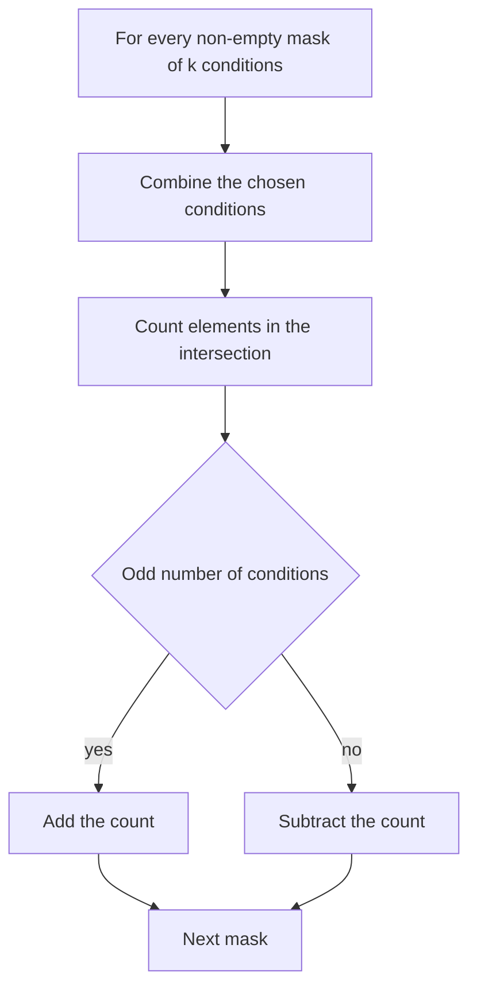

## The hook

How many numbers from 1 to 10¹⁸ are divisible by at least one of the primes 2, 3, 5 and 7? You cannot loop to 10¹⁸. Counting multiples of each prime is easy, n / p, but adding them counts 6, 10, 14 and friends twice, and 210 four times.

The fix is a counting rule that corrects its own overcounting, one layer at a time. It is called inclusion-exclusion, and it turns this problem into sixteen tiny divisions.

## The intuition

:::analogy
Imagine counting guests at a party who like tea or coffee. You ask the tea lovers to raise hands: 30. Coffee lovers: 25. But 10 people raised their hands both times, so 30 + 25 counts them twice. Subtract them once: 45 people like at least one. With a third drink, people who like all three get added three times, subtracted three times, and must be added back once.
:::

The [[inclusion-exclusion principle]] is that bookkeeping, done precisely: add each group, subtract each overlap of two, add back each overlap of three, and keep alternating.

## How it works

For sets A₁ to A_k, the size of their [[union]] is:

$$|A_1 \cup \dots \cup A_k| = \sum_{\emptyset \ne S \subseteq \{1..k\}} (-1)^{|S|+1} \left| \bigcap_{i \in S} A_i \right|$$

- S runs over every non-empty subset of the conditions.
- $\bigcap_{i \in S} A_i$ is the [[intersection]]: elements satisfying every condition in S.
- $(-1)^{|S|+1}$ is + for odd-sized subsets and − for even-sized ones.

The trick in practice is that intersections are usually easy to count even when the union is not. For divisibility, "divisible by every prime in S" means "divisible by their product", so the count is $\lfloor n / \prod_{p \in S} p \rfloor$.

### Enumerating subsets with bitmasks

With k conditions, loop `mask` from 1 to 2ᵏ − 1. Bit i of the mask says whether condition i is in the subset. Compute the intersection for that mask, and add or subtract by the parity of `popcount(mask)`.



### Complement counting

Often you want elements satisfying **none** of the conditions: total minus the union. That is [[complement counting]], and it is how [[derangement]]s are counted: permutations where no element is in its own position. With condition i meaning "element i is fixed", the count of permutations fixing a chosen set of j elements is (n − j)!, so

$$D(n) = \sum_{j=0}^{n} (-1)^j \binom{n}{j} (n-j)!$$

### Two more shapes you will meet

- **Ranges [L, R]:** count with f(R) − f(L − 1), where f(x) counts within 1..x. Most divisibility problems are posed on a range, and this prefix trick reduces them to the 1..n case.
- **Onto functions (surjections):** how many ways can n distinct balls go into k distinct boxes with no box empty? Let condition i be "box i is empty". Fixing a chosen set of j boxes empty leaves (k − j)ⁿ placements, so the count is $\sum_{j=0}^{k} (-1)^j \binom{k}{j} (k-j)^n$. For n = 3 balls and k = 2 boxes: 2³ − 2·1³ + 0 = 6, which matches listing them: every split except "all in box 1" and "all in box 2".

Both follow the same recipe: name the "bad" conditions, count how many objects satisfy a chosen set of them, and alternate signs.

:::insight
When the union is hard to count but intersections are easy, inclusion-exclusion converts one hard count into many easy ones with alternating signs. Bitmasks make enumerating those intersections a single loop.
:::

## Walk through an example

**Numbers from 1 to 100 divisible by 2, 3 or 5.**

| Subset | Product | ⌊100 / product⌋ | Sign | Contribution |
|---|---|---|---|---|
| {2} | 2 | 50 | + | +50 |
| {3} | 3 | 33 | + | +33 |
| {5} | 5 | 20 | + | +20 |
| {2,3} | 6 | 16 | − | −16 |
| {2,5} | 10 | 10 | − | −10 |
| {3,5} | 15 | 6 | − | −6 |
| {2,3,5} | 30 | 3 | + | +3 |

Total: 50 + 33 + 20 − 16 − 10 − 6 + 3 = **74**. So 26 numbers from 1 to 100 are divisible by none of them.

**Derangements of 4 items:** 4! − 4·3! + 6·2! − 4·1! + 1·0! = 24 − 24 + 12 − 4 + 1 = **9**.

:::try-this
How many numbers from 1 to 60 are divisible by 4 or 6? Be careful with the intersection. (Multiples of 4: 15. Of 6: 10. Divisible by both means divisible by lcm(4, 6) = 12, not 24: 5 of them. Answer: 15 + 10 − 5 = 20.)
:::

## The code

```pseudo
count_divisible_by_any(n, primes):
    total = 0
    for mask in 1 .. 2^k - 1:
        prod = product of primes[i] for bits i in mask    // stop early if prod > n
        term = n / prod
        if popcount(mask) is odd: total += term
        else: total -= term
    return total
```

```cpp
#include <bits/stdc++.h>
using namespace std;

long long countDivisibleByAny(long long n, const vector<long long>& primes) {
    int k = primes.size();
    long long total = 0;
    for (int mask = 1; mask < (1 << k); mask++) {
        long long prod = 1;
        bool tooBig = false;
        for (int i = 0; i < k && !tooBig; i++)
            if (mask >> i & 1) {
                if (prod > n / primes[i]) tooBig = true;  // prod * p would exceed n
                else prod *= primes[i];
            }
        if (tooBig) continue;                           // contributes n / prod = 0
        long long term = n / prod;
        total += (__builtin_popcount(mask) & 1) ? term : -term;
    }
    return total;
}

int main() {
    cout << countDivisibleByAny(100, {2, 3, 5}) << '\n';            // 74
    cout << countDivisibleByAny(1000000000000000000LL, {2, 3, 5, 7}) << '\n';
}
```

## Complexity

O(2ᵏ × k) for k conditions: fine up to about k = 20, since 2²⁰ is about a million. If k is larger, look for structure, such as many intersections being empty, or switch to Möbius inversion or DP.

## Common mistakes

:::warning
Common misconception: "the intersection of 'divisible by a' and 'divisible by b' is 'divisible by a × b'." That is only true when a and b are coprime. In general it is divisible by lcm(a, b). Products are safe for distinct primes; otherwise use LCMs.
:::

- **Overflow** when multiplying many numbers; stop as soon as the product exceeds n, because the term is then zero.
- **Wrong sign convention**: odd-sized subsets are added in the union formula; check with a tiny case.
- **Forgetting the empty set** when counting the complement directly: "none of the conditions" includes the full total with a + sign.
- **Using it with too many conditions**, where 2ᵏ explodes.

## Practice problems

*Prime Multiples* (CSES) is the walkthrough above with up to 20 primes and n up to 10¹⁸. *Ugly Number III* combines inclusion-exclusion over three numbers, using LCMs, with binary search on the answer. *Christmas Party* is derangements, solvable with inclusion-exclusion or a recurrence. *Count Primes* can be revisited with complement counting for intuition, though the sieve is the efficient method.

## Key takeaways

- Inclusion-exclusion counts a union by adding single sets, subtracting pairwise intersections, adding triple intersections, and so on.
- It shines when intersections are easy to count, such as multiples of a product of primes.
- Enumerate the 2^k − 1 non-empty subsets with bitmasks and choose the sign by the parity of the subset size.
- Counting elements satisfying none of the conditions is the total minus the union, which also counts derangements.
- Use LCMs instead of products for non-coprime numbers, and stop early when a product exceeds the range.
