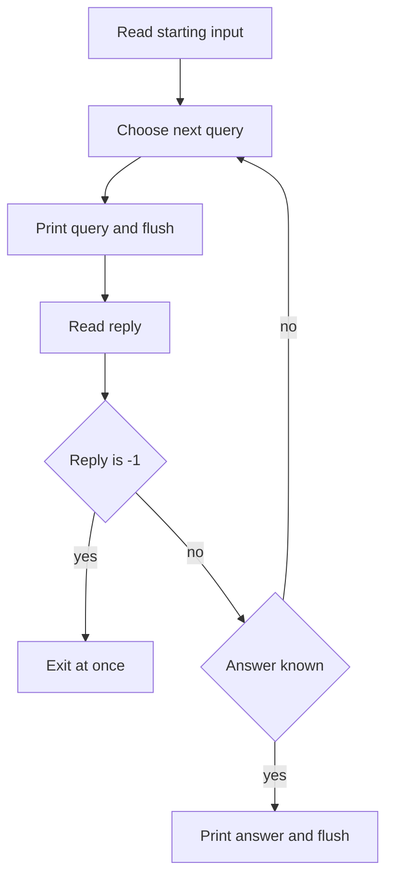

## The hook

You open problem D and there is no input file. Instead the statement says: "The judge has hidden a number between 1 and 10⁹. You may ask at most 30 questions of the form '? x', and the judge will tell you whether its number is at least x."

Your first submission prints a perfect binary search and gets Idleness limit exceeded. Nothing in your algorithm was wrong.

Interactive problems trip up many contestants the first time, almost never because of the idea. They fail on plumbing: output that never left the program, a reply read in the wrong order, one query too many. Once the plumbing is a habit, these problems are often easier than they look.

## The intuition

:::analogy
Think of the party game twenty questions. One friend thinks of something; you ask yes-or-no questions, one at a time, and must name it before your questions run out. You cannot ask the next question until you hear the last answer, and a question whispered so quietly that nobody hears it gets no answer at all. Good players do not ask "is it a cat?" They ask questions that split the remaining possibilities in half.
:::

An [[interactive problem]] is exactly this game, played against a program called the [[interactor]]. It holds the hidden data. Your program asks, the interactor answers, and you guess at the end. The two rules of the party game become the two rules of the format: speak clearly so the question actually arrives, and spend questions wisely so you never run out.

## Let's build it up

### The conversation

Every interactive statement has an "Interaction" section. Read it as carefully as the problem itself. A typical protocol:

1. Read the input that starts the game, such as n, or the number of test cases.
2. To ask, print a line like `? x`, then read the judge's reply.
3. To answer, print a line like `! y`. Some problems then send a verdict line, or move on to the next test case.

The order is strict. If you read before the judge has something to say, or print two queries and read only one reply, both programs end up waiting for each other.

### Speak clearly: flush every query

Output is buffered. `cout` collects text in memory and sends it in big chunks, which is great for speed and fatal here. If your query is still sitting in the buffer when you call `cin`, the judge never sees it, never replies, and the clock runs out. On Codeforces this is the [[idleness limit exceeded]] verdict.

The fix is to [[flush]] after every query and after the final answer:

- `cout << "? " << x << endl;` because `endl` writes a newline and flushes,
- or `cout << "? " << x << '\n' << flush;`,
- or `fflush(stdout)` after `printf`.

There is a catch from [The Thirty Lines You Paste Before Every Contest](article:cp-fast-io-template). The line `cin.tie(nullptr)` stops `cin` from flushing `cout` automatically before each read. That is why your template is fast, and also why an unflushed query silently disappears. In interactive problems, use `endl` for queries on purpose.

### Spend questions wisely: read the query limit

The [[query limit]] is a hint about the intended algorithm. A yes/no answer at best halves the possibilities, so k answers can separate at most 2ᵏ cases. You need at least log₂(n) queries for n possibilities, rounded up.

| Possibilities | Yes/no queries needed |
|---|---|
| 100 | 7 |
| 1,000,000 | 20, since 2²⁰ = 1,048,576 |
| 10⁹ | 30, since 2³⁰ is about 1.07 × 10⁹ |

So "at most 30 queries" on a range of 10⁹ shouts binary search, as in [Binary Search Without the Off-by-One Fear](article:dsa-binary-search). A limit like n + 10 suggests a linear scan with a little slack. A limit of about 2 log n suggests two searches, or one search where each step costs two queries.

### Know how the judge can fight back

Some judges are an [[adaptive judge]]: they do not fix the hidden answer at the start, and they choose any answer consistent with their earlier replies. Randomly guessing and hoping is then hopeless. Your strategy must succeed in the worst case, which a halving strategy does.

Many statements also say that the judge replies -1 when a query is invalid or over the limit. If you read -1, exit immediately. Continuing to read from a judge that has stopped leads to confusing verdicts.



:::insight
An interactive solution is an ordinary algorithm whose input arrives one answer at a time. Flush every line you print, and count your questions against the limit using the halving argument before you write any code.
:::

## A tiny example

The hidden number is 37, somewhere in 1 to 100. Each query `? m` gets the reply `>=` if the number is at least m, and `<` otherwise. Keep a range [lo, hi] that always contains the answer, and ask about the upper middle, m = (lo + hi + 1) / 2, rounded down.

| Query | lo | hi | m | Reply | New range |
|---|---|---|---|---|---|
| 1 | 1 | 100 | 51 | < | [1, 50] |
| 2 | 1 | 50 | 26 | >= | [26, 50] |
| 3 | 26 | 50 | 38 | < | [26, 37] |
| 4 | 26 | 37 | 32 | >= | [32, 37] |
| 5 | 32 | 37 | 35 | >= | [35, 37] |
| 6 | 35 | 37 | 36 | >= | [36, 37] |
| 7 | 36 | 37 | 37 | >= | [37, 37] |

After 7 queries the range has one number, so print `! 37`. Seven is exactly the limit from the table for 100 possibilities, so this strategy never wastes a question.

You cannot test this with a normal input file, since the replies depend on your queries. The standard trick is to hide all talking inside one `ask` function. In the contest, `ask` prints and reads.

Locally, swap in a fake judge that knows the secret, counts queries and checks the limit. Then loop over every possible secret, the way [Let a Robot Find Your Wrong Answer](article:cp-stress-testing) loops over random inputs.

```pseudo
solve(n, ask):
    lo = 1, hi = n
    while lo < hi:
        m = (lo + hi + 1) / 2
        if ask(m) == ">=": lo = m
        else: hi = m - 1
    return lo
```

```cpp partial
// Contest version of ask: print, flush, read, bail out on -1.
string ask(int m) {
    cout << "? " << m << endl;          // endl flushes
    string reply; cin >> reply;
    if (reply == "-1") exit(0);
    return reply;
}
```

```cpp
#include <bits/stdc++.h>
using namespace std;

int solve(int n, const function<string(int)>& ask) {
    int lo = 1, hi = n;
    while (lo < hi) {
        int m = (lo + hi + 1) / 2;
        if (ask(m) == ">=") lo = m;
        else hi = m - 1;
    }
    return lo;
}

int main() {
    int n = 100, worst = 0;
    for (int secret = 1; secret <= n; secret++) {      // fake judge for every secret
        int used = 0;
        auto ask = [&](int m) { used++; return secret >= m ? string(">=") : string("<"); };
        if (solve(n, ask) != secret) cout << "wrong for " << secret << '\n';
        worst = max(worst, used);
    }
    int used = 0;
    int found = solve(n, [&](int m) { used++; return 37 >= m ? string(">=") : string("<"); });
    cout << found << ' ' << used << ' ' << worst << '\n';  // 37 7 7
}
```

:::try-this
The range is 1 to 1000, but each reply is now three-way: `<`, `=` or `>`. Can you do better than 10 queries? (No. The `=` reply ends the game early, but an adaptive judge can withhold it, so each query still leaves two live halves. With k queries you can tell apart at most 2ᵏ − 1 numbers, and 2¹⁰ − 1 = 1023 is the first that covers 1000, so the worst case is still 10.)
:::

## Where you'll see this again

Codeforces runs interactive problems regularly, from easy Div. 4 slots to hard Div. 1 ones, and its statements follow the conventions above. A few good ones to start with, in rising difficulty:

- [Interview](https://codeforces.com/problemset/problem/1807/E): find which pile hides one heavier stone by asking for the total weight of groups of piles. Halve the piles each time.
- [Guess the K-th Zero (Easy version)](https://codeforces.com/problemset/problem/1520/F1): find the position of the k-th zero in a hidden 0/1 array by asking for range sums. Binary search on the prefix count of zeros.
- [Bear and Prime 100](https://codeforces.com/problemset/problem/679/A): decide whether a hidden number up to 100 is prime by asking which numbers divide it, which needs a clever choice of questions rather than plain halving.

Interactive problems also reward [Guessing the Answer, Then Checking It](article:dsa-binary-search-answer): the "check" step becomes a query, and the monotone yes/no answer is what makes halving valid.

## Key takeaways

- An interactive problem is a conversation: print a query, flush it, read the reply, and repeat until you can print the answer.
- Forgetting to flush leaves the query in your buffer while both programs wait, which Codeforces reports as Idleness limit exceeded.
- The fast-I/O line cin.tie(nullptr) removes automatic flushing, so interactive solutions should flush every query explicitly, for example with endl.
- A yes/no query can at best halve the possibilities, so the query limit tells you whether the intended solution is a binary search, a linear scan or something in between.
- Hiding all judge communication inside one ask function lets you test against a fake judge for every possible hidden value before submitting.
