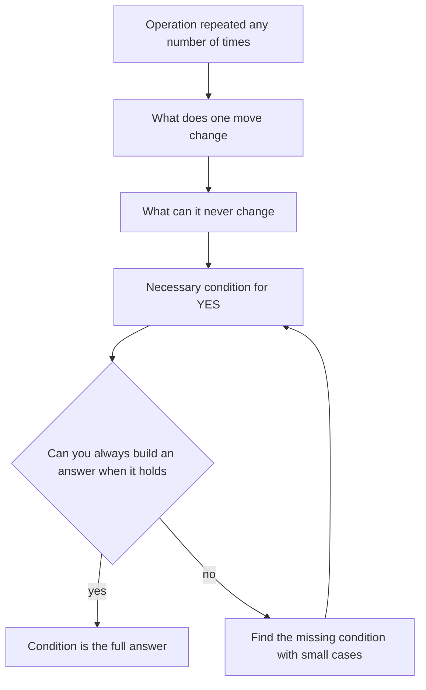

## The hook

A chessboard has two opposite corners cut off, leaving 62 squares. Can you cover it exactly with 31 dominoes? People try for minutes, shuffling dominoes around in their heads. Then someone notices the colours: every domino covers one black and one white square, but the two removed corners are the same colour. There are 32 squares of one colour and 30 of the other. Impossible, instantly.

No search, no cleverness with placements. One quantity that no move can change. That style of thinking solves a huge share of contest problems between 1200 and 1600.

## The intuition

:::analogy
Picture a magician shuffling a deck while you watch. However many times the cards move, some things cannot change: there are still 52 cards, still four aces. A good detective ignores the flurry of moves and asks, "what is the one thing this magician cannot alter?" If the trick claims to end in a state where that thing has changed, the trick is a lie.
:::

That unchangeable thing is an [[invariant]]. Contest problems often describe an operation you may repeat any number of times, then ask whether a target is reachable or what the best result is. Simulating is hopeless; the number of move sequences explodes. Finding what the moves cannot change cuts straight to the answer.

## How it works

A practical routine when a problem says "you may perform this operation any number of times":

1. **Write the operation as a change to numbers**: what does one move do to the sum, the count of odd elements, the maximum, the positions?
2. **Look for what stays the same**: sum, sum modulo something, [[parity]], the multiset of values, the count of inversions modulo 2, the GCD.
3. **Look for what only moves one way**, a [[monovariant]]: the number of inversions only drops, the minimum only grows. This proves processes end and bounds their length.
4. **Turn the invariant into a [[necessary condition]]**: "the target needs an even sum, and the start has an odd sum, so NO."
5. **Check it is also a [[sufficient condition]]**: try to build the answer whenever the condition holds. Small cases or a brute force will tell you quickly if more conditions are missing.



:::insight
Most "can you reach this?" problems are decided by one invariant plus a construction. The invariant says when it is impossible; the construction proves every other case is possible. Look for the first, then convince yourself of the second.
:::

## Walk through an example

**Coin Piles** (CSES): two piles with a and b coins. One move removes 2 from one pile and 1 from the other. Can both piles be emptied?

**Step 1: what a move does.** A move is either (−2, −1) or (−1, −2) to the two piles. Either way, it removes exactly 3 coins in total.

**Step 2: invariant.** The total drops by exactly 3 each move, so (a + b) mod 3 never changes. To reach 0, we need (a + b) mod 3 = 0.

**Step 3: another necessary condition.** Each move takes at most 2 from a pile and at least 1 from the other. If a > 2b, then even taking 2 from a on every move, b runs out first. So we also need a ≤ 2b and b ≤ 2a.

**Step 4: sufficiency.** Suppose both conditions hold. Choose x moves of type (−2, −1) and y of type (−1, −2) with 2x + y = a and x + 2y = b. Solving gives x = (2a − b)/3 and y = (2b − a)/3, both non-negative whole numbers exactly when our two conditions hold.

| a | b | (a+b) mod 3 | a ≤ 2b and b ≤ 2a | Answer |
|---|---|---|---|---|
| 2 | 1 | 0 | yes | YES |
| 2 | 2 | 1 | yes | NO |
| 3 | 3 | 0 | yes | YES |
| 6 | 0 | 0 | no | NO |

:::try-this
Apply the routine to: "an array; one move picks any element and adds 2 to it. Can all elements become equal?" (Adding 2 never changes an element's parity. So all elements must have the same parity; if they do, raise everything to the maximum in steps of 2. Condition: all even or all odd.)
:::

## The code

Once the observation is found, the code is often tiny. The idea:

```pseudo
coin_piles(a, b):
    if (a + b) mod 3 != 0: return NO
    if a > 2 * b or b > 2 * a: return NO
    return YES
```

```cpp
#include <bits/stdc++.h>
using namespace std;

int main() {
    ios::sync_with_stdio(false);
    cin.tie(nullptr);
    int t;
    cin >> t;
    while (t--) {
        long long a, b;
        cin >> a >> b;
        bool ok = (a + b) % 3 == 0 && a <= 2 * b && b <= 2 * a;
        cout << (ok ? "YES" : "NO") << '\n';
    }
}
```

## Complexity

The final solution is O(1) per test here, and usually O(n) when the invariant is computed over an array. The real work is the reasoning, which is why these problems feel "easy after the editorial".

## Common mistakes

:::warning
Common misconception: "I found an invariant, so I have the answer." An invariant only rules cases out. Many Wrong Answers come from stopping at the necessary condition. Always check sufficiency with a construction, or stress test the condition against a brute force on small inputs.
:::

- **Missing a second condition**, like the a ≤ 2b bound above, because the first invariant looked complete.
- **Simulating the moves** when the count can be up to 10⁹; if you find yourself simulating, look for the invariant instead.
- **Forgetting edge cases** such as zeros, n = 1, or all elements already equal.
- **Using `int`** when a ≤ 2b involves doubling values near 10⁹.

## Practice problems

*Watermelon* is the friendliest parity problem. *Coin Piles* is the example above. *Two Sets* asks whether 1..n splits into two equal-sum halves: the invariant is the total sum's parity, and the construction pairs numbers from both ends. *Palindrome Reorder* rests on a parity count: at most one letter may appear an odd number of times. Then browse Codeforces problems tagged "constructive algorithms" or "math" around 1200 to 1500.

## Key takeaways

- When a problem allows an operation any number of times, ask what the operation can never change.
- Common invariants are sums, sums modulo a number, parity, counts of odd elements and GCDs.
- Monovariants, quantities that only move one way, prove that processes end and bound how long they take.
- An invariant gives a necessary condition; a construction or a brute-force check shows it is also sufficient.
- Once the observation is found, the code is often a few lines, so the reasoning is where the time should go.
