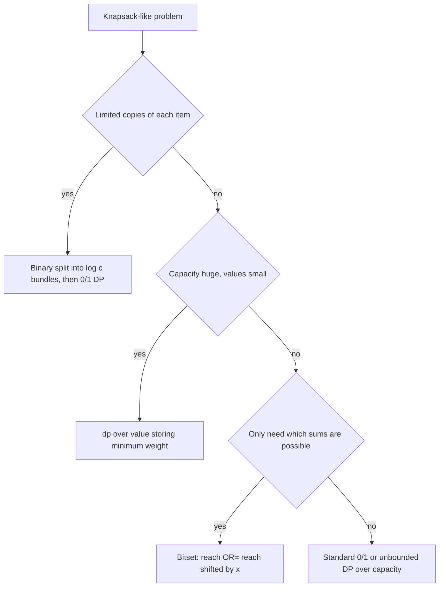

## The hook

You know the classic 0/1 knapsack from [Packing a Backpack With a Weight Limit](article:dsa-knapsack-01): each item once, a table over capacities, done. Then the contest changes one detail, and the template breaks:

- the shop has up to 1,000 copies of each book, and expanding them one by one is too slow;
- weights go up to 10⁹, so a table over capacities would need a billion cells;
- you only need to know which totals are possible, for 100 coins up to 1,000 each, and 10⁷ booleans updated per coin is borderline.

Each change has a standard fix. Knowing all three turns knapsack from one problem into a family you can recognise and solve on sight.

## The intuition

:::analogy
Imagine packing a backpack in a shop that has only a limited number of each item: three water bottles, thirteen energy bars. You could treat each energy bar as a separate item, but deciding thirteen yes-or-no questions about identical bars is wasteful. A smarter shopkeeper pre-packs them into boxes of 1, 2, 4 and 6 bars. Now you decide about four boxes, and any number of bars from 0 to 13 is still possible by choosing the right boxes.
:::

That pre-packing is [[binary splitting]], the fix for [[bounded knapsack]]. The other two variants change what the table is indexed by, or how many table cells you update in one instruction.

## How it works

### Variant 1: bounded knapsack with binary splitting

An item with weight w, value v and c copies becomes bundles of 1, 2, 4, …, 2ᵏ⁻¹ copies plus a remainder r = c − (2ᵏ − 1), choosing k as large as possible with 2ᵏ − 1 ≤ c. Each bundle is an ordinary 0/1 item with weight (bundle size × w) and value (bundle size × v).

Why every count 0 to c is reachable: the powers 1, 2, …, 2ᵏ⁻¹ can form every number from 0 to 2ᵏ − 1 (binary representation), and adding the remainder shifts that range to cover r up to c. No combination exceeds c, because all bundles together are exactly c.

The c copies become about log₂ c items, so the 0/1 DP costs O(W × Σ log cᵢ) instead of O(W × Σ cᵢ).

### Variant 2: value-indexed DP when weights are huge

When capacity W is up to 10⁹ but total value V = Σ vᵢ is small, swap the roles:

- minW[val] = the minimum total weight needed to reach exactly value val.
- minW[0] = 0, everything else infinity.
- For each item, for val from V down to v: minW[val] = min(minW[val], minW[val − v] + w).
- The answer is the largest val with minW[val] ≤ W.

This is [[value-indexed DP]]: the table's size depends on the small dimension. The general rule is to index the DP by whichever quantity is small.

### Variant 3: bitset subset sums

To find every reachable [[subset sum]], keep a boolean array reach[s]. Adding a number x does reach[s] |= reach[s − x] for all s, from high to low. Written as a [[bitset]], that whole loop is one line:

```pseudo
reach |= reach << x
```

Shifting by x moves every reachable sum s to s + x, and OR keeps the old sums too. Because the machine processes 64 bits per word, this is roughly 64 times faster than a boolean loop.



:::insight
All three variants keep the same knapsack recurrence and change only its packaging: fewer items (splitting), a smaller index (value instead of weight), or more cells per instruction (bitsets). When a knapsack is too slow, ask which of the three dimensions you can shrink.
:::

### Related shapes

- **Unbounded** (unlimited copies): iterate capacities upwards for each item, so one item can be reused.
- **Counting ways** instead of maximising: replace max with + (modulo a prime), keeping the same loop order rules.
- **Bounded with a monotonic queue**: an O(n × W) method exists that processes each residue class of capacities modulo w with a sliding-window maximum. It is rarely needed when binary splitting fits.

## Walk through an example

**Bounded knapsack.** Capacity 10. Item A: weight 2, value 3, 3 copies. Item B: weight 3, value 5, 2 copies.

Splitting: A's 3 copies become bundles of 1 and 2: (w 2, v 3) and (w 4, v 6). B's 2 copies become 1 and 1: (w 3, v 5) twice.

Running 0/1 knapsack over these four items gives, for capacities 0 to 10:

| Capacity | 0 | 1 | 2 | 3 | 4 | 5 | 6 | 7 | 8 | 9 | 10 |
|---|---|---|---|---|---|---|---|---|---|---|---|
| Best value | 0 | 0 | 3 | 5 | 6 | 8 | 10 | 11 | 13 | 14 | **16** |

16 = 2 copies of A (w 4, v 6) + 2 copies of B (w 6, v 10). A brute-force loop over all copy counts agrees.

**Value-indexed.** Capacity 90; items (w 30, v 3), (w 50, v 4), (w 60, v 5). Total value 12. The table minW over values 0 to 12 has finite entries at 0, 3, 4, 5, 7, 8, 9 and 12, with minW[7] = 80, minW[8] = 90, minW[9] = 110 and minW[12] = 140. The largest value with weight at most 90 is **8** (items 1 and 3).

**Bitset.** Coins 3, 5, 5. Start with only sum 0. After 3: {0, 3}. After 5: {0, 3, 5, 8}. After the second 5: {0, 3, 5, 8, 10, 13}. The distinct non-zero sums are **3, 5, 8, 10, 13**.

:::try-this
Split an item with 10 copies. (1, 2, 4, then the remainder 10 − 7 = 3. Check: 3 + 4 + 2 + 1 = 10, and for example 9 = 4 + 3 + 2.)
:::

## The code

```pseudo
bounded_knapsack(items, W):            // items: (w, v, c)
    dp = [0] * (W + 1)
    for (w, v, c) in items:
        k = 1
        while c > 0:
            t = min(k, c); c -= t; k *= 2
            for cap = W down to t*w:
                dp[cap] = max(dp[cap], dp[cap - t*w] + t*v)
    return dp[W]
```

```cpp
#include <bits/stdc++.h>
using namespace std;

int main() {
    // Bounded knapsack with binary splitting
    int W = 10;
    vector<array<int, 3>> items = {{2, 3, 3}, {3, 5, 2}};      // weight, value, copies
    vector<long long> dp(W + 1, 0);
    for (auto [w, v, c] : items)
        for (int k = 1; c > 0; k *= 2) {
            int t = min(k, c); c -= t;
            for (int cap = W; cap >= t * w; cap--)
                dp[cap] = max(dp[cap], dp[cap - t * w] + 1LL * t * v);
        }
    cout << dp[W] << '\n';                                     // 16

    // Value-indexed DP: minimum weight for each value
    vector<pair<long long, int>> its = {{30, 3}, {50, 4}, {60, 5}};
    long long cap = 90; int V = 12;
    vector<long long> minW(V + 1, LLONG_MAX / 2);
    minW[0] = 0;
    for (auto [w, v] : its)
        for (int val = V; val >= v; val--) minW[val] = min(minW[val], minW[val - v] + w);
    int best = 0;
    for (int val = 0; val <= V; val++) if (minW[val] <= cap) best = val;
    cout << best << '\n';                                      // 8

    // Bitset subset sums
    bitset<64> reach; reach[0] = 1;
    for (int x : {3, 5, 5}) reach |= reach << x;
    for (int s = 1; s < 64; s++) if (reach[s]) cout << s << ' ';  // 3 5 8 10 13
    cout << '\n';
}
```

## Complexity

- **Bounded with splitting:** O(W × Σ log₂ cᵢ) time, O(W) memory. For *Book Shop II*, with 100 books, up to 1,000 copies each and a budget of 10⁵, that is about 10⁵ × 100 × 10 = 10⁸ simple operations, which fits.
- **Value-indexed:** O(n × V) time and O(V) memory, independent of W.
- **Bitset subset sum:** O(n × S / 64) for a maximum sum S.

## Common mistakes

:::warning
Common misconception: "binary splitting means bundles of 1, 2, 4, 8, … up to the next power of two." The last bundle must be the remainder, not the next power of two, or you could take more copies than exist. For 13 copies the bundles are 1, 2, 4, 6, not 1, 2, 4, 8.
:::

- **Wrong table dimension**: allocating dp[W + 1] with W = 10⁹. Check which quantity is small before choosing the index.
- **Loop direction**: bundles are 0/1 items, so capacities go downwards; going upwards would reuse a bundle.
- **Infinity overflow** in min-weight tables: use a large but safe sentinel like LLONG_MAX / 2 so adding a weight does not overflow.
- **Bitset size** must be a compile-time constant at least the maximum sum plus one.
- **Expanding copies one by one** when Σ cᵢ is large, which silently turns a fast solution into a time-limit failure.

## Practice problems

*Book Shop* (CSES) is the plain 0/1 warm-up. *Book Shop II* adds copies per book: binary splitting. *Knapsack 2* (AtCoder Educational DP Contest) has weights up to 10⁹ and small values: value-indexed DP. *Money Sums* (CSES) lists every reachable sum: a bitset, or a boolean DP that also fits.

## Key takeaways

- Bounded knapsack splits c copies into bundles of 1, 2, 4, … plus a remainder, so any count from 0 to c can still be chosen with about log c items.
- When weights are huge but values are small, index the DP by value and store the minimum weight for each value.
- Subset-sum reachability is one bitset operation per number, reach |= reach << x, which is about 64 times faster than a boolean loop.
- All three keep the knapsack recurrence and shrink a different dimension: item count, table index, or work per cell.
- Keep 0/1 loops going downward over capacity, and choose a safe infinity for min-weight tables.
