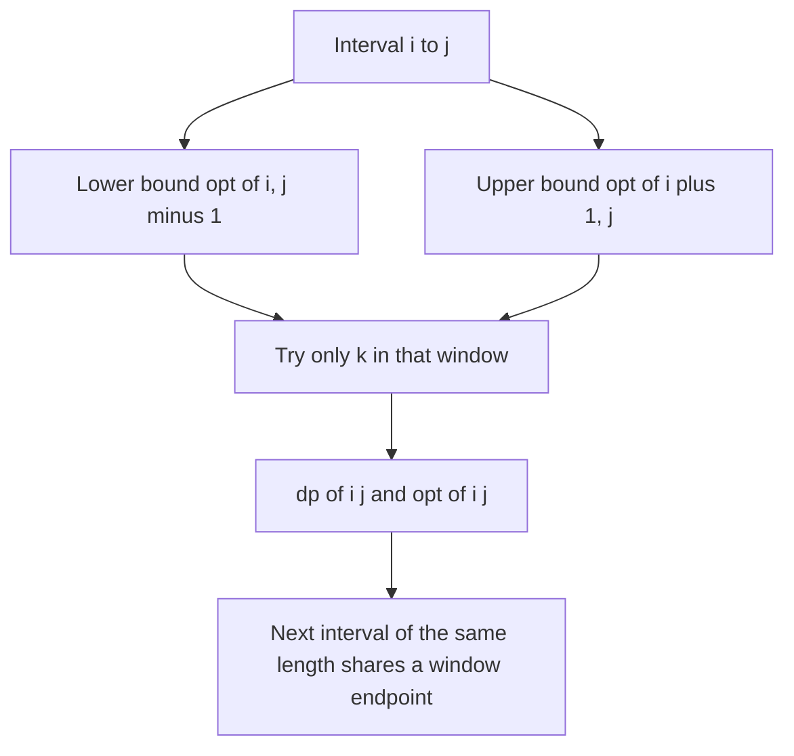

## The hook

A carpenter cuts a long board at marked points, paying the board's current length for each cut. Choosing the order of cuts is a classic interval DP: for every stretch of the board, try every mark as the first cut. That is O(n³) for n marks, fine for 100 marks and far too slow for 3,000.

Then you notice something about the answers. Make the stretch one mark longer on the right, and the best first cut moves right a little, never left; make it longer on the left, and the best cut cannot move right of the old one. That squeeze, discovered by Donald Knuth for optimal binary search trees, reduces the whole table to O(n²).

## The intuition

:::analogy
For a stretch of board, the best first cut sits somewhere in the middle. Extend the stretch by one mark at the right end, and the best cut can only drift a little towards the new end. Extend it at the left, and it can only drift towards that end. So once the best cuts of the two slightly shorter stretches are known, the best cut of the longer stretch is trapped between them, and only that narrow gap needs searching.
:::

The DP is a [[split-point interval DP]]:

dp[i][j] = min over i ≤ k < j of dp[i][k] + dp[k + 1][j] + C(i, j).

[[Knuth's condition]] says opt[i][j - 1] ≤ opt[i][j] ≤ opt[i + 1][j]. Filling by increasing length, both bounds are known when [i, j] is computed, so the loop over k only covers that window. The [[telescoping bound]] shows the window widths add up to O(n) per length.

## How it works

### The loop

```
for i: dp[i][i] = 0 (or the base value); opt[i][i] = i
for len = 2 .. n:
    for i = 0 .. n - len:
        j = i + len - 1
        for k = opt[i][j-1] .. min(opt[i+1][j], j - 1):
            try dp[i][k] + dp[k+1][j] + C(i, j); remember the best k as opt[i][j]
```

### Why O(n²)

For a fixed length, the windows of consecutive intervals [i, j] and [i + 1, j + 1] are [opt[i][j - 1], opt[i + 1][j]] and [opt[i + 1][j], opt[i + 2][j + 1]]: each starts where the previous one ended. Their total width telescopes to opt[last] - opt[first] + (number of intervals), at most about 2n. With n lengths, the total is O(n²).

### When the condition holds

A sufficient condition is that C satisfies the quadrangle inequality, C(a, c) + C(b, d) ≤ C(a, d) + C(b, c) for a ≤ b ≤ c ≤ d, and is a [[monotone cost]], C(b, c) ≤ C(a, d) for nested intervals. Sums over the interval satisfy both, which covers the classic problems:

| Problem | C(i, j) | Knuth applies? |
|---|---|---|
| Merge adjacent piles, cost = merged size | sum of the piles | yes |
| Cut a stick at marks, cost = current length | length of the piece | yes |
| Optimal binary search tree | sum of access frequencies | yes |
| Burst Balloons | product of three values | not in this form |
| Merge K consecutive piles at a time | sum, but a different recurrence | not directly |

*Minimum Cost to Merge Stones* allows merging K piles at a time; for K = 2 it is the classic pile-merging DP above, and Knuth's speed-up applies. *Minimum Cost to Cut a Stick* and SPOJ *Breaking String* are the cutting version.



:::insight
When the best split of an interval is trapped between the best splits of its two one-shorter sub-intervals, searching only that gap costs O(n) per interval length in total, so an O(n³) interval DP becomes O(n²).
:::

## Walk through an example

Merge adjacent piles [3, 1, 4, 1, 5, 9] into one, each merge costing the size of the new pile.

The optimal total cost is 55. The opt table (row i, column j, for j ≥ i):

| opt[i][j] | j=0 | 1 | 2 | 3 | 4 | 5 |
|---|---|---|---|---|---|---|
| i=0 | 0 | 0 | 1 | 1 | 2 | 3 |
| i=1 | | 1 | 1 | 1 | 2 | 4 |
| i=2 | | | 2 | 2 | 3 | 4 |
| i=3 | | | | 3 | 3 | 4 |
| i=4 | | | | | 4 | 4 |
| i=5 | | | | | | 5 |

Every row is non-decreasing left to right and every column non-decreasing top to bottom, which is Knuth's condition. For example, opt[0][5] = 3 lies between opt[0][4] = 2 and opt[1][5] = 4, so [0, 5] only tries k = 2, 3, 4 instead of all five.

Even on six piles, the windowed DP evaluates 27 candidate splits against 35 for the full O(n³) loop; on 300 random piles, the program below counts about 90,000 (90,311 in one run) against about 4.5 million.

:::try-this
For the piles [3, 1, 4, 1, 5, 9], which split points does [1, 4] try, and why? (Its window is opt[1][3] = 1 to opt[2][4] = 3, so k = 1, 2, 3, which here happens to be every possible split, since [1, 4] has only three. Windows save most on long intervals.)
:::

:::warning
Common misconception: "Knuth's optimisation and divide and conquer optimisation are interchangeable." They target different recurrences. Knuth's is for interval DPs dp[i][j] with a split point k inside the interval; divide and conquer optimisation is for layered DPs dp[k][i] over prefixes. Both need a monotonicity property, and applying either without it gives wrong answers silently.
:::

## The code

```pseudo
dp[i][i] = 0; opt[i][i] = i
for len in 2..n:
    for i in 0..n-len:
        j = i + len - 1; dp[i][j] = inf
        for k in opt[i][j-1] .. min(opt[i+1][j], j-1):
            v = dp[i][k] + dp[k+1][j] + C(i, j)
            if v < dp[i][j]: dp[i][j] = v; opt[i][j] = k
```

```cpp
#include <bits/stdc++.h>
using namespace std;
using ll = long long;

pair<ll, ll> mergeKnuth(const vector<ll>& a) {           // returns (cost, candidates tried)
    int n = a.size();
    vector<ll> P(n + 1, 0);
    for (int i = 0; i < n; i++) P[i + 1] = P[i] + a[i];
    vector<vector<ll>> dp(n, vector<ll>(n, 0));
    vector<vector<int>> opt(n, vector<int>(n, 0));
    for (int i = 0; i < n; i++) opt[i][i] = i;
    ll work = 0;
    for (int len = 2; len <= n; len++)
        for (int i = 0; i + len - 1 < n; i++) {
            int j = i + len - 1;
            dp[i][j] = LLONG_MAX;
            int lo = opt[i][j - 1], hi = min(opt[i + 1][j], j - 1);
            for (int k = lo; k <= hi; k++) {              // only the window Knuth allows
                work++;
                ll v = dp[i][k] + dp[k + 1][j] + (P[j + 1] - P[i]);
                if (v < dp[i][j]) dp[i][j] = v, opt[i][j] = k;
            }
        }
    return {dp[0][n - 1], work};
}

pair<ll, ll> mergeCubic(const vector<ll>& a) {
    int n = a.size();
    vector<ll> P(n + 1, 0);
    for (int i = 0; i < n; i++) P[i + 1] = P[i] + a[i];
    vector<vector<ll>> dp(n, vector<ll>(n, 0));
    ll work = 0;
    for (int len = 2; len <= n; len++)
        for (int i = 0; i + len - 1 < n; i++) {
            int j = i + len - 1;
            dp[i][j] = LLONG_MAX;
            for (int k = i; k < j; k++, work++) dp[i][j] = min(dp[i][j], dp[i][k] + dp[k + 1][j] + P[j + 1] - P[i]);
        }
    return {dp[0][n - 1], work};
}

int main() {
    auto [c1, w1] = mergeKnuth({3, 1, 4, 1, 5, 9});
    auto [c2, w2] = mergeCubic({3, 1, 4, 1, 5, 9});
    cout << c1 << ' ' << c2 << ' ' << w1 << ' ' << w2 << '\n';     // 55 55 27 35

    mt19937 rng(29);
    int bad = 0;
    for (int t = 0; t < 200; t++) {                                 // stress test on small inputs
        vector<ll> a(rng() % 15 + 1);
        for (ll& x : a) x = rng() % 50 + 1;
        bad += mergeKnuth(a).first != mergeCubic(a).first;
    }
    vector<ll> big(300);
    for (ll& x : big) x = rng() % 1000 + 1;
    auto [cb, wb] = mergeKnuth(big);
    auto [cc, wc] = mergeCubic(big);
    cout << bad << ' ' << (cb == cc) << ' ' << (wb < wc / 20) << '\n';   // 0 1 1
}
```

The last line checks, on 300 piles, that both methods agree and that the windowed DP evaluates fewer than a twentieth of the candidate splits of the cubic one.

## Complexity

- **Time: O(n²)** split evaluations in total, against O(n³) without the optimisation.
- **Space: O(n²)** for dp and opt.
- **Practical limit:** n around 5,000 fits in time, but the two n × n tables need memory, about 300 MB for 64-bit dp plus 32-bit opt at n = 5,000; use smaller types where possible.

## Common mistakes

- **Applying it to costs that break Knuth's condition,** such as products of values at the boundaries.
- **Letting the upper bound exceed j - 1,** which allows an empty right part.
- **Filling the table in the wrong order:** both bounds must be computed first, so fill by increasing length.
- **Forgetting opt[i][i] = i,** the base case the first windows depend on.
- **Using it for layered prefix DPs,** where divide and conquer optimisation is the right tool.

## Practice problems

SPOJ *Breaking String* is the cutting version, where n is too large for the cubic DP. *Minimum Cost to Cut a Stick* is the same problem at a size where the cubic DP passes, a good place to verify the optimisation. *Minimum Cost to Merge Stones* with K = 2 is pile merging. The base interval DP is in [Choosing Which Balloon to Pop Last](article:dsa-interval-dp), and the prefix-layer counterpart in [District Lines That Only Move Right](article:cp-divide-conquer-dp).

## Key takeaways

- Knuth's optimisation applies to interval DPs dp[i][j] = min over k of dp[i][k] + dp[k + 1][j] + C(i, j).
- When opt[i][j - 1] ≤ opt[i][j] ≤ opt[i + 1][j], each interval searches only the split points between those two bounds.
- The window widths telescope to O(n) per interval length, so the whole table costs O(n²) instead of O(n³).
- Costs that are sums over the interval, as in merging piles or cutting sticks, satisfy the condition.
- The optimisation is only valid when the condition holds, so prove it or stress-test against the cubic DP.
