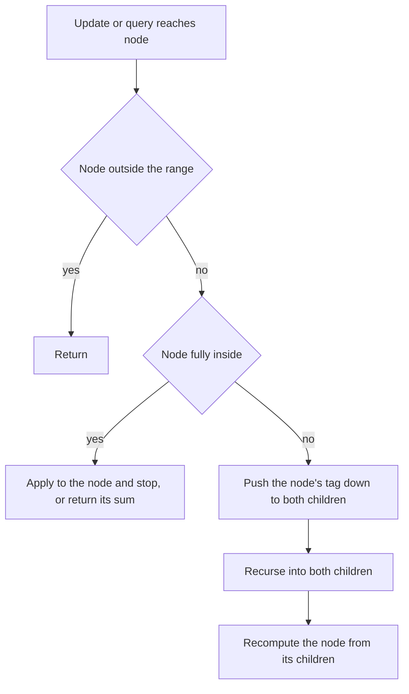

## The hook

A company announces a raise of 500 for everyone in the engineering department. The head of engineering does not walk to every desk; they update the department's salary total immediately and write a note: "everyone below me is owed 500". Months later, someone asks about one team's payroll, and only then does the note get passed down to that team's lead, who updates their total and passes the note further only if asked.

That is lazy propagation, the technique that lets a segment tree handle "add to a whole range" and "set a whole range" in O(log n) instead of O(n log n). The CSES problems that need it are some of the most instructive in the range-queries section, because the tags have to be combined exactly right.

## The intuition

:::analogy
Each manager in the company keeps two things: the up-to-date total for their whole team, and a sticky note of raises promised to their reports but not yet passed on. When a company-wide or department-wide raise arrives, any manager whose entire team is covered just fixes their own total and adds to their sticky note. The note travels down one level only when someone needs to talk to the manager's reports directly, and then it is handed over and torn up.
:::

The sticky note is a [[lazy tag]]. Three operations make the scheme work:

- **[[Apply]]** an update to a node: fix its stored answer for the whole segment and merge the update into its tag.
- **[[Push down]]** a node: apply its tag to both children, then clear it. This happens just before any operation visits the children.
- **[[Tag composition]]**: when a new update meets an existing tag, merge them into one tag that has the same effect as doing both in order.

Because a range is covered by O(log n) nodes, an update touches only O(log n) nodes plus their ancestors, exactly like a range query.

## How it works

### Range add, range sum

Each node stores sum and a tag add.

- apply(node, d): sum += d × length; add += d.
- push(node): if add ≠ 0, apply both children with add, then add = 0.
- update(l, r, d): if the node is outside, return; if fully inside, apply and return; otherwise push, recurse into both children, then sum = left.sum + right.sum.
- query(l, r): if outside, return 0; if inside, return sum; otherwise push, recurse, and add the results.

CSES *Range Update Queries* asks for range add and single-element reads; a Fenwick tree over differences also works, but it is the simplest lazy tree to practise on.

### Mixing add and assign

CSES *Range Updates and Sums* has both "increase a range by x" and "set a range to x", with range-sum queries. The tag must compose correctly:

| Existing tag | New update | Combined tag |
|---|---|---|
| none | add d | add d |
| add a | add d | add a + d |
| any | set v | set v, any old add is discarded |
| set v | add d | set v + d |

Store the tag as (hasSet, setValue, add). Apply a set: sum = v × length, hasSet = true, setValue = v, add = 0. Apply an add: sum += d × length, and if hasSet, setValue += d, otherwise add += d. Push applies the set first, if any, then the add, in that order, which is exactly what the table says.

### Polynomial Queries: an arithmetic progression tag

CSES *Polynomial Queries* adds 1 to a[l], 2 to a[l + 1], and so on up to a[r]. An [[arithmetic progression tag]] stores (first, step): the node's first element gets first, the next first + step, and so on. Applying it to a segment of length L adds first × L + step × L(L - 1) / 2 to the sum. Two progression tags add component-wise. When pushing, the right child's first value is shifted by step × (length of the left child).



:::insight
A lazy tag is a promise that a node's answer already includes an update its children have not seen. Keeping that promise honest takes two rules: apply updates to whole covered nodes and stop, and push tags down before anything looks inside. Everything else is choosing a tag that composes.
:::

## Walk through an example

Array [1, 2, 3, 4, 5, 6, 7, 8], sum tree with add and assign tags.

| Operation | Array afterwards | Answer |
|---|---|---|
| add 3 to [1, 4] | 1, 5, 6, 7, 8, 6, 7, 8 | |
| set [3, 6] to 10 | 1, 5, 6, 10, 10, 10, 10, 8 | |
| sum [0, 7] | | 60 |
| sum [2, 5] | | 36 |
| add 2 to [0, 7] | 3, 7, 8, 12, 12, 12, 12, 10 | |
| value at 4 | | 12 |
| sum [0, 2] | | 18 |

Inside the tree, the first update covers [1, 4] with nodes [1, 1], [2, 3] and [4, 4]. Node [2, 3] gets sum += 3 × 2 and tag add 3; its children are not touched.

The second update, set [3, 6] to 10, needs to go inside [2, 3], so it pushes add 3 down to [2, 2] and [3, 3] first, then sets [3, 3]. Node [4, 7] is not fully covered either, so it recurses: [4, 5] is covered and gets set 10, which overwrites leaf [4, 4]'s earlier add when it is eventually pushed; [6, 6] gets set 10.

The final add 2 to [0, 7] touches only the root: sum += 2 × 8 and tag add 2. The query "value at 4" then pushes that tag down the path to leaf 4, and nowhere else.

:::try-this
After set [3, 6] to 10, suppose a node covering [4, 5] holds the tag "set 10", and then "add 2" arrives for [4, 5]. What tag does the node hold, and what is its sum? (Composition gives set 12, because adding after an assignment changes the assigned value. The sum is 12 × 2 = 24.)
:::

:::warning
Common misconception: "Queries only read, so they never need to push." If a query descends into a node with a pending tag, the children's sums are stale, and the query adds up wrong values. Either push in queries too, or design the query to add the tag's effect on the way down; pushing is simpler and much harder to get wrong.
:::

## The code

```pseudo
apply_set(v, len, x):  sum[v] = x * len; has_set[v] = true; set_val[v] = x; add[v] = 0
apply_add(v, len, d):  sum[v] += d * len; if has_set[v]: set_val[v] += d else: add[v] += d
push(v, l, r):
    if has_set[v]: apply_set to both children with set_val[v]; has_set[v] = false
    if add[v] != 0: apply_add to both children with add[v]; add[v] = 0
update(v, l, r, ql, qr, op):
    if outside: return; if inside: apply op to v; return
    push(v); recurse into both halves; sum[v] = sum[left] + sum[right]
```

```cpp
#include <bits/stdc++.h>
using namespace std;
using ll = long long;

struct LazySeg {
    int n;
    vector<ll> sum, add, setv;
    vector<char> hasSet;
    explicit LazySeg(const vector<ll>& a) : n(a.size()), sum(4 * n), add(4 * n), setv(4 * n), hasSet(4 * n, 0) {
        build(1, 0, n - 1, a);
    }
    void build(int v, int l, int r, const vector<ll>& a) {
        if (l == r) { sum[v] = a[l]; return; }
        int m = (l + r) / 2;
        build(2 * v, l, m, a), build(2 * v + 1, m + 1, r, a);
        sum[v] = sum[2 * v] + sum[2 * v + 1];
    }
    void applySet(int v, int len, ll x) { sum[v] = x * len, hasSet[v] = 1, setv[v] = x, add[v] = 0; }
    void applyAdd(int v, int len, ll d) {
        sum[v] += d * len;
        if (hasSet[v]) setv[v] += d; else add[v] += d;          // compose with an existing set
    }
    void push(int v, int l, int r) {
        int m = (l + r) / 2, ll_ = m - l + 1, rl = r - m;
        if (hasSet[v]) applySet(2 * v, ll_, setv[v]), applySet(2 * v + 1, rl, setv[v]), hasSet[v] = 0;
        if (add[v]) applyAdd(2 * v, ll_, add[v]), applyAdd(2 * v + 1, rl, add[v]), add[v] = 0;
    }
    void update(int v, int l, int r, int ql, int qr, bool isSet, ll x) {
        if (qr < l || r < ql) return;
        if (ql <= l && r <= qr) {                               // fully covered: apply and stop
            if (isSet) applySet(v, r - l + 1, x); else applyAdd(v, r - l + 1, x);
            return;
        }
        push(v, l, r);
        int m = (l + r) / 2;
        update(2 * v, l, m, ql, qr, isSet, x), update(2 * v + 1, m + 1, r, ql, qr, isSet, x);
        sum[v] = sum[2 * v] + sum[2 * v + 1];
    }
    ll query(int v, int l, int r, int ql, int qr) {
        if (qr < l || r < ql) return 0;
        if (ql <= l && r <= qr) return sum[v];
        push(v, l, r);                                          // children must be up to date
        int m = (l + r) / 2;
        return query(2 * v, l, m, ql, qr) + query(2 * v + 1, m + 1, r, ql, qr);
    }
    void rangeAdd(int l, int r, ll d) { update(1, 0, n - 1, l, r, false, d); }
    void rangeSet(int l, int r, ll x) { update(1, 0, n - 1, l, r, true, x); }
    ll rangeSum(int l, int r) { return query(1, 0, n - 1, l, r); }
};

int main() {
    LazySeg t({1, 2, 3, 4, 5, 6, 7, 8});
    t.rangeAdd(1, 4, 3);
    t.rangeSet(3, 6, 10);
    cout << t.rangeSum(0, 7) << ' ' << t.rangeSum(2, 5) << ' ';
    t.rangeAdd(0, 7, 2);
    cout << t.rangeSum(4, 4) << ' ' << t.rangeSum(0, 2) << '\n';     // 60 36 12 18

    mt19937 rng(9);                                                  // random check against a plain array
    vector<ll> ref(50);
    for (ll& x : ref) x = rng() % 100;
    LazySeg big(ref);
    int bad = 0;
    for (int it = 0; it < 3000; it++) {
        int l = rng() % 50, r = rng() % 50, op = rng() % 3;
        if (l > r) swap(l, r);
        ll x = rng() % 50;
        if (op == 0) { big.rangeAdd(l, r, x); for (int i = l; i <= r; i++) ref[i] += x; }
        else if (op == 1) { big.rangeSet(l, r, x); for (int i = l; i <= r; i++) ref[i] = x; }
        else bad += big.rangeSum(l, r) != accumulate(ref.begin() + l, ref.begin() + r + 1, 0LL);
    }
    cout << bad << '\n';                                             // 0
}
```

The random check mixes adds, sets and sums against a plain array; it is the fastest way to catch a tag-composition bug, which usually shows up only after a particular order of operations.

## Complexity

- **Range update and range query: O(log n)** each, since O(log n) nodes are covered and O(log n) partially covered nodes are pushed and recomputed.
- **Build: O(n).**
- **Space: O(n)** for sums and tags, allocated as 4n per array.

## Common mistakes

- **Not pushing in queries,** reading stale children.
- **Pushing after recursing** instead of before.
- **Composing tags in the wrong order:** an assignment must clear earlier adds, and a later add must modify the assignment value.
- **Forgetting the segment length** when applying a tag to a sum.
- **Using int for sums** that reach 2 × 10⁵ × 10⁹ or more after many range adds.
- **Losing the shift in arithmetic progression tags:** the right child's first value is first + step × (left child length).

## Practice problems

*Range Update Queries* is range add with point reads. *Range Updates and Sums* mixes add and assign, the best test of tag composition. *Polynomial Queries* uses the arithmetic progression tag. The non-lazy foundations, and a first look at tags, are in [A Tournament Bracket for Your Array](article:cp-segment-tree).

## Key takeaways

- Lazy propagation lets a segment tree apply range updates in O(log n) by updating fully covered nodes and leaving a tag for their children.
- A node's tag means its own answer already includes the update but its children's answers do not.
- Every operation that visits a node's children, query or update, must push the node's tag down first.
- Tags must compose: an assignment overrides earlier adds, and an add after an assignment changes the assigned value.
- Random tests against a plain array catch composition bugs that the samples almost never show.
