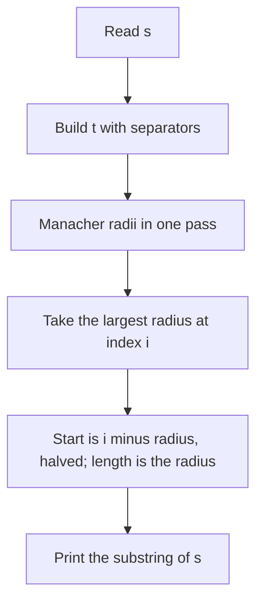

## The hook

The longest palindrome inside a string sounds like an interview warm-up, and at interview sizes it is: expand around each centre and keep the best. CSES *Longest Palindrome* raises the length to a million letters and includes the input that breaks expansion, a long run of one letter.

This walkthrough solves it three ways, each fast enough for a different size, and checks them against each other. The fastest is Manacher's algorithm from [A Mirror That Remembers the Reflections It Already Checked](article:cp-manacher); the part that most often goes wrong is not the algorithm but turning its answer back into a substring.

## The problem

Given a string of n lowercase letters, with n up to 10⁶, print a longest substring that is a palindrome. If several have the maximum length, any of them is accepted.

For s = "cabbacabbad", the answer is "abbacabba", of length 9, starting at index 1. The string also contains even palindromes such as "bb" and "abba", which a correct method must not miss.

## The obvious approach

A palindrome has a [[centre]]: a letter for odd lengths, a gap between two letters for even lengths. Try all 2n − 1 centres and grow each palindrome by [[expansion]] while the letters on both sides match.

That is correct and runs in time proportional to the total of all radii. On most strings the radii are small. On "aaaa...a" every centre expands to the nearest end of the string, and the total is about n²/2, roughly 5·10¹¹ letter comparisons for n = 10⁶. Hours, not a second.

## The key insight

:::analogy
Picture walking along the string carrying a mirror, stopping at each centre to see how far the reflection matches. A careless walker measures every reflection from scratch. A smarter walker notices two things. First, reflections are nested: if the mirror shows a match ten letters out, it also shows a match nine letters out, so the farthest match can be found by halving guesses. Second, while standing inside a long palindrome already measured, every smaller reflection on the right side was already measured on the left side, so it can be copied.
:::

The first observation gives an O(n log n) method; the second gives Manacher's O(n).

### O(n log n): binary search with hashes

Because of the [[monotone radius]], the largest radius at a centre can be binary searched. Testing "is s[l..r] a palindrome" in O(1) needs two hashes: one of s read forwards and one of s read backwards. A substring is a palindrome when its forward fingerprint equals its [[reverse fingerprint]]. Each centre costs O(log n), for O(n log n) in total: 2·10⁶ centres times about 20 halving steps, a few times 10⁷ hash comparisons at n = 10⁶.

The risk is collisions: two different strings with the same fingerprint. With arithmetic modulo 2⁶⁴ and an adversarial test this can fail; a random base, or a large prime modulus, is safer for contest submissions.

### O(n): Manacher

Transform s into t = #s₀#s₁#...#, so every palindrome has one centre in t, and compute the radius array in one left-to-right pass, copying each radius from its mirror inside the rightmost palindrome found so far. Take the position i with the largest radius p[i].

### Mapping back

This [[index mapping]] is the step to write carefully:

- the palindrome's length in s is p[i], because each letter in the window is paired with a '#';
- the window in t starts at i − p[i], which is always a '#', and the '#' before s[k] is t[2k];
- so the answer is `s.substr((i − p[i]) / 2, p[i])`.

| Method | Time | Exact | Safe for n = 10⁶ |
|---|---|---|---|
| expansion around 2n − 1 centres | O(n²) worst case | yes | no |
| binary search plus hashing | O(n log n) | with high probability | yes |
| Manacher | O(n) | yes | yes |



:::insight
All three methods test the same thing, how far a reflection matches around each centre. Expansion pays for every letter at every centre; binary search pays a logarithm per centre; Manacher pays only for letters beyond what an earlier, larger palindrome already guaranteed.
:::

## Walk through an example

s = "cabbacabbad", indices 0 to 10.

**Expansion, at a few centres.**

| Centre | Kind | Grows to | Length |
|---|---|---|---|
| between 2 and 3 | gap, "bb" | s[1..4] = "abba" | 4 |
| letter 5, "c" | letter | s[1..9] = "abbacabba" | 9 |
| between 7 and 8 | gap, "bb" | s[6..9] = "abba" | 4 |
| letter 10, "d" | letter | "d" | 1 |

The best is the letter centre at index 5, length 9.

**Binary search at centre 5.** Radius k means the window s[5 − k..5 + k], and k can be at most min(5, 10 − 5) = 5. Trying k = 3 gives s[2..8] = "bbacabb", a palindrome, so the radius is at least 3. Trying k = 4 gives s[1..9] = "abbacabba", also a palindrome. Trying k = 5 gives the whole string "cabbacabbad", which is not. So the radius is 4 and the length is 2·4 + 1 = 9.

**Manacher.** In t = #c#a#b#b#a#c#a#b#b#a#d#, the letter 'c' at s index 5 sits at t index 11. Its radius is 9, so the start is (11 − 9) / 2 = 1 and the length is 9: "abbacabba", matching the other two methods.

**The worst case.** The program builds a million a's with a single b in the middle, at index 500,000. Both Manacher and hashing return a palindrome of length 999,999 almost instantly; expansion on the same string would need on the order of 10¹¹ comparisons.

:::try-this
For s = "abba", what are the transformed index, the radius and the mapped answer? (t = #a#b#b#a#, and the middle '#' at index 4 has radius 4. The start is (4 − 4) / 2 = 0 and the length 4, so the answer is "abba". An even palindrome needs no special case.)
:::

:::warning
Common misconception: "The centre index in t divided by two is where the palindrome starts." Index 11 in t corresponds to s index 5, the centre, not the start. Printing `s.substr(i / 2, p[i])` returns "cabbad", the six letters from index 5 to the end, instead of "abbacabba". Always subtract the radius first: start = (i − p[i]) / 2.
:::

## The code

```pseudo
expansion: for c in 0..2n-2: l = c/2; r = l + c%2; grow while s[l] == s[r]; keep the best
hashing:   forward hash f, backward hash g; for each centre: if the core matches,
           binary search the largest k with fw(l0-k, r0+k+1) == bw(l0-k, r0+k+1)
manacher:  t = "#" + join(s, "#") + "#"; radii p; best i; answer s.substr((i - p[i]) / 2, p[i])
```

```cpp
#include <bits/stdc++.h>
using namespace std;
using ull = unsigned long long;

string byExpansion(const string& s) {                            // O(n^2) worst case: expand around 2n - 1 centres
    int n = s.size(), bestL = 0, bestLen = n ? 1 : 0;
    for (int c = 0; c < 2 * n - 1; c++) {
        int l = c / 2, r = l + c % 2;                            // even c: letter centre, odd c: gap centre
        while (l >= 0 && r < n && s[l] == s[r]) l--, r++;
        if (r - l - 1 > bestLen) bestLen = r - l - 1, bestL = l + 1;
    }
    return s.substr(bestL, bestLen);
}

string byHashing(const string& s) {                              // O(n log n): binary search the radius at each centre
    int n = s.size();
    const ull B = 131;
    vector<ull> f(n + 1, 0), g(n + 1, 0), pw(n + 1, 1);          // forward and backward fingerprints, mod 2^64
    for (int i = 0; i < n; i++) f[i + 1] = f[i] * B + s[i], pw[i + 1] = pw[i] * B;
    for (int i = n - 1; i >= 0; i--) g[i] = g[i + 1] * B + s[i];
    auto fw = [&](int l, int r) { return f[r] - f[l] * pw[r - l]; };          // s[l..r) read forwards
    auto bw = [&](int l, int r) { return g[l] - g[r] * pw[r - l]; };          // s[l..r) read backwards
    int bestL = 0, bestLen = n ? 1 : 0;
    for (int c = 0; c < 2 * n - 1; c++) {
        int l0 = c / 2, r0 = l0 + c % 2;                         // the palindrome is s[l0 - k .. r0 + k]
        if (r0 >= n || s[l0] != s[r0]) continue;
        int lo = 0, hi = min(l0, n - 1 - r0);                    // largest extra radius k that still works
        while (lo < hi) {
            int k = (lo + hi + 1) / 2;
            if (fw(l0 - k, r0 + k + 1) == bw(l0 - k, r0 + k + 1)) lo = k; else hi = k - 1;
        }
        int len = r0 - l0 + 1 + 2 * lo;
        if (len > bestLen) bestLen = len, bestL = l0 - lo;
    }
    return s.substr(bestL, bestLen);
}

string byManacher(const string& s) {                             // O(n)
    string t = "#";
    for (char c : s) t += c, t += '#';
    int m = t.size(), best = 0;
    vector<int> p(m, 0);
    for (int i = 0, l = 0, r = 0; i < m; i++) {
        if (i < r) p[i] = min(r - i, p[l + r - i]);
        while (i - p[i] - 1 >= 0 && i + p[i] + 1 < m && t[i - p[i] - 1] == t[i + p[i] + 1]) p[i]++;
        if (i + p[i] > r) l = i - p[i], r = i + p[i];
        if (p[i] > p[best]) best = i;
    }
    return s.substr((best - p[best]) / 2, p[best]);              // radius in t = length in s
}

int main() {
    string s = "cabbacabbad";
    cout << byExpansion(s) << ' ' << byHashing(s) << ' ' << byManacher(s) << '\n';   // abbacabba abbacabba abbacabba

    mt19937 rng(28);                                             // all three must agree on the length
    bool ok = true;
    for (int t = 0; t < 1000; t++) {
        int n = 1 + rng() % 30;
        string x;
        for (int i = 0; i < n; i++) x += char('a' + rng() % 2);
        string a = byExpansion(x), b = byHashing(x), c = byManacher(x);
        auto isPal = [](const string& w) { return equal(w.begin(), w.end(), w.rbegin()); };
        ok = ok && a.size() == b.size() && b.size() == c.size() && isPal(b) && isPal(c)
                && x.find(b) != string::npos && x.find(c) != string::npos;
    }
    string big(1000000, 'a');                                    // all equal letters: expansion would be quadratic
    big[500000] = 'b';
    cout << byManacher(big).size() << ' ' << byHashing(big).size() << ' ' << (ok ? "stress ok" : "stress FAILED") << '\n';   // 999999 999999 stress ok
}
```

The random test runs all three methods on 1000 random binary strings and checks that the lengths agree, that each answer really is a palindrome, and that it occurs in the string. The last line runs the two fast methods on a million letters.

## Complexity

- **Manacher: O(n)** time and memory.
- **Hashing with binary search: O(n log n)** time, O(n) memory.
- **Expansion: O(n²)** in the worst case, fine only for small n.

## Common mistakes

- **Starting the substring at i / 2** instead of (i − p[i]) / 2.
- **Halving the radius** after transforming, when the radius already equals the length in s.
- **Forgetting even centres** in the expansion or hashing methods.
- **Binary searching past the string's ends:** the radius bound is min(l0, n − 1 − r0).
- **Weak hashing on adversarial tests;** use a random base or a prime modulus.
- **Returning an empty string for n = 1;** a single letter is a palindrome of length 1.

## Practice problems

*Longest Palindrome* is this walkthrough. *Longest Palindromic Substring* is the same problem at a size where expansion passes, which makes it a good place to test the index arithmetic. *Shortest Palindrome* needs the longest palindromic prefix, the largest p[i] with i − p[i] = 0 in Manacher's array, or a prefix function on s + '#' + reverse(s) as in [A Reader Who Never Rereads the Page](article:cp-prefix-function).

## Key takeaways

- Expanding around all 2n − 1 centres is correct but quadratic on long runs of equal letters, which is exactly what large tests contain.
- Palindromes at a centre are nested, so the largest radius can be binary searched with forward and backward hashes in O(n log n).
- Manacher's algorithm computes every radius in one linear pass by copying radii from mirror positions inside the rightmost palindrome.
- In the transformed string the radius equals the length in s, and the palindrome starts at (i − p[i]) / 2.
- Comparing three methods on random strings catches index mistakes that a single sample test will not.
