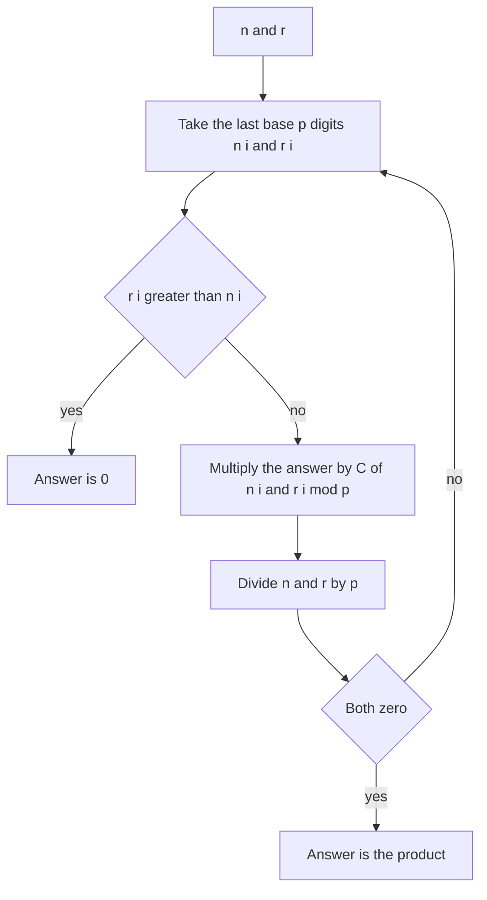

## The hook

Most binomial coefficient problems use a big prime such as 10⁹ + 7, and precomputed factorials do the rest. Then a problem asks for C(n, r) modulo 7, or modulo 10, with n up to 10¹⁸. Factorials are useless: 7! is already 0 modulo 7, and dividing by 0 is not an option.

Édouard Lucas found the way around this in 1878. Write n and r in base p, and the binomial coefficient modulo p splits into a product of tiny binomials, one per digit. It turns an impossible computation into a handful of table lookups.

## The intuition

:::analogy
Think of reading a long number in base p, digit by digit, the way you read a decimal number from left to right. Lucas's theorem says that choosing r things from n, as far as remainders modulo p are concerned, happens independently in each digit position: the digit of r in each place chooses from the digit of n in the same place. If any digit of r is larger than the digit of n above it, that position has no way to choose, and the whole answer is 0 modulo p.
:::

[[Lucas's theorem]]: for a prime p, write n and r in [[base-p digits]], n = n_k ... n_1 n_0 and r = r_k ... r_1 r_0. Then

C(n, r) ≡ C(n_k, r_k) × ... × C(n_1, r_1) × C(n_0, r_0) (mod p),

with C(a, b) = 0 whenever b > a.

## How it works

### Why the usual method breaks

With a large prime M, C(n, r) = n! / (r! (n - r)!) is computed as n! × inverse(r!) × inverse((n - r)!) modulo M, as in [How Many Ways to Pick the Team?](article:cp-binomial-coefficients).

With a [[small prime modulus]] p ≤ n, n! includes the factor p, so it is 0 modulo p, and so may r! be. Zero has no inverse, so the formula cannot be used.

### Computing with Lucas

Each [[digit binomial]] C(n_i, r_i) has n_i, r_i < p, so its factorials contain no factor p and can be inverted modulo p:

- precompute factorials and inverse factorials modulo p for 0..p - 1, O(p);
- loop: take n_i = n mod p and r_i = r mod p, multiply the answer by C(n_i, r_i), then n /= p and r /= p;
- stop when both are 0. Each query is O(log_p n).

If any r_i > n_i, the answer is 0 immediately.

### Pascal's triangle modulo 2

With p = 2, every digit binomial is C(1, 1), C(1, 0), C(0, 0), all equal to 1, or C(0, 1) = 0. So C(n, r) is odd exactly when r's binary digits never have a 1 where n's have a 0: r & n == r. Row n of Pascal's triangle has 2^(popcount(n)) odd entries, which draws the familiar Sierpinski triangle pattern.

### Small composite moduli with CRT

For a modulus like 10 = 2 × 5, compute C(n, r) mod 2 and mod 5 with Lucas, then combine with the Chinese remainder theorem from [Three Clocks That Agree Only Once](article:cp-chinese-remainder). *Check If Digits Are Equal in String After Operations II* uses exactly this: the final digits are sums of the string's digits weighted by binomial coefficients modulo 10. Prime powers such as 4 or 9 need a generalisation of Lucas and are a separate topic.

| Modulus | Method |
|---|---|
| Large prime, n < M | factorials and inverse factorials |
| Small prime p ≤ n | Lucas: product of digit binomials |
| Product of distinct small primes | Lucas for each prime, then CRT |
| Prime powers | generalised Lucas, beyond this article |



:::insight
Modulo a prime p, choosing r from n splits into independent choices digit by digit in base p. That replaces factorials, which vanish modulo a small prime, with binomials of single digits, which never do.
:::

## Walk through an example

| C(n, r) mod p | n in base p | r in base p | Digit binomials | Result | Check |
|---|---|---|---|---|---|
| C(10, 3) mod 3 | 101 | 010 | C(1, 0) × C(0, 1) × C(1, 0) = 1 × 0 × 1 | 0 | 120 mod 3 = 0 |
| C(12, 5) mod 5 | 22 | 10 | C(2, 1) × C(2, 0) = 2 × 1 | 2 | 792 mod 5 = 2 |
| C(1000, 300) mod 7 | 2626 | 0606 | C(2, 0) × C(6, 6) × C(2, 0) × C(6, 6) | 1 | matches direct computation |
| C(9, 4) mod 2 | 1001 | 0100 | the 1 in r sits over a 0 in n | 0 | 126 is even |

### Pascal's triangle rows 0 to 7, modulo 2

| n | Row mod 2 |
|---|---|
| 0 | 1 |
| 1 | 1 1 |
| 2 | 1 0 1 |
| 3 | 1 1 1 1 |
| 4 | 1 0 0 0 1 |
| 5 | 1 1 0 0 1 1 |
| 6 | 1 0 1 0 1 0 1 |
| 7 | 1 1 1 1 1 1 1 1 |

Row 6 is binary 110, with popcount 2, so it has 2² = 4 odd entries, at r = 0, 2, 4, 6: exactly the r whose bits fit inside 110.

### Modulo 10 through 2 and 5

C(31, 15) is 1 modulo 2 (15 = 01111 fits inside 31 = 11111) and 0 modulo 5. The only digit 0 to 9 that is odd and divisible by 5 is 5, so C(31, 15) ≡ 5 (mod 10).

:::try-this
Compute C(13, 6) mod 3. (13 is 111 in base 3 and 6 is 020. The middle pair is C(1, 2) = 0, so the result is 0. Indeed C(13, 6) = 1716 = 3 × 572.)
:::

:::warning
Common misconception: "Lucas's theorem works for any modulus." It needs a prime. For a composite modulus such as 10, apply it to each prime factor and combine with CRT, which works when the factors are distinct primes. For prime powers like 8 or 27, the digit-by-digit product is not correct and a generalised method is needed.
:::

## The code

```pseudo
precompute fact[0..p-1], inv_fact[0..p-1] mod p
small_C(a, b) = 0 if b > a else fact[a] * inv_fact[b] * inv_fact[a-b] mod p

lucas(n, r, p):
    res = 1
    while n > 0 or r > 0:
        res = res * small_C(n mod p, r mod p) mod p
        if res == 0: return 0
        n /= p; r /= p
    return res
```

```cpp
#include <bits/stdc++.h>
using namespace std;
using ll = long long;

struct Lucas {
    ll p;
    vector<ll> f, inv;
    explicit Lucas(ll prime) : p(prime), f(prime), inv(prime) {
        f[0] = 1;
        for (ll i = 1; i < p; i++) f[i] = f[i - 1] * i % p;
        inv[p - 1] = power(f[p - 1], p - 2);
        for (ll i = p - 1; i > 0; i--) inv[i - 1] = inv[i] * i % p;
    }
    ll power(ll b, ll e) const {
        ll r = 1;
        for (b %= p; e; e >>= 1, b = b * b % p) if (e & 1) r = r * b % p;
        return r;
    }
    ll small(ll a, ll b) const { return b > a ? 0 : f[a] * inv[b] % p * inv[a - b] % p; }
    ll C(ll n, ll r) const {
        ll res = 1;
        while ((n || r) && res) {
            res = res * small(n % p, r % p) % p;              // one base-p digit at a time
            n /= p, r /= p;
        }
        return res;
    }
};

ll binomMod10(ll n, ll r, const Lucas& two, const Lucas& five) {
    ll a = two.C(n, r), b = five.C(n, r);
    for (ll x = 0; x < 10; x++) if (x % 2 == a && x % 5 == b) return x;   // CRT by search
    return -1;
}

int main() {
    Lucas l2(2), l3(3), l5(5), l7(7);
    cout << l3.C(10, 3) << ' ' << l5.C(12, 5) << ' ' << l7.C(1000, 300) << ' ' << l2.C(9, 4) << ' '
         << l3.C(13, 6) << '\n';                                             // 0 2 1 0 0
    for (int r = 0; r <= 6; r++) cout << l2.C(6, r);
    cout << ' ' << binomMod10(31, 15, l2, l5) << ' ' << binomMod10(20, 7, l2, l5) << '\n';   // 1010101 5 0
    cout << l7.C(1000000000000000000LL, 123456789012345678LL) << '\n';     // 0, computed instantly for n = 10^18
}
```

The last line runs in about 22 steps, one per base-7 digit of 10¹⁸, where any factorial-based method would be hopeless.

## Complexity

- **Precomputation: O(p)** for factorials and inverses below p.
- **Each query: O(log_p n)** digit steps, about 60 for p = 2 and n = 10¹⁸.
- **Space: O(p).**
- **With CRT over several small primes:** one Lucas query per prime, plus a constant-time combination.

## Common mistakes

- **Using factorial inverses modulo a small prime,** which divides by zero once n ≥ p.
- **Forgetting that a digit binomial is 0 when r_i > n_i,** which makes the whole product 0.
- **Applying Lucas to a composite or prime-power modulus** directly.
- **Stopping the loop when n reaches 0 but r has digits left;** then r > n and the answer must be 0.
- **Precomputing factorials beyond p - 1,** which is unnecessary and reintroduces zeros.

## Practice problems

CSES *Binomial Coefficients* is the large-prime baseline to compare against. *Find Triangular Sum of an Array* can be solved by simulation, but its answer is a binomial-weighted sum modulo 10, a good place to try Lucas with CRT on small inputs. *Check If Digits Are Equal in String After Operations II* requires Lucas modulo 2 and 5 combined with CRT, because the string is too long to simulate.

## Key takeaways

- For a prime p, C(n, r) mod p is the product of the binomials of the base-p digits of n and r.
- The usual factorial formula fails modulo a small prime p ≤ n, because the factorials become 0 and cannot be inverted.
- Each query needs only factorials below p and O(log_p n) digit steps, so n can be as large as 10¹⁸.
- Modulo 2, C(n, r) is odd exactly when the bits of r are a subset of the bits of n.
- Small square-free composite moduli are handled by applying Lucas to each prime factor and combining with the Chinese remainder theorem.
