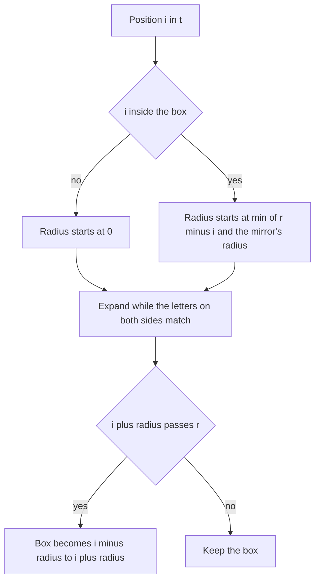

## The hook

Find the longest palindrome inside a string of a million letters. Expanding around each of the 2n − 1 centres is O(n²) in the worst case, for example on a string of a single repeated letter, where every centre expands to the edge. Dynamic programming over all substrings is O(n²) as well.

Manacher found in 1975 how to do it in linear time. The trick is the same one the Z-function uses in [A Window That Remembers What It Already Checked](article:cp-z-function): keep the rightmost structure you have already verified, and reuse it for everything inside. For palindromes, the structure is a mirror.

## The intuition

:::analogy
Stand inside a long palindrome, a hall of mirrors whose two ends reflect each other. Everything on your side of the centre is the reflection of something on the other side. If you want to know how far a smaller palindrome around you extends, look at your reflection on the other side: you already measured its palindrome, so yours is at least as long, as long as it stays inside the hall. Only when it reaches the hall's walls do you need to step outside and check new letters, and every new letter you check pushes the hall's right wall further.
:::

Each palindrome's middle is its [[centre]]; the hall is the [[palindrome box]]; your reflection is the [[mirror position]].

## How it works

### One string for odd and even centres

Even palindromes such as "abba" are centred between two letters. Insert '#' around every letter: the [[transformed string]] t = "#a#b#b#a#" has length 2n + 1, and every palindrome of s, odd or even, has exactly one centre position in t. Its [[radius]] p[i] in t equals its length in s, because each letter of the palindrome is paired with a '#'.

### The algorithm

```
for i in 0 .. |t|-1:
    if i < r: p[i] = min(r - i, p[l + r - i])          # reuse the mirror, capped at the box edge
    while t[i - p[i] - 1] == t[i + p[i] + 1] (within bounds): p[i] += 1
    if i + p[i] > r: l = i - p[i]; r = i + p[i]         # the box moves right
```

| Case | Starting radius | Comparisons |
|---|---|---|
| i ≥ r | 0 | expand from scratch |
| mirror's palindrome ends strictly inside the box | p[mirror], exactly | one, which fails |
| mirror's palindrome reaches or passes the box edge | r − i | continue past r |

**Why it is linear.** Every successful comparison checks a letter beyond r, and afterwards the box's right edge covers it, so r increases. r never exceeds |t|, so successful comparisons total O(n). Each position has at most one failed comparison.

### Back to the original string

The index arithmetic is where solutions go wrong.

- The palindrome at t-centre i with radius p[i] has length p[i] in s.
- t[i − p[i]] is always a '#', and the '#' just before s[k] is t[2k]. So the palindrome starts at s index (i − p[i]) / 2.

CSES *Longest Palindrome* is then: take the i with the largest p[i] and print `s.substr((i − p[i]) / 2, p[i])`.

### Counting every palindrome

A radius p[i] at a letter centre contains palindromes of s of lengths p[i], p[i] − 2, ..., 1; at a '#' centre, lengths p[i], p[i] − 2, ..., 2. Either way there are (p[i] + 1) / 2 of them, with integer division. Summing over all i counts every palindromic substring by position.

| Question | From p |
|---|---|
| longest palindrome | the largest p[i], starting at (i − p[i]) / 2 |
| number of palindromic substrings | sum of (p[i] + 1) / 2 |
| is s[a..b] a palindrome | centre c = a + b + 1 in t; check p[c] ≥ b − a + 1 |
| longest palindromic prefix | the largest p[i] with i − p[i] = 0 |

The third row turns Manacher into an O(1) palindrome test for any substring, after O(n) preprocessing.



:::insight
A palindrome is its own mirror, so inside it every smaller palindrome has a twin already measured on the other side. Copying the twin's radius, capped at the box, means letters are only ever compared beyond the rightmost point checked so far.
:::

## Walk through an example

s = "abacabab", so t = "#a#b#a#c#a#b#a#b#", positions 0 to 16.

| i | t[i] | Box before | Start | Extra | p[i] | Box after |
|---|---|---|---|---|---|---|
| 1 | a | none | 0 | 1 | 1 | [0, 2] |
| 3 | b | [0, 2] | 0, outside | 3 | 3 | [0, 6] |
| 5 | a | [0, 6] | min(1, p[1] = 1) = 1 | 0 | 1 | [0, 6] |
| 7 | c | [0, 6] | 0, outside | 7 | 7 | [0, 14] |
| 9 | a | [0, 14] | min(5, p[5] = 1) = 1 | 0 | 1 | [0, 14] |
| 11 | b | [0, 14] | min(3, p[3] = 3) = 3 | 0 | 3 | [0, 14] |
| 13 | a | [0, 14] | min(1, p[1] = 1) = 1 | 2 | 3 | [10, 16] |
| 15 | b | [10, 16] | min(1, p[11] = 3) = 1 | 0 | 1 | [10, 16] |

The '#' positions all have radius 0 here, since no two neighbouring letters are equal. Full p: 0 1 0 3 0 1 0 7 0 1 0 3 0 3 0 1 0.

- At i = 7, the centre 'c', the palindrome "abacaba" spans the whole of t from 0 to 14: radius 7.
- At i = 9 and 11, the answers are copied from the mirrors 5 and 3 with no fresh work: "a" and "aba" on the right mirror "a" and "aba" on the left.
- At i = 13, the mirror says 1, which reaches the box edge at 14, so the algorithm keeps comparing past it and finds "bab" at s positions 5 to 7: radius 3, and the box moves to [10, 16].

**Answers.** The largest radius is 7 at i = 7: start (7 − 7) / 2 = 0, length 7, "abacaba". The palindrome count is the sum of (p[i] + 1) / 2: eight single letters, plus aba at the start, the three palindromes around 'c' (aca, bacab, abacaba), the second aba and the final bab, which is 14, matching a check of all 36 substrings.

:::try-this
Compute p for "abba" and read off the longest palindrome. (t = "#a#b#b#a#". The middle '#' at index 4 expands all the way: radius 4. Its start is (4 − 4) / 2 = 0 and its length 4: "abba", an even palindrome found by the same loop with no special case.)
:::

:::warning
Common misconception: "The radius in t is twice the palindrome's length in s, so divide by two." With '#' inserted between every letter, the radius already equals the length in s: in the example, radius 7 at the 'c' is the seven-letter "abacaba". Dividing again gives 3, and printing from i / 2 instead of (i − p[i]) / 2 starts in the middle of the palindrome. Write down one small case, like "abba", and check the arithmetic on it.
:::

## The code

```pseudo
t = "#" + join(s, "#") + "#"
for i in 0..|t|-1:
    if i < r: p[i] = min(r - i, p[l + r - i])
    while in bounds and t[i - p[i] - 1] == t[i + p[i] + 1]: p[i] += 1
    if i + p[i] > r: l, r = i - p[i], i + p[i]
longest: i with max p[i]; answer s.substr((i - p[i]) / 2, p[i])
count:   sum of (p[i] + 1) / 2
```

```cpp
#include <bits/stdc++.h>
using namespace std;
using ll = long long;

// p[i] = palindrome radius at position i of t = "#s0#s1#...#"; it equals the palindrome's length in s
vector<int> manacher(const string& s) {
    string t = "#";
    for (char c : s) t += c, t += '#';
    int n = t.size();
    vector<int> p(n, 0);
    for (int i = 0, l = 0, r = 0; i < n; i++) {                  // [l, r] = rightmost palindrome found so far
        if (i < r) p[i] = min(r - i, p[l + r - i]);              // mirror inside the box, capped at its edge
        while (i - p[i] - 1 >= 0 && i + p[i] + 1 < n && t[i - p[i] - 1] == t[i + p[i] + 1]) p[i]++;
        if (i + p[i] > r) l = i - p[i], r = i + p[i];            // the box only moves right
    }
    return p;
}

string longestPalindrome(const string& s) {
    auto p = manacher(s);
    int best = max_element(p.begin(), p.end()) - p.begin();
    return s.substr((best - p[best]) / 2, p[best]);              // back to indices of s
}

ll countPalindromes(const string& s) {                           // palindromic substrings, counted by position
    ll total = 0;
    for (int x : manacher(s)) total += (x + 1) / 2;              // a radius of x holds (x + 1) / 2 palindromes of s
    return total;
}

int main() {
    string s = "abacabab";
    for (int x : manacher(s)) cout << x << ' ';
    cout << '\n';                                                // 0 1 0 3 0 1 0 7 0 1 0 3 0 3 0 1 0
    cout << longestPalindrome(s) << ' ' << countPalindromes(s) << '\n';            // abacaba 14
    cout << longestPalindrome("abba") << ' ' << longestPalindrome("x") << '\n';    // abba x

    mt19937 rng(24);                                             // against checking every substring
    bool ok = true;
    for (int t = 0; t < 500; t++) {
        int n = 1 + rng() % 16;
        string x;
        for (int i = 0; i < n; i++) x += char('a' + rng() % 2);
        int bestLen = 0;
        ll cnt = 0;
        for (int i = 0; i < n; i++)
            for (int j = i + 1; j <= n; j++) {
                string sub = x.substr(i, j - i);
                if (equal(sub.begin(), sub.end(), sub.rbegin())) cnt++, bestLen = max(bestLen, j - i);
            }
        string got = longestPalindrome(x);
        ok = ok && (int)got.size() == bestLen && equal(got.begin(), got.end(), got.rbegin())
                && x.find(got) != string::npos && countPalindromes(x) == cnt;
    }
    cout << (ok ? "stress ok" : "stress FAILED") << '\n';        // stress ok
}
```

The random test checks 500 random binary strings, where palindromes are dense, against a brute force over every substring: the returned palindrome must be a real palindrome of the right length that occurs in the string, and the count must match.

## Complexity

- **Time: O(n),** by the moving right edge.
- **Space: O(n)** for t and p; the two-array version without '#' uses the same.
- **Substring palindrome test: O(1)** after the O(n) pass.

## Common mistakes

- **Dividing the radius by two** after transforming, or forgetting how the radius maps back.
- **Start index i / 2** instead of (i − p[i]) / 2.
- **Copying the mirror radius without the cap r − i.**
- **Using a separator that occurs in the input.** With '#' and lowercase letters this cannot happen, but with arbitrary bytes pick a value outside the alphabet.
- **Handling odd and even palindromes with two loops** and mixing up their index conventions; the single transformed string avoids this.
- **int overflow when counting** palindromes in a long string: up to about n²/2.

## Practice problems

*Longest Palindrome* on CSES is the template at n = 10⁶, where quadratic expansion is far too slow. *Longest Palindromic Substring* is the same at interview size, where expansion around centres also passes. *Palindromic Substrings* counts them all with the sum of (p[i] + 1) / 2. The DP view of palindromic subsequences, a different problem, is in [Folding a Word So Its Ends Meet](article:dsa-longest-palindromic-subsequence).

## Key takeaways

- Inserting a separator between all letters gives every palindrome, odd or even, exactly one centre, so one loop handles both.
- Inside the rightmost palindrome found so far, each position starts from its mirror's radius, capped at the box's edge.
- Letters are only compared beyond the box's right edge, which only moves forward, so the algorithm runs in linear time.
- In the transformed string the radius equals the palindrome's length in the original, and it starts at original index (i − p[i]) / 2.
- Summing (p[i] + 1) / 2 over all positions counts every palindromic substring, and p also answers whether any substring is a palindrome in O(1).
