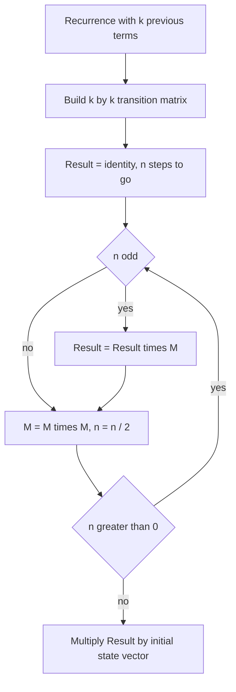

## The hook

Compute the 10¹⁸-th Fibonacci number modulo 10⁹ + 7. A loop that adds the last two terms needs 10¹⁸ steps, which would take decades. Yet the answer comes back in microseconds with a trick built from two things you already know: the recurrence, and fast exponentiation from [Raising to the Power of a Billion in Thirty Steps](article:cp-binary-exponentiation).

The same trick counts dice sequences summing to 10¹⁸, walks of length 10⁹ in a graph, and tilings of huge boards. Whenever a problem has a small fixed "state" that evolves linearly and n is huge, think matrix exponentiation.

## The intuition

:::analogy
Imagine a machine that takes the last two Fibonacci numbers and outputs the next pair: put in (F(n), F(n−1)), get out (F(n+1), F(n)). To advance 10¹⁸ steps you could crank the machine 10¹⁸ times. But machines can be combined: two cranks glued together form a machine that advances two steps; glue that to itself and you get four steps. Doubling the machine 60 times gives one that advances 2⁶⁰ steps in a single turn.
:::

The machine is a [[transition matrix]]. Gluing machines together is matrix multiplication, and doubling repeatedly is binary exponentiation, which works for matrices because matrix multiplication is associative.

## How it works

### Step 1: write the recurrence as a matrix

For Fibonacci, the [[state vector]] is (F(n), F(n−1)). The next state is:

- F(n+1) = 1·F(n) + 1·F(n−1)
- F(n) = 1·F(n) + 0·F(n−1)

So

$$\begin{pmatrix} F(n+1) \\ F(n) \end{pmatrix} = \begin{pmatrix} 1 & 1 \\ 1 & 0 \end{pmatrix} \begin{pmatrix} F(n) \\ F(n-1) \end{pmatrix}$$

Applying the matrix M n times: (F(n+1), F(n)) = Mⁿ · (F(1), F(0)).

For a general [[linear recurrence]] f(n) = c₁f(n−1) + c₂f(n−2) + ... + c_k f(n−k), the k × k matrix has the coefficients c₁ ... c_k in its first row, and ones just below the diagonal, which shift each old term down one slot.

### Step 2: raise it to the n-th power fast

Binary exponentiation works on matrices exactly as on numbers. Start from the [[identity matrix]] I. While n > 0: if n is odd, multiply the result by M; square M; halve n. That is about 2 log₂ n multiplications, each costing k³ operations for a k × k matrix.



### Step 3: read off the answer

Multiply Mⁿ by the initial state vector, and the term you want is one of the entries.

### Counting walks in a graph

If A is a graph's [[adjacency matrix]], then entry (i, j) of Aᵏ counts walks of exactly k edges from i to j. The reason is the same "extend by one step" logic: walks of length k + 1 from i to j are walks of length k from i to some m, followed by an edge m → j, summed over every m, which is exactly the formula for matrix multiplication.

:::insight
Any process whose next state is a fixed linear combination of its current state is "multiply by a matrix". Doing it n times is a matrix power, and powers can be computed with about 2 log n multiplications. The size of the state, k, decides the cost, not n.
:::

### Variation: min-plus matrices

Replace "multiply and add" with "add and take the minimum", and the same exponentiation computes the shortest walk using exactly k edges. *Graph Paths II* is this variant.

## Walk through an example

**Fibonacci.** M = [[1, 1], [1, 0]].

- M² = [[2, 1], [1, 1]]
- M³ = [[3, 2], [2, 1]]
- M¹⁰ = [[89, 55], [55, 34]]

So F(10) = 55 and F(11) = 89, as the top row says. For n = 10, binary 1010, the algorithm squares M to get M², M⁴, M⁸ and multiplies the result by M² and M⁸.

**Dice sums.** Ways to get sum n by throwing a six-sided die repeatedly: f(n) = f(n−1) + ... + f(n−6), with f(0) = 1. The first values are 1, 1, 2, 4, 8, 16, 32, then f(7) = 63, f(8) = 125. For n up to 10¹⁸, build the 6 × 6 matrix with all ones in the first row and ones below the diagonal.

**Graph walks.** Directed edges 1 → 2, 1 → 3, 2 → 3, 3 → 1. Entry (1, 3) of A⁴ is 2: the walks 1 → 2 → 3 → 1 → 3 and 1 → 3 → 1 → 2 → 3.

:::try-this
Write the transition matrix for f(n) = 2f(n−1) + 3f(n−2). (First row [2, 3], second row [1, 0]. The state is (f(n), f(n−1)).)
:::

## The code

```pseudo
mat_mul(A, B):                          // k x k, all entries mod MOD
    C = k x k zeros
    for i, t, j: C[i][j] = (C[i][j] + A[i][t] * B[t][j]) mod MOD
    return C

mat_pow(M, n):
    R = identity
    while n > 0:
        if n odd: R = mat_mul(R, M)
        M = mat_mul(M, M)
        n = n / 2
    return R

fib(n): return mat_pow([[1,1],[1,0]], n)[0][1]
```

```cpp
#include <bits/stdc++.h>
using namespace std;
const long long MOD = 1'000'000'007;
using Mat = vector<vector<long long>>;

Mat mul(const Mat& A, const Mat& B) {
    int k = A.size();
    Mat C(k, vector<long long>(k, 0));
    for (int i = 0; i < k; i++)
        for (int t = 0; t < k; t++) {
            if (!A[i][t]) continue;
            for (int j = 0; j < k; j++) C[i][j] = (C[i][j] + A[i][t] * B[t][j]) % MOD;
        }
    return C;
}

Mat power(Mat M, long long n) {
    int k = M.size();
    Mat R(k, vector<long long>(k, 0));
    for (int i = 0; i < k; i++) R[i][i] = 1;
    while (n > 0) {
        if (n & 1) R = mul(R, M);
        M = mul(M, M);
        n >>= 1;
    }
    return R;
}

int main() {
    cout << power({{1, 1}, {1, 0}}, 10)[0][1] << '\n';               // 55
    cout << power({{1, 1}, {1, 0}}, 1000000000000000000LL)[0][1] << '\n';
}
```

## Complexity

- **Time:** O(k³ log n). For Fibonacci, k = 2, so a handful of operations per step. For k = 100 and n = 10¹⁸, about 10⁶ × 120 ≈ 10⁸ operations, which is near the limit.
- **Space:** O(k²) for a few matrices.

## Common mistakes

:::warning
Common misconception: "taking mod after every multiplication is enough to prevent overflow." Each product of two values below 10⁹ + 7 fits in a 64-bit integer, but summing k such products before reducing can overflow. Reduce after each addition, as in the code, or accumulate in unsigned 128-bit where available.
:::

- **Off-by-one in the power**: decide whether you need Mⁿ or Mⁿ⁻¹ by checking n = 1 and n = 2 by hand.
- **Wrong initial vector order**: the state vector's order must match the matrix rows, newest term first.
- **Using it when n is small**: for n up to about 10⁷, a plain loop is simpler and faster.
- **Large k**: k³ grows fast; for k in the hundreds, consider whether a smaller state exists.

## Practice problems

*Fibonacci Numbers* (CSES) is the 2 × 2 template. *Throwing Dice* is the 6 × 6 recurrence above with n up to 10¹⁸. *Graph Paths I* counts walks of length k with the adjacency matrix. *Graph Paths II* uses min-plus multiplication for the shortest walk of exactly k edges.

## Key takeaways

- A linear recurrence with k previous terms can be written as a k × k transition matrix acting on a state vector.
- Advancing n steps means raising the matrix to the n-th power, which binary exponentiation does with about 2 log n multiplications.
- The total cost is O(k³ log n), so it shines when n is huge and the state is small.
- Entry (i, j) of the adjacency matrix to the k-th power counts walks of exactly k edges from i to j.
- Reduce modulo after every addition inside matrix multiplication to avoid overflow, and check the power's off-by-one on small cases.
