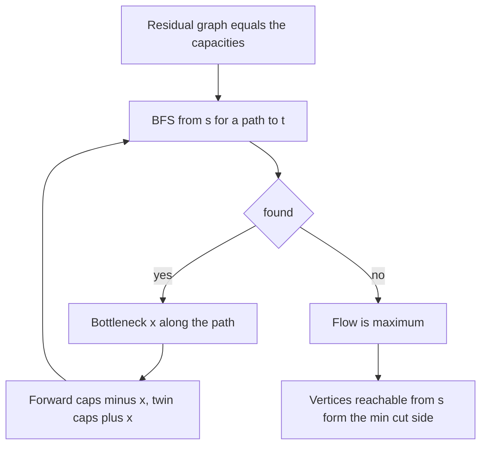
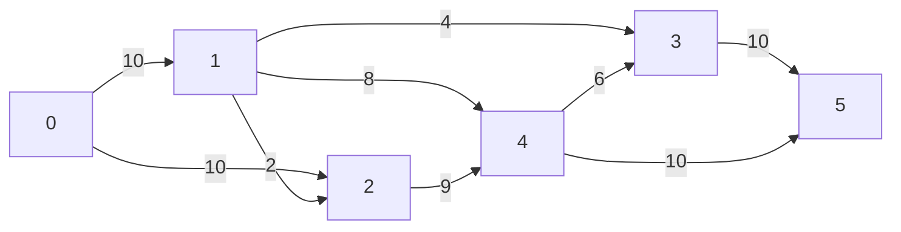

## The hook

A reservoir feeds a city through a network of pipes, each with a limit on how many litres per second it can carry. Water can split at junctions and merge again, but nothing leaks and nothing is stored. How much water per second can reach the city?

The answer is a maximum flow, and the same model fits download bandwidth through routers, matching students to projects, and choosing the fewest roads to block to cut a city in two. Ford and Fulkerson published the augmenting-path method in 1956. In [Water Racing Through a Network of Pipes](article:dsa-dijkstra) the question was how soon water arrives; here it is how much can pass at once.

## The intuition

:::analogy
An engineer opens valves one route at a time. They find any route from the reservoir to the city where every pipe still has spare room, and push as much as the tightest pipe allows. Then they look for another route. Sometimes the best plan needs a pipe that is already carrying water to carry less: water that went one way could be sent elsewhere, freeing the pipe for a different route. So every pipe also gets a "give back" valve that lets a later route cancel water sent earlier. When no route with spare room is left, the network is at full capacity.
:::

The pipe network is the [[flow network]]. Spare room is [[residual capacity]], and the pipes with spare room, including the "give back" valves, make the [[residual graph]]. A route with spare room is an [[augmenting path]], and the give-back valve is the [[reverse edge]].

## How it works

### Residual capacities

For an edge u → v with capacity c currently carrying f:

| Direction | Residual capacity | Meaning |
|---|---|---|
| u → v | c − f | room to send more forward |
| v → u | f | room to cancel flow already sent |

Store each edge and its twin next to each other, at indices i and i ^ 1. Pushing x along edge i subtracts x from e[i].cap and adds x to e[i ^ 1].cap. That one rule maintains both rows of the table.

### The augmenting path method

```
flow = 0
while there is an s -> t path in the residual graph:
    x = smallest residual capacity on the path      (the bottleneck)
    for each edge on the path: cap[edge] -= x; cap[twin] += x
    flow += x
```

With integer capacities each round adds at least 1, so the method ends. Searching for the path with BFS, which always picks a path with the fewest edges, is the Edmonds–Karp rule, and it bounds the number of rounds by O(V·E) regardless of capacity values, giving O(V·E²) in total. That is comfortable for the small networks in the CSES flow problems. Dinic's algorithm, which augments along many shortest paths per phase, is faster in the worst case and is the usual choice for larger networks.

### Why reverse edges are essential

Suppose the first augmenting path found uses an edge that the optimal solution leaves empty. Without reverse edges, that flow is stuck there forever and can block the optimum. A later path that walks backwards along the reverse edge cancels it: in effect the two paths swap their tails, and both become usable. The program below builds such a trap, where the shortest path blocks two longer ones; without reverse edges the algorithm stops at 1, with them it reaches 2.

### Cuts and the main theorem

A [[cut]] splits the vertices into S, containing s, and T, containing t. Every unit of flow must cross from S to T at least once, so **any flow is at most any cut's capacity**. The [[max-flow min-cut theorem]] says the two meet: the largest flow equals the smallest cut.

When the algorithm stops, there is no residual s → t path. Let S be the vertices still reachable from s in the residual graph. Then:

- every original edge from S to T is saturated, or its far end would be reachable;
- every original edge from T to S carries no flow, or its reverse edge would make its tail reachable.

So the flow equals the capacity of this cut, which proves both that the flow is maximum and that this cut is minimum. CSES *Police Chase* asks for the fewest streets to close to separate two places: the edges from S to T in the final residual graph.

### Modelling tricks

| Situation | Model |
|---|---|
| undirected edge of capacity c | one edge whose reverse twin also starts at c |
| several sources or sinks | a super source with edges to each source, or a super sink |
| a vertex can carry at most k | split it into v_in → v_out with capacity k |
| edge-disjoint paths | every capacity 1; the flow value counts the paths |
| capacities up to 10⁹ with many edges | long long for flow and capacities |

CSES *Distinct Routes* asks for the most edge-disjoint routes and the routes themselves. Set every capacity to 1, find the max flow, then walk from s along edges that carry flow, removing each used edge, once per unit.



:::insight
Reverse edges turn a greedy method into a correct one. Each augmentation may undo part of an earlier one, so the order in which paths are found never traps the algorithm, and when no path remains, the reachable set certifies the answer with a cut of the same value.
:::

## Walk through an example

Source 0, sink 5, nine pipes: 0 → 1 (10), 0 → 2 (10), 1 → 2 (2), 1 → 3 (4), 1 → 4 (8), 2 → 4 (9), 4 → 3 (6), 3 → 5 (10), 4 → 5 (10).



Edmonds–Karp finds these paths, shortest first:

| Round | Path | Bottleneck | Pipe that fills | Total |
|---|---|---|---|---|
| 1 | 0 → 1 → 3 → 5 | 4 | 1 → 3 | 4 |
| 2 | 0 → 1 → 4 → 5 | 6 | 0 → 1 | 10 |
| 3 | 0 → 2 → 4 → 5 | 4 | 4 → 5 | 14 |
| 4 | 0 → 2 → 4 → 3 → 5 | 5 | 2 → 4 | 19 |

In round 2, 0 → 1 has only 10 − 4 = 6 left. In round 4 the route must detour through 4 → 3 because 4 → 5 is already full. After round 4, BFS from 0 can reach only 2: 0 → 1 is full, and from 2 the only pipe out, 2 → 4, is full. No path remains.

Final flow on each pipe:

| Pipe | 0→1 | 0→2 | 1→2 | 1→3 | 1→4 | 2→4 | 4→3 | 3→5 | 4→5 |
|---|---|---|---|---|---|---|---|---|---|
| capacity | 10 | 10 | 2 | 4 | 8 | 9 | 6 | 10 | 10 |
| flow | 10 | 9 | 0 | 4 | 6 | 9 | 5 | 9 | 10 |

Check conservation at 4: in 6 + 9 = 15, out 5 + 10 = 15. The minimum cut is S = {0, 2}: the pipes leaving S are 0 → 1 (10) and 2 → 4 (9), total 19, equal to the flow. The pipe 1 → 2 goes from T into S, so it does not count, and indeed it carries nothing.

### The trap that reverse edges fix

Take eight vertices, all capacities 1: s → a, a → b, b → t, a → x, x → y, y → t, s → c, c → d, d → b. The best plan sends s → a → x → y → t and s → c → d → b → t, flow 2.

But the shortest path is s → a → b → t, and BFS finds it first. Now s → a and b → t are full, and the route s → c → d → b is stuck at b. Without reverse edges the algorithm stops at 1.

With reverse edges, b → a is open with capacity 1, so the path s → c → d → b → a → x → y → t exists: it cancels the flow on a → b, and the total becomes 2.

:::try-this
In the main example, raise the capacity of 2 → 4 from 9 to 20. What is the new maximum flow, and which cut proves it? (S = {0, 2} now has capacity 10 + 20 = 30, so look elsewhere. Pipes into the sink, 3 → 5 and 4 → 5, total 20, and the cut {0, 1, 2, 3, 4} versus {5} has capacity 20. A flow of 20 exists: 0 → 1 sends 10 split as 4 to 3 and 6 to 4, 0 → 2 sends 10 to 4, and 4 forwards 10 to 5 and 6 to 3, so 3 receives 10. So the answer is 20.)
:::

:::warning
Common misconception: "The edges of a minimum cut are simply the full edges." Many saturated edges are not in the minimum cut: in the example, 0 → 1, 1 → 3, 2 → 4 and 4 → 5 are all full, with total capacity 33, but the cut found from the residual graph uses only 0 → 1 and 2 → 4, total 19. Take the reachable set from s and the original edges leaving it, not every saturated edge.
:::

## The code

```pseudo
addEdge(a, b, c, back = 0): store a->b with cap c at index i, b->a with cap back at index i+1
maxflow(s, t):
    loop:
        BFS from s over edges with cap > 0, remembering the edge used to reach each vertex
        if t not reached: return flow
        x = min cap along the path from t back to s
        for each path edge i: cap[i] -= x; cap[i ^ 1] += x
        flow += x
min cut: S = vertices reachable from s using cap > 0; cut = original edges from S to outside S
```

```cpp
#include <bits/stdc++.h>
using namespace std;

struct MaxFlow {                                                 // Edmonds-Karp: shortest augmenting paths by BFS
    struct Edge { int to; long long cap; };
    vector<Edge> e;                                              // edges 2i and 2i+1 are twins: forward and reverse
    vector<vector<int>> g;
    bool useReverse = true;                                      // switched off only to show the classic bug
    MaxFlow(int n) : g(n) {}
    int addEdge(int a, int b, long long c, long long backCap = 0) {   // backCap = c for an undirected edge
        g[a].push_back(e.size()), e.push_back({b, c});
        g[b].push_back(e.size()), e.push_back({a, backCap});
        return e.size() - 2;
    }
    long long run(int s, int t) {
        long long flow = 0;
        while (true) {
            vector<int> via(g.size(), -1);                       // residual edge used to reach each vertex
            vector<int> q = {s};
            for (int i = 0; i < (int)q.size() && via[t] == -1; i++)
                for (int id : g[q[i]])
                    if (e[id].cap > 0 && via[e[id].to] == -1 && e[id].to != s) via[e[id].to] = id, q.push_back(e[id].to);
            if (via[t] == -1) return flow;                       // no augmenting path: flow is maximum
            long long push = LLONG_MAX;
            for (int v = t; v != s; v = e[via[v] ^ 1].to) push = min(push, e[via[v]].cap);   // bottleneck
            for (int v = t; v != s; v = e[via[v] ^ 1].to) {
                e[via[v]].cap -= push;                           // forward residual shrinks
                if (useReverse) e[via[v] ^ 1].cap += push;       // reverse residual grows: flow can be undone
            }
            flow += push;
        }
    }
    vector<bool> sourceSide(int s) const {                       // vertices reachable from s in the residual graph
        vector<bool> seen(g.size(), false);
        vector<int> st = {s};
        seen[s] = true;
        while (!st.empty()) {
            int u = st.back(); st.pop_back();
            for (int id : g[u]) if (e[id].cap > 0 && !seen[e[id].to]) seen[e[id].to] = true, st.push_back(e[id].to);
        }
        return seen;
    }
};

int main() {
    vector<array<int, 3>> E = {{0, 1, 10}, {0, 2, 10}, {1, 2, 2}, {1, 3, 4}, {1, 4, 8}, {2, 4, 9}, {4, 3, 6}, {3, 5, 10}, {4, 5, 10}};
    MaxFlow f(6);
    vector<int> ids;
    for (auto [a, b, c] : E) ids.push_back(f.addEdge(a, b, c));
    cout << f.run(0, 5) << '\n';                                 // 19
    auto side = f.sourceSide(0);
    for (auto [a, b, c] : E) if (side[a] && !side[b]) cout << a << "->" << b << ' ';
    cout << '\n';                                                // 0->1 2->4
    for (int i = 0; i < (int)E.size(); i++) cout << E[i][2] - f.e[ids[i]].cap << ' ';
    cout << '\n';                                                // 10 9 0 4 6 9 5 9 10

    // s=0 a=1 b=2 t=3 x=4 y=5 c=6 d=7: the shortest path 0-1-2-3 blocks both longer routes
    vector<array<int, 2>> trap = {{0, 1}, {1, 2}, {2, 3}, {1, 4}, {4, 5}, {5, 3}, {0, 6}, {6, 7}, {7, 2}};
    for (bool rev : {false, true}) {
        MaxFlow h(8);
        h.useReverse = rev;
        for (auto [a, b] : trap) h.addEdge(a, b, 1);
        cout << h.run(0, 3) << ' ';
    }
    cout << '\n';                                                // 1 2

    mt19937 rng(8);                                              // max flow equals the cheapest s-t cut
    bool ok = true;
    for (int it = 0; it < 300; it++) {
        int n = 2 + rng() % 6, m = rng() % 12;
        vector<array<int, 3>> r;
        MaxFlow h(n);
        for (int i = 0; i < m; i++) {
            int a = rng() % n, b = rng() % n, c = rng() % 6;
            if (a == b) continue;
            r.push_back({a, b, c}), h.addEdge(a, b, c);
        }
        long long flow = h.run(0, n - 1), best = LLONG_MAX;
        for (int mask = 0; mask < (1 << n); mask++) {
            if (!(mask & 1) || (mask >> (n - 1) & 1)) continue;   // source inside, sink outside
            long long cut = 0;
            for (auto [a, b, c] : r) if ((mask >> a & 1) && !(mask >> b & 1)) cut += c;
            best = min(best, cut);
        }
        ok = ok && flow == best;
    }
    cout << (ok ? "stress ok" : "stress FAILED") << '\n';        // stress ok
}
```

The stress test is the theorem itself on 300 random networks: the flow found equals the cheapest of all 2ⁿ⁻² cuts that keep s inside and t outside. For *Police Chase*, add each street with `addEdge(a, b, 1, 1)`, run from 1 to n, and print the streets with one end reachable from the source and the other not.

## Complexity

- **Edmonds–Karp: O(V·E²)** time; each BFS is O(V + E) and there are O(V·E) augmentations.
- **Plain Ford–Fulkerson with DFS: O(E·F)** for integer capacities and maximum flow F, which can be terrible when capacities are large.
- **Minimum cut:** one more O(V + E) search after the flow.
- **Space: O(V + E)**, two entries per edge.

## Common mistakes

- **Forgetting reverse edges,** or giving them the wrong starting capacity: 0 for directed edges, c for undirected ones.
- **Pairing twins wrongly;** with indices i and i ^ 1, edges must be added in pairs from index 0.
- **Using int** for flow when capacities reach 10⁹ and many paths add up.
- **Taking every saturated edge as the cut** instead of the edges leaving the residual-reachable set.
- **Modelling a vertex limit as an edge limit** without splitting the vertex.
- **Counting reverse edges as original edges** when printing the cut or the routes.

## Practice problems

*Download Speed* is maximum flow directly, with capacities large enough to need long long. *Police Chase* is the minimum cut on an undirected graph. *Distinct Routes* is unit-capacity flow plus path extraction. A faster implementation for the same problems, and the modelling steps in detail, come in the Download Speed walkthrough later in this track; the BFS that drives each round is in [Ripples on a Pond: Breadth-First Search](article:dsa-bfs).

## Key takeaways

- Maximum flow repeatedly sends the bottleneck amount along an s-to-t path in the residual graph until no such path is left.
- Every edge needs a reverse twin whose capacity equals the flow on the edge, so later paths can cancel and reroute earlier flow.
- Choosing shortest augmenting paths with BFS, the Edmonds–Karp rule, bounds the work at O(V·E²) whatever the capacities are.
- The maximum flow equals the minimum cut, and the vertices reachable from s in the final residual graph give that cut directly.
- Undirected edges, multiple sources, vertex limits and disjoint paths all reduce to flow with small modelling tricks.
