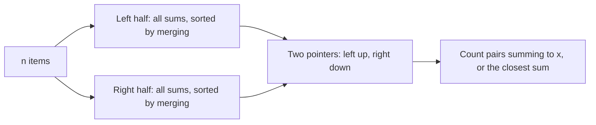

## The hook

Forty numbers, and the question: how many subsets add up to exactly x? Trying all 2⁴⁰ subsets is about 10¹² sums, hours of computing. A knapsack DP over sums does not help either when the numbers are up to 10⁹.

But 40 is not that big if you cut it in half. Twenty numbers have only about a million subsets. Enumerate the first twenty, enumerate the last twenty, and every subset of all forty is just one subset from each side. The whole trick is to combine the two lists without looking at every pair.

## The intuition

:::analogy
Two teams dig a tunnel through a mountain, one from each side. Neither team has to dig the whole length: each digs halfway, and they only need to make sure they meet. In the subset problem, one team lists every sum the first half can make, the other lists every sum the second half can make, and they meet wherever a left sum and a right sum add up to the target. Lining both lists up in order lets the teams find every meeting point in a single walk.
:::

The technique is [[meet in the middle]]; each team's output is a [[half list]]; and finding the meeting points is the [[combine step]].

## How it works

### Step 1: split and enumerate

Split the n items into a left half of size ⌊n/2⌋ and a right half. Every subset of all items is a left subset plus a right subset, and its sum is a left sum plus a right sum. Each half list has at most 2²⁰, about 10⁶, values for n = 40.

### Step 2: enumerate each half already sorted

Instead of generating the sums and then sorting, use [[merge generation]]: start with [0]; for each item, the current sorted list with the item added to every value is also sorted, so merge the two lists in linear time. The final list is sorted after 2 + 4 + ... + 2^(n/2) steps, O(2^(n/2)) with no logarithm.

### Step 3: combine

| Goal | Combine step | Cost |
|---|---|---|
| count subsets with sum exactly x | left ascending, right descending, two pointers over [[equal runs]] | O(\|L\| + \|R\|) |
| does any subset sum to x | hash set of right sums, or two pointers | O(\|L\| + \|R\|) |
| sum closest to a goal | two pointers, checking both neighbours | O(\|L\| + \|R\|) |
| best sum not above a limit | binary search in R for each l | O(\|L\| log \|R\|) |
| split into two equal-size groups | lists grouped by subset size, then two pointers per size | O(2^(n/2) · n) |

For counting, walk the left list upwards and the right list downwards. For each run of equal left values l, move the right pointer down past values with l + r > x, then measure the run of right values with l + r = x, and add the product of the two run lengths. Both pointers only move one way, so the pass is linear.

### When to reach for it

- n is around 30 to 45: too big for 2^n, small enough for 2^(n/2);
- the values are large, so DP over values is impossible;
- the choices are independent, so a full choice splits into two half choices whose effects combine simply, such as by adding.



:::insight
Meet in the middle trades time for memory: two lists of 2^(n/2) values replace 2^n combinations. The saving only survives if the two lists are combined in near-linear time, which is why sorted order, two pointers and hashing sit at the heart of every version.
:::

## Walk through an example

Items 3, 5, 2, 7, 4, 1 and target x = 10. Left half 3, 5, 2; right half 7, 4, 1.

**Merge generation for the left half.**

| After item | Old list | Shifted list | Merged |
|---|---|---|---|
| start | | | 0 |
| 3 | 0 | 3 | 0 3 |
| 5 | 0 3 | 5 8 | 0 3 5 8 |
| 2 | 0 3 5 8 | 2 5 7 10 | 0 2 3 5 5 7 8 10 |

The right half gives 0 1 4 5 7 8 11 12 the same way.

**Two-pointer counting.**

| Left run | Matching right values | Pairs |
|---|---|---|
| 0 | needs 10: none | 0 |
| 2 | needs 8: one | 1 |
| 3 | needs 7: one | 1 |
| 5, a run of two | needs 5: one | 2 |
| 7 | needs 3: none | 0 |
| 8 | needs 2: none | 0 |
| 10 | needs 0: one | 1 |

Total: 5 subsets with sum 10. For instance the run of two 5s is {5} and {3, 2} on the left, each paired with {4, 1} on the right: {5, 4, 1} and {3, 2, 4, 1}. A brute force over all 64 subsets agrees.

**Closest sum.** For items 4, −6, 9, −3 and goal 2, no subset sums to exactly 2, but 1 = 4 − 3 and 3 = −6 + 9 are both 1 away, so the answer is 1.

**Scale.** The program also runs n = 40 with values up to 10⁹: two lists of 2²⁰ sums each, generated and combined in well under a second, against 2⁴⁰ subsets for brute force.

:::try-this
With the same six items, how many subsets have sum 11? (Pair left and right sums adding to 11: left 0 with right 11, left 3 with 8, left 7 with 4, left 10 with 1. Left 2 needs 9, left 5 needs 6 and left 8 needs 3, none of which the right list has. That is 4 subsets, for example {3, 7, 1} and {5, 2, 4}.)
:::

:::warning
Common misconception: "After splitting, check every left sum against every right sum." That is 2^(n/2) × 2^(n/2) = 2^n pairs again: for n = 40, a trillion checks, exactly what the split was meant to avoid. The combine step must use order or hashing, so each value is touched a constant or logarithmic number of times.
:::

## The code

```pseudo
sortedSums(items): sums = [0]
    for x in items: sums = merge(sums, [s + x for s in sums])
count(x): L = sortedSums(left half); R = sortedSums(right half); j = |R| - 1
    for each run of equal values l in L:
        move j down while l + R[j] > x
        count the run of R[j] with l + R[j] == x; add (run in L) * (run in R)
closest(goal): j = |R| - 1; for l in L ascending:
    while j > 0 and l + R[j] > goal: check |l + R[j] - goal|; j -= 1
    check |l + R[j] - goal|
```

```cpp
#include <bits/stdc++.h>
using namespace std;
using ll = long long;

vector<ll> sortedSubsetSums(const vector<ll>& a, int from, int to) {   // all 2^(to-from) sums, sorted, by merging
    vector<ll> sums = {0};
    for (int i = from; i < to; i++) {                            // sums without a[i] (sorted) and with it (sorted)
        vector<ll> with(sums.size()), merged(2 * sums.size());
        for (size_t k = 0; k < sums.size(); k++) with[k] = sums[k] + a[i];
        merge(sums.begin(), sums.end(), with.begin(), with.end(), merged.begin());
        sums.swap(merged);
    }
    return sums;
}

ll countSubsetsWithSum(const vector<ll>& a, ll x) {              // CSES Meet in the Middle
    int n = a.size();
    auto L = sortedSubsetSums(a, 0, n / 2), R = sortedSubsetSums(a, n / 2, n);
    ll count = 0;
    int j = R.size() - 1;
    for (size_t i = 0; i < L.size();) {                          // L ascending, R walked descending
        size_t i2 = i;
        while (i2 < L.size() && L[i2] == L[i]) i2++;             // a run of equal left sums
        while (j >= 0 && L[i] + R[j] > x) j--;
        int j2 = j;
        while (j2 >= 0 && L[i] + R[j2] == x) j2--;               // a run of matching right sums
        count += (ll)(i2 - i) * (j - j2);
        i = i2;
    }
    return count;
}

ll closestSubsetSum(const vector<ll>& a, ll goal) {              // minimum |subset sum - goal|
    int n = a.size();
    auto L = sortedSubsetSums(a, 0, n / 2), R = sortedSubsetSums(a, n / 2, n);
    ll best = LLONG_MAX;
    int j = R.size() - 1;
    for (ll l : L) {                                             // two pointers: as l grows, the best r shrinks
        while (j > 0 && l + R[j] > goal) best = min(best, llabs(l + R[j] - goal)), j--;
        best = min(best, llabs(l + R[j] - goal));
    }
    return best;
}

int main() {
    vector<ll> a = {3, 5, 2, 7, 4, 1};
    for (ll s : sortedSubsetSums(a, 0, 3)) cout << s << ' ';
    cout << "| ";
    for (ll s : sortedSubsetSums(a, 3, 6)) cout << s << ' ';
    cout << '\n';                                                // 0 2 3 5 5 7 8 10 | 0 1 4 5 7 8 11 12
    cout << countSubsetsWithSum(a, 10) << ' ' << closestSubsetSum({4, -6, 9, -3}, 2) << '\n';   // 5 1

    mt19937 rng(30);                                             // against all 2^n subsets
    bool ok = true;
    for (int t = 0; t < 300; t++) {
        int n = rng() % 13;
        vector<ll> v(n);
        for (auto& x : v) x = (ll)(rng() % 21) - 5;
        ll x = (ll)(rng() % 31) - 5, cnt = 0, best = LLONG_MAX;
        for (int mask = 0; mask < (1 << n); mask++) {
            ll s = 0;
            for (int i = 0; i < n; i++) if (mask >> i & 1) s += v[i];
            cnt += s == x, best = min(best, llabs(s - x));
        }
        ok = ok && countSubsetsWithSum(v, x) == cnt && closestSubsetSum(v, x) == best;
    }
    vector<ll> big(40);                                          // n = 40: 2^40 subsets, but 2 * 2^20 sums
    for (auto& x : big) x = 1 + rng() % 1000000000;
    ll target = 0;
    for (int i = 0; i < 40; i += 2) target += big[i];            // a sum that certainly exists
    cout << (countSubsetsWithSum(big, target) >= 1) << ' ' << (ok ? "stress ok" : "stress FAILED") << '\n';   // 1 stress ok
}
```

The random test compares both routines with all 2ⁿ subsets for up to 12 items, with negative values allowed so that sums can repeat and runs of equal values appear.

## Complexity

- **Time: O(2^(n/2))** for merge generation and two-pointer combining; O(2^(n/2) · n) if the halves are sorted with std::sort instead.
- **Space: O(2^(n/2))**, two lists of about 10⁶ 64-bit values for n = 40, roughly 16 MB.
- **Hashing variant:** expected O(2^(n/2)), but vulnerable to anti-hash tests with std::unordered_map.

## Common mistakes

- **Pairing every left sum with every right sum,** which is 2^n again.
- **Counting runs wrongly:** equal values on both sides must multiply, not add.
- **Overflow:** sums of 40 values up to 10⁹ exceed 32 bits.
- **Sorting with comparisons when time is tight;** merge generation removes the log factor.
- **Unbalanced halves,** such as 30 and 10 items, which gives 2³⁰ on one side.
- **std::unordered_map with default hashing** on hacked tests; a sorted list or a custom hash is safer.

## Practice problems

*Meet in the Middle* is the exact count above, with n up to 40. *Closest Subsequence Sum* is the closest-sum variant. *Partition Array Into Two Arrays to Minimize Sum Difference* needs both groups to have the same size, so the half lists are grouped by how many items they use. *Maximum Subsequence* maximises a subset sum modulo m, combining each left value with the best right value below m minus it. Plain subset enumeration is in [Take It or Leave It: Generating Every Subset](article:dsa-subsets-permutations), and the small-n brute force that comes before all this is the Apple Division walkthrough in this track.

## Key takeaways

- Meet in the middle splits n independent choices into two halves of n/2, enumerates each half completely and combines the two lists.
- Every full choice is one choice from each half, so 2^n combinations become two lists of 2^(n/2) values.
- Building each half's sums by repeatedly merging a sorted list with its shifted copy gives sorted lists in linear time, with no extra log factor.
- Two pointers over the sorted lists count exact matches, multiplying runs of equal values, and find the closest sum in one pass.
- The combine step must stay near-linear, because pairing every left value with every right value would bring back the full 2^n cost.
