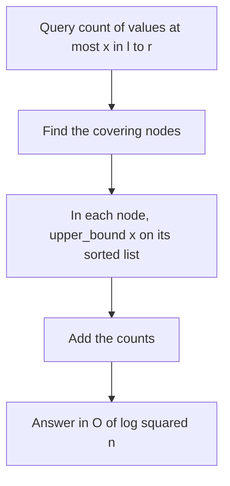

## The hook

A library keeps a sorted index-card box on every shelf, every bookcase and every room, each listing the books it holds by publication year. Asked "how many books in rooms 3 to 5 were published before 1990?", a librarian does not scan the books: they pick the few boxes that cover exactly those rooms and, in each box, flip straight to 1990 to read off a count.

That is a merge sort tree. It answers questions that plain segment trees cannot easily summarise, such as how many values in a range are at most x, by storing a sorted list in every node and binary searching it.

## The intuition

:::analogy
Each shelf has a small sorted card box, each bookcase a bigger box with the cards of all its shelves merged in order, and each room a box merging its bookcases. For any stretch of rooms, a few boxes cover it exactly, the way a segment tree covers a range. Because every box is sorted, counting the cards below a cut-off in a box is a quick jump, not a walk through the cards. Add up those few jumps and the question is answered.
:::

The library is a [[merge sort tree]]: a segment tree where node [l, r] stores a[l..r] sorted. Building it is merge sort: each node merges its two children's lists. The query that makes it useful is a [[range rank query]]: count the elements of a[l..r] that are at most x.

## How it works

### Build

Leaves hold one element. Each internal node merges its children's sorted lists with `std::merge`. Every element appears once per level, so the build takes O(n log n) time and memory.

### Counting values at most x

Decompose [l, r] into the usual O(log n) covering nodes. In each, upper_bound(x) on the sorted list gives how many elements are ≤ x. Add them: O(log n) nodes × O(log n) per binary search = O(log² n). Counting values > k, as in SPOJ *K-query*, is the covering size minus that.

### k-th smallest in a range

SPOJ *K-th Number* asks for the k-th smallest of a[l..r]. Binary search on the answer: the k-th smallest is the smallest value v such that at least k elements of a[l..r] are ≤ v. Each probe is a range rank query, so O(log n) probes over the sorted distinct values give O(log³ n) per query. A persistent segment tree, later in this track, does it in O(log n).

### Distinct values with next occurrences

CSES *Distinct Values Queries* asks how many distinct values a[l..r] contains. Build the [[next-occurrence array]]: next[i] is the next index with the same value, or n. In any range, each distinct value has exactly one occurrence whose next copy lies outside the range: its last one. So the answer is the number of i in [l, r] with next[i] > r, a range rank query on next. (The offline Fenwick sweep in its own walkthrough is faster, but this method answers queries online.)

| Query on a[l..r] | Stored per node | Per query |
|---|---|---|
| How many ≤ x | sorted values | O(log² n) |
| How many > k | sorted values | O(log² n) |
| k-th smallest | sorted values, plus binary search on the answer | O(log³ n) |
| How many distinct | sorted next-occurrence values | O(log² n) |

### Limits

A merge sort tree is a [[static structure]]: changing one element would mean editing a sorted list in each of log n nodes, O(n) in the worst case. Memory is O(n log n): for n = 2 × 10⁵, about 18 levels × 2 × 10⁵ integers, around 14 MB, usually fine.



:::insight
When a node cannot summarise its segment in one number, it can keep the whole segment sorted. Merge sort builds every such list in O(n log n), and binary search in each covering node turns order questions about any range into a sum of a few lookups.
:::

## Walk through an example

a = [5, 1, 4, 2, 3, 8, 6, 7], indices 0 to 7.

| Level | Nodes and their sorted lists |
|---|---|
| root | [0, 7]: 1 2 3 4 5 6 7 8 |
| 1 | [0, 3]: 1 2 4 5, [4, 7]: 3 6 7 8 |
| 2 | [0, 1]: 1 5, [2, 3]: 2 4, [4, 5]: 3 8, [6, 7]: 6 7 |
| leaves | 5, 1, 4, 2, 3, 8, 6, 7 |

### How many values ≤ 4 in a[2..6]?

The covering nodes are [2, 3], [4, 5] and [6, 6].

| Node | Sorted list | Count ≤ 4 |
|---|---|---|
| [2, 3] | 2, 4 | 2 |
| [4, 5] | 3, 8 | 1 |
| [6, 6] | 6 | 0 |

Total 3: the values 4, 2 and 3. Directly, a[2..6] = 4, 2, 3, 8, 6.

### Distinct values in b = [3, 1, 3, 2, 1, 3]

next = [2, 4, 5, 6, 6, 6], with 6 meaning "no later copy". For [1, 4] (values 1, 3, 2, 1), count i in 1..4 with next[i] > 4: next[1] = 4 is not, next[2] = 5, next[3] = 6 and next[4] = 6 are. Three distinct values: 3, 2 and 1, each counted at its last occurrence.

:::try-this
What is the 3rd smallest value in a[1..5] = 1, 4, 2, 3, 8, and how does binary search on the answer find it? (Sorted, the range is 1, 2, 3, 4, 8, so the answer is 3. The binary search over candidate values asks "how many ≤ v?": for v = 2 the count is 2, fewer than 3; for v = 3 it is 3, enough. The smallest such v is 3.)
:::

:::warning
Common misconception: "A merge sort tree supports updates like any segment tree." Each node's sorted list would need an insertion and a deletion, which costs O(segment length) in a vector. With updates, use an ordered set per node, a Fenwick tree of ordered sets, or answer the queries offline; the plain merge sort tree is for static arrays.
:::

## The code

```pseudo
build(v, l, r):
    if l == r: list[v] = [a[l]]; return
    build children; list[v] = merge(list[2v], list[2v + 1])

count_le(v, l, r, ql, qr, x):
    if outside: return 0
    if inside: return upper_bound(list[v], x)
    return count_le(left half) + count_le(right half)
```

```cpp
#include <bits/stdc++.h>
using namespace std;

struct MergeSortTree {
    int n;
    vector<vector<int>> t;
    explicit MergeSortTree(const vector<int>& a) : n(a.size()), t(4 * a.size()) { build(1, 0, n - 1, a); }
    void build(int v, int l, int r, const vector<int>& a) {
        if (l == r) { t[v] = {a[l]}; return; }
        int m = (l + r) / 2;
        build(2 * v, l, m, a), build(2 * v + 1, m + 1, r, a);
        merge(t[2 * v].begin(), t[2 * v].end(), t[2 * v + 1].begin(), t[2 * v + 1].end(), back_inserter(t[v]));
    }
    int countLE(int v, int l, int r, int ql, int qr, int x) const {
        if (qr < l || r < ql) return 0;
        if (ql <= l && r <= qr) return upper_bound(t[v].begin(), t[v].end(), x) - t[v].begin();
        int m = (l + r) / 2;
        return countLE(2 * v, l, m, ql, qr, x) + countLE(2 * v + 1, m + 1, r, ql, qr, x);
    }
    int countLE(int l, int r, int x) const { return countLE(1, 0, n - 1, l, r, x); }
    int kth(int l, int r, int k) const {                      // k-th smallest, by binary search on value
        const vector<int>& all = t[1];
        int lo = 0, hi = all.size() - 1;
        while (lo < hi) {
            int mid = (lo + hi) / 2;
            if (countLE(l, r, all[mid]) >= k) hi = mid; else lo = mid + 1;
        }
        return all[lo];
    }
};

int distinctIn(const MergeSortTree& nextTree, int l, int r) {
    int len = r - l + 1;
    return len - nextTree.countLE(l, r, r);                  // positions with next[i] > r
}

int main() {
    MergeSortTree mt({5, 1, 4, 2, 3, 8, 6, 7});
    cout << mt.countLE(2, 6, 4) << ' ' << mt.countLE(0, 7, 5) << ' ' << mt.kth(1, 5, 3) << '\n';   // 3 5 3
    vector<int> b = {3, 1, 3, 2, 1, 3}, nxt(b.size());
    map<int, int> last;
    for (int i = b.size() - 1; i >= 0; i--) {
        nxt[i] = last.count(b[i]) ? last[b[i]] : (int)b.size();
        last[b[i]] = i;
    }
    MergeSortTree nt(nxt);
    cout << distinctIn(nt, 1, 4) << ' ' << distinctIn(nt, 0, 5) << ' ' << distinctIn(nt, 2, 2) << '\n';   // 3 3 1
}
```

## Complexity

- **Build: O(n log n) time and memory.**
- **Count ≤ x, count > k, distinct values: O(log² n)** per query.
- **k-th smallest: O(log³ n)** with binary search on the value; faster structures exist.
- **Updates: not supported** in this form.

## Common mistakes

- **Allocating per-node vectors without reserving,** which is slower but still correct; `merge` into a reserved vector helps.
- **Using lower_bound for "≤ x"** instead of upper_bound, which drops equal values.
- **Forgetting the O(n log n) memory,** which can exceed limits for n = 10⁶.
- **Binary searching k-th smallest over raw integers** instead of the sorted list of actual values, which works but takes more steps.
- **Expecting updates to be cheap.**

## Practice problems

SPOJ *K-query* counts values greater than k in ranges. SPOJ *K-th Number* is the k-th smallest in a range. CSES *Distinct Values Queries* works with the next-occurrence trick shown above, and also has an offline solution with a Fenwick tree. The segment tree basics are in [A Tournament Bracket for Your Array](article:cp-segment-tree).

## Key takeaways

- A merge sort tree is a segment tree whose nodes store their segment's elements in sorted order, built by merging children like merge sort.
- Counting values at most x in a range sums an upper_bound in each of O(log n) covering nodes, for O(log² n) per query.
- The k-th smallest in a range follows by binary searching on the value with that count.
- Distinct values in a range equal the positions whose next equal value lies beyond the range, another counting query.
- The structure uses O(n log n) memory and does not support cheap updates.
