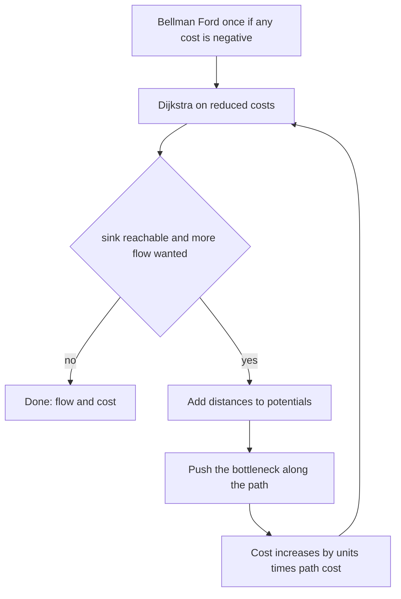

## The hook

A warehouse must send a fixed number of crates to a store. Every road has a limit on how many crates it can carry, and a price per crate. Maximum flow from [Water Pipes From a Reservoir to a City](article:cp-max-flow) tells you how many crates can get through; now you also want the cheapest way to send exactly the number you need.

The same model assigns workers to tasks at least total cost, picks k cheapest flight routes that never share a flight, and solves many scheduling problems that look nothing like graphs. The algorithm is a small change to max flow: search for the cheapest augmenting path instead of any path.

## The intuition

:::analogy
A shipping clerk sends crates one batch at a time, each batch along the currently cheapest route with spare room. Sometimes the cheapest new route involves taking back crates that an earlier batch sent along some road and sending them a different way: the earlier road's fee is refunded, and the batches swap their tails. As long as each batch takes the cheapest route available, including refunds, the total bill for any number of crates shipped so far is the lowest possible.
:::

The bill is a [[minimum cost flow]]. The refund is the [[residual cost]] of a reverse edge, and "each batch along the cheapest route" is [[successive shortest paths]].

## How it works

### Costs on the residual graph

Each edge u → v with capacity c and cost w gets a twin v → u with capacity 0 and cost −w. Pushing x units along an edge lowers its capacity by x and raises the twin's by x, exactly as in max flow; the cost of the push is x times the edge's cost, and pushing along a twin refunds.

### Successive shortest paths

```
flow = 0, cost = 0
while flow < required and a residual path from s to t exists:
    P = cheapest residual path from s to t
    x = min(bottleneck of P, required - flow)
    push x along P; flow += x; cost += x * cost(P)
```

**Why it is optimal.** A flow is the cheapest among all flows of its value exactly when its residual graph has no negative-cost cycle: such a cycle would be a way to reroute some units more cheaply. The empty flow has none if the original graph has none, and augmenting along a cheapest path never creates one. So after every step, the flow sent so far is optimal for its value.

### Potentials: Dijkstra despite negative edges

Reverse edges have negative costs, so plain Dijkstra is not safe. Bellman–Ford is, but O(V·E) per augmentation is slow. The fix uses a [[potential]] per vertex and searches on [[reduced cost]]s:

- reduced(u, v) = cost(u, v) + pot[u] − pot[v];
- along any path from s to t, the potentials cancel except at the ends, so every path's cost changes by the same pot[s] − pot[t], and the cheapest path stays the cheapest;
- if pot[v] is the shortest distance from s, every residual edge has reduced(u, v) ≥ 0, by the triangle inequality.

After an augmentation, set pot[v] += d[v], where d is the Dijkstra distance in reduced costs. Edges on the path used had reduced cost 0, so their new reverse twins also have reduced cost 0, and every other edge stays non-negative. Dijkstra therefore works in every round. Only the very first round needs Bellman–Ford, and only if the original costs can be negative.

| Situation | First round | Later rounds |
|---|---|---|
| all costs non-negative | Dijkstra with zero potentials | Dijkstra with potentials |
| some negative costs, no negative cycle | Bellman–Ford for potentials | Dijkstra with potentials |
| negative cycles in the input | not handled by this method | needs cycle cancelling first |

### Modelling

- **[[Assignment problem]], CSES *Task Assignment*.** Source to each worker with capacity 1 and cost 0; worker i to task j with capacity 1 and cost c[i][j]; each task to the sink with capacity 1 and cost 0. Send n units. The edges worker → task that end up saturated are the assignment.
- **k cheapest disjoint routes, CSES *Distinct Routes II*.** Every flight is an edge with capacity 1 and its price as cost. Send k units from 1 to n; if fewer than k units fit, the answer is impossible. Peel the routes off by following saturated flights from the source.
- **Maximum profit:** negate profits to costs, and stop augmenting when the next cheapest path has positive cost, if sending fewer units is allowed.



:::insight
Successive shortest paths is greedy, and reverse edges with refunded costs are what make the greed safe. Potentials then turn the negative refund edges into non-negative reduced costs, so each greedy step is a plain Dijkstra.
:::

## Walk through an example

### Assigning three workers to three tasks

Cost matrix, rows are workers and columns tasks:

| | Task 0 | Task 1 | Task 2 |
|---|---|---|---|
| Worker 0 | 4 | 1 | 3 |
| Worker 1 | 2 | 0 | 5 |
| Worker 2 | 3 | 2 | 2 |

A greedy clerk takes the cheapest cell, worker 1 on task 1 for 0, then worker 0's best remaining task, task 2 for 3, leaving worker 2 on task 0 for 3: total 6.

Successive shortest paths:

| Round | Cheapest residual path | Path cost | Effect |
|---|---|---|---|
| 1 | source → worker 1 → task 1 → sink | 0 | worker 1 takes task 1 |
| 2 | source → worker 2 → task 2 → sink | 2 | worker 2 takes task 2 |
| 3 | source → worker 0 → task 1 → back to worker 1 → task 0 → sink | 1 − 0 + 2 = 3 | worker 0 takes task 1, worker 1 moves to task 0 |

Total 0 + 2 + 3 = 5: worker 0 on task 1, worker 1 on task 0, worker 2 on task 2, costing 1 + 2 + 2. Round 3 is the refund in action: the path walks backwards along worker 1 → task 1, cancelling that assignment at a refund of 0, and sends worker 1 to task 0 instead. Checking all 6 permutations confirms 5 is the minimum.

### Two disjoint cheapest routes

Flights 0 → 1 (1), 0 → 2 (2), 1 → 3 (2), 2 → 3 (1), 1 → 2 (0), each usable once, and two routes from 0 to 3 are needed.

| Round | Cheapest residual path | Cost |
|---|---|---|
| 1 | 0 → 1 → 2 → 3 | 1 + 0 + 1 = 2 |
| 2 | 0 → 2, back along 1 → 2 to 1, then 1 → 3 | 2 − 0 + 2 = 4 |

Total 6. The flight 1 → 2 was used in round 1 and cancelled in round 2, so the final routes are 0 → 1 → 3 and 0 → 2 → 3, each costing 3.

:::try-this
In the assignment example, change worker 2's cost for task 2 from 2 to 9. What is the new minimum? (The old optimum now costs 1 + 2 + 9 = 12. Of the six permutations the cheapest is worker 0 on task 2, worker 1 on task 1 and worker 2 on task 0, costing 3 + 0 + 3 = 6. This time the greedy clerk happens to be right, which is exactly why greedy is dangerous: it is right often enough to be trusted.)
:::

:::warning
Common misconception: "Run Dijkstra on the residual graph as it is; the negative costs are only on reverse edges, so they rarely matter." They matter exactly when rerouting is needed, as in round 3 above, and plain Dijkstra can then finalise a vertex too early and return a wrong total. Either use potentials, as here, or use Bellman–Ford in every round.
:::

## The code

```pseudo
addEdge(a, b, cap, cost): forward (cap, cost), twin (0, -cost)
run(s, t, want):
    pot = Bellman-Ford distances from s (handles negative input costs)
    while flow < want:
        Dijkstra from s with edge weight cost + pot[u] - pot[v] over edges with cap > 0
        if t unreachable: stop
        pot[v] += d[v] for reachable v
        x = min(bottleneck, want - flow); push x; cost += x * (pot[t] - pot[s])
```

```cpp
#include <bits/stdc++.h>
using namespace std;
using ll = long long;
const ll INF = LLONG_MAX / 4;

struct MinCostFlow {                                             // successive shortest paths, Dijkstra on reduced costs
    struct Edge { int to; ll cap, cost; };
    vector<Edge> e;                                              // edges 2i and 2i+1 are twins; twin cost is negated
    vector<vector<int>> g;
    vector<ll> pot;                                              // potentials: reduced costs stay non-negative
    MinCostFlow(int n) : g(n), pot(n, 0) {}
    int addEdge(int a, int b, ll cap, ll cost) {
        g[a].push_back(e.size()), e.push_back({b, cap, cost});
        g[b].push_back(e.size()), e.push_back({a, 0, -cost});
        return e.size() - 2;
    }
    void bellmanFord(int s) {                                    // initial potentials, allowing negative costs
        int n = g.size();
        vector<ll> d(n, INF);
        d[s] = 0;
        for (int round = 0; round < n; round++)
            for (int u = 0; u < n; u++) if (d[u] < INF)
                for (int id : g[u]) if (e[id].cap > 0 && d[u] + e[id].cost < d[e[id].to]) d[e[id].to] = d[u] + e[id].cost;
        for (int v = 0; v < n; v++) pot[v] = d[v] < INF ? d[v] : 0;
    }
    pair<ll, ll> run(int s, int t, ll want) {                    // (flow, cost), sending at most `want`
        int n = g.size();
        bellmanFord(s);
        ll flow = 0, cost = 0;
        while (flow < want) {
            vector<ll> d(n, INF);
            vector<int> via(n, -1);
            priority_queue<pair<ll, int>, vector<pair<ll, int>>, greater<>> pq;
            d[s] = 0, pq.push({0, s});
            while (!pq.empty()) {
                auto [du, u] = pq.top(); pq.pop();
                if (du > d[u]) continue;
                for (int id : g[u]) {
                    if (e[id].cap == 0) continue;
                    int v = e[id].to;
                    ll nd = du + e[id].cost + pot[u] - pot[v];       // reduced cost, never negative
                    if (nd < d[v]) d[v] = nd, via[v] = id, pq.push({nd, v});
                }
            }
            if (d[t] == INF) break;                              // no more augmenting paths
            for (int v = 0; v < n; v++) if (d[v] < INF) pot[v] += d[v];
            ll push = want - flow;
            for (int v = t; v != s; v = e[via[v] ^ 1].to) push = min(push, e[via[v]].cap);
            for (int v = t; v != s; v = e[via[v] ^ 1].to) e[via[v]].cap -= push, e[via[v] ^ 1].cap += push;
            ll pathCost = pot[t] - pot[s];                       // true cost of this shortest path
            flow += push, cost += push * pathCost;
        }
        return {flow, cost};
    }
};

vector<vector<int>> routes(MinCostFlow& f, const vector<int>& ids, const vector<array<ll, 3>>& E, int s, int t) {
    map<int, vector<int>> used;                                  // vertex -> heads of its used flights
    for (int i = 0; i < (int)ids.size(); i++) if (f.e[ids[i]].cap == 0) used[E[i][0]].push_back(E[i][1]);
    vector<vector<int>> out;
    while (!used[s].empty()) {                                   // peel off one route per unit of flow
        vector<int> r = {s};
        while (r.back() != t) { int u = r.back(); r.push_back(used[u].back()); used[u].pop_back(); }
        out.push_back(r);
    }
    return out;
}

int main() {
    vector<vector<ll>> c = {{4, 1, 3}, {2, 0, 5}, {3, 2, 2}};    // Task Assignment: c[worker][task]
    int n = 3, S = 2 * n, T = 2 * n + 1;
    MinCostFlow f(2 * n + 2);
    vector<vector<int>> id(n, vector<int>(n));
    for (int i = 0; i < n; i++) f.addEdge(S, i, 1, 0), f.addEdge(n + i, T, 1, 0);
    for (int i = 0; i < n; i++) for (int j = 0; j < n; j++) id[i][j] = f.addEdge(i, n + j, 1, c[i][j]);
    auto [fl, co] = f.run(S, T, n);
    cout << fl << ' ' << co << ':';
    for (int i = 0; i < n; i++) for (int j = 0; j < n; j++) if (f.e[id[i][j]].cap == 0) cout << ' ' << i << "->" << j;
    cout << '\n';                                                // 3 5: 0->1 1->0 2->2

    vector<array<ll, 3>> E = {{0, 1, 1}, {0, 2, 2}, {1, 3, 2}, {2, 3, 1}, {1, 2, 0}};   // Distinct Routes II style
    MinCostFlow h(4);
    vector<int> ids;
    for (auto [a, b, w] : E) ids.push_back(h.addEdge(a, b, 1, w));
    auto [k, total] = h.run(0, 3, 2);
    cout << k << ' ' << total << ':';
    for (auto& r : routes(h, ids, E, 0, 3)) { cout << ' '; for (int v : r) cout << v; }
    cout << '\n';                                                // 2 6: 023 013

    mt19937 rng(18);                                             // assignment against all permutations
    bool ok = true;
    for (int t = 0; t < 300; t++) {
        int m = 1 + rng() % 5;
        vector<vector<ll>> w(m, vector<ll>(m));
        for (auto& row : w) for (auto& x : row) x = (ll)(rng() % 21) - 5;   // negative costs are allowed
        MinCostFlow F(2 * m + 2);
        for (int i = 0; i < m; i++) F.addEdge(2 * m, i, 1, 0), F.addEdge(m + i, 2 * m + 1, 1, 0);
        for (int i = 0; i < m; i++) for (int j = 0; j < m; j++) F.addEdge(i, m + j, 1, w[i][j]);
        ll got = F.run(2 * m, 2 * m + 1, m).second, best = INF;
        vector<int> p(m);
        iota(p.begin(), p.end(), 0);
        do {
            ll s = 0;
            for (int i = 0; i < m; i++) s += w[i][p[i]];
            best = min(best, s);
        } while (next_permutation(p.begin(), p.end()));
        ok = ok && got == best;
    }
    cout << (ok ? "stress ok" : "stress FAILED") << '\n';        // stress ok
}
```

The random test solves 300 assignment problems of up to 5 workers, with costs from −5 to 15, and compares against trying every permutation. Negative costs exercise the Bellman–Ford start; the network has no cycles, so no negative cycle can exist. For *Task Assignment*, print the cost and then each saturated worker → task edge, 1-indexed.

## Complexity

- **Time: O(F·(V + E) log V)** for F units of flow, plus one O(V·E) Bellman–Ford when costs can be negative. For the assignment problem F = n, giving O(n³ log n) on the dense network.
- **Space: O(V + E).**
- The Hungarian algorithm solves the assignment problem in O(n³) directly; the flow version is easier to adapt to extra constraints.

## Common mistakes

- **Reverse edges with cost +w** instead of −w.
- **Plain Dijkstra without potentials** on the residual graph.
- **Forgetting the initial Bellman–Ford** when input costs are negative.
- **Updating potentials of unreachable vertices** with an infinite distance; skip them.
- **Computing the path cost from reduced costs** without converting back: the true cost is pot[t] − pot[s] after the update.
- **Negative cycles in the input,** which successive shortest paths does not handle.
- **Overflow:** cost totals can be units times path cost; use long long.

## Practice problems

*Task Assignment* is the bipartite network above. *Distinct Routes II* is k units of flow with unit capacities and route extraction. *Binary Tree on Plane* connects points into a binary tree whose edges always point downwards, at least total length: every point offers two child slots and needs one parent, which is a minimum cost flow with real-valued costs. The matching version without costs is in [Pairing Dancers Who Agreed to Dance Together](article:cp-bipartite-matching).

## Key takeaways

- Minimum cost flow sends a required amount of flow while minimising the sum of flow times cost per unit over all edges.
- Successive shortest paths augments along the cheapest residual path each time, and reverse edges with negated costs let later paths reroute earlier ones for a refund.
- After every augmentation the residual graph has no negative cycle, which is exactly the condition for the flow sent so far to be the cheapest for its value.
- Potentials equal to previous shortest distances make every reduced cost non-negative, so each round is a Dijkstra, with Bellman–Ford needed only once for negative input costs.
- Assignment problems and k disjoint cheapest routes are unit-capacity networks solved by the same code.
