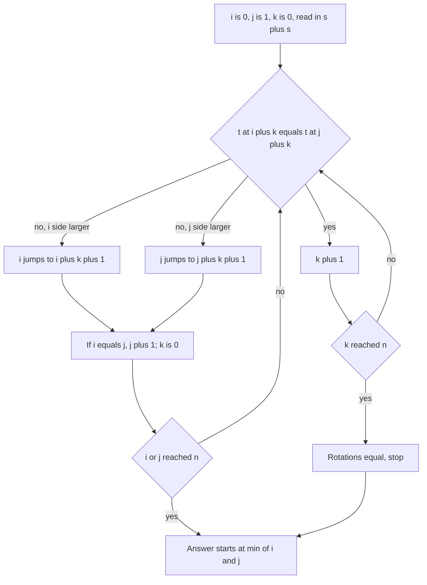

## The hook

A [[necklace]] of lettered beads has no beginning: you can start reading it anywhere. To file necklaces in a catalogue, you agree to read each one from the start that gives the alphabetically smallest string. That reading is the minimal rotation, and it answers "are these two strings rotations of each other?" by comparing their canonical forms.

CSES *Minimal Rotation* asks for it on a string of a million letters. Comparing every rotation with every other is quadratic, so the question is how to avoid most comparisons. Hashing, as in [A Fingerprint for Every Substring](article:cp-string-hashing), gets to O(n log n); a short two-pointer argument gets to O(n).

## The problem

Given a string s of n lowercase letters, with n up to 10⁶, print its lexicographically smallest [[rotation]]. A rotation moves some number of letters from the front to the back.

For s = "bcabcaba", the rotations include "cabcabab", "abcababc" and "ababcabc"; the smallest is "ababcabc", starting at index 5.

## The obvious approach

Build each of the n rotations and keep the smallest. Each comparison can take O(n) letters, so the total is O(n²): fine for a few thousand letters, but about 10¹² letter comparisons in the worst case at n = 10⁶, for example on a string of all a's except one b, where every comparison runs long.

Two easy improvements leave the problem quadratic: avoid building rotations by reading them from the [[doubled string]] t = s + s, and stop each comparison at the first difference. On repetitive strings the first difference can still be far away.

## The key insight

:::analogy
Picture two people each holding a finger on a different bead of the necklace, both claiming theirs is the best starting point. They read forward together, bead by bead, while the beads agree. At the first disagreement, the one who reads the larger letter loses, and not only their starting bead: every bead they read along the way would also lose, because starting there would just replay the same comparison a little later, against the matching bead on the winner's side. So the loser jumps past everything they read and picks a fresh start, while the winner stays put.
:::

The two fingers are the [[candidate start]]s i and j, and the jump is the [[block discard]].

### The two-pointer method

Keep i = 0, j = 1 and a matched length k = 0, all reading in t = s + s:

- if t[i + k] = t[j + k], increase k;
- if t[i + k] > t[j + k], every start from i to i + k loses, so set i = i + k + 1;
- if t[i + k] < t[j + k], symmetrically set j = j + k + 1;
- if i and j become equal, move j forward by one; reset k = 0 after any jump.

Stop when i or j reaches n, or when k reaches n, which means the two rotations are identical, as in periodic strings. The answer starts at min(i, j).

**Why the discard is safe.** Suppose t[i..i + k) = t[j..j + k) and t[i + k] > t[j + k]. For any d from 0 to k, the rotation at i + d agrees with the rotation at j + d for k − d letters and then shows t[i + k] against t[j + k], the larger letter. So it is beaten by the rotation at j + d. The best rotation is therefore never discarded.

**Why it is linear.** Each mismatch moves i or j forward by k + 1, paying for the k matched comparisons plus one. Both i and j stay below n, so the total work is at most about 3n comparisons.

### The hashing method

Fix the best start found so far. For each new start i, binary search the longest common prefix of the rotations at best and at i, comparing substring hashes of t in O(1); the first letter after the prefix decides which is smaller. That is O(n log n), easy to write if you already have a hashing template, but probabilistic.

| Method | Time | Exact | Notes |
|---|---|---|---|
| build and compare every rotation | O(n²) | yes | fine for small n only |
| hashing plus binary search on LCP | O(n log n) | with high probability | reuses a hashing template |
| two pointers | O(n) | yes | a dozen lines |
| Booth's algorithm or the Lyndon factorisation | O(n) | yes | heavier machinery for the same answer |



:::insight
A single mismatch after k equal letters does not just decide between two starts: it rules out k + 1 starts at once on the losing side. That block discard is what turns n pairwise comparisons into one linear sweep.
:::

## Walk through an example

s = "bcabcaba", n = 8, t = "bcabcababcabcaba".

| Step | i | j | Equal letters k | Mismatch | Jump |
|---|---|---|---|---|---|
| 1 | 0 | 1 | 0 | b vs c, j side larger | j = 2 |
| 2 | 0 | 2 | 0 | b vs a, i side larger | i = 1 |
| 3 | 1 | 2 | 0 | c vs a, i side larger | i = 2, equal to j, so j = 3 |
| 4 | 2 | 3 | 0 | a vs b | j = 4 |
| 5 | 2 | 4 | 0 | a vs c | j = 5 |
| 6 | 2 | 5 | 2: "ab" | c vs a, i side larger | i = 2 + 3 = 5, equal to j, so j = 6 |
| 7 | 5 | 6 | 0 | a vs b | j = 7 |
| 8 | 5 | 7 | 2: "ab" | a vs c | j = 7 + 3 = 10, past n: stop |

The answer starts at min(5, 10) = 5: "ababcabc". Step 6 is the block discard in action: starts 2, 3 and 4 all fall at once, because the rotations at 2 and 5 agreed on "ab" and then 2 showed the larger letter.

**Periodic strings.** For "abab", the rotations at 0 and 2 are identical, k reaches n, and the loop stops with the answer "abab". For "aaaa" every rotation is the same string.

**A long test.** The program also builds a million letters, a with a b at every seventh position. Because 10⁶ is not a multiple of 7, the string's end and start join into a run of seven a's, and the minimal rotation starts there: "aaaaaaab...".

:::try-this
Run the method by hand on "cabacabd". (Step 1: c vs a, so i = 1. Step 2: a vs b at i = 1, j = 2, so j = 3. Step 3: i = 1, j = 3 agree on "a" and then b vs c, so j = 5. Step 4: i = 1, j = 5 agree on "ab" and then a vs d, so j = 8, past n. The answer starts at 1: "abacabdc".)
:::

:::warning
Common misconception: "Just pick the position of the smallest letter." Several positions can hold the smallest letter, and the tie is decided by what follows, possibly many letters later. In "bcabcaba" the letter a appears at 2, 5 and 7, and only 5 starts the minimal rotation; picking the first one gives "abcababc", which is larger.
:::

## The code

```pseudo
twoPointers(s): t = s + s; i = 0; j = 1; k = 0
    while i < n and j < n and k < n:
        if t[i+k] == t[j+k]: k += 1; continue
        if t[i+k] > t[j+k]: i += k + 1 else: j += k + 1
        if i == j: j += 1
        k = 0
    return t.substr(min(i, j), n)
```

```cpp
#include <bits/stdc++.h>
using namespace std;
using ull = unsigned long long;

string byBruteForce(const string& s) {                           // O(n^2): build and compare every rotation
    string best = s;
    for (int i = 1; i < (int)s.size(); i++) best = min(best, s.substr(i) + s.substr(0, i));
    return best;
}

string byHashing(const string& s) {                              // O(n log n): compare rotations by LCP via hashes
    int n = s.size();
    string t = s + s;
    const ull B = 1000003;
    vector<ull> h(2 * n + 1, 0), pw(2 * n + 1, 1);
    for (int i = 0; i < 2 * n; i++) h[i + 1] = h[i] * B + t[i], pw[i + 1] = pw[i] * B;
    auto get = [&](int l, int len) { return h[l + len] - h[l] * pw[len]; };
    int best = 0;
    for (int i = 1; i < n; i++) {
        int lo = 0, hi = n;                                      // longest common prefix of rotations best and i
        while (lo < hi) {
            int mid = (lo + hi + 1) / 2;
            if (get(best, mid) == get(i, mid)) lo = mid; else hi = mid - 1;
        }
        if (lo < n && t[i + lo] < t[best + lo]) best = i;        // first difference decides
    }
    return t.substr(best, n);
}

string byTwoPointers(const string& s) {                          // O(n): discard whole blocks of losing starts
    int n = s.size(), i = 0, j = 1, k = 0;
    string t = s + s;
    while (i < n && j < n && k < n) {
        char a = t[i + k], b = t[j + k];
        if (a == b) { k++; continue; }
        if (a > b) i += k + 1;                                   // starts i..i+k all lose to j..j+k
        else j += k + 1;                                         // starts j..j+k all lose to i..i+k
        if (i == j) j++;
        k = 0;
    }
    return t.substr(min(i, j), n);
}

int main() {
    string s = "bcabcaba";
    cout << byBruteForce(s) << ' ' << byHashing(s) << ' ' << byTwoPointers(s) << '\n';   // ababcabc ababcabc ababcabc
    cout << byTwoPointers("aaaa") << ' ' << byTwoPointers("abab") << '\n';                // aaaa abab

    mt19937 rng(29);                                             // all three must agree exactly
    bool ok = true;
    for (int t = 0; t < 1000; t++) {
        int n = 1 + rng() % 25;
        string x;
        for (int i = 0; i < n; i++) x += char('a' + rng() % 2);
        string a = byBruteForce(x);
        ok = ok && byHashing(x) == a && byTwoPointers(x) == a;
    }
    string big;
    for (int i = 0; i < 1000000; i++) big += char('a' + (i % 7 == 3));   // periodic, many ties
    cout << byTwoPointers(big).substr(0, 8) << ' ' << (ok ? "stress ok" : "stress FAILED") << '\n';   // aaaaaaab stress ok
}
```

The random test checks all three methods against each other on 1000 random binary strings, where long runs of ties are common.

## Complexity

- **Two pointers: O(n)** time, O(n) for the doubled string.
- **Hashing: O(n log n)** time, O(n) memory.
- **Brute force: O(n²)** comparisons.

## Common mistakes

- **Choosing the first occurrence of the smallest letter,** which ignores ties.
- **Moving the loser by one** instead of by k + 1, which makes the method quadratic again.
- **Forgetting the i = j case,** which makes both pointers compare a start with itself forever.
- **Not stopping when k reaches n** on periodic strings.
- **Building every rotation as a new string** instead of reading from s + s.
- **Returning max(i, j)** instead of min(i, j).

## Practice problems

*Minimal Rotation* is this walkthrough. *Orderly Queue* allows moving one of the first k letters to the end; for k = 1 the reachable strings are exactly the rotations, so the answer is the minimal rotation, and for larger k it is the sorted string. *Rotate String* asks whether one string is a rotation of another, which comparing minimal rotations answers, as does a search in s + s with [A Reader Who Never Rereads the Page](article:cp-prefix-function).

## Key takeaways

- Every rotation of s is a substring of s + s, so rotations can be compared without building them.
- Comparing every rotation is quadratic, while hashing with a binary search for the common prefix brings each comparison to O(log n).
- The two-pointer method keeps two candidate starts and, after k equal letters and a mismatch, discards the loser together with all k starts it read.
- Each discard moves a pointer forward by k + 1, so the total work is linear and the method is exact.
- The minimal rotation is a canonical form for necklaces, so two strings are rotations of each other exactly when their minimal rotations match.
