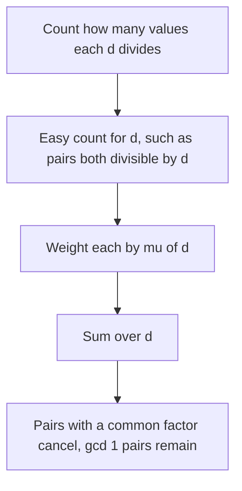

## The hook

How many pairs of numbers in a list share no common factor? Checking every pair with gcd is O(n²), and with 10⁵ numbers that is 5 × 10⁹ gcd calls. Counting the opposite is tempting: pairs both even, pairs both multiples of 3, and so on, but pairs that are both multiples of 6 got subtracted twice, and fixing that by hand becomes inclusion-exclusion over every combination of primes.

The Möbius function does that bookkeeping for you. One number per d, computed by a sieve, tells you exactly how much the pairs sharing d should be added or subtracted, so the whole inclusion-exclusion collapses into one sum.

## The intuition

:::analogy
Picture an accountant correcting overlapping tallies. First count every pair. Then, for each prime p, subtract the pairs that are both multiples of p. Pairs that are both multiples of two primes, like 6, have now been subtracted twice, so add them back once; pairs divisible by three primes were subtracted three times and added back three times, so subtract them once more. Instead of tracking this by hand, the accountant has a stamp for every number d saying "+1", "-1" or "ignore", and the stamps are designed so that every pair with a common factor ends up counted exactly zero times.
:::

The stamp is the [[Möbius function]] μ(d):

| d | Factorisation | μ(d) |
|---|---|---|
| 1 | | 1 |
| prime p | p | -1 |
| product of 2 distinct primes, such as 6 | 2 × 3 | 1 |
| product of 3 distinct primes, such as 30 | 2 × 3 × 5 | -1 |
| any multiple of a square, such as 4 or 12 | contains p² | 0 |

Only [[square-free]] numbers get nonzero stamps, because inclusion-exclusion only ever needs products of distinct primes. The design guarantee is the [[divisor-sum identity]]:

Σ over d dividing n of μ(d) = 1 if n = 1, and 0 otherwise.

For n = 12, the divisors 1, 2, 3, 4, 6, 12 have μ values 1, -1, -1, 0, 1, 0, which sum to 0.

## How it works

### Computing μ with a sieve

A linear sieve, an extension of the one in [Washing Away Every Multiple](article:cp-sieve), computes μ for every number up to M in O(M). An even shorter O(M log M) method uses the divisor-sum identity directly: start with μ(1) = 1 and every other value 0, then for each i, subtract μ(i) from every multiple 2i, 3i, ...; each number's divisor sum is then forced to 0.

### Counting coprime pairs in an array

CSES *Counting Coprime Pairs*: n numbers up to 10⁶, count pairs with gcd 1.

- Count occurrences of each value, then compute the [[multiple count]] cnt[d], how many inputs are divisible by d, by summing over multiples of d: O(M log M) by the harmonic lemma.
- The answer is Σ over d of μ(d) × cnt[d] × (cnt[d] - 1) / 2.

Why it works: a pair with gcd g is counted in the term for d exactly when d divides g. Its total weight is Σ over d dividing g of μ(d), which is 1 when g = 1 and 0 otherwise. Every pair with a common factor cancels itself out.

### Coprime pairs in a grid

The number of pairs (x, y) with 1 ≤ x, y ≤ n and gcd(x, y) = 1 is Σ over d of μ(d) × ⌊n / d⌋², by the same argument with ⌊n / d⌋² pairs divisible by d. For n up to 10⁷, sieve μ and sum directly; for larger n, group the ⌊n / d⌋ values into floor blocks, as in [Grouping Receipts by How Many Fit the Budget](article:cp-number-theory-tricks), with prefix sums of μ.

### Möbius inversion in general

If g(n) = Σ over d dividing n of f(d), then f(n) = Σ over d dividing n of μ(d) × g(n / d): this is [[Möbius inversion]]. Euler's totient is an example: Σ over d dividing n of φ(d) = n, so φ(n) = Σ μ(d) × n / d, the formula from [Counting the Numbers That Share Nothing With n](article:cp-euler-totient). The array version above is inversion "over multiples": the number of pairs whose gcd is exactly g is Σ over multiples m of g of μ(m / g) × C(cnt[m], 2).

| Want | Easy count | Combine with μ |
|---|---|---|
| Pairs in an array with gcd 1 | C(cnt[d], 2), pairs both divisible by d | Σ μ(d) × C(cnt[d], 2) |
| Grid pairs with gcd 1 | ⌊n / d⌋², pairs both divisible by d | Σ μ(d) × ⌊n / d⌋² |
| φ(n) | numbers up to n divisible by d: n / d | Σ over d dividing n of μ(d) × n / d |



:::insight
Counting things "divisible by d" is easy for every d at once with a sieve over multiples. The Möbius function weights those easy counts so that the inclusion-exclusion over common divisors happens automatically, leaving exactly the items with gcd 1.
:::

## Walk through an example

### μ for 1 to 12

| n | 1 | 2 | 3 | 4 | 5 | 6 | 7 | 8 | 9 | 10 | 11 | 12 |
|---|---|---|---|---|---|---|---|---|---|---|---|---|
| μ(n) | 1 | -1 | -1 | 0 | -1 | 1 | -1 | 0 | 0 | 1 | -1 | 0 |

### Coprime pairs in [2, 3, 4, 6, 5, 9, 10]

| d | μ(d) | Values divisible by d | cnt[d] | Pairs C(cnt, 2) | Weighted |
|---|---|---|---|---|---|
| 1 | 1 | all 7 | 7 | 21 | +21 |
| 2 | -1 | 2, 4, 6, 10 | 4 | 6 | -6 |
| 3 | -1 | 3, 6, 9 | 3 | 3 | -3 |
| 5 | -1 | 5, 10 | 2 | 1 | -1 |
| 6 | 1 | 6 | 1 | 0 | 0 |
| 10 | 1 | 10 | 1 | 0 | 0 |

Total: 21 - 6 - 3 - 1 = 11 coprime pairs, which matches checking all 21 pairs with gcd. Values like d = 4 or 9 have μ = 0 and never matter, even though cnt[4] and cnt[9] are positive.

### Coprime pairs in a 6 × 6 grid

Σ μ(d) × ⌊6 / d⌋² = 36 - 9 - 4 + 0 - 1 + 1 = 23, using d = 1, 2, 3, 4, 5, 6. Checking all 36 pairs directly also gives 23.

:::try-this
Add the number 15 to the array [2, 3, 4, 6, 5, 9, 10]. How many coprime pairs are there now? (cnt[1] = 8, cnt[2] = 4, cnt[3] = 4 (3, 6, 9, 15), cnt[5] = 3 (5, 10, 15), cnt[15] = 1 and cnt[6] = cnt[10] = 1. The sum is 28 - 6 - 6 - 3 + 0 + 0 + 0 = 13. The new pairs with 15 are (15, 2) and (15, 4), so the count rises from 11 to 13.)
:::

:::warning
Common misconception: "μ(d) is -1 for every composite number, like the sign alternating with the number of prime factors counted with repetition." Any number with a repeated prime factor has μ = 0, so 4, 8, 9 and 12 contribute nothing. Getting this wrong in the sieve, for example setting μ(12) = 1 from its three prime factors 2, 2, 3, is the most common Möbius bug.
:::

## The code

```pseudo
mobius(M):                                    # O(M log M)
    mu = [0] * (M + 1); mu[1] = 1
    for i in 1..M:
        for j = 2i, 3i, ... <= M: mu[j] -= mu[i]

coprime_pairs(a):
    freq[v] = occurrences of v
    for d in 1..M: cnt[d] = sum of freq[m] for multiples m of d
    return sum over d of mu[d] * cnt[d] * (cnt[d] - 1) / 2
```

```cpp
#include <bits/stdc++.h>
using namespace std;
using ll = long long;

vector<int> mobius(int M) {
    vector<int> mu(M + 1, 0);
    mu[1] = 1;
    for (int i = 1; i <= M; i++)
        for (int j = 2 * i; j <= M; j += i) mu[j] -= mu[i];   // forces each divisor sum to 0
    return mu;
}

ll coprimePairs(const vector<int>& a) {
    int M = *max_element(a.begin(), a.end());
    vector<int> freq(M + 1, 0);
    for (int x : a) freq[x]++;
    vector<int> mu = mobius(M);
    ll ans = 0;
    for (int d = 1; d <= M; d++) {
        if (!mu[d]) continue;
        ll cnt = 0;
        for (int m = d; m <= M; m += d) cnt += freq[m];       // values divisible by d
        ans += mu[d] * cnt * (cnt - 1) / 2;
    }
    return ans;
}

ll coprimeGrid(int n) {
    vector<int> mu = mobius(n);
    ll ans = 0;
    for (int d = 1; d <= n; d++) ans += (ll)mu[d] * (n / d) * (n / d);
    return ans;
}

int main() {
    auto mu = mobius(12);
    for (int i = 1; i <= 12; i++) cout << mu[i] << ' ';
    cout << '\n';                                             // 1 -1 -1 0 -1 1 -1 0 0 1 -1 0
    cout << coprimePairs({2, 3, 4, 6, 5, 9, 10}) << ' ' << coprimePairs({2, 3, 4, 6, 5, 9, 10, 15}) << ' '
         << coprimeGrid(6) << '\n';                           // 11 13 23
}
```

## Complexity

- **Möbius sieve: O(M log M)** with the subtraction method, or O(M) with a linear sieve.
- **Multiple counts: O(M log M)** by the harmonic lemma.
- **Coprime pairs: O(n + M log M)** overall, against O(n² log M) for checking every pair.
- **Space: O(M)** for μ and the frequency array.

## Common mistakes

- **Setting μ ≠ 0 for numbers with a repeated prime factor.**
- **Computing cnt[d] by testing every input against every d,** which is O(n × M); sum frequencies over multiples instead.
- **Overflow in cnt × (cnt - 1),** which needs 64-bit for n = 10⁵.
- **Counting ordered pairs when unordered ones are asked,** or including pairs of an element with itself.
- **Forgetting that μ is about divisors of the gcd,** and trying to apply it to sums or other non-multiplicative conditions.

## Practice problems

*Counting Coprime Pairs* is the Möbius sum over multiple counts. *Number of Different Subsequences GCDs* uses the same "loop over multiples of d" step to test which gcd values are achievable, without needing μ. *Count Array Pairs Divisible by K* counts pairs through their gcds with k, another divisor-indexed count. The inclusion-exclusion that μ automates is explained in [Counting Without Double Counting](article:cp-inclusion-exclusion).

## Key takeaways

- The Möbius function is 0 for numbers with a repeated prime factor and (-1)^k for products of k distinct primes.
- The sum of μ(d) over the divisors of n is 1 for n = 1 and 0 for every larger n.
- Counting pairs with gcd 1 becomes the sum of μ(d) times the number of pairs both divisible by d, because every other pair cancels.
- How many values each d divides is computed for every d at once by summing frequencies over multiples, in O(M log M).
- Möbius inversion recovers f from its divisor sums, which explains formulas such as φ(n) = Σ μ(d) × n / d.
