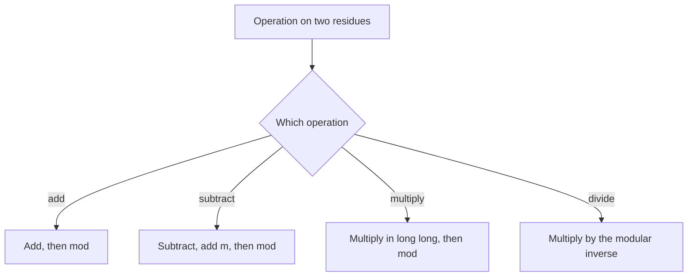

## The hook

"Print the number of ways, modulo 10⁹ + 7." This line appears under thousands of contest problems. The true answer might have a million digits; the number of ways to arrange 100,000 items is astronomically large. No integer type can hold it.

So the problem asks for the remainder instead. That seems like a small change, but it comes with a precise set of rules. Follow them and huge counts stay tiny and correct; break one, and you get a wrong answer that looks completely reasonable.

## The intuition

:::analogy
Think of a 12-hour clock face. If it is 9 o'clock and you add 5 hours, you do not say 14 o'clock; you say 2. Add 500 hours and you still land somewhere between 1 and 12. The clock only remembers the remainder, but it never forgets correctly: you can add hours in any order or in chunks and still end up at the right time.
:::

Arithmetic modulo m is clock arithmetic with m positions, numbered 0 to m − 1. The [[modulus]] is the size of the clock. The [[remainder]] is where the hand points. Two numbers that land on the same position are [[congruent]].

## How it works

### The three safe rules

For a modulus m:

$$(a + b) \bmod m = \big((a \bmod m) + (b \bmod m)\big) \bmod m$$
$$(a - b) \bmod m = \big((a \bmod m) - (b \bmod m) + m\big) \bmod m$$
$$(a \times b) \bmod m = \big((a \bmod m) \times (b \bmod m)\big) \bmod m$$

- $a \bmod m$ is the remainder of a divided by m.
- The "+ m" in subtraction keeps the result non-negative.

In clock terms: it does not matter whether you add 500 hours at once, or 20 hours twenty-five times, reducing to the clock face after each addition. You land in the same place. That is why you can reduce after **every** step and never let numbers grow.

### Division is different

There is no general rule for division: $(a / b) \bmod m$ is not $(a \bmod m) / (b \bmod m)$. Division needs a modular inverse, which exists when m is a [[prime modulus]] and b is not a multiple of m. That is one reason contests use primes like 10⁹ + 7 and 998244353. Inverses get their own article in this track.



:::insight
Reduce after every single operation, and do every multiplication in 64-bit integers. With values below about 10⁹, a sum is below 2 × 10⁹ and a product is below about 10¹⁸, both safe in a long long. That one habit eliminates most modular-arithmetic bugs.
:::

### Why 10⁹ + 7?

It is prime, so division works through inverses. It is just above 10⁹, so remainders fit in a 32-bit int, and the product of two remainders, about 10¹⁸, fits comfortably in a 64-bit long long. It makes accidental [[overflow]] easy to avoid and answers easy to check.

## Walk through an example

**Bit Strings** (CSES): how many binary strings of length n are there, modulo 10⁹ + 7? The answer is 2ⁿ, so multiply by 2, n times, reducing each time.

Use a small clock, m = 7, and n = 5, to watch it work:

| Step | Value before mod | After mod 7 |
|---|---|---|
| start | 1 | 1 |
| ×2 | 2 | 2 |
| ×2 | 4 | 4 |
| ×2 | 8 | 1 |
| ×2 | 2 | 2 |
| ×2 | 4 | 4 |

Check: 2⁵ = 32, and 32 = 4 × 7 + 4, so 32 mod 7 = 4. Reducing at every step gave the same answer without the number ever exceeding 8.

:::try-this
Compute (123 × 456 + 789) mod 10 two ways: fully, then by reducing each part first. (Full: 56,088 + 789 = 56,877, which ends in 7. Reduced: 3 × 6 = 18 → 8, then 8 + 9 = 17 → 7. Same answer.)
:::

## The code

```pseudo
MOD = 1000000007
add(a, b) = (a + b) mod MOD
sub(a, b) = (a - b + MOD) mod MOD
mul(a, b) = (a * b) mod MOD            // compute a * b in 64 bits

power_of_two(n):
    r = 1
    repeat n times: r = mul(r, 2)
    return r
```

```cpp
#include <bits/stdc++.h>
using namespace std;

const long long MOD = 1'000'000'007;

long long addm(long long a, long long b) { return (a + b) % MOD; }
long long subm(long long a, long long b) { return ((a - b) % MOD + MOD) % MOD; }
long long mulm(long long a, long long b) { return (a % MOD) * (b % MOD) % MOD; }

int main() {
    int n = 5;
    long long r = 1;
    for (int i = 0; i < n; i++) r = mulm(r, 2);
    cout << r << '\n';                       // 32
    cout << subm(3, 10) << '\n';             // 1000000000, not -7
    cout << mulm(999999999, 999999999) << '\n';
}
```

### Building intuition with negative residues

On a clock with 7 positions, −1 and 6 are the same position: one step backwards from 0 lands on 6. So "−3 mod 7" should be 4, not −3. Mathematically every integer has exactly one representative between 0 and m − 1, and adding m before the final remainder is just a way of stepping forward a full turn of the clock so the hand lands on that representative.

## Complexity

Each modular operation is O(1). A loop of n multiplications is O(n); for exponents up to 10¹⁸, that is far too slow, and the next article, fast exponentiation, brings it down to O(log n).

## Common mistakes

:::warning
Common misconception: "the % operator always gives a result between 0 and m − 1." In C++, the result takes the sign of the left operand, so (−7) % 3 is −1. After any subtraction, add m before taking the remainder again.
:::

- **Multiplying in `int`**: two values near 10⁹ overflow a 32-bit int. Use `long long` for every product.
- **Reducing only at the end**: intermediate sums of many large terms overflow even a long long.
- **Dividing directly**: `(a / b) % MOD` is wrong once a has been reduced; use the modular inverse.
- **Comparing reduced values**: after reduction, a larger true count can have a smaller remainder, so never use remainders to decide which answer is bigger.

## Practice problems

*Bit Strings* is the example above. *Dice Combinations* is a counting DP that adds counts modulo 10⁹ + 7 at every step. *Exponentiation* needs the fast power technique from the next article. *Count Good Numbers* mixes both ideas with an exponent up to 10¹⁵. You will meet this rule set in almost every counting problem from about 1200 rating upward.

## Key takeaways

- Modular arithmetic keeps only the remainder after dividing by m, like a clock with m positions.
- Addition, subtraction and multiplication can be reduced after every step without changing the final remainder.
- Do products in 64-bit integers, since two remainders below 10^9 multiply to about 10^18.
- In C++, fix negative remainders with ((x % m) + m) % m after subtraction.
- Division needs a modular inverse, which is why contests use prime moduli like 10^9 + 7.
