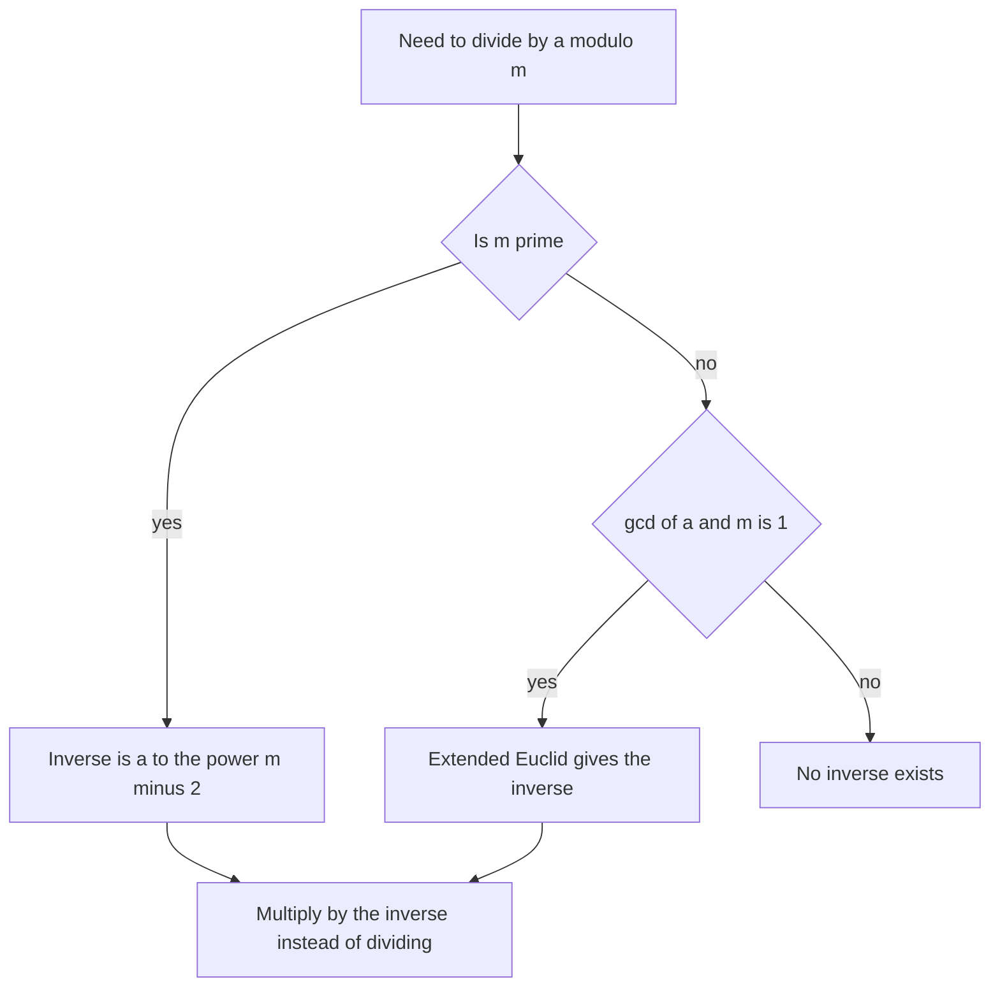

## The hook

You need n! / (k! (n − k)!) modulo 10⁹ + 7 for n up to a million: the number of ways to choose a team. Computing the factorials modulo p is easy. But then you need to divide, and as [Doing Maths on a Clock Face](article:cp-modular-arithmetic) warned, division does not survive taking remainders.

The fix is to never divide at all. Instead, multiply by a number that undoes the multiplication: a modular inverse. Learn two ways to find one, plus one trick to precompute a million of them, and most counting problems open up.

## The intuition

:::analogy
On a 7-hour clock, multiplying by 3 scrambles the positions: 1 goes to 3, 2 goes to 6, 3 goes to 2, and so on. Is there another multiplication that unscrambles them, sending every position back where it started? There is: multiplying by 5. Because 3 × 5 = 15, which is one full turn of 14 plus 1, doing "times 3" then "times 5" is the same as doing nothing. Five is the undo button for three.
:::

That undo number is the [[modular inverse]]. Dividing by a modulo m means multiplying by the inverse of a.

## How it works

### When does an inverse exist?

a has an inverse modulo m exactly when a and m are [[coprime]], gcd(a, m) = 1. With a prime modulus p, every a from 1 to p − 1 qualifies, which is a big reason contests use primes.

### Way 1: Fermat (prime modulus)

[[Fermat's little theorem]] says $a^{p-1} \equiv 1 \pmod p$ when p is prime and does not divide a. Split one factor off:

$$a \cdot a^{p-2} \equiv 1 \pmod p \quad\Rightarrow\quad a^{-1} \equiv a^{p-2} \pmod p$$

- $p$ is the prime modulus, for example 10⁹ + 7.
- $a^{p-2}$ is computed with fast exponentiation from [Raising to the Power of a Billion in Thirty Steps](article:cp-binary-exponentiation), in O(log p).

### Way 2: extended Euclid (any modulus)

The [[extended Euclidean algorithm]] finds x, y with $a x + m y = \gcd(a, m)$. If the gcd is 1, then $a x \equiv 1 \pmod m$, so x (made non-negative) is the inverse. This works for non-prime moduli too, as long as a and m are coprime. See [The Largest Tile That Fits the Floor](article:cp-gcd-lcm).

### Way 3: a million inverses at once

For binomial coefficients up to n, build a [[factorial table]]:

1. `fact[0] = 1`, `fact[i] = fact[i−1] × i mod p`.
2. `inv_fact[n] = fact[n]^(p−2) mod p`: one exponentiation.
3. Walk down: `inv_fact[i−1] = inv_fact[i] × i mod p`, because 1/(i−1)! = i × 1/i!.

Then $\binom{n}{k} = \text{fact}[n] \cdot \text{inv\_fact}[k] \cdot \text{inv\_fact}[n-k]$, each query in O(1).



:::insight
Under a modulus, division is multiplication by an inverse. With a prime modulus, the inverse is just one fast power away, and with a factorial table, a whole family of divisions costs a single exponentiation plus linear work.
:::

## Walk through an example

Compute 10 / 4 modulo 7 (the true answer, 2.5, is not an integer, but modular arithmetic still has an answer).

1. Inverse of 4 modulo 7 with Fermat: 4^(7−2) = 4⁵ = 1024. 1024 mod 7: 7 × 146 = 1022, remainder **2**. Check: 4 × 2 = 8 ≡ 1. ✓
2. 10 / 4 ≡ 10 × 2 = 20 ≡ **6** (mod 7). Check: 4 × 6 = 24 ≡ 3, and 10 ≡ 3 (mod 7). ✓

Now C(5, 2) modulo 7 with tables:

| i | fact[i] mod 7 | inv_fact[i] mod 7 |
|---|---|---|
| 0 | 1 | 1 |
| 1 | 1 | 1 |
| 2 | 2 | 4 |
| 3 | 6 | 6 |
| 4 | 3 | 5 |
| 5 | 1 | 1 |

C(5, 2) = fact[5] × inv_fact[2] × inv_fact[3] = 1 × 4 × 6 = 24 ≡ 3 (mod 7). The true value is 10, and 10 mod 7 = 3. ✓

:::try-this
Find the inverse of 3 modulo 11 with Fermat. (3^9 mod 11: 3² = 9, 3⁴ = 81 ≡ 4, 3⁸ ≡ 16 ≡ 5, 3⁹ ≡ 15 ≡ 4. Check: 3 × 4 = 12 ≡ 1. The inverse is 4.)
:::

## The code

```pseudo
inv(a, p) = power(a, p - 2, p)            // p prime, a not divisible by p

build(n, p):
    fact[0] = 1
    for i in 1..n: fact[i] = fact[i-1] * i mod p
    inv_fact[n] = inv(fact[n], p)
    for i in n down to 1: inv_fact[i-1] = inv_fact[i] * i mod p

C(n, k) = 0 if k < 0 or k > n
        else fact[n] * inv_fact[k] * inv_fact[n-k] mod p
```

```cpp
#include <bits/stdc++.h>
using namespace std;

const long long MOD = 1'000'000'007;

long long power(long long a, long long b) {
    long long r = 1; a %= MOD;
    while (b) { if (b & 1) r = r * a % MOD; a = a * a % MOD; b >>= 1; }
    return r;
}

int main() {
    const int N = 1'000'000;
    vector<long long> fact(N + 1), invFact(N + 1);
    fact[0] = 1;
    for (int i = 1; i <= N; i++) fact[i] = fact[i - 1] * i % MOD;
    invFact[N] = power(fact[N], MOD - 2);
    for (int i = N; i >= 1; i--) invFact[i - 1] = invFact[i] * i % MOD;

    auto C = [&](int n, int k) -> long long {
        if (k < 0 || k > n) return 0;
        return fact[n] * invFact[k] % MOD * invFact[n - k] % MOD;
    };
    cout << C(5, 2) << ' ' << C(1'000'000, 500'000) << '\n';  // 10 and a large value mod p
}
```

## Complexity

- **One inverse:** O(log p) with Fermat or extended Euclid.
- **Factorial tables up to n:** O(n) time plus one O(log p) exponentiation; O(n) memory.
- **Each binomial query afterwards:** O(1).

## Common mistakes

:::warning
Common misconception: "Fermat's trick works for any modulus." It needs a prime modulus. For a composite m, a^(m−2) is generally not the inverse; use extended Euclid, and remember the inverse only exists when gcd(a, m) = 1.
:::

- **Inverting zero or a multiple of p**, which has no inverse; Fermat silently returns 0.
- **Forgetting to reduce intermediate products**, such as `fact[n] * invFact[k] * invFact[n-k]` without a `% MOD` between multiplications, which overflows.
- **Building tables per test case** instead of once at the start.
- **Using n > p** with factorial tables: if n ≥ p, then n! ≡ 0 mod p and the formula breaks; Lucas' theorem handles that case.

## Practice problems

*Binomial Coefficients* (CSES) is the factorial-table template exactly. *Creating Strings II* divides n! by the factorial of each letter's count. *Distributing Apples* uses stars and bars, C(n + m − 1, m). *Count Ways to Make Array With Product* combines factorisation with binomial coefficients. Expect inverses from about 1500 rating onward.

## Key takeaways

- A modular inverse of a is a number x with a × x ≡ 1, and dividing by a means multiplying by x.
- An inverse exists exactly when a and the modulus are coprime, which holds for every non-zero a under a prime modulus.
- With a prime p, the inverse is a^(p−2) mod p by Fermat's little theorem, computed with fast exponentiation.
- For other moduli, the extended Euclidean algorithm finds the inverse when the gcd is 1.
- Precomputing factorials and inverse factorials makes every binomial coefficient an O(1) query.
