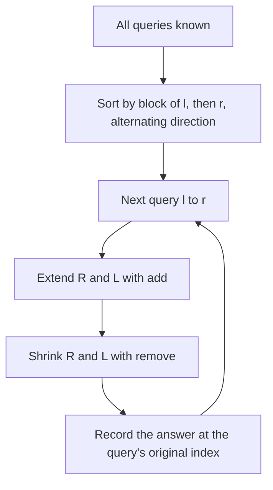

## The hook

A tour guide has twenty groups, each wanting to see a different stretch of a long street of shops. Visiting the stretches in the order they were booked sends the guide marching up and down the whole street again and again. Sorting the bookings cleverly, so the next stretch overlaps the last one as much as possible, cuts the walking enormously.

Mo's algorithm is that sorting for range queries. When a question is easy to update by one element but hard to summarise in a segment tree, such as "how many distinct values" or "sum of count² × value", it answers all queries offline with a single sliding window and about (n + q)√n steps.

## The intuition

:::analogy
The guide splits the street into neighbourhoods of about √n shops. Bookings are grouped by the neighbourhood where their stretch starts, and inside each group sorted by where the stretch ends. Within a group, the end of the stretch only ever moves forward along the street, and the start wobbles only inside one neighbourhood. So the guide's total walking is a few passes along the street per neighbourhood, plus small wobbles, instead of a full street length for every booking.
:::

That is [[Mo's algorithm]]:

- keep a window [L, R] and its [[window state]];
- define [[add and remove]] for one element entering or leaving;
- sort queries by (block of l, r), with a [[block size]] near √n;
- for each query, move L and R one step at a time to [l, r], then read the answer from the state.

It is offline: all queries must be known in advance, and answers are written back to their original positions.

## How it works

### The movement bound

Let B be the block size:

- within one block of left ends, right ends are sorted, so R moves at most n positions across the whole block; with n / B blocks, R moves O(n² / B) in total;
- L stays inside one block, so it moves at most B per query: O(qB) in total.

With B ≈ n / √q, both terms are about n√q; with B = √n, the total is O((n + q)√n). Each move costs one add or remove.

### The [[odd-even ordering]] trick

After finishing a block, R is near the end of the array. If the next block starts with small r again, R walks all the way back. Sorting r descending in odd blocks makes R sweep forward, then backward, then forward, roughly halving its movement in practice.

### Order of pointer moves

Move from [L, R] to [l, r] in this order:

- extend R right while R < r (add);
- extend L left while L > l (add);
- shrink R left while R > r (remove);
- shrink L right while L < l (remove).

Extending first keeps the window non-empty and valid, so remove is never called on an element that was not added.

### Distinct values

The state is a count per value and the number of values with a positive count. add(i): if cnt[a[i]] goes from 0 to 1, distinct++. remove(i): if it goes from 1 to 0, distinct--. Values must be compressed to a small range first, as in [Renaming Huge Numbers as 1, 2, 3](article:cp-coordinate-compression). This solves CSES *Distinct Values Queries* and SPOJ *D-query*, though the offline Fenwick sweep is faster for this particular problem.

### Powerful array

Codeforces *Powerful array* asks, for each range, the sum over values v of cnt[v]² × v. Adding one copy of v changes cnt² from c² to (c + 1)², so the sum changes by (2c + 1) × v; removing is the reverse. A segment tree has no simple way to merge these, but Mo's algorithm only needs the O(1) add and remove.

| Problem | Window state | add(i) | remove(i) |
|---|---|---|---|
| Distinct values | cnt[v], distinct | distinct++ if cnt becomes 1 | distinct-- if cnt becomes 0 |
| Powerful array | cnt[v], total | total += (2 cnt + 1) × v, then cnt++ | cnt--, then total -= (2 cnt + 1) × v |
| Pairs of equal values in range | cnt[v], pairs | pairs += cnt, then cnt++ | cnt--, then pairs -= cnt |



:::insight
Reordering offline queries so consecutive ranges overlap turns many independent range computations into one sliding window. Block sorting caps the total movement at about (n + q)√n single-element steps, so any quantity with cheap add and remove becomes answerable.
:::

## Walk through an example

a = [1, 2, 1, 3, 2, 2, 1, 4], queries (0-based, inclusive) for distinct counts: (0, 3), (2, 6), (1, 1), (4, 7), (0, 7), (5, 6). Block size 3.

Block of l: (0, 3), (2, 6), (1, 1) and (0, 7) are in block 0, sorted by r ascending; (4, 7) and (5, 6) are in block 1, sorted by r descending.

| Order | Query | Distinct | Total pointer moves so far |
|---|---|---|---|
| 1 | (1, 1) | 1 | 3 |
| 2 | (0, 3) | 3 | 6 |
| 3 | (2, 6) | 3 | 11 |
| 4 | (0, 7) | 4 | 14 |
| 5 | (4, 7) | 3 | 18 |
| 6 | (5, 6) | 2 | 20 |

Answers in input order: 3, 3, 1, 3, 4, 2. In block 0, R moved steadily from 1 to 7. In block 1, because of the descending order, R only had to step back from 7 to 6 at the end. (The program below picks B = ⌊√8⌋ = 2 for this array, which gives a different order but the same answers.)

:::try-this
Without the odd-even trick, block 1 would be sorted ascending: (5, 6), then (4, 7). How many moves do those two queries cost, starting from the window (0, 7)? (From (0, 7) to (5, 6): R back 1, L forward 5, so 6 moves. Then to (4, 7): R forward 1, L back 1, so 2 moves. Total 8. With the descending order, (4, 7) then (5, 6) costs 4 + 2 = 6.)
:::

:::warning
Common misconception: "Mo's algorithm works for any range query." It needs an add and a remove for single elements. Range minimum is a poor fit, because removing the current minimum from the window requires knowing the next one, which needs another structure. For those, a sparse table or segment tree is the right tool; Mo's shines where counts of values drive the answer.
:::

## The code

```pseudo
sort queries by (l / B, r ascending if (l / B) even else r descending)
L = 0; R = -1
for each query (l, r, idx) in sorted order:
    while R < r: R += 1; add(R)
    while L > l: L -= 1; add(L)
    while R > r: remove(R); R -= 1
    while L < l: remove(L); L += 1
    answer[idx] = current state
```

```cpp
#include <bits/stdc++.h>
using namespace std;

struct Query { int l, r, idx; };

vector<int> distinctMo(const vector<int>& raw, vector<Query> qs) {
    vector<int> vals(raw), a(raw.size());
    sort(vals.begin(), vals.end());
    vals.erase(unique(vals.begin(), vals.end()), vals.end());
    for (size_t i = 0; i < raw.size(); i++) a[i] = lower_bound(vals.begin(), vals.end(), raw[i]) - vals.begin();

    int B = max(1, (int)sqrt((double)a.size()));
    sort(qs.begin(), qs.end(), [&](const Query& x, const Query& y) {
        int bx = x.l / B, by = y.l / B;
        if (bx != by) return bx < by;
        return (bx & 1) ? x.r > y.r : x.r < y.r;            // odd-even ordering
    });
    vector<int> cnt(vals.size(), 0), ans(qs.size());
    int distinct = 0, L = 0, R = -1;
    auto add = [&](int i) { if (cnt[a[i]]++ == 0) distinct++; };
    auto remove = [&](int i) { if (--cnt[a[i]] == 0) distinct--; };
    for (auto& q : qs) {
        while (R < q.r) add(++R);                             // extend first
        while (L > q.l) add(--L);
        while (R > q.r) remove(R--);                          // then shrink
        while (L < q.l) remove(L++);
        ans[q.idx] = distinct;
    }
    return ans;
}

long long bruteDistinct(const vector<int>& a, int l, int r) {
    return set<int>(a.begin() + l, a.begin() + r + 1).size();
}

int main() {
    vector<int> a = {1, 2, 1, 3, 2, 2, 1, 4};
    vector<Query> qs = {{0, 3, 0}, {2, 6, 1}, {1, 1, 2}, {4, 7, 3}, {0, 7, 4}, {5, 6, 5}};
    for (int x : distinctMo(a, qs)) cout << x << ' ';
    cout << '\n';                                             // 3 3 1 3 4 2

    mt19937 rng(11);                                          // random check against brute force
    vector<int> big(300);
    for (int& x : big) x = rng() % 20 * 1000000;              // large values, compressed inside
    vector<Query> many;
    for (int i = 0; i < 500; i++) {
        int l = rng() % 300, r = rng() % 300;
        if (l > r) swap(l, r);
        many.push_back({l, r, i});
    }
    auto got = distinctMo(big, many);
    int bad = 0;
    for (auto& q : many) bad += got[q.idx] != bruteDistinct(big, q.l, q.r);
    cout << bad << '\n';                                      // 0
}
```

## Complexity

- **Time: O((n + q)√n) add and remove calls,** plus O(q log q) to sort the queries.
- **Space: O(n + q)** for the array, the queries and the window state.
- **In practice:** n = q = 2 × 10⁵ means around 10⁸ cheap steps, which fits in a couple of seconds with O(1) add and remove.

## Common mistakes

- **Shrinking before extending,** which can remove elements never added.
- **Forgetting to store each query's original index,** and printing answers in sorted order.
- **Using a hash map for counts,** which is slow at 10⁸ operations; compress values to a plain array.
- **A poor block size,** such as a fixed 100 for n = 2 × 10⁵, which unbalances the two pointers.
- **Expecting it to work online** or with updates; basic Mo's algorithm is offline and static.

## Practice problems

CSES *Distinct Values Queries* and SPOJ *D-query* are the classic distinct-count use. Codeforces *Powerful array* needs the (2c + 1) × v update and shows where Mo's beats tree structures. The block idea itself is in [Splitting a Long Road Into Neighbourhoods](article:cp-sqrt-decomposition).

## Key takeaways

- Mo's algorithm answers offline range queries with one sliding window, sorting queries by the block of their left end and then by right end.
- With block size about √n, the two window ends move O((n + q)√n) steps in total.
- The method needs only add and remove functions that update the window state for one element.
- Extending the window before shrinking it keeps the state valid, and answers must be stored at each query's original index.
- Alternating the right-end order between blocks reduces the right pointer's back-and-forth movement.
