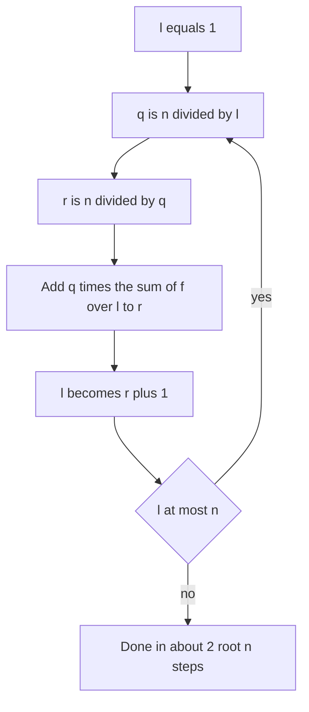

## The hook

An accountant must answer: summing over every price from 1 to 10¹², how many times does each price fit into a budget of 10¹², and what do those counts add up to? Looping over 10¹² prices is out of the question. But most prices fit the same number of times: every price from 500,000,000,001 to 10¹² fits exactly once. Group the prices by how many times they fit, and only about two million groups remain.

That grouping idea, together with a few counting facts about divisors, solves a whole shelf of contest problems that look like they need loops far beyond any time limit.

## The intuition

:::analogy
Picture a pile of receipts, one for every price from 1 to n, and a budget of n. Each receipt is stamped with how many times its price fits into the budget. Small prices get big, all-different stamps: n, n / 2, n / 3. Large prices get small stamps shared by huge groups: half of all receipts are stamped 1. Sorting the receipts into piles by stamp leaves only a few thousand piles for a budget of a few million, and each pile can be totalled in one step because its prices form a consecutive range.
:::

The stamp is ⌊n / i⌋, and each pile is a [[floor block]]: a range [l, r] where ⌊n / i⌋ = q for every i. Its right end is r = ⌊n / q⌋. There are at most about 2√n [[distinct quotients]]: for i ≤ √n there are at most √n values of i, and for i > √n the quotient is below √n.

The second idea is [[contribution counting]]: rather than computing something for every number and adding, ask how much each divisor contributes across all numbers.

## How it works

### The harmonic lemma: sieves over multiples

Loop d from 1 to n and, for each d, loop over its multiples d, 2d, 3d, .... Number d has ⌊n / d⌋ multiples, and by the [[harmonic lemma]] the total is about n ln n. So "for every number up to 10⁶, list or count its divisors" costs about 1.4 × 10⁷ steps:

- divisor counts: for each d, add 1 to cnt[m] for every multiple m;
- divisor sums: add d instead of 1.

CSES *Counting Divisors* asks for the divisor count of up to 10⁵ numbers, each up to 10⁶, which this sieve answers in O(1) per query after an O(n log n) precomputation.

### Iterating over floor blocks

To compute S = Σ over i from 1 to n of f(i) × ⌊n / i⌋ for some f with an easy prefix sum, walk the blocks:

```
l = 1
while l <= n:
    q = n / l;  r = n / q
    S += q × (f(l) + ... + f(r))
    l = r + 1
```

Each block is one step, so the loop runs O(√n) times. The block formula r = ⌊n / ⌊n / l⌋⌋ is the part to remember, and the most common place for off-by-one errors.

### Sum of Divisors up to 10¹²

CSES *Sum of Divisors* asks for σ(1) + σ(2) + ... + σ(n) modulo 10⁹ + 7, where σ(k) is the sum of the divisors of k, with n up to 10¹². By contribution counting, divisor d appears in σ(k) for each of the ⌊n / d⌋ multiples k, contributing d each time:

Σ σ(k) = Σ over d of d × ⌊n / d⌋.

Group by blocks: each block contributes q × (l + ... + r) = q × (l + r)(r - l + 1) / 2, computed modulo the prime with care for the division by 2. For n = 10¹², there are 1,999,999 blocks, instant compared with 10¹² terms.

### Divisor count, sum and product from a factorisation

CSES *Divisor Analysis* gives n as primes with exponents, n = p₁^k₁ × p₂^k₂ × ..., possibly enormous, and asks for the number, sum and product of its divisors modulo 10⁹ + 7.

| Quantity | Formula |
|---|---|
| Number of divisors | (k₁ + 1)(k₂ + 1) ... |
| Sum of divisors | product over primes of (p^(k + 1) - 1) / (p - 1) |
| Product of divisors | n^(count / 2), computed prime by prime |

The product needs care, because count / 2 can be a fraction when n is a perfect square, and count itself is huge. Build it prime by prime: if the divisors found so far have product P and count D, adding p^k gives product P^(k + 1) × (p^(k(k + 1) / 2))^D and count D × (k + 1). Keep D modulo M - 1, using [[exponent reduction]] from Fermat's little theorem, as in [Doing Maths on a Clock Face](article:cp-modular-arithmetic).



:::insight
Values of ⌊n / i⌋ repeat in long runs, and there are only O(√n) different ones, so any sum weighted by ⌊n / i⌋ can be computed block by block. Combined with counting each divisor's contribution, that turns sums over 10¹² numbers into a couple of million steps.
:::

## Walk through an example

### Blocks for n = 10

| Block [l, r] | q = ⌊10 / i⌋ | Sum of i in block | Contribution q × sum |
|---|---|---|---|
| [1, 1] | 10 | 1 | 10 |
| [2, 2] | 5 | 2 | 10 |
| [3, 3] | 3 | 3 | 9 |
| [4, 5] | 2 | 9 | 18 |
| [6, 10] | 1 | 40 | 40 |

Total 87. Checking directly: σ(1) to σ(10) are 1, 3, 4, 7, 6, 12, 8, 15, 13, 18, which also sum to 87. Five blocks instead of ten terms; for n = 10¹², 1,999,999 blocks instead of 10¹² terms.

### Divisor analysis

| n | Factorisation | Count | Sum | Product |
|---|---|---|---|---|
| 12 | 2² × 3 | 3 × 2 = 6 | 7 × 4 = 28 | 12³ = 1,728 |
| 200 | 2³ × 5² | 4 × 3 = 12 | 15 × 31 = 465 | 999,552,007 mod 10⁹ + 7 |

For 12, the divisors 1, 2, 3, 4, 6, 12 pair up as 1 × 12, 2 × 6, 3 × 4, so their product is 12 to the power of 6 / 2 = 3. The prime-by-prime rule gives the same: after 2², P = 1 × 2 × 4 = 8 and D = 3; adding 3¹ gives P = 8² × 3³ = 1,728 and D = 6.

:::try-this
How many floor blocks does n = 100 have, and what are the last three? (Quotients for i = 1 to 10 are all distinct, and beyond that they repeat. The blocks number 19. The last three are [26, 33] with q = 3, [34, 50] with q = 2, and [51, 100] with q = 1.)
:::

:::warning
Common misconception: "There are about √n floor blocks, so the loop runs √n times." It is about 2√n: up to √n blocks of length 1 for small i, plus up to √n blocks for the small quotients. For n = 10¹² that is 1,999,999, not 10⁶. Both are fast, but the factor of two matters when estimating tighter limits or nesting the loop.
:::

## The code

```pseudo
sum_sigma(n):                                 # sum of sigma(k) for k = 1..n, mod M
    ans = 0; l = 1
    while l <= n:
        q = n / l; r = n / q
        ans += q * (sum of l..r)             # all mod M
        l = r + 1
    return ans

divisor_analysis(primes with exponents):
    count = 1; sum = 1; prod = 1; D = 1      # D kept mod M - 1
    for (p, k):
        count *= k + 1
        sum *= (p^(k+1) - 1) / (p - 1)
        prod = prod^(k+1) * (p^(k(k+1)/2))^D
        D = D * (k + 1) mod (M - 1)
```

```cpp
#include <bits/stdc++.h>
using namespace std;
using ll = long long;
const ll M = 1000000007;

ll power(ll b, ll e, ll m = M) {
    ll r = 1;
    b %= m;
    for (; e > 0; e >>= 1, b = b * b % m) if (e & 1) r = r * b % m;
    return r;
}

ll sumOfDivisors(ll n) {
    const ll inv2 = (M + 1) / 2;
    ll ans = 0;
    for (ll l = 1; l <= n;) {
        ll q = n / l, r = n / q;                                   // block [l, r] shares quotient q
        ll s = (l + r) % M * ((r - l + 1) % M) % M * inv2 % M;     // l + ... + r
        ans = (ans + q % M * s) % M;
        l = r + 1;
    }
    return ans;
}

array<ll, 3> divisorAnalysis(const vector<pair<ll, ll>>& f) {      // (prime, exponent)
    ll cnt = 1, sum = 1, prod = 1, D = 1;                          // D = divisor count mod M - 1
    for (auto [p, k] : f) {
        cnt = cnt * ((k + 1) % M) % M;
        sum = sum * ((power(p, k + 1) - 1 + M) % M) % M * power(p - 1, M - 2) % M;
        ll tri = (__int128)k * (k + 1) / 2 % (M - 1);              // k(k+1)/2 mod M - 1
        prod = power(prod, k + 1) * power(power(p, tri), D) % M;
        D = D * ((k + 1) % (M - 1)) % (M - 1);
    }
    return {cnt, sum, prod};
}

vector<int> divisorCounts(int n) {                                 // harmonic sieve
    vector<int> c(n + 1, 0);
    for (int d = 1; d <= n; d++)
        for (int m = d; m <= n; m += d) c[m]++;
    return c;
}

int main() {
    cout << sumOfDivisors(10) << ' ' << sumOfDivisors(1000000000000LL) << '\n';   // 87 146462362
    auto a = divisorAnalysis({{2, 2}, {3, 1}});
    auto b = divisorAnalysis({{2, 3}, {5, 2}});
    cout << a[0] << ' ' << a[1] << ' ' << a[2] << ' ' << b[0] << ' ' << b[1] << ' ' << b[2] << '\n';   // 6 28 1728 12 465 999552007
    auto c = divisorCounts(12);
    cout << c[12] << ' ' << c[7] << ' ' << c[10] << '\n';                 // 6 2 4
}
```

## Complexity

- **Floor-block sums: O(√n) time, O(1) space;** about 2 × 10⁶ iterations for n = 10¹².
- **Harmonic sieve: O(n log n) time, O(n) space;** about 1.4 × 10⁷ steps for n = 10⁶.
- **Divisor analysis: O(m log M)** for m distinct primes, from fast exponentiation.

## Common mistakes

- **Off-by-one in block bounds:** the right end is r = ⌊n / ⌊n / l⌋⌋, and the next block starts at r + 1.
- **Overflow in (l + r)(r - l + 1)** before reducing; reduce each factor modulo M first, or use 128-bit arithmetic.
- **Dividing by 2 directly in modular arithmetic;** multiply by the inverse of 2 instead.
- **Reducing exponents modulo M** instead of M - 1.
- **Computing the product of divisors as n^(count / 2)** with integer division, which is wrong when n is a perfect square and count is odd.
- **Trial-dividing every number up to 10⁶ separately** when a harmonic sieve does all of them together.

## Practice problems

*Counting Divisors* is the harmonic sieve. *Sum of Divisors* is contribution counting plus floor blocks. *Divisor Analysis* is the three formulas with careful exponent reduction. Prime sieves themselves are in [Washing Away Every Multiple](article:cp-sieve), and counting divisors by factorisation in [A Million Numbers, Each Asking How Many Divisors It Has](article:cp-counting-divisors).

## Key takeaways

- Looping over the multiples of every number up to n costs about n ln n, which makes divisor sieves fast.
- The quotient ⌊n / i⌋ takes at most about 2√n distinct values, in blocks [l, r] with r = ⌊n / ⌊n / l⌋⌋.
- Sums weighted by ⌊n / i⌋ are computed block by block in O(√n) time.
- The sum of σ(k) for k up to n equals the sum over d of d × ⌊n / d⌋, by counting each divisor's contribution.
- Divisor count, sum and product follow from the factorisation, with the product built prime by prime and exponents reduced modulo M - 1.
