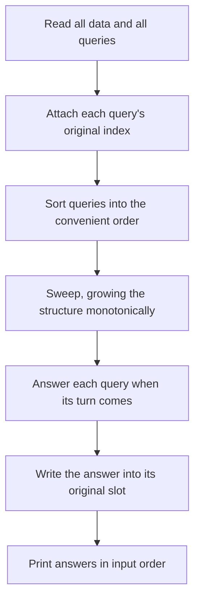

## The hook

A teacher collects a stack of exams and grades them in whatever order is fastest: all the question-1 answers together, then all question 2, so the marking scheme stays in their head. Then they sort the papers back into roll-call order before handing them out. Nobody in the class can tell the grading order, and it saved an hour.

Many range and graph problems are hard only because queries arrive in an awkward order. If the problem lets you read every query before answering, you can grade them in the convenient order and hand back answers in the original one. This single idea solves problems that would otherwise need persistent trees or dynamic connectivity.

## The intuition

:::analogy
The teacher's trick has three parts: note each exam's roll number, grade in the order that keeps the marking easy, then file each mark under its roll number. For queries, the roll number is the query's index, the easy order is one where the data structure only grows or only moves forward, and filing marks is writing each answer into its slot in an array.
:::

An [[offline query]] can be answered in any order; only the reported order matters. Every offline technique keeps an [[answer slot]] per query and follows one of a few patterns:

| Pattern | Sort queries by | Data changes during the sweep | Example |
|---|---|---|---|
| Right-end sweep | right end | marks move forward | Distinct Values Queries |
| [[Threshold sweep]] | a value limit | items are only inserted | count values > k in a range, edge-limited paths |
| [[Reverse time]] | input order, backwards | deletions become insertions | components after edge deletions |
| Mo's ordering | block of left end, then right end | a window slides | frequency-based range answers |

The first and last are covered in [Counting a Guest Only at Their Latest Visit](article:cp-distinct-values-queries) and [A Tour Guide Who Orders the Stops](article:cp-mos-algorithm); this article covers the other two and the habits common to all.

## How it works

### Threshold sweep with a Fenwick tree

SPOJ *K-query*: for each query (l, r, k), count elements of a[l..r] greater than k. Online, that needs a merge sort tree or a persistent tree. Offline:

- sort elements by value, descending, and queries by k, descending;
- keep a pointer into the elements; for each query, insert every element with value > k into a Fenwick tree at its position (+1);
- the answer is the Fenwick sum over [l, r].

Each element is inserted once, each query is one range sum: O((n + q) log n).

### Threshold sweep with union-find

*Checking Existence of Edge Length Limited Paths*: given weighted edges and queries (u, v, limit), is there a path from u to v using only edges with weight strictly below limit?

- sort edges by weight and queries by limit;
- for each query in increasing limit, union every edge with weight < limit;
- the answer is whether u and v share a root.

Edges are added once, in order, with union-find from [Friend Groups That Merge at a Party](article:dsa-union-find): near-linear overall.

### Reverse time for deletions

Union-find cannot delete edges. But if all deletions are known in advance:

- build the graph with only the edges that are never deleted;
- process deletions from last to first; before re-adding each one, record the current answer;
- reverse the recorded answers to restore input order.

The same idea answers "after each removal" questions with any structure that supports insertion only.

### Sorting to expose structure: Nested Ranges Check

CSES *Nested Ranges Check* asks, for each range, whether it contains another range and whether it is contained in one. Sorting ranges by left end ascending and right end descending means every range that could contain range i comes before it: track the maximum right end seen so far. A reverse sweep tracks the minimum right end for the other question. Sorting is the whole solution; the answer slots put results back in order.



:::insight
A query is hard when it needs a state the structure cannot easily reach in the given order. Reading every query first and reordering them so the structure only grows, or time only moves one way, turns many hard online problems into a sort and a sweep.
:::

## Walk through an example

### Count values greater than k

a = [5, 1, 4, 2, 3, 8, 6, 7] (positions 0 to 7). Queries: (1, 5, k = 2), (0, 7, k = 5), (2, 4, k = 3).

| Query (by k descending) | Elements inserted so far (value at position) | Sum over [l, r] |
|---|---|---|
| k = 5 on [0, 7] | 8 at 5, 7 at 7, 6 at 6 | 3 |
| k = 3 on [2, 4] | add 5 at 0, 4 at 2 | position 2 only: 1 |
| k = 2 on [1, 5] | add 3 at 4 | positions 2, 4, 5: 3 |

Answers in input order: 3, 3, 1.

### Edge-limited paths

Edges: 0–1 (2), 1–2 (4), 3–4 (3), 2–3 (8), 0–3 (10). Queries: (0, 2, 5), (0, 3, 8), (1, 4, 9), (2, 4, 11), (0, 4, 4).

| Limit (sorted) | Edges added (weight < limit) | Query | Connected? |
|---|---|---|---|
| 4 | 0–1, 3–4 | (0, 4) | no |
| 5 | 1–2 | (0, 2) | yes |
| 8 | none new (2–3 has weight 8, not below 8) | (0, 3) | no |
| 9 | 2–3 | (1, 4) | yes |
| 11 | 0–3 | (2, 4) | yes |

Answers in input order: yes, no, yes, yes, no.

### Deletions in reverse

A cycle 0–1–2–3–4–0 (edges e0 to e4). Delete e1 (1–2), then e3 (3–4), then e0 (0–1), reporting components after each.

| Step (reversed) | Graph | Components recorded |
|---|---|---|
| start: only e2 and e4 | 2–3, 4–0 | 3 |
| re-add e0 | + 0–1 | 2 |
| re-add e3 | + 3–4 | 1 |

Recorded in reverse: 3, 2, 1, so the answers after each deletion, in input order, are 1, 2, 3.

:::try-this
In the edge-limited example, add a query (1, 3, 9). Where does it go in the sorted order, and what is the answer? (Its limit 9 places it with the (1, 4, 9) query, after edge 2–3 is added. Then 1–2–3 is connected using weights 4 and 8, both below 9, so the answer is yes.)
:::

:::warning
Common misconception: "Offline means slow or a last resort." Offline solutions are usually the shortest and fastest correct ones whenever the problem gives all queries up front. The only true restriction is a forced-online problem, where each query depends on the previous answer, often by XOR-ing it in; then you need persistent or fully dynamic structures.
:::

## The code

```pseudo
count_greater(a, queries):                    # queries (l, r, k, idx)
    sort elements by value desc; sort queries by k desc
    ptr = 0
    for (l, r, k, idx) in queries:
        while ptr < n and value[ptr] > k: bit.add(pos[ptr], 1); ptr += 1
        ans[idx] = bit.sum(l, r)

limited_paths(edges, queries):                # queries (u, v, limit, idx)
    sort edges by weight; sort queries by limit
    for each query: union all edges with weight < limit; ans[idx] = find(u) == find(v)
```

```cpp
#include <bits/stdc++.h>
using namespace std;

struct BIT {
    int n;
    vector<int> t;
    explicit BIT(int n) : n(n), t(n + 1, 0) {}
    void add(int i, int d) { for (++i; i <= n; i += i & -i) t[i] += d; }
    int pre(int i) const { int s = 0; for (++i; i > 0; i -= i & -i) s += t[i]; return s; }
    int range(int l, int r) const { return pre(r) - (l ? pre(l - 1) : 0); }
};

struct DSU {
    vector<int> p;
    int comps;
    explicit DSU(int n) : p(n), comps(n) { iota(p.begin(), p.end(), 0); }
    int find(int x) { return p[x] == x ? x : p[x] = find(p[x]); }
    void unite(int a, int b) { a = find(a), b = find(b); if (a != b) p[a] = b, comps--; }
};

vector<int> countGreater(const vector<int>& a, const vector<array<int, 3>>& qs) {      // (l, r, k)
    int n = a.size();
    vector<int> byVal(n), byK(qs.size()), ans(qs.size());
    iota(byVal.begin(), byVal.end(), 0), iota(byK.begin(), byK.end(), 0);
    sort(byVal.begin(), byVal.end(), [&](int x, int y) { return a[x] > a[y]; });
    sort(byK.begin(), byK.end(), [&](int x, int y) { return qs[x][2] > qs[y][2]; });
    BIT bit(n);
    int p = 0;
    for (int q : byK) {
        while (p < n && a[byVal[p]] > qs[q][2]) bit.add(byVal[p++], 1);                 // threshold sweep
        ans[q] = bit.range(qs[q][0], qs[q][1]);                                         // answer slot
    }
    return ans;
}

vector<bool> limitedPaths(int n, vector<array<int, 3>> edges, const vector<array<int, 3>>& qs) {
    sort(edges.begin(), edges.end(), [](auto& x, auto& y) { return x[2] < y[2]; });
    vector<int> order(qs.size());
    iota(order.begin(), order.end(), 0);
    sort(order.begin(), order.end(), [&](int x, int y) { return qs[x][2] < qs[y][2]; });
    DSU d(n);
    vector<bool> ans(qs.size());
    size_t e = 0;
    for (int q : order) {
        while (e < edges.size() && edges[e][2] < qs[q][2]) d.unite(edges[e][0], edges[e][1]), e++;
        ans[q] = d.find(qs[q][0]) == d.find(qs[q][1]);
    }
    return ans;
}

vector<int> componentsAfterDeletions(int n, const vector<array<int, 2>>& edges, const vector<int>& dels) {
    vector<bool> deleted(edges.size(), false);
    for (int i : dels) deleted[i] = true;
    DSU d(n);
    for (size_t i = 0; i < edges.size(); i++) if (!deleted[i]) d.unite(edges[i][0], edges[i][1]);
    vector<int> rec;
    for (int j = dels.size() - 1; j >= 0; j--) {          // reverse time: deletions become additions
        rec.push_back(d.comps);
        d.unite(edges[dels[j]][0], edges[dels[j]][1]);
    }
    reverse(rec.begin(), rec.end());
    return rec;
}

int main() {
    for (int x : countGreater({5, 1, 4, 2, 3, 8, 6, 7}, {{1, 5, 2}, {0, 7, 5}, {2, 4, 3}})) cout << x << ' ';
    cout << '\n';                                                                     // 3 3 1
    vector<array<int, 3>> E = {{0, 1, 2}, {1, 2, 4}, {3, 4, 3}, {2, 3, 8}, {0, 3, 10}};
    for (bool b : limitedPaths(5, E, {{0, 2, 5}, {0, 3, 8}, {1, 4, 9}, {2, 4, 11}, {0, 4, 4}, {1, 3, 9}})) cout << b;
    cout << '\n';                                                                     // 101101
    for (int c : componentsAfterDeletions(5, {{0, 1}, {1, 2}, {2, 3}, {3, 4}, {0, 4}}, {1, 3, 0})) cout << c << ' ';
    cout << '\n';                                                                     // 1 2 3
}
```

## Complexity

- **Threshold sweep with a Fenwick tree: O((n + q) log n)** after sorting.
- **Threshold sweep with union-find: O((m + q) log(m + q))** for sorting plus near-linear unions.
- **Reverse-time union-find: O(m + q)** unions, near-linear.
- **Space: O(n + q)** for the structures and answer slots.

## Common mistakes

- **Forgetting the answer slots,** and printing answers in sorted order.
- **Using ≤ instead of <** for strict thresholds, as in edge-limited paths.
- **Recording answers after re-adding** in reverse time instead of before.
- **Ties in sorting:** queries with equal thresholds must all see the same set of inserted items; insert with a while loop before answering each.
- **Applying offline methods to forced-online problems,** where each query depends on the last answer.

## Practice problems

SPOJ *K-query* is the threshold sweep with a Fenwick tree. *Checking Existence of Edge Length Limited Paths* is the threshold sweep with union-find. CSES *Nested Ranges Check* is solved entirely by a clever sort and a sweep. The right-end sweep is in [Counting a Guest Only at Their Latest Visit](article:cp-distinct-values-queries).

## Key takeaways

- When all queries are known in advance, they can be answered in any convenient order and reported in the original order through stored indices.
- Sorting queries by a threshold and inserting data in the same order lets a Fenwick tree or union-find answer each query with a structure that only grows.
- Deletions become insertions when processed in reverse time, which makes union-find usable for connectivity after removals.
- Clever sorting, such as by left end ascending and right end descending, can expose structure that makes each query a single comparison.
- Offline techniques fail only for forced-online problems, where each query depends on the previous answer.
