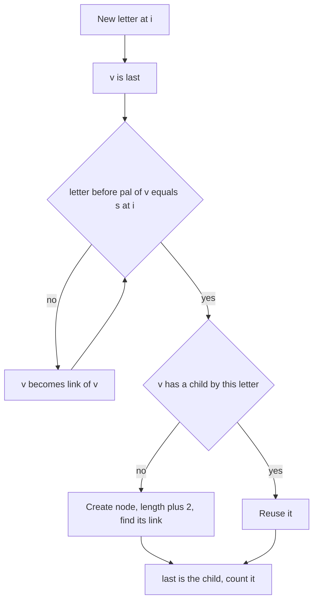

## The hook

Manacher's algorithm from [A Mirror That Remembers the Reflections It Already Checked](article:cp-manacher) finds the longest palindrome around every centre. It does not, by itself, tell you which palindromes are distinct, how often each one occurs, or how they relate to each other.

The palindromic tree does. It gives every distinct palindrome of a string its own node, links each palindrome to its longest palindromic suffix, and is built one letter at a time. Along the way it proves a surprising fact: a string of length n has at most n distinct non-empty palindromic substrings.

## The intuition

:::analogy
Picture a family tree where each person is a palindrome, and a child is born by placing the same letter on both sides of its parent: from "b" comes "aba", from "aba" comes "cabac". Two founding ancestors start the tree: an empty palindrome, whose children are double letters like "aa", and a strange ancestor of length −1, whose children are single letters. Separately, every palindrome remembers its longest palindromic ending, a kind of godparent. When a new letter arrives, you ask the person who currently ends the string, and then their godparent, and so on, until one of them can welcome a child by wrapping the new letter around themselves.
:::

The family tree is the [[palindromic tree]]; the two ancestors are the [[imaginary root]] and the [[empty root]]; the godparent relation is the [[suffix link]]; and the person who currently ends the string is the [[longest suffix palindrome]].

## How it works

### Nodes, edges and links

- Node 0 has length −1, node 1 has length 0, and link[1] = 0.
- An edge from X by letter c leads to the node for cXc, of length len(X) + 2.
- link[v] is the node of the longest proper palindromic suffix of v; for a single letter, that is the empty root.

### Adding a letter

Let i be the new letter's index, and last the node of the longest palindrome ending at i − 1.

- **Step 1, find where to wrap.** Starting from v = last, follow suffix links until s[i − len(v) − 1] = s[i]; then c·pal(v)·c is the longest palindrome ending at i. The imaginary root always passes this test, since with length −1 it compares s[i] with itself.
- **Step 2, create the node if it is new.** If v has no child by c, create u with length len(v) + 2.
- **Step 3, link it.** If v is the imaginary root, u is a single letter and links to the empty root. Otherwise, continue the same walk from link[v] to find the next palindrome that can be wrapped by c, and link u to that one's child by c.
- **Step 4, move on.** last = the child of v by c.

Set the new child edge only after computing its link, or the walk in step 3 can find u itself.

### Why there are at most n palindromes

Suppose two different palindromes ending at i were both new. The shorter is a suffix of the longer, and because the longer one is a palindrome, the shorter one is also its prefix, so it already ended at an earlier position. Contradiction. So each letter adds at most one node, and the tree has at most n + 2 nodes.

The walks along suffix links are amortised O(n) in total, by an argument like the prefix function's: the length of the current palindrome rises by at most 2 per letter and each step of a walk lowers it.

### Counting occurrences

At position i, every palindrome ending there is on the suffix-link chain of last. So:

- add 1 to cnt[last] after each letter;
- at the end, process nodes from the last created to the first, adding cnt[v] into cnt[link[v]], since a link always points to an older, shorter node.

APIO 2014 *Palindromes* asks for the largest value of length times occurrences over all palindromic substrings, which is one pass over the nodes after this step.

| Question | Answer from the tree |
|---|---|
| number of distinct palindromes | number of nodes minus the two roots |
| new palindrome at each prefix | whether adding the letter created a node |
| occurrences of each palindrome | counts pushed along suffix links |
| palindromes ending at each position | depth of last in the link tree |



:::insight
Every palindrome ending at a position is a suffix of the longest one, and they form a single chain of suffix links. That one fact gives the bound of n distinct palindromes, the linear construction, and occurrence counting by pushing counts down the chain.
:::

## Walk through an example

s = "abaaba". Nodes 0 and 1 are the roots; new nodes are numbered from 2.

| i | Letter | Walk from last | Wrap around | New node | Its suffix link |
|---|---|---|---|---|---|
| 0 | a | empty root fails, imaginary root fits | imaginary | 2: "a" | 1, empty |
| 1 | b | "a" fails, empty fails, imaginary fits | imaginary | 3: "b" | 1, empty |
| 2 | a | "b": s[0] = a fits | "b" | 4: "aba" | 2: "a" |
| 3 | a | "aba" out of range, "a": s[1] = b fails, empty: s[2] = a fits | empty | 5: "aa" | 2: "a" |
| 4 | b | "aa": s[1] = b fits | "aa" | 6: "baab" | 3: "b" |
| 5 | a | "baab": s[0] = a fits | "baab" | 7: "abaaba" | 4: "aba" |

For node 7, the link walk starts at link["baab"] = "b" and checks s[5 − 1 − 1] = s[3] = a, which matches, so the link is the child of "b" by a: "aba".

**Counting.** The longest suffix palindromes after each letter are nodes 2, 3, 4, 5, 6, 7, one count each. Pushing from the newest node down: node 7 gives 1 to "aba", making 2; node 6 gives 1 to "b", making 2; node 5 gives 1 to "a"; node 4, now 2, gives 2 to "a", which ends with 4.

| Palindrome | a | b | aba | aa | baab | abaaba |
|---|---|---|---|---|---|---|
| occurrences | 4 | 2 | 2 | 1 | 1 | 1 |
| length × occurrences | 4 | 2 | 6 | 2 | 4 | 6 |

Six distinct palindromes in a string of length 6, the maximum possible. The APIO value is 6, reached by both "aba" and "abaaba".

:::try-this
Build the tree for "abcabc". How many letters create a new node? (The first three letters create "a", "b" and "c". At index 3 the longest palindrome ending there is just "a", which exists, so nothing is created, and the same happens for "b" and "c". Three nodes for six letters: the bound of n is an upper limit, not a guarantee.)
:::

:::warning
Common misconception: "The two roots are an implementation detail; a single empty root is enough." With only the empty root, a single letter c would need to be c + "" + c = "cc", which is wrong, and the suffix-link walk would have no node that always fits, so it could run off the end. The length −1 root makes single letters follow the same wrapping rule and guarantees every walk stops; link[empty] = imaginary and link[single letter] = empty are the two edge cases to get right.
:::

## The code

```pseudo
roots: node 0 len -1, node 1 len 0, link[1] = 0; last = 1
add(c at index i):
    v = last; while s[i - len[v] - 1] != s[i] (or out of range): v = link[v]
    if no child of v by c:
        lk = 1 if len[v] == -1 else child by c of fit(link[v])
        u = new node, len[v] + 2, link lk; child[v][c] = u
    last = child[v][c]; cnt[last] += 1
occurrences: for v from newest down to 2: cnt[link[v]] += cnt[v]
```

```cpp
#include <bits/stdc++.h>
using namespace std;
using ll = long long;

struct Eertree {                                                 // palindromic tree over lowercase letters
    vector<array<int, 26>> next;                                 // next[v][c] = node for c + pal(v) + c
    vector<int> len, link, cnt;                                  // link = longest proper palindromic suffix
    vector<int> endAt;                                           // where each palindrome first ended, to print it
    string s;
    int last = 1;                                                // node of the longest palindromic suffix so far
    Eertree() {
        addNode(-1, 0);                                          // node 0: imaginary root, length -1
        addNode(0, 0);                                           // node 1: empty root, length 0, links to node 0
    }
    int addNode(int L, int lk) { next.push_back({}); next.back().fill(0); len.push_back(L); link.push_back(lk); cnt.push_back(0); endAt.push_back(-1); return len.size() - 1; }
    int fit(int v, int i) const {                                // walk suffix links until s[i - len - 1] == s[i]
        while (i - len[v] - 1 < 0 || s[i - len[v] - 1] != s[i]) v = link[v];
        return v;
    }
    bool add(char ch) {                                          // returns true if a new palindrome appeared
        s += ch;
        int i = s.size() - 1, c = ch - 'a';
        int v = fit(last, i);
        bool created = false;
        if (!next[v][c]) {
            int lk = len[v] == -1 ? 1 : next[fit(link[v], i)][c];   // single letters link to the empty root
            int u = addNode(len[v] + 2, lk);
            next[v][c] = u, endAt[u] = i;                        // set after computing lk: u is not its own link
            created = true;
        }
        last = next[v][c];
        cnt[last]++;                                             // the longest palindrome ending here
        return created;
    }
    vector<ll> occurrences() const {                             // occurrences of each node's palindrome
        vector<ll> occ(cnt.begin(), cnt.end());
        for (int v = len.size() - 1; v >= 2; v--) occ[link[v]] += occ[v];   // longer nodes were created later
        return occ;
    }
};

int main() {
    Eertree t;
    string s = "abaaba";
    for (char ch : s) cout << t.add(ch);
    cout << '\n';                                                // 111111: every letter adds a palindrome
    auto occ = t.occurrences();
    ll best = 0;
    for (int v = 2; v < (int)t.len.size(); v++) {
        cout << t.len[v] << ':' << occ[v] << ' ';                // length and occurrences of each palindrome
        best = max(best, (ll)t.len[v] * occ[v]);
    }
    cout << "| " << best << '\n';                               // 1:4 1:2 3:2 2:1 4:1 6:1 | 6
    Eertree u;
    for (char ch : string("abcabc")) cout << u.add(ch);
    cout << ' ' << u.len.size() - 2 << '\n';                     // 111000 3

    mt19937 rng(25);                                             // against listing every palindromic substring
    bool ok = true;
    for (int it = 0; it < 400; it++) {
        int n = 1 + rng() % 16;
        string x;
        for (int i = 0; i < n; i++) x += char('a' + rng() % 3);
        map<string, ll> brute;
        for (int i = 0; i < n; i++)
            for (int j = i + 1; j <= n; j++) {
                string sub = x.substr(i, j - i);
                if (equal(sub.begin(), sub.end(), sub.rbegin())) brute[sub]++;
            }
        Eertree E;
        for (char ch : x) E.add(ch);
        auto O = E.occurrences();
        map<string, ll> got;
        for (int v = 2; v < (int)E.len.size(); v++) got[x.substr(E.endAt[v] - E.len[v] + 1, E.len[v])] = O[v];
        ok = ok && got == brute;
    }
    cout << (ok ? "stress ok" : "stress FAILED") << '\n';        // stress ok
}
```

The random test lists every palindromic substring of 400 random strings over three letters with its number of occurrences, then rebuilds the same map from the tree, using the position where each node was created to print its palindrome; the two maps must be identical.

## Complexity

- **Construction: O(n)** amortised link walks, plus O(σ) memory per node for the child table.
- **Occurrence counts: O(n)** for one pass over the nodes.
- **Space: O(n·σ)** with arrays of children; a map per node trades speed for memory with large alphabets.

## Common mistakes

- **Wrong root links:** link[empty] must be the imaginary root, and single letters must link to the empty root.
- **Setting the child edge before computing the new node's link,** so the link walk can return the node itself.
- **Forgetting the bounds check** i − len − 1 ≥ 0 in the walk; the imaginary root makes the index i, which is always valid.
- **Pushing counts in creation order** instead of from the newest node down.
- **Counting distinct palindromes as all nodes,** including the two roots.
- **Assuming n palindromes always exist;** n is only the maximum.

## Practice problems

*Palindromes* from APIO 2014 is the occurrence count times length maximum. *Palisection* counts pairs of overlapping palindromes, which needs the number of palindromes starting and ending at each position; the tree's link depths give those counts, or Manacher plus difference arrays does. *Palindrome Partition* uses extra links that group suffix palindromes into arithmetic series for a fast DP, a well-known extension of this structure. Finding the longest palindrome alone is simpler with Manacher's algorithm.

## Key takeaways

- The palindromic tree has one node per distinct palindromic substring, with edges that wrap a letter around a palindrome and suffix links to its longest palindromic suffix.
- Two roots, of lengths −1 and 0, let single letters and double letters follow the same rule as every other palindrome and guarantee every suffix-link walk stops.
- Each new letter creates at most one new palindrome, because every shorter palindrome ending there is also a prefix of the longest one and appeared earlier.
- Construction follows suffix links from the previous longest suffix palindrome, in amortised linear time overall.
- Occurrence counts come from counting the longest suffix palindrome at each position and pushing counts along suffix links from the newest nodes down.
