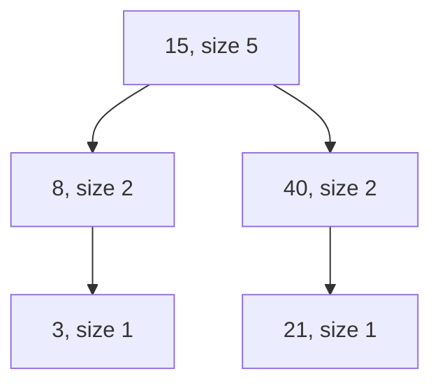

## The hook

You are reading numbers one at a time, and after each one you must say how many earlier numbers were smaller. Or children stand in a circle, and you must repeatedly remove the child k places ahead, among those still standing. Both questions ask about positions in a sorted order that keeps changing.

`std::set` keeps things sorted in O(log n), but asking for a position with `distance` walks it one step at a time, which is O(n). A Fenwick tree can count, but only over values you compressed in advance. Is there a set that just knows where everything sits? GCC ships one, and it answers both questions in O(log n), online.

## The intuition

:::analogy
Picture a library shelf that keeps its books in sorted order by title. A normal shelf can tell you whether a title is there. This shelf has a librarian who can also answer two more questions instantly: "which book is in position 37?" and "how many books come before this title?" Books arrive and leave all day, and the answers stay correct without anyone recounting the shelf.
:::

That shelf is an [[ordered set]]. The two questions are its whole point:

| Question on the shelf | Name in pbds | What it returns |
|---|---|---|
| Which book is in position k? | `find_by_order(k)` | An iterator to the k-th smallest element, counting from 0, or `end()` if k is too big |
| How many books come before this title? | `order_of_key(x)` | The number of elements strictly smaller than x, its [[rank]] |

The k-th smallest element is called the k-th [[order statistic]], so the tag that turns this feature on is named `tree_order_statistics_node_update`.

How can the librarian be that fast? Behind the shelf is a balanced binary search tree, a red-black tree, where every node also stores its [[subtree size]]: how many books live under it. If you know how many books are in the left subtree, you know how many books come before the current node, without counting them.

## How it works

### Declaring it

The library is part of GCC's [[policy-based data structures]]. The usual contest declaration is:

```cpp partial
#include <ext/pb_ds/assoc_container.hpp>
#include <ext/pb_ds/tree_policy.hpp>
using namespace __gnu_pbds;

template <class T>
using ordered_set = tree<T, null_type, less<T>, rb_tree_tag,
                         tree_order_statistics_node_update>;
```

Read the five template arguments left to right: the key type; `null_type`, meaning there is no mapped value (use a real type here to get an ordered map); the comparator; `rb_tree_tag`, meaning a red-black tree; and the node-update policy that maintains subtree sizes.

Everything you know from `std::set` still works: `insert`, `erase` (by value or iterator), `find`, `lower_bound`, `upper_bound`, `size`, iteration in sorted order. The two new member functions sit on top.

### How order_of_key walks the tree

Take the set {3, 8, 15, 21, 40}. Suppose the tree looks like this, each node with its subtree size:



To compute `order_of_key(22)`, walk down from the root, adding up everything you know is smaller:

| Node | Compare 22 with node | Add | Running count | Go to |
|---|---|---|---|---|
| 15 | 22 is larger | left size 2, plus 1 for 15 itself | 3 | right child, 40 |
| 40 | 22 is smaller | nothing | 3 | left child, 21 |
| 21 | 22 is larger | left size 0, plus 1 for 21 | 4 | right child, empty |

The answer is 4: the elements 3, 8, 15 and 21. One root-to-leaf path, so O(log n) in a balanced tree.

### How find_by_order walks the tree

`find_by_order(3)` goes the other way. At each node, compare k with the left subtree size L. If k < L, the answer is on the left. If k = L, it is this node. Otherwise subtract L + 1 and go right.

| Node | Left size L | k | Decision |
|---|---|---|---|
| 15 | 2 | 3 | 3 > 2, so k becomes 3 − 2 − 1 = 0 and go right |
| 40 | 1 | 0 | 0 < 1, go left |
| 21 | 0 | 0 | k = L, answer is 21 |

Sorted, the set is 3, 8, 15, 21, 40, and position 3 (from 0) is indeed 21. Each insert or erase updates the sizes along one path, so they stay O(log n) too. That is the librarian's secret: she never counts the shelf, she only reads the size labels along one path.

:::insight
Any balanced search tree can answer rank questions if each node also stores the size of its subtree. pbds keeps those sizes for you, so a sorted set gains "position of x" and "element at position k" for the price of two `#include` lines.
:::

### Duplicates: give every book a unique sticker

The shelf is a set, so a second copy of the same key is silently ignored. Insert 5 three times and the size is 1. Many problems have repeated values, so you need a fix.

The clean fix is a [[tie-breaker]]: store pairs (value, unique id), where the id is the input index or a running counter. Pairs compare by value first, then by id, so equal values become distinct keys and sit next to each other in sorted order.

The counting queries then become:

| You want | Query with pairs |
|---|---|
| Count of values < x | `order_of_key({x, INT_MIN})` |
| Count of values ≤ x | `order_of_key({x, INT_MAX})` |
| Count of values ≥ x | `size() - order_of_key({x, INT_MIN})` |
| Erase one copy with id i | `erase({x, i})` |

Using INT_MIN and INT_MAX as the id places the probe before or after every real pair with value x, assuming real ids are ordinary indices. On the shelf, it is like asking "how many books come before the very first copy of this title" versus "before the spot just after its last copy".

:::warning
Common misconception: "Use `less_equal<int>` as the comparator to get an ordered multiset." It does insert duplicates, but it breaks the tree's assumptions: `find` never finds anything, `erase(value)` does nothing, and `lower_bound` and `upper_bound` swap meanings. Some people use it carefully, erasing only by iterator, but it is a trap under contest pressure. Pairs with a tie-breaker behave exactly like a normal set.
:::

### When to reach for it

The cues in a problem statement:

- "the k-th smallest among the current elements", with inserts and deletes mixed in;
- "how many earlier (or later) elements are smaller or larger than this one", especially online;
- "remove the element at position p" from a list that keeps shrinking;
- a median or percentile of a changing window.

## Walk through an example

### Example 1: the shrinking circle

In *Josephus Problem II* on CSES, children numbered 1 to n stand in a circle and are removed one at a time by counting k places around the remaining circle. Read the problem for the exact convention. With the convention that matches its sample, you skip k children and remove the next one, so the next position is `(pos + k) mod size`, measured on the current circle.

The circle is the shelf. The children still standing, in number order, are the books, and `pos` is a position on the shelf. When you remove the child at position `pos`, the next child slides into that same position, so you count on from there.

Trace for n = 7 and k = 2:

| Size before | pos = (pos + 2) mod size | Children still standing | Removed |
|---|---|---|---|
| 7 | (0 + 2) mod 7 = 2 | 1 2 3 4 5 6 7 | 3 |
| 6 | (2 + 2) mod 6 = 4 | 1 2 4 5 6 7 | 6 |
| 5 | (4 + 2) mod 5 = 1 | 1 2 4 5 7 | 2 |
| 4 | (1 + 2) mod 4 = 3 | 1 4 5 7 | 7 |
| 3 | (3 + 2) mod 3 = 2 | 1 4 5 | 5 |
| 2 | (2 + 2) mod 2 = 0 | 1 4 | 1 |
| 1 | (0 + 2) mod 1 = 0 | 4 | 4 |

The removal order is 3 6 2 7 5 1 4. With a vector, each removal shifts up to n elements, so the whole thing is O(n²). With `find_by_order` it is O(n log n), and because k can be huge, the `mod size` keeps the step small.

### Example 2: nested ranges with duplicates

In *Nested Ranges Count*, for every range you report how many other ranges it contains and how many contain it. Range [a, b] contains [c, d] when a ≤ c and d ≤ b. Take five ranges, numbered 0 to 4, where two are identical:

| Id | Range |
|---|---|
| 0 | [1, 6] |
| 1 | [2, 4] |
| 2 | [3, 6] |
| 3 | [4, 8] |
| 4 | [2, 4] |

Sort by left end ascending and, for equal left ends, right end descending: 0 [1,6], 1 [2,4], 4 [2,4], 2 [3,6], 3 [4,8]. Now every range that could contain range i has already been seen by the time you reach it, because its left end is no larger. Among those, the ones that contain i are exactly the ones whose right end is at least r_i.

Identical ranges contain each other, so handle a group of identical ranges together: insert the whole group, then query, then subtract 1 so a range does not count itself.

**Forward pass: how many contain it.** Store pairs (r, id) and count those with r ≥ r_i.

| Group | Right ends seen after inserting | Count of r ≥ r_i, minus 1 | Contained by |
|---|---|---|---|
| 0 [1,6] | 6 | 1 − 1 | 0 |
| 1, 4 [2,4] | 6, 4, 4 | 3 − 1 | 2 each |
| 2 [3,6] | 6, 4, 4, 6 | 2 − 1 | 1 |
| 3 [4,8] | 6, 4, 4, 6, 8 | 1 − 1 | 0 |

**Backward pass: how many it contains.** Walk the same sorted order from the end, so every range already seen has a left end at least as large, and count right ends r ≤ r_i.

| Group | Right ends seen after inserting | Count of r ≤ r_i, minus 1 | Contains |
|---|---|---|---|
| 3 [4,8] | 8 | 1 − 1 | 0 |
| 2 [3,6] | 8, 6 | 1 − 1 | 0 |
| 1, 4 [2,4] | 8, 6, 4, 4 | 2 − 1 | 1 each |
| 0 [1,6] | 8, 6, 4, 4, 6 | 4 − 1 | 3 |

So by id: contains = 3 1 0 0 1 and contained by = 0 2 1 0 2, which matches a brute-force check of all pairs. Notice that the duplicate right end 4 would have vanished in a plain set of ints. The (r, id) pairs keep both copies, which is exactly why the second [2, 4] is counted.

:::try-this
An ordered set of pairs holds (4, 1), (4, 4), (6, 0), (6, 2), (8, 3). What do `order_of_key({6, INT_MIN})` and `order_of_key({6, INT_MAX})` return? (2 and 4. The first counts pairs with value below 6, the two copies of 4. The second also counts both pairs with value 6.)
:::

## The code

```pseudo
ordered set S                       # sorted, with subtree sizes

order_of_key(x):                    # how many keys are < x
    count = 0; node = root
    while node exists:
        if x > node.key: count += size(node.left) + 1; node = node.right
        else: node = node.left
    return count

find_by_order(k):                   # key at position k, counting from 0
    node = root
    while node exists:
        L = size(node.left)
        if k < L: node = node.left
        else if k == L: return node
        else: k = k - L - 1; node = node.right
    return none

josephus(n, k):
    S = {1..n}; pos = 0
    while S not empty:
        pos = (pos + k) mod |S|
        output and erase the key at position pos

nested counts(ranges):
    sort by left ascending, right descending
    forward over groups of identical ranges:
        insert (r, id) for the group
        containedBy = count of r >= r_i, minus 1
    clear S; backward over the same groups:
        insert (r, id) for the group
        contains = count of r <= r_i, minus 1
```

```cpp
#include <bits/stdc++.h>
#include <ext/pb_ds/assoc_container.hpp>
#include <ext/pb_ds/tree_policy.hpp>
using namespace std;
using namespace __gnu_pbds;

template <class T>
using ordered_set = tree<T, null_type, less<T>, rb_tree_tag, tree_order_statistics_node_update>;

// Josephus with skip k: the circle is the shelf, pos is a rank on it.
vector<int> josephus(int n, long long k) {
    ordered_set<int> alive;
    for (int i = 1; i <= n; i++) alive.insert(i);
    vector<int> order;
    long long pos = 0;
    while (!alive.empty()) {
        pos = (pos + k) % alive.size();
        auto it = alive.find_by_order(pos);   // the child at rank pos
        order.push_back(*it);
        alive.erase(it);                      // pos now points at the next child
    }
    return order;
}

// For each range: how many other ranges it contains, and how many contain it.
pair<vector<int>, vector<int>> nestedCount(const vector<pair<int, int>>& rg) {
    int n = rg.size();
    vector<int> idx(n), contains(n), containedBy(n);
    iota(idx.begin(), idx.end(), 0);
    sort(idx.begin(), idx.end(), [&](int a, int b) {   // l ascending, r descending
        if (rg[a].first != rg[b].first) return rg[a].first < rg[b].first;
        return rg[a].second > rg[b].second;
    });
    ordered_set<pair<int, int>> seen;                   // (r, id): ids keep duplicates apart
    for (int i = 0; i < n;) {                           // forward: count earlier r >= r_i
        int j = i;
        while (j < n && rg[idx[j]] == rg[idx[i]]) seen.insert({rg[idx[j]].second, idx[j]}), j++;
        for (int t = i; t < j; t++) {
            int r = rg[idx[t]].second;
            containedBy[idx[t]] = (int)seen.size() - (int)seen.order_of_key({r, INT_MIN}) - 1;
        }
        i = j;
    }
    seen.clear();
    for (int i = n - 1; i >= 0;) {                      // backward: count later r <= r_i
        int j = i;
        while (j >= 0 && rg[idx[j]] == rg[idx[i]]) seen.insert({rg[idx[j]].second, idx[j]}), j--;
        for (int t = i; t > j; t--) {
            int r = rg[idx[t]].second;
            contains[idx[t]] = (int)seen.order_of_key({r, INT_MAX}) - 1;
        }
        i = j;
    }
    return {contains, containedBy};
}

int main() {
    ordered_set<int> s;
    for (int x : {21, 3, 40, 15, 8, 15}) s.insert(x);      // second 15 is ignored
    cout << s.size() << '\n';                               // 5
    cout << s.order_of_key(15) << ' ' << s.order_of_key(16) << '\n';    // 2 3
    cout << *s.find_by_order(0) << ' ' << *s.find_by_order(4) << '\n';  // 3 40
    cout << (s.find_by_order(5) == s.end()) << '\n';                    // 1

    for (int c : josephus(7, 2)) cout << c << ' ';
    cout << '\n';                                           // 3 6 2 7 5 1 4

    vector<pair<int, int>> rg = {{1, 6}, {2, 4}, {3, 6}, {4, 8}, {2, 4}};
    auto [contains, containedBy] = nestedCount(rg);
    for (int c : contains) cout << c << ' ';
    cout << '\n';                                           // 3 1 0 0 1
    for (int c : containedBy) cout << c << ' ';
    cout << '\n';                                           // 0 2 1 0 2
}
```

For an ordered map, replace `null_type` with the mapped type: `tree<int, int, less<int>, rb_tree_tag, tree_order_statistics_node_update>` gives `m[key]` plus the same two rank functions, which rank by key.

### The same jobs without pbds

In interviews, or on a judge without GCC, you need a portable alternative. With all values known in advance, [compress them to 1, 2, 3](article:cp-coordinate-compression), then keep a Fenwick tree of counts over the compressed values. Inserting x adds 1 at its index, a prefix sum gives `order_of_key`, and a binary descent over the Fenwick tree gives `find_by_order`, all in O(log n).

A segment tree of counts does the same, and the descent is the same technique as finding the first position with enough room in [A Tournament Bracket for Your Array](article:cp-segment-tree). These are usually faster than pbds, but they need the values offline. The shelf works online with any key that has a comparator.

## Complexity

- **insert, erase, find, lower_bound:** O(log n). A red-black tree has height O(log n), and each operation follows one path while fixing the sizes along it.
- **order_of_key and find_by_order:** O(log n). Each is a single root-to-leaf walk that reads subtree sizes.
- **Space:** O(n). One node per element, each with pointers, a colour and a size, so the constant factor is several times that of a plain array.
- **In practice:** pbds is slower than a Fenwick tree by a noticeable constant factor, because of pointer chasing and memory allocation. For n up to a few hundred thousand with ordinary time limits it is usually fine; with very tight limits, prefer a Fenwick tree.

## Common mistakes

- **Duplicates vanish.** `ordered_set<int>` stores each value once. Counts come out too small with no error. Use (value, id) pairs.
- **Strictly less, not less or equal.** `order_of_key(x)` counts keys < x. For ≤ x with plain ints, use `order_of_key(x + 1)`; with pairs, use `{x, INT_MAX}`.
- **Off-by-one on positions.** `find_by_order(k)` is 0-indexed. The median of an odd-sized set of size m is `find_by_order(m / 2)`, not `find_by_order((m + 1) / 2)`.
- **Dereferencing end().** `find_by_order(k)` with k ≥ size returns `end()`. Check before `*it`.
- **Forgetting the update policy.** Without `tree_order_statistics_node_update`, the two rank functions do not exist and the code does not compile.
- **The less_equal trap.** A comparator that is not strict breaks `find`, `erase` by value and the bound functions, as the warning above explains.
- **Mixing up the id sentinel.** If real ids can be negative, INT_MIN is no longer below every id. Keep ids as non-negative indices.
- **Portability.** It is a GCC extension. It compiles on Codeforces and CSES with GNU G++, but not with MSVC, and you should not write it in an interview without saying what it is.

## Practice problems

Start with *Josephus Problem II*: it is pure `find_by_order` plus `erase`, exactly the first walkthrough. *List Removals* is the same "remove the element at position p" idea on a list.

*Nested Ranges Count* needs the sort order and the (value, id) pairs from the second walkthrough. *Sliding Window Median* keeps a window in an ordered set of pairs and asks for the middle position after each slide. *Salary Queries* mixes updates with "how many values lie in [a, b]", which is a difference of two `order_of_key` calls; it can also be done offline with compression and a Fenwick tree, so try both.

*Count of Smaller Numbers After Self* is the interview version: scan from the right and ask `order_of_key` before inserting, but on LeetCode write it with a Fenwick tree or merge sort, because interviewers expect portable code. Ordered-set tricks start to pay off from roughly 1600 to 1900 rating, where many problems that look like they need a custom balanced tree only need this shelf.

## Key takeaways

- The pbds ordered set is a red-black tree that also stores subtree sizes, so it answers `find_by_order(k)` and `order_of_key(x)` in O(log n) alongside the usual set operations.
- `order_of_key(x)` counts elements strictly smaller than x, and `find_by_order(k)` returns the element at 0-indexed position k, or `end()` if there is none.
- A set drops duplicates silently, so store (value, unique id) pairs and probe with INT_MIN or INT_MAX ids to count values below, up to or above x.
- It works online with any comparable keys, while a Fenwick tree needs the values compressed in advance but is faster and portable.
- It is a GCC libstdc++ extension: safe on Codeforces and CSES, but in interviews use a portable structure or explain what you are using.
