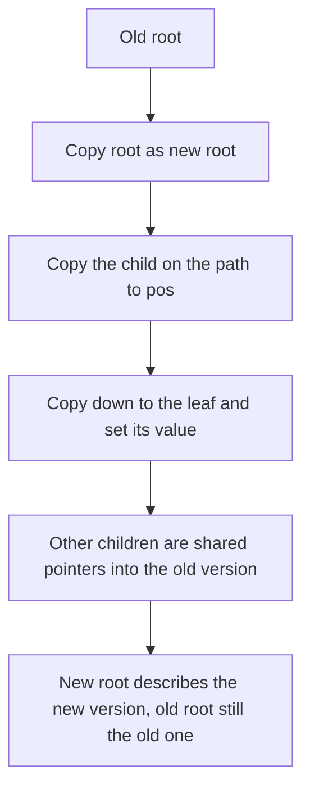

## The hook

A writer saves every draft of a long document. Copying the whole file for each save would fill the disk; good version control instead stores only what changed and points to the previous version for everything else. Any old draft can still be opened in full.

A persistent segment tree is version control for an array. Each update creates a new version by copying only the O(log n) nodes it touches, every version stays queryable, and copying an entire array becomes O(1). It also gives the neatest O(log n) solution to "k-th smallest value in a range".

## The intuition

:::analogy
Each version of the document is a table of contents pointing to chapters, which point to sections, which point to paragraphs. To change one paragraph, write a new paragraph, a new section that points to it and to the old unchanged paragraphs, a new chapter pointing to the new section and the old sections, and a new table of contents. Everything not on that path is shared with the old version. The old table of contents still exists and still describes the old document exactly.
:::

That is [[persistence]] through [[path copying]]. Each version is a [[version root]]; all versions live in one [[node pool]]. An update never modifies an existing node, so old roots keep describing old arrays.

## How it works

### Update by path copying

```
update(old, l, r, pos, val):
    new = copy of old
    if l == r: value[new] = val; return new
    if pos <= mid: left[new] = update(left[old], l, mid, pos, val)
    else:          right[new] = update(right[old], mid + 1, r, pos, val)
    value[new] = combine(value[left[new]], value[right[new]])
    return new
```

One new node per level, about log₂ n + 1 in total; the other child pointer is shared. Queries are ordinary segment tree queries started from whichever version root you choose.

### Range Queries and Copies

CSES *Range Queries and Copies* starts with one array and supports: set a value in array k, sum a range of array k, and copy array k as a new array. With a persistent sum tree:

- set: roots[k] = update(roots[k], ...), O(log n) new nodes;
- sum: an ordinary query from roots[k];
- copy: roots.push_back(roots[k]), O(1), because the two arrays share all nodes until one changes.

### k-th smallest in a range

Build [[prefix versions]] of a count tree over value ranks: version 0 is empty, and version i + 1 is version i with a[i]'s rank incremented. Version r + 1 minus version l counts how many of each value occur in a[l..r]. To find the k-th smallest, descend both versions together:

- c = count[left of version r + 1] - count[left of version l];
- if k ≤ c, go left in both; otherwise go right in both with k - c.

That is O(log n) per query, compared with O(log³ n) for a merge sort tree with binary search, and the same structure answers "how many values ≤ x in a[l..r]" online in O(log n).

### Memory

Each update adds O(log n) nodes and nothing is freed. With n = 2 × 10⁵ and 2 × 10⁵ updates, that is about 2 × 10⁵ × 19 ≈ 4 × 10⁶ new nodes plus the initial 4 × 10⁵: preallocate around 5 × 10⁶ nodes, each with two int children and a 64-bit value, about 80 MB. Check the memory limit, and use a smaller value type when possible.

| Operation | Cost | Effect on old versions |
|---|---|---|
| Point update | O(log n) time, O(log n) new nodes | unchanged |
| Range query on any version | O(log n) | |
| Copy a version | O(1) | shares every node |
| k-th smallest in a range | O(log n), two versions at once | |



:::insight
A point update changes only the nodes whose segments contain the position, one per level. Copying just those and sharing everything else gives a full new version in O(log n) time and space, so every past version remains a valid tree with its own root.
:::

## Walk through an example

### Versions and copies

Array 0 = [3, 1, 4, 1, 5].

| Step | Operation | Arrays afterwards | Answer |
|---|---|---|---|
| 1 | copy array 0 as array 1 | 0: 3 1 4 1 5; 1: same root | |
| 2 | set array 1, position 2, to 9 | 1: 3 1 9 1 5 | |
| 3 | sum of positions 1..3 in array 0 | | 1 + 4 + 1 = 6 |
| 4 | sum of positions 1..3 in array 1 | | 1 + 9 + 1 = 11 |
| 5 | copy array 1 as array 2, set position 0 to 0 | 2: 0 1 9 1 5 | |
| 6 | total of arrays 2, 1 and 0 | | 16, 19, 14 |

Step 2 created three new nodes: the root, the node for positions [0, 2] and the leaf for position 2. Array 0's root still points to the original nodes, so step 3 sees the old value 4.

### k-th smallest

a = [5, 1, 4, 2, 3, 8, 6, 7].

| Query | Range | Sorted range | Answer |
|---|---|---|---|
| 3rd smallest in [1, 5] | 1, 4, 2, 3, 8 | 1, 2, 3, 4, 8 | 3 |
| 1st smallest in [0, 7] | all | 1, ..., 8 | 1 |
| 5th smallest in [3, 7] | 2, 3, 8, 6, 7 | 2, 3, 6, 7, 8 | 8 |
| 2nd smallest in [2, 4] | 4, 2, 3 | 2, 3, 4 | 3 |

For the first query, the descent compares version 6 with version 1 at each node: at the root's left child (values 1 to 4) the difference is 4, at least 3, so go left; and so on down to value 3.

:::try-this
In an array of 8 elements, how many nodes does one persistent update create, and how many nodes do 1,000 updates add in total? (A tree over 8 leaves has 4 levels, so each update copies 4 nodes, one per level. 1,000 updates add 4,000 nodes, on top of the 15 nodes of the initial tree.)
:::

:::warning
Common misconception: "Persistent means you can update an old version in place." Updating an old version creates a new branch of history; it never changes the old root, because other versions may share its nodes. If two arrays share nodes after a copy, modifying a shared node in place would silently change both arrays. Every update must go through path copying.
:::

## The code

```pseudo
update(old, l, r, pos, val) -> new root      # copies one node per level
query(root, l, r, ql, qr)                     # ordinary query from any root
kth(u, v, l, r, k):                           # u = version l, v = version r + 1 of the count tree
    if l == r: return l
    c = cnt[left[v]] - cnt[left[u]]
    if k <= c: return kth(left[u], left[v], l, mid, k)
    return kth(right[u], right[v], mid + 1, r, k - c)
```

```cpp
#include <bits/stdc++.h>
using namespace std;
using ll = long long;

struct PersistentSeg {                                   // sums; node 0 is a shared empty node
    vector<int> L, R;
    vector<ll> val;
    int n;
    explicit PersistentSeg(int n) : L(1, 0), R(1, 0), val(1, 0), n(n) {}
    int clone(int v) { L.push_back(L[v]), R.push_back(R[v]), val.push_back(val[v]); return val.size() - 1; }
    int build(int l, int r, const vector<ll>& a) {
        int v = clone(0);
        if (l == r) { val[v] = a[l]; return v; }
        int m = (l + r) / 2;
        int lc = build(l, m, a), rc = build(m + 1, r, a);
        L[v] = lc, R[v] = rc, val[v] = val[lc] + val[rc];
        return v;
    }
    int setv(int old, int l, int r, int pos, ll x) {      // returns the new root
        int v = clone(old);
        if (l == r) { val[v] = x; return v; }
        int m = (l + r) / 2;
        if (pos <= m) { int c = setv(L[old], l, m, pos, x); L[v] = c; }
        else { int c = setv(R[old], m + 1, r, pos, x); R[v] = c; }
        val[v] = val[L[v]] + val[R[v]];
        return v;
    }
    int addOne(int old, int l, int r, int pos) {          // count tree: +1 at pos
        int v = clone(old);
        val[v]++;
        if (l == r) return v;
        int m = (l + r) / 2;
        if (pos <= m) { int c = addOne(L[old], l, m, pos); L[v] = c; }
        else { int c = addOne(R[old], m + 1, r, pos); R[v] = c; }
        return v;
    }
    ll sum(int v, int l, int r, int ql, int qr) const {
        if (!v || qr < l || r < ql) return 0;
        if (ql <= l && r <= qr) return val[v];
        int m = (l + r) / 2;
        return sum(L[v], l, m, ql, qr) + sum(R[v], m + 1, r, ql, qr);
    }
    int kth(int u, int v, int l, int r, int k) const {    // k-th smallest in version v minus version u
        if (l == r) return l;
        int m = (l + r) / 2, c = val[L[v]] - val[L[u]];
        return k <= c ? kth(L[u], L[v], l, m, k) : kth(R[u], R[v], m + 1, r, k - c);
    }
};

int main() {
    PersistentSeg ps(5);
    vector<int> roots = {ps.build(0, 4, {3, 1, 4, 1, 5})};
    roots.push_back(roots[0]);                           // copy array 0 in O(1)
    roots[1] = ps.setv(roots[1], 0, 4, 2, 9);
    cout << ps.sum(roots[0], 0, 4, 1, 3) << ' ' << ps.sum(roots[1], 0, 4, 1, 3) << ' ';
    roots.push_back(roots[1]);
    roots[2] = ps.setv(roots[2], 0, 4, 0, 0);
    cout << ps.sum(roots[2], 0, 4, 0, 4) << ' ' << ps.sum(roots[1], 0, 4, 0, 4) << ' '
         << ps.sum(roots[0], 0, 4, 0, 4) << '\n';                               // 6 11 16 19 14

    vector<int> a = {5, 1, 4, 2, 3, 8, 6, 7};
    vector<int> vals(a);
    sort(vals.begin(), vals.end());
    int m = vals.size();
    PersistentSeg cnt(m);
    vector<int> ver = {0};                               // version i counts a[0..i-1]
    for (int x : a) ver.push_back(cnt.addOne(ver.back(), 0, m - 1, lower_bound(vals.begin(), vals.end(), x) - vals.begin()));
    auto kthSmallest = [&](int l, int r, int k) { return vals[cnt.kth(ver[l], ver[r + 1], 0, m - 1, k)]; };
    cout << kthSmallest(1, 5, 3) << ' ' << kthSmallest(0, 7, 1) << ' ' << kthSmallest(3, 7, 5) << ' '
         << kthSmallest(2, 4, 2) << '\n';                                       // 3 1 8 3
}
```

Child indices are read into a local variable before assigning, as in `int c = setv(...); L[v] = c;`. Writing `L[v] = setv(...)` directly is a classic bug: the call can push to the vectors and reallocate them, so the reference `L[v]` may point into freed memory.

## Complexity

- **Build: O(n)** nodes and time.
- **Update: O(log n) time and new nodes.**
- **Query on any version: O(log n).**
- **k-th smallest in a range: O(log n)** after O(n log n) preprocessing.
- **Memory: O(n + u log n)** for u updates; preallocate or reserve to avoid reallocation.

## Common mistakes

- **Modifying a node in place,** which corrupts every version that shares it.
- **Assigning a child from a recursive call that may reallocate the vectors,** as explained after the code.
- **Underestimating memory:** 20 nodes per update adds up quickly.
- **Using version r instead of r + 1** for prefix versions in k-th queries; version i counts the first i elements.
- **Forgetting the empty node 0** with zero count, which lets missing children read as empty segments.

## Practice problems

CSES *Range Queries and Copies* is persistence with copies and sums. SPOJ *K-th Number* is k-th smallest with prefix versions. SPOJ *K-query Online* forces online answers to "how many values greater than k in a range", where prefix versions replace the offline sweep. The non-persistent foundations are in [A Tournament Bracket for Your Array](article:cp-segment-tree).

## Key takeaways

- A persistent segment tree keeps every version by copying only the O(log n) nodes on an update's path and sharing all others.
- Each version is a root into one shared pool of nodes, so copying a whole array is O(1).
- Old versions are never modified, which is what keeps them valid after newer updates.
- Prefix versions of a count tree over values answer the k-th smallest in a range by descending two versions at once in O(log n).
- Memory grows by O(log n) nodes per update, so it must be estimated and preallocated against the limit.
