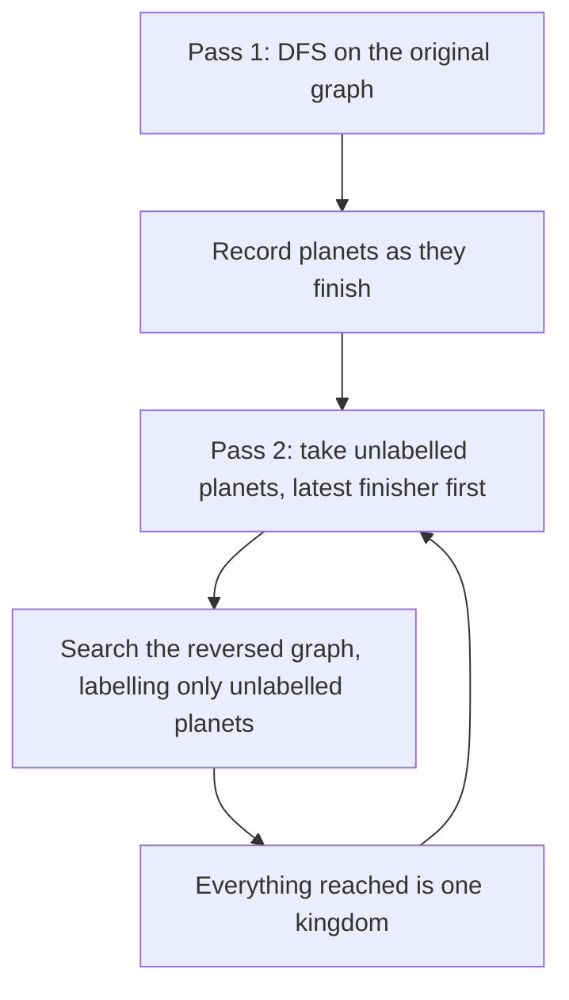

## The hook

A galaxy of planets is linked by one-way teleporters. Two planets belong to the same kingdom when you can teleport from each to the other, possibly through other planets. Label every planet with its kingdom.

This is strongly connected components in its purest form. [One-Way Streets, Found in a Single Walk](article:cp-scc) solved it with Tarjan's one-pass algorithm. Here we solve it with Kosaraju's two passes, which many people find easier to get right under pressure, and make both passes safe for very deep graphs.

## The problem

There are n planets and m one-way teleporters, with n up to 10⁵ and m up to 2·10⁵. Print the number of kingdoms k, then for each planet a label from 1 to k, so that two planets share a label exactly when each can reach the other. Any labelling with that property is accepted.

For seven planets 0 to 6 and teleporters 0 → 1, 1 → 2, 2 → 0, 2 → 3, 3 → 4, 4 → 5, 5 → 3, 6 → 5, 6 → 0, there are three kingdoms: {0, 1, 2}, {3, 4, 5} and {6}.

## The obvious approach

Run a BFS from every planet to get its reachable set, then put a and b together when each is in the other's set. That is n searches of O(n + m) each, about 10⁵ · 3·10⁵ = 3·10¹⁰ steps, and the reachability table alone would need 10¹⁰ bits. Far too slow and far too big.

Even the half-clever version, "a BFS from each planet in the graph and in the reversed graph, then intersect", is still one pair of searches per planet. We need all components from a constant number of searches.

## The key insight

:::analogy
Think of each kingdom as a sealed region and draw the regions as a map with arrows between them; there are no loops between regions, or they would be one kingdom. An explorer who keeps going until stuck, and notes each planet when they have finished everything reachable from it, finishes upstream regions last. Now flip every teleporter. Starting from the planet the explorer finished last, which sits in an upstream region, the flipped teleporters lead only back into that same region: nothing upstream of it exists. Label what you reach, seal it off, and repeat with the next latest finisher.
:::

Each sealed region is a [[kingdom]]. The explorer's notes give the [[finishing order]], and the latest finisher sits in a [[source component]]. Searching the [[reversed graph]] from it, the search cannot leak out, because in the reversed graph a source component becomes a component with no exits.

Why the latest finisher is in a source component: take any edge from component C to component D. If the DFS enters C first, it explores all of D before finishing the first vertex of C, so C finishes later. If it enters D first, it cannot reach C from D at all, so D finishes completely before C is even started. Either way some vertex of C finishes after every vertex of D. So the overall latest finisher is in a component with no incoming edges.

After labelling that component, remove it in effect by skipping labelled planets; the next unlabelled latest finisher is a source of what remains, and the same argument repeats.

### Both passes without recursion

A long cycle of 10⁵ planets makes a recursive DFS 10⁵ calls deep. Pass one becomes an [[explicit stack DFS]] with a next-edge pointer per vertex: look at the top vertex; if it has an unexamined edge to an unseen planet, push that planet; if it has none left, it finishes, so record it and pop. Pass two only needs to label everything reachable, so any order works, including a simple stack.

| Pass | Graph | Order | Records |
|---|---|---|---|
| 1 | original | any start order, full DFS | finishing order |
| 2 | reversed | decreasing finishing time | one kingdom per new start |



:::insight
Finishing times sort the condensation for free: some vertex of an upstream component always finishes after everything downstream. Reversing the edges then turns "upstream" into "nothing leaves", which is exactly what a labelling search needs to stop at a component's border.
:::

## Walk through an example

Pass one starts at planet 0 and follows edges in input order.

| Step | DFS stack | Finishes |
|---|---|---|
| 1 | 0, 1, 2 | |
| 2 | 0, 1, 2, 3, 4, 5 | 5 has only 5 → 3, already seen |
| 3 | unwinds | 5, then 4, then 3, then 2, then 1, then 0 |
| 4 | new start 6: both its edges lead to seen planets | 6 |

Finishing order: 5, 4, 3, 2, 1, 0, 6.

Reversed teleporters: 1 → 0, 2 → 1, 0 → 2, 3 → 2, 4 → 3, 5 → 4, 3 → 5, 5 → 6, 0 → 6.

| Start, latest first | Reverse search reaches | Kingdom |
|---|---|---|
| 6 | nothing points into 6 in the original graph, so only 6 | 1: {6} |
| 0 | 2, 1 and 6, but 6 is labelled | 2: {0, 1, 2} |
| 1, 2 | already labelled | |
| 3 | 5, 4, then 2 and 6, both labelled | 3: {3, 4, 5} |

Output: 3 kingdoms, labels 2 2 2 3 3 3 1 for planets 0 to 6. The labels also follow the arrows between kingdoms: {6} with label 1 points into labels 2 and 3, and label 2 points into 3. Kosaraju emits kingdoms in topological order, the opposite of Tarjan, which emits sinks first.

:::try-this
Process pass two in the wrong order, earliest finisher first, starting the reverse search at planet 5. What happens? (Reversed edges from 5 lead to 4 and 6, from 4 to 3, from 3 to 2, from 2 to 1, from 1 to 0. All seven planets get one label, merging three kingdoms. The earliest finisher sits in a sink component, which the reversed graph turns into a source with exits everywhere.)
:::

:::warning
Common misconception: "Pass two can search the original graph as long as it uses the right order." From planet 6, the original teleporters lead to 5 and 0, and from there to everything, so one search swallows the whole galaxy. The reversal is not decoration: it is what turns the starting component into one that cannot be left.
:::

## The code

```pseudo
pass 1: for each unseen s: iterative DFS on g
            top u: if u has an unexamined edge to unseen v: push v
                   else: append u to order; pop
pass 2: for i from n-1 down to 0: s = order[i]
            if s unlabelled: k += 1; search rg from s, labelling unlabelled planets with k
```

```cpp
#include <bits/stdc++.h>
using namespace std;

// Kosaraju with both passes iterative. Labels 1..k come out in topological order of the condensation.
vector<int> kingdoms(int n, const vector<array<int, 2>>& edges, int& k) {
    vector<vector<int>> g(n), rg(n);
    for (auto [a, b] : edges) g[a].push_back(b), rg[b].push_back(a);
    vector<int> order, it(n, 0);                                 // vertices in order of finishing
    vector<char> seen(n, 0);
    for (int s = 0; s < n; s++) {                                // pass 1: DFS on g, record finish order
        if (seen[s]) continue;
        vector<int> st = {s};
        seen[s] = 1;
        while (!st.empty()) {
            int u = st.back();
            if (it[u] < (int)g[u].size()) {
                int v = g[u][it[u]++];
                if (!seen[v]) seen[v] = 1, st.push_back(v);
            } else {
                order.push_back(u), st.pop_back();               // u finishes after everything it reaches
            }
        }
    }
    vector<int> label(n, 0);
    k = 0;
    for (int i = n - 1; i >= 0; i--) {                           // pass 2: latest finisher first, on rg
        if (label[order[i]]) continue;
        k++;
        vector<int> st = {order[i]};
        label[order[i]] = k;
        while (!st.empty()) {
            int u = st.back(); st.pop_back();
            for (int v : rg[u]) if (!label[v]) label[v] = k, st.push_back(v);   // stays inside one kingdom
        }
    }
    return label;
}

int main() {
    vector<array<int, 2>> e = {{0, 1}, {1, 2}, {2, 0}, {2, 3}, {3, 4}, {4, 5}, {5, 3}, {6, 5}, {6, 0}};
    int k;
    auto lab = kingdoms(7, e, k);
    cout << k << ':';
    for (int x : lab) cout << ' ' << x;
    cout << '\n';                                                // 3: 2 2 2 3 3 3 1

    int n = 100000;                                              // a 10^5-long cycle: deep for a recursive DFS
    vector<array<int, 2>> ring;
    for (int v = 0; v < n; v++) ring.push_back({v, (v + 1) % n});
    kingdoms(n, ring, k);
    cout << k << '\n';                                           // 1

    mt19937 rng(13);                                             // compare with mutual reachability
    bool ok = true;
    for (int t = 0; t < 300; t++) {
        int m = 1 + rng() % 8;
        vector<array<int, 2>> r;
        for (int i = 0; i < 12; i++) r.push_back({(int)(rng() % m), (int)(rng() % m)});
        vector<vector<char>> reach(m, vector<char>(m, 0));
        for (int v = 0; v < m; v++) reach[v][v] = 1;
        for (auto [a, b] : r) reach[a][b] = 1;
        for (int w = 0; w < m; w++) for (int a = 0; a < m; a++) for (int b = 0; b < m; b++)
            if (reach[a][w] && reach[w][b]) reach[a][b] = 1;
        int kk;
        auto L = kingdoms(m, r, kk);
        for (int a = 0; a < m; a++) for (int b = 0; b < m; b++)
            ok = ok && ((L[a] == L[b]) == (reach[a][b] && reach[b][a]));
        for (auto [a, b] : r) ok = ok && L[a] <= L[b];           // labels follow topological order
    }
    cout << (ok ? "stress ok" : "stress FAILED") << '\n';        // stress ok
}
```

For CSES input, read planets as 1 to n, subtract one when storing edges, and print `k` and then `lab`. The random test compares labels against a Floyd–Warshall style reachability table and also checks that every teleporter goes from a smaller or equal label to a larger or equal one.

## Complexity

- **Time: O(n + m).** Each pass visits every planet once and examines every edge once.
- **Space: O(n + m)** for the graph, its reverse, the finishing order and the explicit stacks.

## Common mistakes

- **Starting pass two at the earliest finisher,** which merges components.
- **Searching the original graph in pass two** instead of the reversed one.
- **Recording a vertex when it is first visited** instead of when it finishes.
- **Recursing 10⁵ deep** on a long chain or cycle.
- **Building the reversed graph from the wrong side,** for example `rg[a].push_back(b)` instead of `rg[b].push_back(a)`.
- **Assuming the labels must match the sample exactly;** any labelling with the right grouping is accepted.

## Practice problems

*Planets and Kingdoms* is this walkthrough. *Flight Routes Check* needs only one search in each direction from a single planet, plus a counterexample pair when the graph is not strongly connected. *Coin Collector* builds the condensation and runs a DP along the topological order that Kosaraju's labels already provide. The same components found by a single DFS are in [One-Way Streets, Found in a Single Walk](article:cp-scc), and the interview-level version is [One-Way Streets and the Loops Between Them](article:dsa-scc-for-interviews).

## Key takeaways

- Two planets share a kingdom exactly when each can reach the other, which is a strongly connected component, and pairwise searches are far too slow at 10⁵ planets.
- Kosaraju's first pass records finishing times, and some planet of every upstream component finishes after everything downstream of it.
- The second pass searches the reversed graph starting from the latest finisher, which keeps each search inside one component.
- Kosaraju labels components in topological order of the condensation, the reverse of Tarjan's emission order.
- Both passes are easy to write with explicit stacks, which removes any risk from deep recursion on long chains or cycles.
