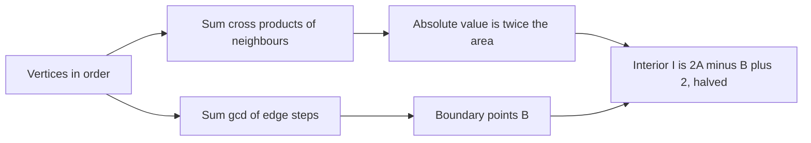

## The hook

Given the corners of a field as integer coordinates, how big is it? Splitting a general polygon into triangles by hand is messy, especially when it is not convex. A single formula does it in one pass, and it got its name from the criss-cross pattern of multiplications, like laces across a shoe.

CSES *Polygon Area* asks for that area, and *Polygon Lattice Points* asks how many integer points lie inside and on the boundary. Both are exact integer computations, built on the cross product from [Left Turn or Right Turn at the Junction](article:cp-geometry-basics).

## The problem

A simple polygon, meaning its edges do not cross, has n vertices with integer coordinates, given in order around the boundary, either clockwise or counter-clockwise. Coordinates can be up to 10⁹ in absolute value.

- **Polygon Area:** print twice the area, which is always an integer.
- **Polygon Lattice Points:** print the number of lattice points strictly inside and the number on the boundary.

For the pentagon (0, 0), (4, 0), (4, 3), (1, 5), (0, 2): twice the area is 31, so the area is 15.5, and there are 11 points inside and 11 on the boundary.

## The obvious approach

Triangulate: pick a vertex and fan out triangles to all others, adding their areas with Heron's formula. Heron's formula needs square roots, so it loses exactness with coordinates near 10⁹, and the fan is only valid as stated for convex polygons.

For lattice points, the obvious approach is to test every integer point in the bounding box. With coordinates up to 10⁹ that box can hold about 4·10¹⁸ points. Impossible.

## The key insight

:::analogy
Imagine lacing a shoe: the lace runs from each eyelet to the next across the polygon. Each lace segment, together with a fixed peg at the origin, sweeps a thin triangle. Where the lace moves counter-clockwise around the peg, the triangle is counted as positive area; where it doubles back, the triangle is counted as negative. Going all the way round the polygon, every bit outside the polygon is swept once forwards and once backwards and cancels, and what is left is exactly the polygon.
:::

That cancellation is the [[shoelace formula]]:

- 2A = Σ (x_i · y_{i+1} − x_{i+1} · y_i), with indices wrapping around.

Each term is the cross product of consecutive vertices, the [[signed area]] of the triangle they form with the origin, doubled. The total is positive for counter-clockwise order and negative for clockwise, so take the absolute value. Because every term is an integer, the [[doubled area]] is an exact integer, which is why CSES asks for it.

### Lattice points

**On the boundary.** An edge from p to q with steps dx and dy holds gcd(|dx|, |dy|) lattice points if one endpoint is counted, because those points are evenly spaced by (dx, dy)/gcd. Summing over all edges counts every vertex exactly once: B = Σ gcd(|dx|, |dy|), the [[boundary lattice points]].

**Inside.** [[Pick's theorem]] links area, interior points I and boundary points B for any simple polygon with integer vertices:

- A = I + B/2 − 1, so I = (2A − B + 2)/2.

Using the doubled area keeps every step in integers.

| Quantity | Formula | Exact? |
|---|---|---|
| twice the area | \|Σ cross(p_i, p_{i+1})\| | yes, integers |
| orientation | sign of the same sum | yes |
| boundary points B | Σ gcd(\|dx\|, \|dy\|) | yes |
| interior points I | (2A − B + 2)/2 | yes |

### Overflow

Each product x·y can reach 10¹⁸, and the doubled area of a polygon with coordinates up to 10⁹ can approach 8·10¹⁸, close to the 64-bit limit of about 9.2·10¹⁸. Accumulating in __int128, or translating all points so the first vertex is the origin, removes any risk.



:::insight
The shoelace formula works for any simple polygon, convex or not, because the parts swept outside the polygon cancel in sign. Working with twice the area keeps everything in integers, and Pick's theorem then turns area and boundary counts into interior counts without testing a single point.
:::

## Walk through an example

Pentagon (0, 0), (4, 0), (4, 3), (1, 5), (0, 2), listed counter-clockwise.

| Edge | x_i·y_{i+1} − x_{i+1}·y_i | dx, dy | gcd |
|---|---|---|---|
| (0, 0) → (4, 0) | 0·0 − 4·0 = 0 | 4, 0 | 4 |
| (4, 0) → (4, 3) | 4·3 − 4·0 = 12 | 0, 3 | 3 |
| (4, 3) → (1, 5) | 4·5 − 1·3 = 17 | −3, 2 | 1 |
| (1, 5) → (0, 2) | 1·2 − 0·5 = 2 | −1, −3 | 1 |
| (0, 2) → (0, 0) | 0·0 − 0·2 = 0 | 0, −2 | 2 |
| total | 31 | | 11 |

- Twice the area is 31, so the area is 15.5. Listing the vertices clockwise gives −31.
- Boundary points B = 11: the bottom edge contributes (0, 0), (1, 0), (2, 0) and (3, 0), its far end (4, 0) being counted by the next edge, and so on around.
- Interior points I = (31 − 11 + 2)/2 = 11.

A check of every integer point in the box from (0, 0) to (4, 5) finds the same 11 inside and 11 on the edges.

:::try-this
Compute both answers for the rectangle (0, 0), (3, 0), (3, 2), (0, 2). (Cross products: 0, 6, 6, 0, so twice the area is 12 and the area is 6. Boundary: 3 + 2 + 3 + 2 = 10. Interior: (12 − 10 + 2)/2 = 2, the points (1, 1) and (2, 1).)
:::

:::warning
Common misconception: "The polygon's vertices are given counter-clockwise, so the sum is already positive." CSES does not promise an orientation. A clockwise input gives a negative sum, and printing it as is gives a wrong answer; Pick's formula with a negative 2A gives nonsense too. Take the absolute value first.
:::

## The code

```pseudo
twiceArea = | sum over i of x[i]*y[i+1] - x[i+1]*y[i] |        # indices wrap around
B = sum over edges of gcd(|dx|, |dy|)
I = (twiceArea - B + 2) / 2
```

```cpp
#include <bits/stdc++.h>
using namespace std;
using ll = long long;
struct P { ll x, y; };

ll doubledSignedArea(const vector<P>& p) {                       // shoelace: positive if counter-clockwise
    __int128 s = 0;
    int n = p.size();
    for (int i = 0; i < n; i++) {
        const P &a = p[i], &b = p[(i + 1) % n];
        s += (__int128)a.x * b.y - (__int128)b.x * a.y;          // cross product of consecutive vertices
    }
    return (ll)s;
}

ll boundaryPoints(const vector<P>& p) {                          // lattice points on the edges
    ll b = 0;
    int n = p.size();
    for (int i = 0; i < n; i++) b += gcd(llabs(p[(i + 1) % n].x - p[i].x), llabs(p[(i + 1) % n].y - p[i].y));
    return b;
}

pair<ll, ll> latticePoints(const vector<P>& p) {                 // (interior, boundary) by Pick's theorem
    ll A2 = llabs(doubledSignedArea(p)), B = boundaryPoints(p);
    return {(A2 - B + 2) / 2, B};                                // A = I + B/2 - 1, so 2I = 2A - B + 2
}

int classify(const vector<P>& p, P q) {                          // 0 outside, 1 on the boundary, 2 inside
    int n = p.size();
    bool inside = false;
    for (int i = 0; i < n; i++) {
        P a = p[i], b = p[(i + 1) % n];
        ll cr = (b.x - a.x) * (q.y - a.y) - (b.y - a.y) * (q.x - a.x);
        if (cr == 0 && min(a.x, b.x) <= q.x && q.x <= max(a.x, b.x) && min(a.y, b.y) <= q.y && q.y <= max(a.y, b.y)) return 1;
        if ((a.y > q.y) != (b.y > q.y)) {                        // edge crosses the horizontal line through q
            ll num = (b.x - a.x) * (q.y - a.y), den = b.y - a.y; // crossing x = a.x + num / den
            bool right = den > 0 ? (q.x - a.x) * den < num : (q.x - a.x) * den > num;
            if (right) inside = !inside;
        }
    }
    return inside ? 2 : 0;
}

int main() {
    vector<P> poly = {{0, 0}, {4, 0}, {4, 3}, {1, 5}, {0, 2}};   // counter-clockwise
    vector<P> cw(poly.rbegin(), poly.rend());                    // the same polygon, clockwise
    cout << doubledSignedArea(poly) << ' ' << doubledSignedArea(cw) << '\n';     // 31 -31
    auto [I, B] = latticePoints(poly);
    cout << I << ' ' << B << '\n';                               // 11 11

    mt19937 rng(33);                                             // Pick's theorem against counting every lattice point
    bool ok = true;
    for (int t = 0; t < 300; t++) {
        int k = 3 + rng() % 6;
        vector<P> pts;
        for (int i = 0; i < k; i++) pts.push_back({(ll)(rng() % 13), (ll)(rng() % 13)});
        double cx = 0, cy = 0;
        for (auto& q : pts) cx += q.x, cy += q.y;
        cx /= k, cy /= k;
        sort(pts.begin(), pts.end(), [&](P a, P b) {             // star-shaped order around the centroid
            double A = atan2(a.y - cy, a.x - cx), Bn = atan2(b.y - cy, b.x - cx);
            return A < Bn || (A == Bn && hypot(a.x - cx, a.y - cy) < hypot(b.x - cx, b.y - cy));
        });
        bool degenerate = doubledSignedArea(pts) == 0;
        for (int i = 0; i < k && !degenerate; i++) {             // skip repeated or collinear-adjacent corners
            P a = pts[i], b = pts[(i + 1) % k], c = pts[(i + 2) % k];
            if ((a.x == b.x && a.y == b.y) || (b.x - a.x) * (c.y - a.y) - (b.y - a.y) * (c.x - a.x) == 0) degenerate = true;
        }
        if (degenerate) continue;
        ll in = 0, on = 0;
        for (ll x = 0; x <= 12; x++) for (ll y = 0; y <= 12; y++) { int c = classify(pts, {x, y}); in += c == 2, on += c == 1; }
        auto [I2, B2] = latticePoints(pts);
        ok = ok && I2 == in && B2 == on && doubledSignedArea(pts) > 0;
    }
    cout << (ok ? "stress ok" : "stress FAILED") << '\n';        // stress ok
}
```

The random test builds 300 simple polygons, by sorting random points by angle around their centroid, and counts every lattice point in the box as inside, on the boundary or outside with an exact point-in-polygon test; Pick's formula must agree each time.

## Complexity

- **Time: O(n)** for the area, plus O(n log C) for the gcds of coordinate differences up to C.
- **Space: O(n)** for the vertices.

## Common mistakes

- **Forgetting the absolute value** when the input is clockwise.
- **Printing the area instead of twice the area** in Polygon Area, or dividing too early and losing the half.
- **Overflow** in the sum of cross products for coordinates near 10⁹.
- **Forgetting the wrap-around term** from the last vertex back to the first.
- **Counting both endpoints of every edge** for B, which counts every vertex twice.
- **Using Pick's theorem on a polygon with non-integer vertices or self-intersections,** where it does not hold.

## Practice problems

*Polygon Area* prints twice the shoelace sum's absolute value. *Polygon Lattice Points* adds the gcd sum and Pick's theorem. *Point in Polygon* classifies query points as inside, outside or on the boundary, using the same cross product to detect boundary points and a ray-crossing count for the rest. The cross product itself, and orientation tests, are in [Left Turn or Right Turn at the Junction](article:cp-geometry-basics), and the hull of a point set in [Snapping a Rubber Band Around Nails](article:cp-convex-hull).

## Key takeaways

- The shoelace formula gives twice the signed area of a simple polygon as the sum of cross products of consecutive vertices.
- The sign of that sum gives the orientation, positive for counter-clockwise, so the area is its absolute value.
- With integer vertices, twice the area is an exact integer, which avoids floating point entirely.
- An edge with steps dx and dy holds gcd of their absolute values lattice points when one endpoint is counted, so summing over edges gives the boundary count.
- Pick's theorem, A = I + B/2 − 1, then gives the interior count as (2A − B + 2)/2.
