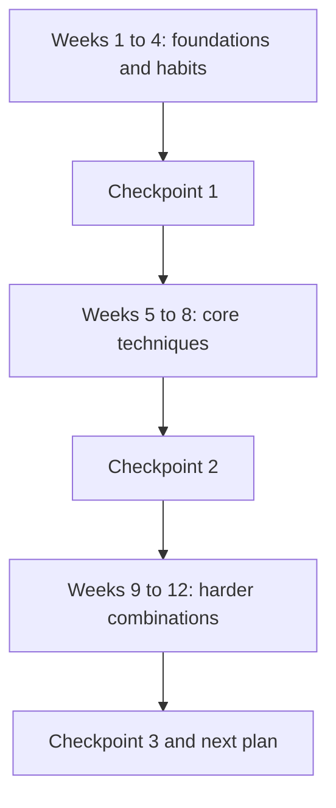

## The hook

You have placements in a few months, a pile of DSA to revise, and a vague plan to "do some Codeforces". Without a plan, practice drifts: some days of easy problems, a contest that goes badly, a week off, then guilt. Twelve weeks later, very little has changed.

With a plan, the same hours compound. This article lays out a twelve-week schedule of about eight to ten hours a week that fits beside placement preparation, and points to the article in this subject for each step.

## The intuition

:::analogy
Think of a marathon training plan. Nobody runs a marathon on day one. The plan mixes long slow runs, speed sessions and rest days, increases the load a little each week, and has checkpoints like a 10K race to measure progress. Each session has a purpose, and the mix matters more than any single run.
:::

Here, [[topic set]]s are the speed sessions that build a specific skill. Contests and [[virtual contest]]s are the races. Upsolving is the cool-down that turns a race into learning. And every four weeks there is a [[checkpoint]].

## Let's build it up

### The weekly rhythm

| Day | Activity | Time |
|---|---|---|
| 2 weekdays | topic set on this week's technique | 1.5 hours each |
| 1 weekday | upsolve last contest's next unsolved problem | 1 hour |
| Weekend | one live or virtual contest | 2 hours |
| Weekend | upsolve and update your [[mistakes log]] | 1.5 hours |
| 1 day | rest | 0 |

That is about eight hours. Placement DSA practice runs alongside; many techniques overlap, so the hours reinforce each other.

### The twelve weeks

**Weeks 1 to 4: foundations and habits.** Goal: solve Div. 3 or Div. 4 problems A to C cleanly.

- Week 1: set up your [template](article:cp-fast-io-template); read [how contests work](article:cp-how-contests-work); first virtual Div. 4.
- Week 2: implementation and [reading problems fast](article:cp-reading-problems-fast); sorting and greedy topic set.
- Week 3: prefix sums, two pointers and binary search on the answer, all from the DSA subject.
- Week 4: [stress testing](article:cp-stress-testing) and [debugging](article:cp-debugging-in-contest); a deliberate contest where you test every submission.

**Weeks 5 to 8: core techniques.** Goal: reliable Div. 2 A and B, frequent C.

- Week 5: [modular arithmetic](article:cp-modular-arithmetic) and [fast exponentiation](article:cp-binary-exponentiation).
- Week 6: [sieve](article:cp-sieve), [GCD](article:cp-gcd-lcm), [inverses](article:cp-modular-inverse) and [binomial coefficients](article:cp-binomial-coefficients).
- Week 7: BFS, DFS and union-find from the DSA graphs track.
- Week 8: introductory DP families; [invariants and constructive problems](article:cp-invariants-observations).

**Weeks 9 to 12: harder combinations.** Goal: Div. 2 C regularly, D sometimes.

- Week 9: [coordinate compression](article:cp-coordinate-compression) and Fenwick trees.
- Week 10: segment trees.
- Week 11: bitmask DP and DP on trees.
- Week 12: mixed virtual contests, focusing on choosing techniques quickly.

:::insight
A plan works because it forces [[deliberate practice]]: every week targets one technique in your stretch zone, every contest tests whether you can recognise it unlabelled, and every upsolve turns a failure into a tool. Volume without that structure mostly repeats what you already know.
:::

### What one topic-set session looks like

Pick five to eight problems on the week's technique, sorted from easy to hard, starting about 200 rating points below your level and ending about 200 above it. Give each a fixed time box, 25 minutes for the easier ones and 45 for the harder ones. When a time box ends, read only the hint or the first paragraph of the editorial, then try again before reading further. Finish every problem you start, even if it takes an editorial, and write one line in your log about the key idea. The goal of the session is not the number solved; it is that next week, the technique feels obvious.

### If you have less time

With only four or five hours a week, keep the contest and its upsolve, and do one topic set instead of two. Stretch the plan to sixteen weeks rather than skipping topics; the order matters more than the speed.

### Checkpoints

At the end of weeks 4, 8 and 12, look at three numbers: problems solved per contest, the average rating of problems you can solve, and the top three causes in your mistakes log. Then adjust. If edge cases dominate, add more testing. If editorials use ideas you have never seen, add topic weeks. If you solve well but slowly, add more contests.

:::warning
Common misconception: "I need to grind every day to improve." Consistency beats intensity. Eight focused hours a week for twelve weeks usually beats a few twenty-hour weeks followed by burnout. Rest days are part of the plan, especially alongside placement preparation.
:::

## A tiny example

Anjali starts week 1 unrated. By the week 4 checkpoint, she solves Div. 4 A to C in most rounds, but her log shows "int overflow" four times and "forgot multi-test reset" three times. She updates her template and adds a two-line checklist; those mistakes disappear.

At week 8, she solves Div. 2 A and B reliably, sometimes C, but editorials for her missed C problems often mention number theory she has just learned. She swaps week 9 for extra practice on inverses and combinatorics before moving on. At week 12, she has a rating curve trending upward and a clear next plan.

:::try-this
Write your own week 1 on paper: which days, which two topic sets, which virtual contest, and when you will upsolve. Put it in your calendar now. (A plan that exists only in your head tends to get skipped the first busy week.)
:::

## Where you'll see this again

Every technique named here has its own article in this subject, with practice problems you can use as topic sets. The [rating ladder](article:cp-rating-ladder) tells you which band to practise in, and [upsolving](article:cp-upsolving) explains how to learn from each contest. For placements, the first eight weeks overlap heavily with interview DSA.

## Key takeaways

- A weekly rhythm of topic sets, a contest, upsolving and a rest day builds skill steadily without burning out.
- Twelve weeks split into foundations, core techniques and harder combinations takes you from implementation to Div. 2 C level.
- Topic sets build each technique, while contests train recognising which technique an unlabelled problem needs.
- Checkpoints every four weeks use solved counts and the mistakes log to adjust the plan.
- Consistent, deliberate practice in your stretch zone beats occasional bursts of heavy grinding.
