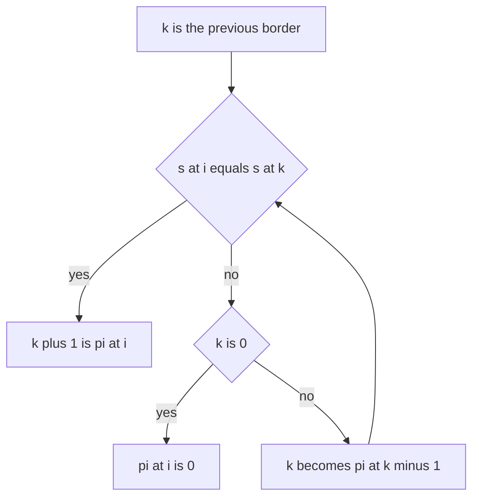

## The hook

A proofreader hunts for one phrase in a book of a million letters. A careless reader, on a mismatch, goes back to just after where the attempt started and tries again, so some letters are read over and over. A careful reader never moves their eyes backwards: on a mismatch they remember how much of the phrase still matches and carry on from there.

Knuth, Morris and Pratt published that idea in 1977, and its core, the prefix function, does far more than matching. [A Reader Who Remembers What Still Matches](article:dsa-kmp-for-interviews) built it for interview problems. Here we prove why it is linear, read borders and periods straight off it, count how often every prefix occurs, and turn it into an automaton for DP over strings.

## The intuition

:::analogy
The careful reader keeps one number in mind: how many letters of the phrase they are currently matching. On a mismatch they do not start over; they ask which shorter beginning of the phrase is also an ending of what they have just matched, and continue from that shorter match. They never reread a letter of the page. The only memory they need is, for each beginning of the phrase, its longest part that is both a beginning and an ending.
:::

A part that is both a beginning and an ending is a [[border]]. The reader's memory is the [[prefix function]], and "the next shorter match to try" walks the [[fallback chain]].

## How it works

### Computing pi

```
pi[0] = 0
for i = 1 .. n-1:
    k = pi[i-1]                              # longest border of the previous prefix
    while k > 0 and s[i] != s[k]: k = pi[k-1]    # fall back to the next shorter border
    if s[i] == s[k]: k += 1
    pi[i] = k
```

A border of s[0..i] with length k + 1 must be a border of s[0..i − 1] of length k, extended by the letter s[k] = s[i]. So the candidates are exactly the borders of the previous prefix, tried longest first, and the fallback chain lists them in that order.

**Why it is linear.** k increases by at most 1 per position, and each fallback decreases it by at least 1. k starts at 0 and never goes negative, so the total number of fallbacks over the whole string is at most n. The inner while loop costs O(n) in total, not per position.

### Matching

Run the same loop over the text t while comparing against the pattern p. When k reaches |p|, record a match at i − |p| + 1 and continue from k = pi[|p| − 1], so overlapping matches are found too. No separator character is needed, unlike the "p + '#' + t" trick, which fails if the separator can appear in the input.

### Borders and periods

- **All borders** of s: follow the chain from pi[n − 1]. CSES *Finding Borders* prints them shortest first.
- **All [[period]]s**: p is a period exactly when n − p is a border, plus p = n itself. CSES *Finding Periods* prints them in increasing order.
- **Smallest period** k = n − pi[n − 1]; s is a whole number of repetitions of its first k letters exactly when k divides n.

### Counting every prefix's occurrences

How many times does each prefix of s occur in s? Every position i is the end of an occurrence of its longest border pi[i], and also of every shorter border on the chain below it. So count cnt[pi[i]] for each i, then push counts down the chain from long to short: cnt[pi[len − 1]] += cnt[len]. Finally add 1 for each prefix's own occurrence at the start.

### The KMP automaton

For DP over strings, precompute go[st][c]: from "the last st letters match the first st letters of p", read c, what is the new matched length?

- if c = p[st], then st + 1;
- otherwise go[pi[st − 1]][c], or 0 from state 0.

Each entry comes from an earlier one in O(1), so the [[KMP automaton]] costs O(m·σ) for alphabet size σ.

CSES *Required Substring* counts strings of length n over 26 letters that contain p. DP over (length built, automaton state): from each state, each of the σ letters moves along go. Reaching state m means p has appeared; make it an [[absorbing state]] that multiplies by σ per step. The answer is dp[m] after n steps, in O(n·m·σ).

| Question | What to read off pi |
|---|---|
| occurrences of p in t | matched length reaching \|p\| |
| all borders of s | chain from pi[n − 1] |
| all periods of s | n − each border, and n |
| is s a repetition of a shorter block | (n − pi[n − 1]) divides n |
| occurrences of every prefix | counts pushed down the chain |
| strings avoiding or containing p | DP on the automaton |



:::insight
The prefix function stores, for every prefix, the start of a fallback chain that lists all its borders. Matching, borders, periods, prefix counts and the automaton are all the same chain read in different ways, and the amortised argument makes every one of them linear.
:::

## Walk through an example

### The prefix function of "aabaaab"

| i | s[i] | Start k | Fallbacks | pi[i] | Longest border |
|---|---|---|---|---|---|
| 0 | a | | | 0 | |
| 1 | a | 0 | none; s[1] = s[0] | 1 | a |
| 2 | b | 1 | s[2] ≠ s[1], k → 0; s[2] ≠ s[0] | 0 | |
| 3 | a | 0 | none; s[3] = s[0] | 1 | a |
| 4 | a | 1 | none; s[4] = s[1] | 2 | aa |
| 5 | a | 2 | s[5] ≠ s[2] = b, k → pi[1] = 1; s[5] = s[1] | 2 | aa |
| 6 | b | 2 | none; s[6] = s[2] | 3 | aab |

At i = 5 the reader was matching "aa" and saw a third 'a' where the pattern has 'b'. Instead of starting over, they fell back to the border "a" of "aa", and the new letter extended it to "aa" again.

### Borders, periods and counts for "abacaba"

pi = 0, 0, 1, 0, 1, 2, 3. The chain from pi[6] = 3 gives 3, then pi[2] = 1, then pi[0] = 0: borders "a" and "aba". Periods are 7 − 3 = 4, 7 − 1 = 6 and 7.

| Prefix length | 1 | 2 | 3 | 4 | 5 | 6 | 7 |
|---|---|---|---|---|---|---|---|
| prefix | a | ab | aba | abac | abaca | abacab | abacaba |
| occurrences in s | 4 | 2 | 2 | 1 | 1 | 1 | 1 |

### Matching and the automaton

Searching "aba" in "abacabadabacaba" finds matches at 0, 4, 8 and 12. For *Required Substring* with p = "ab" over the letters a and b and n = 4: of the 16 strings, the ones without "ab" are those of the form b...ba...a, five of them, so 11 contain it, which is what the automaton DP gives. Over 26 letters with n = 3 there are 26 + 26 = 52 strings containing "ab".

:::try-this
What is the smallest period of "abababab", and is the string a repetition of it? (pi ends with 6, so the smallest period is 8 − 6 = 2, the block "ab". Since 2 divides 8, the string is "ab" repeated four times.)
:::

:::warning
Common misconception: "On a mismatch, restart the comparison from k = 0." That is the careless reader, and it is wrong, not just slow: in "aabaaab" at i = 5, restarting from 0 gives pi[5] = 1 instead of 2, because the border "aa" is found only by falling back to "a" first and then extending. Falling back through pi[k − 1] is what makes the answer correct and the work linear.
:::

## The code

```pseudo
prefixFunction(s): for i: k = pi[i-1]; while k > 0 and s[i] != s[k]: k = pi[k-1]
                         if s[i] == s[k]: k += 1; pi[i] = k
occurrences(p, t): same loop over t against p; when k == |p|: record, k = pi[k-1]
borders(s): k = pi[n-1]; while k > 0: output k; k = pi[k-1]
prefixCounts: cnt[pi[i]]++ for all i; for len = n..1: cnt[pi[len-1]] += cnt[len]; cnt[len] += 1
automaton: go[st][c] = st + 1 if p[st] == c, else go[pi[st-1]][c] (0 from state 0)
```

```cpp
#include <bits/stdc++.h>
using namespace std;
using ll = long long;
const ll MOD = 1'000'000'007;

vector<int> prefixFunction(const string& s) {                    // pi[i] = longest proper border of s[0..i]
    int n = s.size();
    vector<int> pi(n, 0);
    for (int i = 1; i < n; i++) {
        int k = pi[i - 1];                                       // best candidate: extend the previous border
        while (k > 0 && s[i] != s[k]) k = pi[k - 1];             // fall back to the next shorter border
        if (s[i] == s[k]) k++;
        pi[i] = k;
    }
    return pi;
}

vector<int> occurrences(const string& p, const string& t) {      // start positions of p in t, O(|p| + |t|)
    auto pi = prefixFunction(p);
    vector<int> res;
    int k = 0;
    for (int i = 0; i < (int)t.size(); i++) {
        while (k > 0 && t[i] != p[k]) k = pi[k - 1];
        if (t[i] == p[k]) k++;
        if (k == (int)p.size()) res.push_back(i - k + 1), k = pi[k - 1];   // full match: keep its longest border
    }
    return res;
}

vector<int> borders(const string& s) {                           // all border lengths, shortest first
    auto pi = prefixFunction(s);
    vector<int> b;
    for (int k = s.empty() ? 0 : pi.back(); k > 0; k = pi[k - 1]) b.push_back(k);
    reverse(b.begin(), b.end());
    return b;
}

vector<int> prefixCounts(const string& s) {                      // cnt[len] = occurrences of the prefix of length len
    int n = s.size();
    auto pi = prefixFunction(s);
    vector<int> cnt(n + 1, 0);
    for (int i = 0; i < n; i++) cnt[pi[i]]++;                    // each position ends its longest border...
    for (int len = n; len > 0; len--) cnt[pi[len - 1]] += cnt[len];   // ...and every shorter border below it
    for (int len = 0; len <= n; len++) cnt[len]++;               // plus the prefix itself
    return cnt;
}

ll requiredSubstring(int n, const string& p, int sigma) {        // strings of length n over sigma letters containing p
    int m = p.size();
    auto pi = prefixFunction(p);
    vector<vector<int>> go(m, vector<int>(sigma));               // KMP automaton: state = matched length < m
    for (int st = 0; st < m; st++)
        for (int c = 0; c < sigma; c++) {
            if (p[st] - 'a' == c) go[st][c] = st + 1;
            else go[st][c] = st == 0 ? 0 : go[pi[st - 1]][c];    // reuse the answer of the fallback state
        }
    vector<ll> dp(m + 1, 0);                                     // dp[m] = already contains p (absorbing)
    dp[0] = 1;
    for (int step = 0; step < n; step++) {
        vector<ll> nd(m + 1, 0);
        nd[m] = dp[m] * sigma % MOD;
        for (int st = 0; st < m; st++)
            for (int c = 0; c < sigma; c++) nd[go[st][c]] = (nd[go[st][c]] + dp[st]) % MOD;
        dp = nd;
    }
    return dp[m];
}

int main() {
    for (int x : prefixFunction("aabaaab")) cout << x << ' ';
    cout << '\n';                                                // 0 1 0 1 2 2 3
    for (int x : occurrences("aba", "abacabadabacaba")) cout << x << ' ';
    cout << '\n';                                                // 0 4 8 12
    string s = "abacaba";
    auto b = borders(s);
    for (int x : b) cout << x << ' ';
    cout << "| periods:";
    for (int i = b.size() - 1; i >= 0; i--) cout << ' ' << (int)s.size() - b[i];
    cout << ' ' << s.size() << '\n';                             // 1 3 | periods: 4 6 7
    for (int x : prefixCounts(s)) cout << x << ' ';
    cout << '\n';                                                // 8 4 2 2 1 1 1 1
    cout << requiredSubstring(4, "ab", 2) << ' ' << requiredSubstring(3, "ab", 26) << '\n';   // 11 52

    mt19937 rng(20);                                             // everything against brute force
    bool ok = true;
    for (int t = 0; t < 400; t++) {
        int n = 1 + rng() % 12, m = 1 + rng() % 4;
        string x, p;
        for (int i = 0; i < n; i++) x += char('a' + rng() % 2);
        for (int i = 0; i < m; i++) p += char('a' + rng() % 2);
        vector<int> occ;
        for (int i = 0; i + m <= n; i++) if (x.compare(i, m, p) == 0) occ.push_back(i);
        ok = ok && occurrences(p, x) == occ;
        vector<int> bb;
        for (int k = 1; k < n; k++) if (x.compare(0, k, x, n - k, k) == 0) bb.push_back(k);
        ok = ok && borders(x) == bb;
        auto pc = prefixCounts(x);
        for (int len = 1; len <= n; len++) {
            int c = 0;
            for (int i = 0; i + len <= n; i++) c += x.compare(i, len, x, 0, len) == 0;
            ok = ok && pc[len] == c;
        }
        int L = 1 + rng() % 8;
        ll brute = 0;
        for (int mask = 0; mask < (1 << L); mask++) {
            string w;
            for (int i = 0; i < L; i++) w += char('a' + (mask >> i & 1));
            brute += w.find(p) != string::npos;
        }
        ok = ok && requiredSubstring(L, p, 2) == brute;
    }
    cout << (ok ? "stress ok" : "stress FAILED") << '\n';        // stress ok
}
```

The stress test checks matching, borders, prefix counts and the automaton DP against brute force on 400 random binary strings, where repeated letters make borders and overlaps common.

## Complexity

- **Prefix function and matching: O(n + m)** time, O(m) extra space.
- **Borders, periods and prefix counts: O(n).**
- **Automaton: O(m·σ)** to build; the Required Substring DP is O(n·m·σ).

## Common mistakes

- **Restarting from 0 on a mismatch** instead of falling back along the chain.
- **Forgetting k = pi[k − 1] after a full match,** which misses overlapping occurrences.
- **Using a separator that can occur in the input** when concatenating pattern and text.
- **Including the whole string as a border;** borders are proper.
- **Off-by-one between pi indices and lengths:** pi[i] is for the prefix of length i + 1, and the chain uses pi[k − 1].
- **Not making the full-match state absorbing** in "contains p" DPs, which double counts or loses strings.

## Practice problems

*String Matching* counts occurrences of a pattern in a text. *Finding Borders* and *Finding Periods* read the fallback chain. *Required Substring* is the automaton DP. A hashing approach to the same questions is in [A Fingerprint for Every Substring](article:cp-string-hashing), and the Z-function, which answers "longest match with the start" at every position, is the next article in this track.

## Key takeaways

- The prefix function stores, for each prefix, the length of its longest border, and the fallback chain from any value lists all shorter borders.
- Each mismatch falls back to the next shorter border instead of restarting, which is both necessary for correctness and the reason the work is linear.
- Matching runs the same loop over the text and continues from the pattern's longest border after each full match, so overlapping occurrences are found.
- Borders, periods, repetition tests and occurrence counts of every prefix all come from one pass plus the fallback chain.
- The KMP automaton turns the fallback into a table of transitions, which supports DP over strings that must contain or avoid a pattern.
