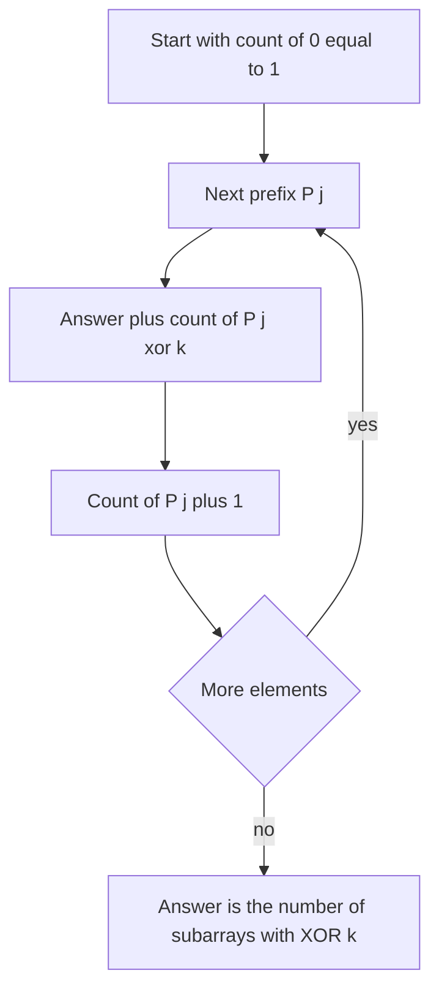

## The hook

A car's odometer tells you how far you have driven since the factory. To know how far you drove between two cities, you do not need a separate trip meter: read the odometer at both, and subtract. Prefix sums are that odometer for arrays.

XOR has its own odometer, and it is even neater: instead of subtracting, you XOR the two readings, because XOR undoes itself. With it, range XOR queries become O(1), and "how many subarrays have XOR k?" becomes a single pass with a hash map, a pattern that appears constantly in Codeforces Div. 2 problems.

## The intuition

:::analogy
Imagine an odometer that, instead of adding each kilometre, XORs each road's number into its display. Read it at the start city and at the end city. Every road driven before the start city was XOR-ed into both readings, so XOR-ing the two readings cancels them, and what remains is exactly the XOR of the roads between the two cities. Two equal readings mean the roads between them XOR to zero.
:::

The odometer is the [[prefix XOR]]: P[0] = 0 and P[i + 1] = P[i] ^ a[i]. Because x ^ x = 0, a [[range XOR]] is

xor(a[l..r]) = P[r + 1] ^ P[l].

This is the same identity as prefix sums in [Answering a Million Range Questions Instantly](article:dsa-prefix-sums), with XOR playing both addition and subtraction. The XOR properties come from [Flip a Switch Twice and Nothing Happened](article:dsa-bit-manipulation-tricks).

## How it works

### Range XOR queries

Build P in O(n). Answer each query (l, r) as P[r + 1] ^ P[l] in O(1). That is CSES *Range Xor Queries* and LeetCode's *XOR Queries of a Subarray*.

### Counting subarrays with XOR exactly k

A subarray a[i..j-1] has XOR P[j] ^ P[i]. It equals k exactly when P[i] = P[j] ^ k. So scan j from 1 to n, and before recording P[j], add the number of earlier prefixes equal to P[j] ^ k. That is [[prefix pair counting]] with a hash map from prefix value to how many times it has appeared:

- start with count[0] = 1, for the empty prefix P[0];
- for each j: answer += count[P[j] ^ k], then count[P[j]] += 1.

It is the XOR twin of counting subarrays with sum k, and it is O(n) expected time.

### Zero-XOR subarrays and the triplet problem

A [[zero-XOR subarray]] is one where P[j] = P[i]: equal readings. *Count the Number of Beautiful Subarrays* turns out to ask exactly that, because a subarray can be cleared by its operation precisely when every bit appears an even number of times, which means its XOR is 0. Count pairs of equal prefixes: for each value v appearing c times among P[0..n], there are c(c - 1) / 2 such subarrays.

*Count Triplets That Can Form Two Arrays of Equal XOR* asks for i < j ≤ k with xor(a[i..j-1]) = xor(a[j..k]). Two equal values XOR to zero, so the condition is that a[i..k] has XOR zero, that is P[i] = P[k + 1], and then every j from i + 1 to k works: k - i triplets for that range. Summing k - i over all equal prefix pairs is O(n²) directly; keeping, for each prefix value, its count and the sum of its indices makes it O(n).

| Question | Condition on prefixes | Method |
|---|---|---|
| XOR of a[l..r] | P[r + 1] ^ P[l] | direct lookup |
| Subarrays with XOR k | P[i] = P[j] ^ k | hash map of earlier prefix counts |
| Subarrays with XOR 0 | P[i] = P[j] | pairs of equal prefixes |
| Equal-XOR triplets | P[i] = P[k + 1], weight k - i | per value, count and index sum |



:::insight
XOR is its own inverse, so the XOR of any subarray is the XOR of two prefix readings. Every subarray question then becomes a question about pairs of prefixes, which a hash map of earlier prefixes answers in one pass.
:::

## Walk through an example

a = [4, 2, 6, 3, 1, 5].

| i | 0 | 1 | 2 | 3 | 4 | 5 | 6 |
|---|---|---|---|---|---|---|---|
| P[i] | 0 | 4 | 6 | 0 | 3 | 2 | 7 |

### A range query

xor(a[1..4]) = P[5] ^ P[1] = 2 ^ 4 = 6. Directly: 2 ^ 6 ^ 3 ^ 1 = 6.

### Subarrays with XOR 7

| j | P[j] | Need earlier P[i] = P[j] ^ 7 | Earlier count | Running answer |
|---|---|---|---|---|
| 1 | 4 | 3 | 0 | 0 |
| 2 | 6 | 1 | 0 | 0 |
| 3 | 0 | 7 | 0 | 0 |
| 4 | 3 | 4 | 1 (P[1]) | 1 |
| 5 | 2 | 5 | 0 | 1 |
| 6 | 7 | 0 | 2 (P[0], P[3]) | 3 |

Three subarrays: a[1..3] = 2 ^ 6 ^ 3 = 7, a[0..5] = 7 and a[3..5] = 3 ^ 1 ^ 5 = 7. The two matches at j = 6 both came from value 0, including the empty prefix P[0]; without it, the whole array would be missed.

### Triplets

Equal prefix pairs: only P[0] = P[3] = 0, so the zero-XOR subarray is a[0..2] = 4 ^ 2 ^ 6 = 0, with i = 0 and k = 2. It gives k - i = 2 triplets: j = 1, splitting into [4] and [2, 6], both XOR 4; and j = 2, splitting into [4, 2] and [6], both XOR 6.

:::try-this
How many zero-XOR subarrays does [1, 2, 3, 1, 2, 3] have? (P = 0, 1, 3, 0, 1, 3, 0. Value 0 appears 3 times, 1 twice and 3 twice, so the count is 3 + 1 + 1 = 5: [1, 2, 3] twice, the whole array, [2, 3, 1] and [3, 1, 2].)
:::

:::warning
Common misconception: "Subarray XOR is like subarray sum, so a sliding window works." Sums of positive numbers grow as a window widens, which is what two pointers rely on. XOR has no such order: adding an element can raise or lower the XOR arbitrarily. Only the prefix-pair method, with a hash map, counts subarrays with a given XOR correctly.
:::

## The code

```pseudo
build: P[0] = 0; P[i+1] = P[i] ^ a[i]
query(l, r): return P[r+1] ^ P[l]

count_xor_k(a, k):
    count = {0: 1}; px = 0; ans = 0
    for x in a:
        px ^= x
        ans += count[px ^ k]
        count[px] += 1
    return ans
```

```cpp
#include <bits/stdc++.h>
using namespace std;
using ll = long long;

vector<int> prefixXor(const vector<int>& a) {
    vector<int> P(a.size() + 1, 0);
    for (size_t i = 0; i < a.size(); i++) P[i + 1] = P[i] ^ a[i];
    return P;
}

ll countXorK(const vector<int>& a, int k) {
    unordered_map<int, ll> cnt{{0, 1}};                   // the empty prefix
    int px = 0;
    ll ans = 0;
    for (int x : a) {
        px ^= x;
        auto it = cnt.find(px ^ k);
        if (it != cnt.end()) ans += it->second;           // earlier prefixes that pair with this one
        cnt[px]++;
    }
    return ans;
}

ll countTriplets(const vector<int>& a) {                  // sum of (k - i) over P[i] == P[k + 1]
    unordered_map<int, pair<ll, ll>> seen;                // value -> (count, sum of indices)
    seen[0] = {1, 0};                                     // P[0] at index 0
    int px = 0;
    ll ans = 0;
    for (int k = 0; k < (int)a.size(); k++) {
        px ^= a[k];                                       // px = P[k + 1]
        auto& [c, s] = seen[px];
        ans += c * k - s;                                 // each earlier i contributes k - i
        c++, s += k + 1;
    }
    return ans;
}

int main() {
    vector<int> a = {4, 2, 6, 3, 1, 5};
    auto P = prefixXor(a);
    cout << (P[5] ^ P[1]) << ' ' << countXorK(a, 7) << ' ' << countTriplets(a) << '\n';   // 6 3 2
    cout << countXorK({1, 2, 3, 1, 2, 3}, 0) << '\n';                                    // 5
}
```

`countTriplets` keeps, for each prefix value, how many times it has occurred and the sum of the positions where it occurred, so the sum of k - i over all earlier i is c × k - s in O(1).

## Complexity

- **Build: O(n).** Each range query: **O(1).**
- **Counting subarrays with XOR k: O(n) expected,** with a hash map of up to n + 1 prefixes.
- **Triplets: O(n) expected** with the count-and-index-sum trick, compared with O(n²) or O(n³) directly.
- **Space: O(n)** for the prefix array or the hash map.

## Common mistakes

- **Forgetting the empty prefix** P[0] = 0 in the hash map, which misses subarrays that start at index 0.
- **Indexing the range formula wrongly:** it is P[r + 1] ^ P[l], not P[r] ^ P[l].
- **Using a sliding window** for subarray XOR conditions, which has no monotonic structure.
- **Counting before or after inserting in the wrong order,** which can pair a prefix with itself and count empty subarrays.
- **Using `unordered_map` with adversarial inputs on Codeforces,** where crafted tests can make it slow; use a custom hash or sort-based counting if needed.

## Practice problems

*Range Xor Queries* and *XOR Queries of a Subarray* are the O(1) range formula. *Count the Number of Beautiful Subarrays* is counting equal prefix pairs. *Count Triplets That Can Form Two Arrays of Equal XOR* adds the weighted count k - i. For the maximum XOR of any subarray, the prefix values go into a bitwise trie instead, as in [Taking the Opposite Turn at Every Fork](article:dsa-max-xor-trie).

## Key takeaways

- The prefix XOR P[i] is the XOR of the first i elements, with P[0] = 0 for the empty prefix.
- The XOR of a[l..r] is P[r + 1] ^ P[l], because the shared prefix cancels.
- Subarrays with XOR k are counted in one pass by adding, at each prefix, how many earlier prefixes equal it XOR k.
- A subarray has XOR zero exactly when two prefix XORs are equal, which turns equal-XOR splitting problems into counting equal prefix pairs.
- Sliding windows do not work for XOR conditions, because XOR does not grow or shrink predictably as a window changes.
