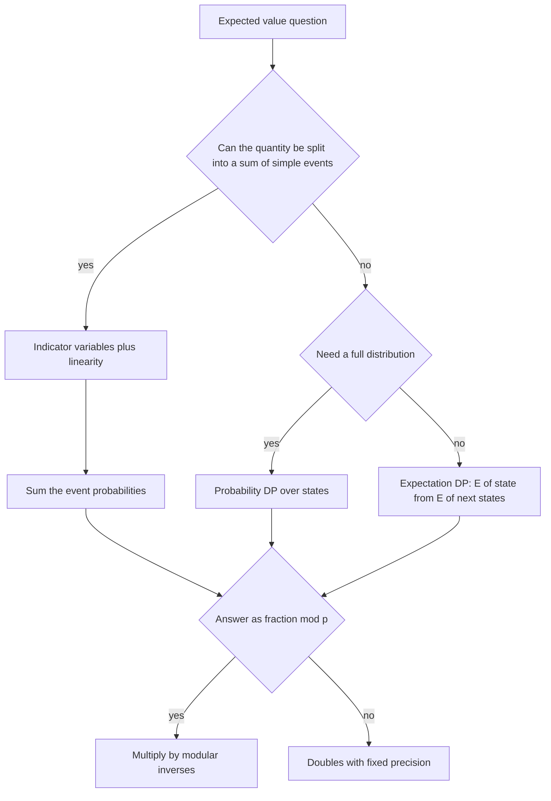

## The hook

You shuffle a deck of 52 cards. On average, how many cards end up in their original position? Trying to answer by listing all 52! orders is hopeless, and even computing the probability of exactly k fixed points needs inclusion-exclusion. Yet the expected number is exactly 1, and the proof takes one line.

That one line is linearity of expectation, and it is the most powerful idea in contest probability. Problems that look like they need huge case analyses, "expected number of empty squares", "expected number of inversions", "expected number of distinct values", often collapse into a sum of simple probabilities.

## The intuition

:::analogy
Imagine running the random experiment in a thousand parallel universes at once: in each universe the deck is shuffled independently. The expected value is simply the average result across all universes. Now, to find the average number of fixed points, you do not need to look at each universe as a whole. Ask instead: in how many universes is card 1 in place? About one in 52 of them. Card 2? Also about one in 52. Add up these per-card averages and you get the average total, because counting "all fixed points in all universes" card by card or universe by universe gives the same grand total.
:::

A [[random variable]] is "the number you read off in one universe". Its [[expected value]] is the average across all the universes, weighted by how likely each one is.

## How it works

### Expected value

For a random variable X taking value x with probability P(X = x):

$$E[X] = \sum_x x \cdot P(X = x)$$

For one fair die, E = (1 + 2 + ... + 6) / 6 = 3.5. The expected value need not be a value X can actually take.

### Linearity of expectation

For any random variables X and Y, and constants a, b:

$$E[aX + bY] = a\,E[X] + b\,E[Y]$$

This holds **whether or not** X and Y are independent. That is what makes it so useful: [[independence]] is often false, and linearity does not care. In the parallel-universes picture it is just adding up a table by columns instead of by rows.

### Indicator variables

Break a count into pieces. Let Iₖ be an [[indicator variable]], 1 if event k happens and 0 otherwise. Then E[Iₖ] = P(event k), and

$$E[\text{count}] = \sum_k P(\text{event } k)$$

Classic uses:

- **Fixed points** of a random permutation: n events of probability 1/n each, so the expectation is 1.
- **Inversions** of a random permutation: each of the n(n − 1)/2 pairs is inverted with probability 1/2, giving n(n − 1)/4.
- **Shared birthdays** among k people: each of C(k, 2) pairs shares with probability 1/365, so for 23 people the expected number of sharing pairs is 253/365 ≈ 0.69.
- **Distinct values** when rolling a die n times: value v appears at least once with probability 1 − (5/6)ⁿ, so the expectation is 6(1 − (5/6)ⁿ).

### Probability DP

When you need a probability distribution and not just an average, use DP over states. For the sum of n dice, let dp[i][s] be the probability that i dice sum to s; then dp[i][s] = Σ dp[i − 1][s − f] / 6 over faces f. *Dice Probability* asks for the probability that the sum lies in a range, which is a sum over the final row.

### Expected values modulo a prime

Exact expected values are fractions P/Q. Problems usually ask for P · Q⁻¹ mod p, using inverses from [Finding the Undo Button on a Clock](article:cp-modular-inverse). You can do the whole computation in modular arithmetic: replace "divide by 6" with "multiply by the inverse of 6", as in [Doing Maths on a Clock Face](article:cp-modular-arithmetic). Some problems instead want a decimal with fixed precision; then use doubles and print enough digits.



:::insight
Linearity lets you stop thinking about the whole random outcome and think about one small event at a time. Ask "what is the probability that this particular thing happens?", answer it for one representative, multiply by the number of such things, and the dependencies between them never matter.
:::

### Expected number of steps

For "expected time until something happens", write E for each state in terms of the next states. Collecting all 6 faces of a die (the coupon collector problem): with k faces already seen, each roll shows a new face with probability (6 − k)/6, so that phase takes 6/(6 − k) rolls on average. Summing over k = 0..5 gives 6(1 + 1/2 + ... + 1/6) = 14.7 rolls.

## Walk through an example

**Fixed points of a random permutation of 3 items**, checked by listing all 6 permutations:

| Permutation | Fixed points |
|---|---|
| (0, 1, 2) | 3 |
| (0, 2, 1) | 1 |
| (1, 0, 2) | 1 |
| (1, 2, 0) | 0 |
| (2, 0, 1) | 0 |
| (2, 1, 0) | 1 |

Average: (3 + 1 + 1 + 0 + 0 + 1) / 6 = 6/6 = **1**. Linearity gives the same: 3 positions × 1/3 = 1. Notice the fixed points are not independent: if two items are in place, the third must be, yet the sum still works.

**Two dice, probability the sum is 7 or 8.** Ways to roll each sum, out of 36:

| Sum | 2 | 3 | 4 | 5 | 6 | 7 | 8 | 9 | 10 | 11 | 12 |
|---|---|---|---|---|---|---|---|---|---|---|---|
| Ways | 1 | 2 | 3 | 4 | 5 | 6 | 5 | 4 | 3 | 2 | 1 |

P = (6 + 5) / 36 = **11/36**. The DP builds exactly this row from the one-die row.

:::try-this
Roll a die 3 times. What is the expected number of distinct values seen? (Each value appears with probability 1 − (5/6)³ = 91/216, so the expectation is 6 × 91/216 = 91/36 ≈ 2.53.)
:::

## The code

```pseudo
dice_sum_distribution(n):
    dp = [1]                                  // 0 dice: sum 0 with probability 1
    repeat n times:
        new = zeros(len(dp) + 6)
        for s, p in dp: for f in 1..6: new[s + f] += p / 6
        dp = new
    return dp

expected_fixed_points(n): return n * (1 / n)  // = 1, by linearity

fraction_mod(P, Q): return P * inverse(Q) mod MOD
```

```cpp
#include <bits/stdc++.h>
using namespace std;
const long long MOD = 1'000'000'007;

long long power(long long b, long long e) {
    long long r = 1; b %= MOD;
    for (; e > 0; e >>= 1, b = b * b % MOD) if (e & 1) r = r * b % MOD;
    return r;
}

int main() {
    int n = 2;
    vector<double> dp = {1.0};
    for (int i = 0; i < n; i++) {
        vector<double> nd(dp.size() + 6, 0.0);
        for (size_t s = 0; s < dp.size(); s++)
            for (int f = 1; f <= 6; f++) nd[s + f] += dp[s] / 6;
        dp = nd;
    }
    printf("%.6f\n", dp[7] + dp[8]);                    // 0.305556 = 11/36

    cout << 7 * power(2, MOD - 2) % MOD << '\n';        // 500000007, i.e. 7/2 mod p
    long long coupon = 0;                               // 6 * (1 + 1/2 + ... + 1/6) mod p
    for (int k = 1; k <= 6; k++) coupon = (coupon + 6 * power(k, MOD - 2)) % MOD;
    cout << coupon << '\n';                             // 900000021, i.e. 147/10 mod p
}
```

## Complexity

- **Linearity arguments:** usually O(number of events), often O(n) or even O(1).
- **Probability DP:** O(states × transitions), such as O(n² × 6) for the sum of n dice.
- **Modular answers:** add O(log p) per inverse, or precompute inverses.

## Common mistakes

:::warning
Common misconception: "linearity of expectation only works for independent events." It works for any random variables. The fixed points of a permutation are dependent, and the linearity answer is still exactly right. What does need independence is the product rule E[XY] = E[X]E[Y].
:::

- **Confusing probability with expectation**: the probability that at least one event happens is not the sum of probabilities, but the expected number of events is.
- **Floating-point output format**: when a decimal is required, print with the exact precision and rounding rule the problem states.
- **Dividing in modular arithmetic**: multiply by inverses instead, and reduce after every multiplication.
- **Expected value of a maximum**: linearity does not apply to max or min; use P(max ≤ k) and differences, as in *Candy Lottery*.

## Practice problems

*Dice Probability* is the DP over sums. *Candy Lottery* asks for the expected maximum, computed from P(max ≤ k) = (k/k_max)ⁿ. *Inversion Probability* applies linearity over pairs with values drawn from ranges. *Moving Robots* combines both: a DP gives each robot's position distribution, and linearity adds up, over squares, the probability that each square is empty.

## Key takeaways

- The expected value is the probability-weighted average of a random variable, the average over many repetitions of the experiment.
- Linearity of expectation, E[X + Y] = E[X] + E[Y], holds even when the variables are dependent.
- Splitting a count into indicator variables turns an expected count into a sum of simple probabilities.
- When a full distribution is needed, build it with DP over states; expected times follow from equations between states.
- Fractional answers modulo a prime are printed as P times the modular inverse of Q.
