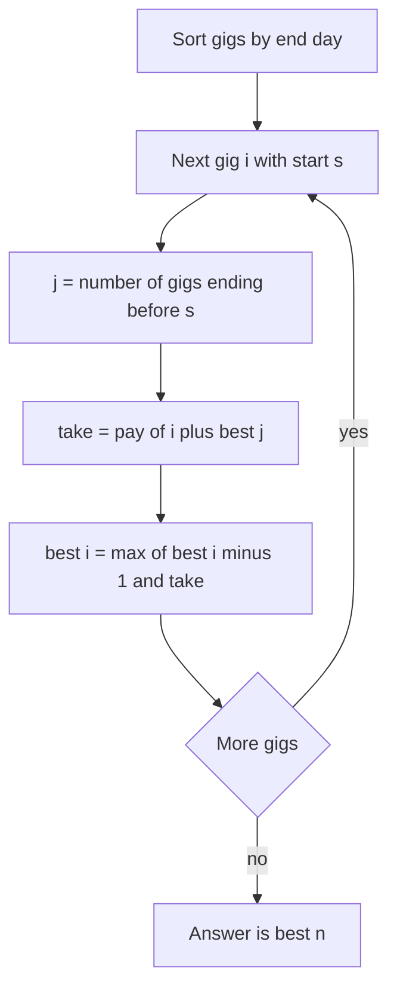

## The hook

Riya is a freelance designer with a calendar full of offers. A logo from day 2 to day 5 pays 80, a poster from day 7 to day 9 pays 60, and a third gig overlaps both. She cannot work two gigs on the same day, and she wants the most money by the end of the month.

Grabbing the best-paid gig first sounds smart. Grabbing the gig that finishes earliest sounds smart too. Both are wrong. So how does she choose, when there are 200,000 offers?

## The problem

You get n projects. Project i runs from day aᵢ to day bᵢ, both days included, and pays pᵢ. You may take any set of projects as long as no two share a day. Maximise the total pay.

This is *Projects* on CSES, and it is the classic [[weighted interval scheduling]] problem.

Two gigs are [[compatible]] when one ends strictly before the other starts. In this version, a gig ending on day 6 and a gig starting on day 6 clash, because both use day 6.

:::analogy
Think of Riya with a paper calendar and a stack of offer letters. She sorts the letters by the day each gig finishes. Then she reads them in that order, and for each letter asks one question: "Is this gig worth more than everything it would force me to give up?" Everything before a gig's start day is already planned as well as it can be, so she only has to look back to the last gig that finishes before this one begins.
:::

## The obvious approach

**Try every subset.** Check each of the 2ⁿ subsets for overlaps and keep the best. Correct, and hopeless beyond about 20 gigs.

**Greedy by pay.** Take the best-paid gig, drop everything that clashes, repeat. One huge gig can block two medium gigs that together pay more.

**Greedy by earliest end.** This is the famous optimal rule for *Movie Festival*, where every movie is worth the same. Its proof is an [[exchange argument]]: swapping any first choice for the earliest-ending one never loses a slot. With rewards, the swap can lose money, so the proof breaks.

On the example below, greedy by pay earns 140, greedy by earliest end earns 130, and the true best is 160. Neither rule looks at what a choice costs.

## The key insight

Sort the gigs by end day, and let best[i] be the most money you can earn using only the first i gigs in that order. For gig i there are exactly two options:

- **Skip it.** The answer is best[i − 1].
- **Take it.** You earn pᵢ, plus the best you can do with the gigs that end before gᵢ starts.

Here is the trick that makes it fast. Because the list is sorted by end, the gigs ending before day aᵢ are a **prefix** of the list. Let j be the length of that prefix, the [[predecessor index]]. Binary search over the sorted end days finds j in O(log n).

$$best[i] = \max\big(best[i-1],\; p_i + best[j]\big), \qquad best[0] = 0$$

Here best[i − 1] is the skip option, pᵢ is gig i's pay, and best[j] is the best plan using only gigs that finish before gig i begins. This [[take-or-skip recurrence]] is the same shape as the house robber DP in [Stairs, Robbers and Secret Codes](article:dsa-dp-1d), except "the house two doors back" becomes "the last compatible gig", found with the binary search from [Binary Search Without the Off-by-One Fear](article:dsa-binary-search).

:::insight
Sorting by end day turns "every gig compatible with gig i" into a prefix of the list. A prefix has a single best answer, best[j], already computed, so each gig needs one binary search and one comparison.
:::



Back in Riya's calendar terms: best[j] is the money from her already-finished planning for the days before the new gig starts. She never re-plans those days. She just decides whether the new letter beats the plan she already has.

## Walk through an example

Six offers, already sorted by end day (days inclusive):

| Gig | Days | Pay |
|---|---|---|
| A | 1-3 | 40 |
| B | 2-5 | 80 |
| C | 4-6 | 30 |
| D | 6-8 | 55 |
| E | 7-9 | 60 |
| F | 9-10 | 25 |

The end days are [3, 5, 6, 8, 9, 10]. For each gig, j = lower_bound(ends, start), which counts end days strictly smaller than the start.

| i | Gig | Days | Pay | j | Take = pay + best[j] | Skip = best[i − 1] | best[i] |
|---|---|---|---|---|---|---|---|
| 1 | A | 1-3 | 40 | 0 | 40 + 0 = 40 | 0 | 40 |
| 2 | B | 2-5 | 80 | 0 | 80 + 0 = 80 | 40 | 80 |
| 3 | C | 4-6 | 30 | 1 | 30 + 40 = 70 | 80 | 80 |
| 4 | D | 6-8 | 55 | 2 | 55 + 80 = 135 | 80 | 135 |
| 5 | E | 7-9 | 60 | 3 | 60 + 80 = 140 | 135 | 140 |
| 6 | F | 9-10 | 25 | 4 | 25 + 135 = 160 | 140 | 160 |

The answer is **160**. Walking back from i = 6: F was taken, jump to j = 4; D was taken, jump to j = 2; B was taken, jump to j = 0. The plan is B, D, F.

Look at row 4. D starts on day 6, and C ends on day 6, so C is not compatible: lower_bound stops at j = 2, and only A and B count. Row 6 is similar: F starts on day 9, the day E ends, so E is excluded.

Compare the greedy rules. By pay, Riya takes B (80), then E (60), and everything else clashes: 140. By earliest end, she takes A, C, E: 130. The DP's 160 beats both.

:::try-this
Suppose a gig may start on the same day another ends, as in the LeetCode problem. Rerun the last two rows with upper_bound. (E gets j = 3 still, take 140. F now gets j = 5 because E ends on day 9, so take = 25 + 140 = 165. The best becomes 165 with B, E, F.)
:::

## The code

```pseudo
max_pay(gigs):
    sort gigs by end day
    ends = list of end days in that order
    best[0] = 0
    for i in 1 .. n:
        (start, end, pay) = gigs[i]
        j = number of values in ends that are < start      // lower_bound
        best[i] = max(best[i - 1], pay + best[j])
    return best[n]

reconstruct(i):                       // optional: which gigs were taken
    while i > 0:
        if best[i] != best[i - 1]: record gig i; i = j of gig i
        else: i = i - 1
```

```cpp
#include <bits/stdc++.h>
using namespace std;
using ll = long long;

struct Gig { int start, end; ll pay; char name; };

// touching = true lets a gig start on the day another ends (LeetCode rule).
ll maxPay(vector<Gig> g, bool touching, string& plan) {
    sort(g.begin(), g.end(), [](const Gig& x, const Gig& y) { return x.end < y.end; });
    int n = g.size();
    vector<int> ends(n), pred(n + 1, 0);
    for (int i = 0; i < n; i++) ends[i] = g[i].end;
    vector<ll> best(n + 1, 0);
    for (int i = 1; i <= n; i++) {
        int s = g[i - 1].start;
        auto it = touching ? upper_bound(ends.begin(), ends.end(), s)
                           : lower_bound(ends.begin(), ends.end(), s);
        pred[i] = it - ends.begin();
        best[i] = max(best[i - 1], g[i - 1].pay + best[pred[i]]);
    }
    plan.clear();
    for (int i = n; i > 0;) {
        if (best[i] != best[i - 1]) { plan = g[i - 1].name + plan; i = pred[i]; }
        else i--;
    }
    return best[n];
}

int main() {
    vector<Gig> gigs = {{1, 3, 40, 'A'}, {2, 5, 80, 'B'}, {4, 6, 30, 'C'},
                        {6, 8, 55, 'D'}, {7, 9, 60, 'E'}, {9, 10, 25, 'F'}};
    string plan;
    cout << maxPay(gigs, false, plan) << ' ' << plan << '\n';  // 160 BDF
    cout << maxPay(gigs, true, plan) << ' ' << plan << '\n';   // 165 BEF
}
```

The `pred` array is only needed to print the plan. For the CSES problem, which asks only for the total, `best` alone is enough.

### A second way: DP over days

If you prefer, compress all start and end days to ranks with [Renaming Huge Numbers as 1, 2, 3](article:cp-coordinate-compression), then let best[d] be the most money using only days up to rank d. Each day either earns nothing new, best[d − 1], or is the end of some gig, best[start − 1] + pay. Both versions are O(n log n); pick whichever you can write without bugs.

## Complexity

- **Time:** O(n log n). Sorting costs O(n log n), and each of the n gigs does one binary search costing O(log n).
- **Space:** O(n) for the sorted gigs, the end days and the best array.
- **Values:** with many gigs paying up to around 10⁹ each, totals overflow 32-bit integers, so keep pay and best in `long long`.

## Common mistakes

:::warning
Common misconception: "sort by start day, then binary search for the last compatible gig." After sorting by start, the end days are not sorted, so the gigs that finish before day s are scattered through the list and binary search over them is meaningless. Sorting by start does work if you run the DP from the right, with best[i] = max(best[i + 1], pay + best[first gig starting after this one ends]). Mixing the two halves of these recipes is the bug.
:::

- **The boundary rule.** CSES uses inclusive days, so a gig ending on day 6 clashes with one starting on day 6: use `lower_bound`. LeetCode lets a job start exactly when another ends: use `upper_bound`. Read the statement twice.
- **Off-by-one between j and best.** best has n + 1 entries with best[0] = 0, and j counts gigs, so best[j] is correct as written. Mixing 0-based gigs with 1-based best is the most common bug.
- **Searching over start days instead of end days.** The search must run over end days, the array that is sorted.
- **Using `int` for totals**, which overflows with many large payments.

## Practice problems

Start with *Projects* (CSES), which is exactly the walkthrough. *Maximum Profit in Job Scheduling* is the same problem with the touching rule and parallel arrays, a good test of the boundary mistake. *Two Best Non-Overlapping Events* limits you to two events, so a prefix maximum over end-sorted events plus a binary search is enough. *Maximum Number of Events That Can Be Attended II* limits you to k events, so the state grows to best[i][count].

Weighted interval scheduling shows up from roughly the 1600-1800 rating range on Codeforces, often hidden inside a story about bookings or contracts.

## Key takeaways

- Weighted interval scheduling picks non-overlapping intervals with the largest total value, and no simple greedy rule solves it.
- Sorting by end day makes every interval compatible with gig i a prefix of the list, so one binary search finds it.
- The recurrence best[i] = max(best[i − 1], pay[i] + best[j]) compares skipping gig i with taking it on top of the best compatible plan.
- Whether touching intervals clash decides between lower_bound and upper_bound, and that one choice changes the answer.
- The whole method runs in O(n log n) time and O(n) memory, and the same skeleton extends to limits like "at most k gigs".
