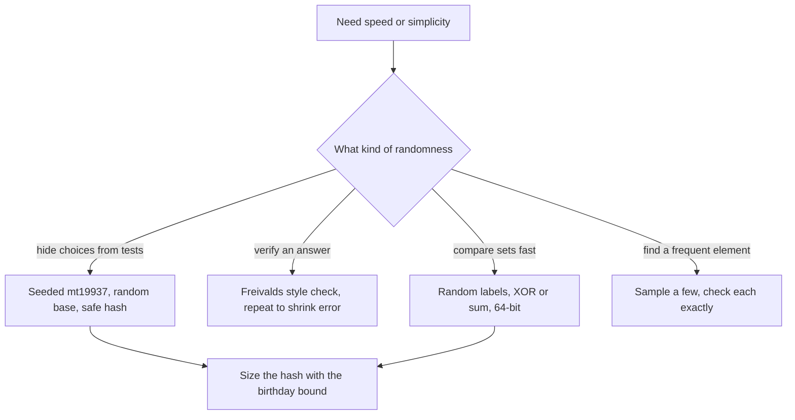

## The hook

An auditor faced with ten thousand receipts does not recheck every one. They pick a few at random and check those carefully. If the books are clean, every spot check passes. If something is wrong, a well-designed spot check catches it with high probability, and repeating it makes a miss astronomically unlikely.

Contest problems use the same bargain all the time: a tiny, controllable chance of error buys a big speed-up or a much simpler algorithm. Done carelessly, randomness is also a source of hacked solutions. This article covers both sides.

## The intuition

:::analogy
A good spot check has two properties. First, the auditor's choice of receipts must be unpredictable: if the person cooking the books knows which receipts will be checked, they simply keep those clean. Second, a single error anywhere must have a fair chance of showing up in the check, so that repeating it drives the chance of missing the error towards zero. Every randomised technique below is one of these two ideas: hide your choices from whoever wrote the tests, and design checks where one mistake is caught half the time or better.
:::

Unpredictable choices need a [[seeded generator]]. Checks that are always right when they say "wrong" have [[one-sided error]].

## How it works

### Randomness that a test cannot predict

- **Use `mt19937` or `mt19937_64`**, seeded from `chrono::steady_clock::now().time_since_epoch().count()`. The C function `rand()` is only guaranteed to return values up to 32767, and on some judges that is all it returns, so `rand() % 1000000` silently never produces most values.
- **Draw ranges with `uniform_int_distribution`** or `rng() % range` with a 64-bit generator, where the bias is negligible.
- **Shuffle with `shuffle(v.begin(), v.end(), rng)`**, which is a Fisher–Yates shuffle: for each position from the end, swap with a uniformly random earlier or equal position.

### Hashes nobody can target

`std::unordered_map` with the default integer hash is predictable, and tests exist that force every key into one bucket, turning O(1) lookups into O(n). A custom hash that mixes the key with a strong function such as splitmix64 plus a random seed chosen at run time removes the attack. For string hashing, as in [A Fingerprint for Every Substring](article:cp-string-hashing), choose the base at random, so a test cannot be built in advance to collide.

### Freivalds' check: verifying a product in O(n²)

Multiplying two n × n matrices is O(n³). Checking a claimed product C is cheaper. [[Freivalds' check]]:

- pick a random vector r of 0s and 1s;
- compute B·r, then A·(B·r), and C·r, each O(n²);
- if A·(B·r) ≠ C·r, the product is certainly wrong; otherwise accept.

If C is wrong, the difference D = A·B − C has some non-zero entry D[i][j]. For any choice of the other entries of r, at most one of the two values of r[j] makes row i of D·r zero, so a wrong C escapes with probability at most 1/2. Twenty independent trials miss with probability at most 2⁻²⁰, about one in a million.

### XOR hashing: comparing sets in O(1)

Give every possible value v a random 64-bit label. [[XOR hashing]] fingerprints a set as the XOR of its labels, and with prefix XORs any subarray's set of values is O(1) to fingerprint.

Codeforces *The Number of Subpermutations* asks how many subarrays are permutations of 1 to their length. A subarray of length L is such a permutation exactly when its multiset of values is {1, ..., L}; since a permutation has distinct values, the XOR of labels over the subarray equals the precomputed XOR for {1, ..., L} exactly in that case, apart from a chance of about 2⁻⁶⁴ per comparison. A plain sum or XOR of the values themselves can be fooled: 1 + 4 = 2 + 3. Use sums of labels instead of XOR when multiplicities matter, because XOR cancels pairs.

### How wide must a hash be?

| Values hashed | Hash space | Expected colliding pairs, k²/(2M) | Verdict |
|---|---|---|---|
| 10⁵ | about 10⁹ | about 5 | collisions likely |
| 10⁶ | about 10⁹ | about 500 | collisions certain |
| 10⁶ | 2⁶⁴, about 1.8·10¹⁹ | about 3·10⁻⁸ | safe |
| 10⁶ | two primes near 10⁹, about 10¹⁸ | about 5·10⁻⁷ | safe |

This is the [[birthday bound]]: a single comparison almost never collides, but when every pair of k values matters, as in "count distinct substrings by hash", there are about k²/2 pairs to worry about.

### Random sampling

If some value fills more than half of an array, a random element is that value with probability above 1/2, so a few random picks plus a frequency check find it. Codeforces *Love-Hate* uses the same idea: the best set of currencies must be liked by at least half of the friends, so a random friend likes all of it with probability at least 1/2. Trying a few dozen random friends, and solving the problem exactly over the few currencies each one likes, finds the answer with overwhelming probability.



:::insight
Randomised methods give guarantees about every input at once, not about typical inputs: for any fixed test, the chance of failure is tiny over the program's own random choices. That only holds if the choices really are unpredictable, which is why seeding and generator choice matter as much as the algorithm.
:::

## Walk through an example

### Freivalds on 2 × 2 matrices

A = [[1, 2], [3, 4]], B = [[5, 6], [7, 8]]. The true product is [[19, 22], [43, 50]], but the claimed C has 51 in the bottom-right corner.

| r | B·r | A·(B·r) | C·r | Verdict |
|---|---|---|---|---|
| (0, 0) | (0, 0) | (0, 0) | (0, 0) | accept, wrongly |
| (1, 0) | (5, 7) | (19, 43) | (19, 43) | accept, wrongly |
| (0, 1) | (6, 8) | (22, 50) | (22, 51) | reject: wrong |
| (1, 1) | (11, 15) | (41, 93) | (41, 94) | reject: wrong |

Exactly the two vectors with r₂ = 1 expose the error, half of the four. The program repeats this on a 60 × 60 product with one entry off by one: across 1000 single trials, about half catch it, and twenty trials together catch it every time.

### Counting subpermutations

Array 2, 1, 3, 2, 4, 1. The subarrays that are permutations of 1..L are [1] twice, [2, 1], [2, 1, 3], [1, 3, 2], [1, 3, 2, 4] and [3, 2, 4, 1]: 7 in total. With random labels, each candidate subarray is checked by one XOR of two prefix values and one comparison.

:::try-this
Why would summing the values themselves fail to recognise permutations? Find a subarray of length 3 whose values sum to 1 + 2 + 3 = 6 but which is not a permutation. (For example 2, 2, 2, or 1, 1, 4. The sum matches but the set does not. Random labels make such coincidences essentially impossible, because the labels of 2, 2, 2 have nothing to do with those of 1, 2, 3.)
:::

:::warning
Common misconception: "Randomised means my solution passes most of the time." With a fixed seed, or rand() without a seed, the program makes the same choices on every run, and a test written against those choices fails it every time. With an unpredictable seed and enough bits, the failure probability is something like 2⁻²⁰ or 2⁻⁶⁴ on every test, which is far more reliable than most deterministic code.
:::

## The code

```pseudo
rng = mt19937_64(seeded from the clock)
safe hash(x) = splitmix64(x + seed chosen once at run time)
freivalds(A, B, C, trials): repeat trials times:
    r = random 0/1 vector; if A*(B*r) != C*r: return "not equal"
    return "equal with probability >= 1 - 2^-trials"
subpermutations: label[v] = rng(); want[L] = label[1] xor ... xor label[L]
    pre = prefix xor of label[a[i]]; subarray [l, r) is a permutation iff pre[r] xor pre[l] == want[r - l]
```

```cpp
#include <bits/stdc++.h>
using namespace std;
using ll = long long;
using ull = unsigned long long;

mt19937_64 rng(12345);                                           // in contests seed with the clock; fixed here for repeatable output

ull splitmix64(ull x) {                                          // a strong 64-bit mixer
    x += 0x9e3779b97f4a7c15ULL;
    x = (x ^ (x >> 30)) * 0xbf58476d1ce4e5b9ULL;
    x = (x ^ (x >> 27)) * 0x94d049bb133111ebULL;
    return x ^ (x >> 31);
}
struct SafeHash {                                                // unordered_map hash that a fixed test cannot target
    size_t operator()(ull x) const {
        static const ull seed = rng();
        return splitmix64(x + seed);
    }
};

bool freivalds(const vector<vector<ll>>& A, const vector<vector<ll>>& B, const vector<vector<ll>>& C, int trials) {
    int n = A.size();
    for (int t = 0; t < trials; t++) {
        vector<ll> r(n), Br(n, 0), ABr(n, 0), Cr(n, 0);
        for (auto& x : r) x = rng() & 1;                         // random 0/1 vector
        for (int i = 0; i < n; i++) for (int j = 0; j < n; j++) Br[i] += B[i][j] * r[j];
        for (int i = 0; i < n; i++) for (int j = 0; j < n; j++) ABr[i] += A[i][j] * Br[j], Cr[i] += C[i][j] * r[j];
        if (ABr != Cr) return false;                             // a witness: certainly A*B != C
    }
    return true;                                                 // equal with probability at least 1 - 2^-trials
}

ll countPermutationSubarrays(const vector<int>& a) {             // subarrays that are a permutation of 1..length
    int n = a.size();
    vector<ull> label(n + 1), want(n + 1, 0), pre(n + 1, 0);
    for (int v = 1; v <= n; v++) label[v] = rng(), want[v] = want[v - 1] ^ label[v];   // xor-hash of {1..v}
    for (int i = 0; i < n; i++) pre[i + 1] = pre[i] ^ label[a[i]];
    ll count = 0;
    for (int l = 0; l < n; l++)                                  // O(n^2) scan, O(1) test per subarray
        for (int r = l + 1; r <= n; r++) count += (pre[r] ^ pre[l]) == want[r - l];
    return count;
}

int main() {
    unordered_map<ull, int, SafeHash> freq;
    for (ull x : {5ULL, 7ULL, 5ULL, 1ULL << 40, 5ULL}) freq[x]++;
    cout << freq[5] << ' ' << freq[1ULL << 40] << '\n';          // 3 1

    int n = 60;
    vector<vector<ll>> A(n, vector<ll>(n)), B = A, C(n, vector<ll>(n, 0));
    for (auto& row : A) for (auto& x : row) x = rng() % 10;
    for (auto& row : B) for (auto& x : row) x = rng() % 10;
    for (int i = 0; i < n; i++) for (int k = 0; k < n; k++) for (int j = 0; j < n; j++) C[i][j] += A[i][k] * B[k][j];
    cout << freivalds(A, B, C, 20);
    C[17][42] += 1;                                              // one wrong entry out of 3600
    int caught = 0;
    for (int rep = 0; rep < 1000; rep++) caught += !freivalds(A, B, C, 1);
    cout << ' ' << freivalds(A, B, C, 20) << ' ' << (caught > 400 && caught < 600) << '\n';   // 1 0 1

    vector<int> a = {2, 1, 3, 2, 4, 1};
    cout << countPermutationSubarrays(a) << '\n';               // 7

    bool ok = true;                                              // xor-hash count against a direct check
    for (int t = 0; t < 300; t++) {
        int m = 1 + rng() % 12;
        vector<int> v(m);
        for (int& x : v) x = 1 + rng() % m;
        ll brute = 0;
        for (int l = 0; l < m; l++)
            for (int r = l + 1; r <= m; r++) {
                vector<int> w(v.begin() + l, v.begin() + r);
                sort(w.begin(), w.end());
                bool perm = true;
                for (int i = 0; i < (int)w.size(); i++) perm = perm && w[i] == i + 1;
                brute += perm;
            }
        ok = ok && countPermutationSubarrays(v) == brute;
    }
    cout << (ok ? "stress ok" : "stress FAILED") << '\n';        // stress ok
}
```

The generator is seeded with a fixed number here only so that the printed results are repeatable; in a submission, seed it from the clock. The random test compares the XOR-hash count with a direct check of every subarray on 300 random arrays.

## Complexity

- **Freivalds: O(n²) per trial,** O(k·n²) for k trials, against O(n³) to multiply.
- **XOR hashing:** O(n) to label and prefix, O(1) per subarray test; the scan over all subarrays in the demo is O(n²), and the Codeforces problem needs a smarter enumeration on top.
- **Safe hashing:** expected O(1) per map operation regardless of the test.

## Common mistakes

- **Using rand()** and assuming it covers large ranges.
- **A fixed or missing seed,** so every run makes the same choices.
- **32-bit hashes or a single prime near 10⁹** when comparing millions of values.
- **XOR of labels for multisets,** where equal pairs cancel; use sums of labels instead.
- **Too few trials:** one Freivalds trial misses an error half the time.
- **Using randomness where a simple deterministic method exists,** adding risk for nothing.

## Practice problems

*The Number of Subpermutations* is XOR hashing plus a careful choice of which subarrays to test. *Love-Hate* samples a random person a few dozen times and solves an exact subproblem for each. *Shuffle an Array* is Fisher–Yates directly. Random priorities also power [Shuffling a Deck So the Tree Stays Bushy](article:cp-treap), and random inputs are how [Let a Robot Find Your Wrong Answer](article:cp-stress-testing) finds bugs.

## Key takeaways

- Randomised solutions are only as strong as their randomness, so use a 64-bit Mersenne Twister seeded from the clock rather than rand() or a fixed seed.
- Random bases and seeded hash functions stop prepared tests from forcing collisions in string hashing and hash maps.
- Freivalds' check verifies a matrix product in O(n²) per trial, with one-sided error of at most one half per trial.
- XOR or sum hashing with random 64-bit labels compares sets or multisets of values in O(1) after prefix computations.
- The birthday bound, about k²/(2M) expected collisions, decides how wide a hash must be when many values are compared at once.
