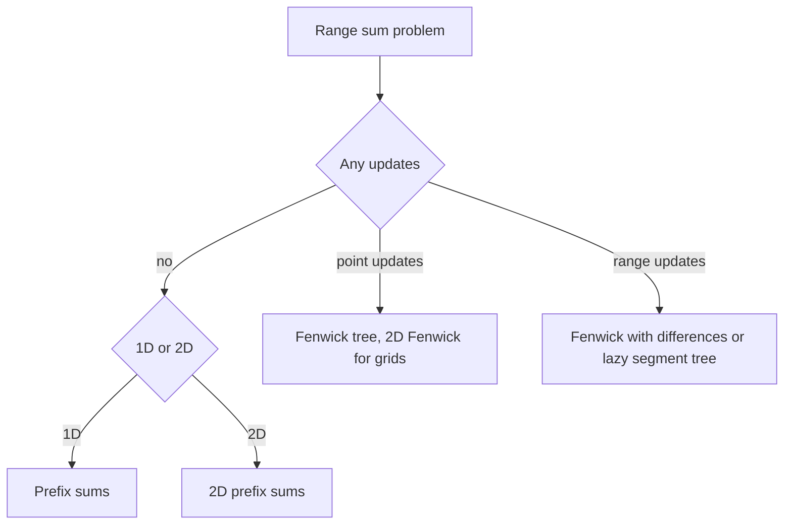

## The hook

A printed road map is perfect until a road closes. Then you need live traffic data, which costs more to maintain. Using live traffic for a city whose roads never change is wasted effort; using a printed map in a city with constant roadworks gets you lost.

The first three range-query problems on CSES are the same trade-off. Each asks for sums over ranges, and the right answer is not "the most powerful structure you know" but the lightest one that fits. Learning to choose quickly is worth more than any single data structure.

## The problem

Three tasks, in my own words:

- **Static Range Sum Queries:** an array of n numbers, then q queries "sum of positions a to b". The array never changes.
- **Dynamic Range Sum Queries:** the same, but some operations change the value at one position.
- **Forest Queries:** an n × n grid of trees and empty squares; each query asks how many trees are in a rectangle. The grid never changes.

All three have n and q up to about 2 × 10⁵ (the forest grid up to 1,000 × 1,000), and values up to 10⁹.

## The obvious approach

Loop over the range for each query: O(n) per query, O(n × q) overall, up to 4 × 10¹⁰ steps. Every one of the three needs something better, but not the same something.

## The key insight

:::analogy
A printed map is drawn once and read many times: that is a prefix-sum table, built in one pass and read in O(1). Live traffic is updated as roads change and is still quick to read: that is a Fenwick tree, O(log n) for both. A city map with districts, read rectangle by rectangle, is a 2D printed map: a 2D prefix table. Pick the map that matches how often the roads change.
:::

The question that decides the tool is whether the data is a [[static array]] or a [[dynamic array]]:

| Situation | Tool | Build | Update | Query |
|---|---|---|---|---|
| 1D, no updates | prefix sums | O(n) | not supported | O(1) |
| 1D, point updates | Fenwick tree | O(n) | O(log n) | O(log n) |
| 1D, range updates | Fenwick with differences, or lazy segment tree | O(n) | O(log n) | O(log n) |
| 1D, min or max instead of sum | sparse table if static, segment tree if dynamic | | | |
| 2D, no updates | [[2D prefix sum]] | O(n × m) | not supported | O(1) |
| 2D, point updates | 2D Fenwick tree | O(n × m log) | O(log n log m) | O(log n log m) |

That table is a [[tool budget]]: start at the top and move down only when the problem forces you to.

### Static Range Sum Queries

P[0] = 0, P[i] = P[i - 1] + a[i]. Answer sum(a..b) = P[b] - P[a - 1]. Use 64-bit: 2 × 10⁵ values of 10⁹ sum to 2 × 10¹⁴. The prefix sums idea is explained in [Answering a Million Range Questions Instantly](article:dsa-prefix-sums).

### Dynamic Range Sum Queries

An update "set position k to u" is a Fenwick add of u - a[k], after which a[k] = u. Queries are sum(b) - sum(a - 1). The structure is in [A Pyramid of Savings Jars](article:dsa-fenwick-tree); a segment tree also works, but is longer.

### Forest Queries

S[r][c] = grid[r][c] + S[r - 1][c] + S[r][c - 1] - S[r - 1][c - 1]. A rectangle from (r1, c1) to (r2, c2) is S[r2][c2] - S[r1 - 1][c2] - S[r2][c1 - 1] + S[r1 - 1][c1 - 1]. The 1-based indexing with a zero row and column makes the borders work without special cases.



:::insight
Every range-sum problem is a choice between "prepare once, answer instantly" and "keep it up to date as it changes". Ask whether there are updates before choosing a structure, and pick the lightest one that meets the limits.
:::

## Walk through an example

### Static, then dynamic, on [3, 1, 4, 1, 5, 9, 2, 6]

| i | 1 | 2 | 3 | 4 | 5 | 6 | 7 | 8 |
|---|---|---|---|---|---|---|---|---|
| a[i] | 3 | 1 | 4 | 1 | 5 | 9 | 2 | 6 |
| P[i] | 3 | 4 | 8 | 9 | 14 | 23 | 25 | 31 |

| Query | Calculation | Answer |
|---|---|---|
| sum(2..5) | P[5] - P[1] = 14 - 3 | 11 |
| sum(1..8) | P[8] - P[0] | 31 |
| sum(5..7) | P[7] - P[4] = 25 - 9 | 16 |

Now set position 3 to 10. With prefix sums, P[3] through P[8] would all change. With a Fenwick tree, add 10 - 4 = 6 at position 3, touching three tree entries. Then sum(2..5) = 17 and sum(3..3) = 10.

### Forest Queries

```
. . * .
* . * *
. * . .
* * . *
```

| Rectangle (1-based) | Trees |
|---|---|
| (1, 1) to (4, 4) | 8 |
| (2, 2) to (3, 4) | 3 |
| (1, 3) to (2, 4) | 3 |

For the second one: S[3][4] - S[1][4] - S[3][1] + S[1][1] = 5 - 1 - 1 + 0 = 3, the trees at (2, 3), (2, 4) and (3, 2). Checking small cases by hand like this is the quickest way to catch a sign error in the formula.

:::try-this
Use the formula to count the trees in rows 3 to 4, columns 1 to 2. (The rectangle is (3, 1) to (4, 2): S[4][2] - S[2][2] - S[4][0] + S[2][0]. The zero column makes the last two terms 0. S[4][2] = 4 trees in the first two columns, S[2][2] = 1, so the answer is 3: (3, 2), (4, 1) and (4, 2).)
:::

:::warning
Common misconception: "Always use a segment tree for range queries, since it handles everything." It does handle a lot, but it is several times more code than prefix sums, with more places for bugs, and it is slower by a log factor on static data. For a static array, prefix sums are strictly better; reach for heavier tools only when updates or non-invertible operations appear.
:::

## The code

```pseudo
static:  P[i] = P[i-1] + a[i];  sum(a, b) = P[b] - P[a-1]
dynamic: fenwick.add(k, u - a[k]); a[k] = u;  sum(a, b) = fenwick.sum(b) - fenwick.sum(a-1)
forest:  S[r][c] = g[r][c] + S[r-1][c] + S[r][c-1] - S[r-1][c-1]
         rect = S[r2][c2] - S[r1-1][c2] - S[r2][c1-1] + S[r1-1][c1-1]
```

```cpp
#include <bits/stdc++.h>
using namespace std;
using ll = long long;

struct Fenwick {
    int n;
    vector<ll> t;
    explicit Fenwick(int n) : n(n), t(n + 1, 0) {}
    void add(int i, ll d) { for (; i <= n; i += i & -i) t[i] += d; }
    ll sum(int i) const { ll s = 0; for (; i > 0; i -= i & -i) s += t[i]; return s; }
};

int main() {
    vector<ll> a = {0, 3, 1, 4, 1, 5, 9, 2, 6};                  // 1-based, a[0] unused
    int n = 8;
    vector<ll> P(n + 1, 0);
    for (int i = 1; i <= n; i++) P[i] = P[i - 1] + a[i];
    cout << P[5] - P[1] << ' ' << P[8] - P[0] << ' ' << P[7] - P[4] << '\n';   // 11 31 16

    Fenwick f(n);
    for (int i = 1; i <= n; i++) f.add(i, a[i]);
    f.add(3, 10 - a[3]), a[3] = 10;                             // set position 3 to 10
    cout << f.sum(5) - f.sum(1) << ' ' << f.sum(3) - f.sum(2) << '\n';         // 17 10

    vector<string> g = {"..*.", "*.**", ".*..", "**.*"};
    int R = 4, C = 4;
    vector<vector<int>> S(R + 1, vector<int>(C + 1, 0));
    for (int r = 1; r <= R; r++)
        for (int c = 1; c <= C; c++)
            S[r][c] = (g[r - 1][c - 1] == '*') + S[r - 1][c] + S[r][c - 1] - S[r - 1][c - 1];
    auto rect = [&](int r1, int c1, int r2, int c2) {
        return S[r2][c2] - S[r1 - 1][c2] - S[r2][c1 - 1] + S[r1 - 1][c1 - 1];
    };
    cout << rect(1, 1, 4, 4) << ' ' << rect(2, 2, 3, 4) << ' ' << rect(1, 3, 2, 4) << '\n';   // 8 3 3
    cout << S[3][4] << ' ' << S[1][4] << ' ' << S[3][1] << ' ' << S[1][1] << '\n';          // 5 1 1 0
}
```

On CSES, read the input with fast IO and print each answer on its own line; the computation is exactly what is shown.

## Complexity

- **Static: O(n + q)** in total.
- **Dynamic: O((n + q) log n)** with a Fenwick tree.
- **Forest: O(n² + q)** for an n × n grid.
- **Memory: O(n)** for the 1D problems, O(n²) for the grid, about 4 MB for 1,000 × 1,000 integers.

## Common mistakes

- **Using int for sums,** which overflows past 2³¹.
- **Off-by-one in P[a - 1],** or building P without the zero entry.
- **Applying "set to u" as "add u"** in the dynamic version; add the difference u - a[k] and remember the new value.
- **Getting the sign of the corner term wrong** in 2D: it is added back.
- **Using a segment tree with lazy propagation** where a plain prefix table or Fenwick tree suffices.

## Practice problems

*Static Range Sum Queries* is prefix sums. *Dynamic Range Sum Queries* is a Fenwick tree. *Forest Queries* is 2D prefix sums. When the grid also changes, the 2D Fenwick tree in [Two Piggy Banks That Track One Total](article:cp-fenwick-advanced) takes over.

## Key takeaways

- The first question for any range-sum problem is whether the data changes between queries.
- Static arrays use prefix sums: O(n) to build and O(1) per query.
- Point updates need a Fenwick tree or segment tree, with O(log n) updates and queries.
- Static grids use 2D prefix sums with inclusion-exclusion over four corner values.
- Choosing the lightest structure that fits the limits saves code, time and bugs.
