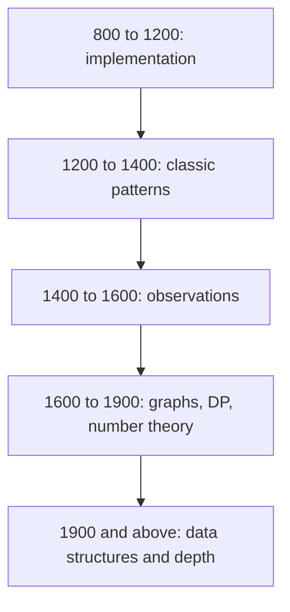

## The hook

Most people quit competitive programming in the first two months. Not because they lack talent, but because they practise blindly: random problems, some far too easy, some impossibly hard, no sense of progress. The rating graph goes flat, and so does the motivation.

Climbers do not walk up a mountain in a straight line. They move between base camps, each one stocked for the next stretch. The rating ladder is that set of base camps for contests.

## The intuition

:::analogy
Think of climbing a big mountain. You do not sprint from the bottom to the summit. You climb to the next base camp, rest, learn the terrain, and only then push higher. Each camp has its own skills: rope work here, ice axes there. Climbing too far above your camp exhausts you; staying at camp teaches nothing.
:::

Every Codeforces problem has a [[problem rating]]. The useful rule: practise in your [[stretch zone]], about 100 to 300 points above your current rating. Below that is your [[comfort zone]], useful for speed but not for growth. Far above it, you will mostly just read editorials.

## Let's build it up

### The base camps

This is a practical guide, not an official syllabus. Topics overlap, and problems at every level also reward clean implementation and careful reading.

| Rating band | Core skills to build | Typical techniques |
|---|---|---|
| 800 to 1200 | read carefully, simulate, handle edge cases | loops, sorting, simple greedy, basic maths, strings |
| 1200 to 1400 | turn a story into a standard task fast | prefix sums, two pointers, frequency counting, parity tricks |
| 1400 to 1600 | spot the key observation | binary search on the answer, greedy with sorting, basic number theory, constructive ideas |
| 1600 to 1900 | combine two techniques | BFS and DFS, DP on arrays, modular arithmetic, bitmasks, DSU |
| 1900 to 2100 | harder observations plus a data structure | segment trees, DP optimisations, combinatorics, shortest paths with twists |
| 2100 and above | depth and speed together | advanced graphs, string algorithms, harder maths, heavy data structures |

:::insight
Speed problems and knowledge problems need different fixes. If you understand editorials easily but solve slowly, you need volume in your stretch zone. If editorials use ideas you have never seen, you have a [[topic gap]]: stop and learn that topic from this subject's articles before grinding more problems.
:::

### A weekly rhythm

A sustainable week for someone also preparing for placements:

- **Two or three contests** (or virtual contests from past rounds), to practise under time pressure.
- **Upsolving** the next one or two problems you missed in each.
- **Topic sets**: five to ten problems on one technique you just learned, from CSES or Codeforces problem tags.
- **A mistakes log**: one line per Wrong Answer explaining the real cause, such as "overflow" or "did not reset array".
- **One rest day.** Rating curves are noisy, and tired practice builds bad habits. A day off keeps the routine sustainable across the months before placements, which matters more than any single heroic week.

### When to read the editorial

Give a stretch problem a real attempt, often 30 to 60 minutes of actual thinking, not staring. Then read the [[editorial]]. Close it, and implement the solution yourself. Coming back a week later to solve it from memory is even better.

:::warning
Common misconception: "solving hundreds of easy problems will raise my rating." It builds speed for the first few problems, which matters, but rating mostly rises when you can solve one more problem per contest. That next problem lives in your stretch zone.
:::

### What transfers to interviews

Contest practice and interview practice overlap a lot, but not completely. Contests train speed, edge-case paranoia and the habit of reading constraints first, all of which interviewers notice. Interviews add two things contests do not: explaining your reasoning out loud, and writing code a reviewer can read. So when you upsolve, write the solution as if someone will read it: clear names, a short comment on the key idea, no clever macros. And once a week, solve one problem while talking through it, as if an interviewer were listening. That one habit closes most of the gap between a good contest rating and a good interview.

## A tiny example

Riya is rated 1250. She has been solving 900 to 1100 problems because they feel good. Her contests always end the same way: A and B solved, C unsolved.

She switches plan. Each week she does twenty problems rated 1300 to 1500, reads the editorial after 40 minutes on any she cannot crack, and upsolves problem C after every contest. Her mistakes log shows three recurring causes: forgetting `long long`, off-by-one in binary search, and not reading "print any answer".

The log is the quiet hero. Two of her three common mistakes are fixed by her template and a checklist, and the third by practice. Within a couple of months, problem C starts falling during contests, not after.

:::try-this
Write your own ladder entry. Pick your current rating (or 800 if you have none), add 200, and list three topics from the table you would need there. Then find five problems at that rating with one of those tags. That list is your next week.
:::

## Where you'll see this again

The rest of this subject is organised by these camps. The number theory, range query, DP, graph and string tracks each say roughly at which rating their techniques start appearing. The [contest template](article:cp-fast-io-template) and the stress-testing article remove the silly mistakes, so your practice time goes into ideas. For placements, the 1400 to 1600 camp already covers most interview DSA.

## Key takeaways

- Practise mostly in your stretch zone, about 100 to 300 rating points above your current rating, where improvement is fastest.
- Each rating band has its own skills, from careful implementation near 1000 to combining graphs, DP and number theory near 1800.
- If editorials use ideas you have never seen, fix the topic gap by learning the technique, not by grinding more problems.
- A weekly rhythm of contests, upsolving, topic sets and a mistakes log keeps progress steady.
- Attempt a hard problem seriously, then read the editorial and re-implement it yourself so the idea sticks.
