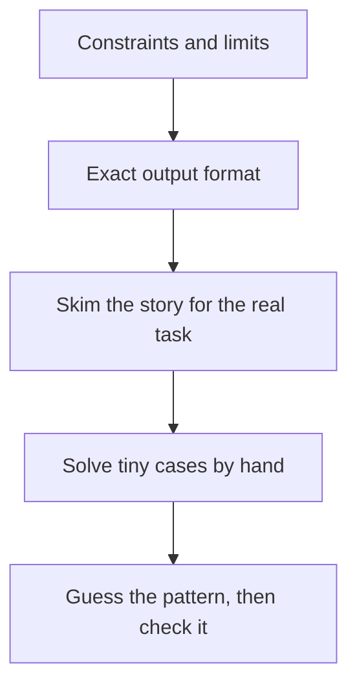

## The hook

Contest problems love stories. Farmer John's cows walk along a fence. A shopkeeper rearranges her shelves. A wizard casts spells on a row of potions. Read every word carefully and five minutes have gone before you know what is being asked.

Strong contestants read differently. In two minutes they know the input size, the required complexity, and often which pattern is hiding under the story. Here is how they do it.

## The intuition

:::analogy
A detective entering a crime scene does not admire the wallpaper. They look for the few clues that matter: the open window, the stopped clock, the missing glass. A contest problem is a scene with a lot of wallpaper. Your clues are the constraints, the exact output, and what happens on tiny inputs.
:::

Read in a deliberate order: clues first, story second, then explore by hand. The order matters because the clues tell you what kind of solution to look for while you read the rest.

## Let's build it up

### Clue 1: the constraints

Jump straight to the line that says something like `1 ≤ n ≤ 2·10⁵`. The [[constraints]] tell you which complexities are allowed, using the budget of about 10⁸ simple operations per second from [Reading Constraints Like a Pro](article:dsa-big-o).

| n up to | Think about |
|---|---|
| 20 | brute force over subsets, bitmasks |
| 500 | O(n³), triple loops, Floyd-Warshall style DP |
| 5,000 | O(n²) DP or pairs |
| 2·10⁵ to 10⁶ | O(n log n) or O(n): sorting, prefix sums, two pointers, binary search |
| 10⁹ to 10¹⁸ | O(log n) or a formula: maths, binary search on the answer |

Values matter too. If values go up to 10⁹ and you add them, you need `long long`. If the answer must be printed "modulo 10⁹ + 7", the true answer is enormous and counting is involved.

### Clue 2: the sum of n

Many problems have t test cases and add a line like "the sum of n over all test cases does not exceed 2·10⁵". That [[sum of n guarantee]] means you can afford O(n log n) **per test**, because the total work is bounded. Without it, t × n could be huge.

### Clue 3: the exact output

Read what to print, precisely. "Print any valid answer" is generous; "print the lexicographically smallest" is a constraint in disguise. "Print -1 if impossible" means you must detect impossibility. "Print YES or NO" usually means the core is a yes-or-no property that may have a simple characterisation.

### Clue 4: strip the story

The [[story text]] almost always wraps a standard task. "Cows that must not stand next to rival cows" is graph colouring. "Choose shelves so no two overlap" is interval scheduling. Rewrite the problem in one plain sentence without the story: "given an array, find the longest subarray where..." If you cannot write that sentence, you have not understood it yet.

:::insight
The [[sample tests]] explain the format; they are not there to catch your bugs. Treat passing the samples as the start of checking, not the end.
:::

### Clue 5: explore small cases

Many problems at 1200 to 1800 have a neat property you would never derive from the statement directly. [[Small-case exploration]] finds it: solve n = 1, 2, 3, 4 by hand, or write a quick brute force and print the answers for every tiny input. Patterns jump out of tables: "the answer is always n − 1 unless all values are equal", or "only the parity of the sum matters".

## A tiny example

Here is a typical Div. 2 problem, paraphrased: *There are n lamps in a row, each on or off. In one move you can toggle two adjacent lamps. Can you turn all of them off?* Constraints: t up to 10⁴, n up to 2·10⁵, sum of n at most 2·10⁵.

**Clues.** The sum-of-n guarantee allows O(n) per test. The output is YES or NO, which hints at a simple property.

**Small cases.** One lamp on, `[1]`: you cannot toggle a single lamp, so NO. `[1, 1]`: toggle both, YES. `[1, 0, 1]`: toggle positions 1 and 2 to get `[0, 1, 1]`, then 2 and 3 to get `[0, 0, 0]`. YES.

**Pattern.** Each move changes the number of lit lamps by −2, 0 or +2, so the parity of the count of lit lamps never changes. If the count is odd, the answer is NO. Trying a few more cases suggests that an even count is always solvable when n ≥ 2. (Proving it: sweep left to right, toggling each lit lamp together with its right neighbour.)

The whole problem was a parity argument wrapped in a lamp story. Two minutes of reading, five of hand exploration, one line of code.

:::try-this
Change the rule to "toggle any two lamps, not necessarily adjacent". Does the answer change? Work out `[1, 0, 1]` and `[1, 1, 1]` by hand. (Parity still decides it, and now the sweep is even easier, since any two lit lamps can be switched off together.)
:::

:::warning
Common misconception: "reading quickly means skipping details." Skim the story, but read the constraints and output format word by word. Many Wrong Answers come from missing "distinct", "at most", "modulo", or "print any".
:::

## Where you'll see this again

Every problem walkthrough in this subject starts with these clues before any code. The next article lays out a rating ladder of what to practise at each level, and later articles teach stress testing, the tool that checks your small-case guesses automatically against a brute force.

## Key takeaways

- Read the constraints first, because the input size tells you which complexity and which family of ideas to try.
- A sum-of-n guarantee means per-test O(n log n) is fine even with many test cases.
- Read the output format word by word; "any", "smallest", "modulo" and "-1 if impossible" all change the problem.
- Strip the story and restate the task in one plain sentence before trying to solve it.
- Solve tiny cases by hand, or print them with a brute force, to discover the property the problem is built on.
