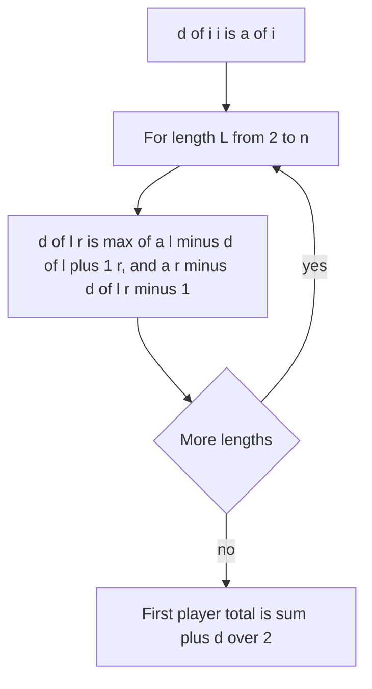

## The hook

A row of coins lies on a table. Two players take turns, each picking up the coin at either end. Both play perfectly. How much does the first player collect? Greedily grabbing the larger end is a trap: it can expose a huge coin for the opponent.

The obvious game-tree search doubles with every coin. The neat trick is to stop tracking two scores and track only their difference, which turns the whole game into a single interval DP.

## The problem

CSES *Removal Game*: n numbers in a row, two players alternately remove the first or the last number and add it to their score. Both maximise their own score. Print the first player's final score. n ≤ 5,000, values up to 10⁹ in absolute value.

For [6, 2, 9, 1, 4, 7], the first player scores 20 of the total 29.

## The obvious approach

Recursively try both ends for each player, which is 2ⁿ move sequences. Memoising on (l, r, whose turn, my score so far) still has too many states, because scores vary.

Tracking both players' totals in the state is the wrong instinct. In a [[zero-sum game]], one number suffices.

## The key insight

:::analogy
Imagine the two players keep one shared scoreboard showing "current player minus the other player". Each time a player takes a coin, it goes in their favour; then the board flips perspective, because it is now the other player's turn. So the value of a position, from the mover's side, is the coin they take minus the value of the position the opponent is left with. That needs only the range of coins left, not anyone's running total.
:::

The scoreboard is the [[score difference]] d[l][r]:

- d[i][i] = a[i]: one coin, the mover takes it;
- d[l][r] = max(a[l] - d[l + 1][r], a[r] - d[l][r - 1]).

The first player's total is (sum + d[0][n - 1]) / 2, since the two totals add to the sum and differ by d. This is the interval DP from [Choosing Which Balloon to Pop Last](article:dsa-interval-dp) in its simplest game form, and the same "value from the mover's view" idea as in [Counting Backwards From the Last Move](article:cp-game-theory).

### Memory for n = 5,000

A full table is 5,000² = 2.5 × 10⁷ entries, 200 MB of 64-bit values. Since d for length L depends only on length L - 1, keep one array indexed by l and update it [[rolling by length]]: before processing length L, d[l] holds the value for [l, l + L - 2]; replace it with the value for [l, l + L - 1]. That needs O(n) memory and is also faster, because it is cache-friendly.

### Even rows: the first player cannot lose

For an even number of coins, colour positions alternately. The first player can take all coins of one colour: whatever end they take, the opponent is left with both ends of the other colour, and after the opponent moves, an end of the first player's colour is exposed again. Choosing the colour with the larger sum guarantees at least half. This [[colour strategy]] proves LeetCode's *Stone Game*, whose answer is always true; the DP still gives the exact margin.

| Question | Read from the DP |
|---|---|
| First player's score (Removal Game) | (sum + d) / 2 |
| Can the first player at least tie? (Predict the Winner) | d ≥ 0 |
| Does the first player win an even row? (Stone Game) | always yes when the total is odd, by the colour strategy |



:::insight
In a zero-sum game, the value of a position from the mover's side is their best immediate gain minus the value of the position they leave to the opponent. That removes running totals from the state, and the game becomes a DP over the remaining range alone.
:::

## Walk through an example

[6, 2, 9, 1, 4, 7].

| d[l][r] | r=0 | 1 | 2 | 3 | 4 | 5 |
|---|---|---|---|---|---|---|
| l=0 | 6 | 4 | 5 | 12 | -4 | **11** |
| l=1 | | 2 | 7 | -6 | 10 | -3 |
| l=2 | | | 9 | 8 | 6 | 5 |
| l=3 | | | | 1 | 3 | 4 |
| l=4 | | | | | 4 | 3 |
| l=5 | | | | | | 7 |

d[0][5] = max(6 - d[1][5], 7 - d[0][4]) = max(6 + 3, 7 + 4) = 11: the first player should take the 7 on the right, not the 6 on the left. The first player's total is (29 + 11) / 2 = 20, and the second player gets 9.

Some cells are negative, such as d[0][4] = -4 for [6, 2, 9, 1, 4]: whoever moves there is losing, because either choice exposes the 9.

### Colour check

Even positions hold 6, 9, 4 (sum 19); odd positions hold 2, 1, 7 (sum 10). The colour strategy guarantees the first player 19; perfect play gets 20, a little more.

:::try-this
For [3, 9, 1, 2], what does the first player score, and which coin should they take first? (d[0][3] = max(3 - d[1][3], 2 - d[0][2]). d[1][3] for [9, 1, 2] is 9 - d[2][3] = 9 - 1 = 8, and d[0][2] for [3, 9, 1] is max(3 - 8, 1 - 6) = -5. So d = max(3 - 8, 2 + 5) = 7: take the 2. The first player scores (15 + 7) / 2 = 11.)
:::

:::warning
Common misconception: "Each player should take the larger end." On [3, 9, 1, 2], greedy takes the 3, exposing the 9 to the opponent, and against good play ends with only 5 of the 15. The optimal first move is the smaller coin, 2, which gives 11. Only the DP over both choices handles traps like this.
:::

## The code

```pseudo
d[l] = a[l] for every l                 # length 1
for L in 2..n:
    for l in 0..n-L:
        r = l + L - 1
        d[l] = max(a[l] - d[l+1], a[r] - d[l])
        # d[l+1] still holds [l+1, r] from length L-1; d[l] holds [l, r-1]
answer = (sum + d[0]) / 2
```

```cpp
#include <bits/stdc++.h>
using namespace std;
using ll = long long;

ll removalGame(const vector<ll>& a) {
    int n = a.size();
    vector<ll> d(a);                                      // length 1: d[l] = a[l]
    for (int L = 2; L <= n; L++)
        for (int l = 0; l + L - 1 < n; l++) {
            int r = l + L - 1;
            d[l] = max(a[l] - d[l + 1], a[r] - d[l]);     // d[l+1] is [l+1, r]; d[l] is [l, r-1]
        }
    ll sum = accumulate(a.begin(), a.end(), 0LL);
    return (sum + d[0]) / 2;
}

ll fullTable(const vector<ll>& a) {                       // O(n^2) memory, for checking
    int n = a.size();
    vector<vector<ll>> D(n, vector<ll>(n, 0));
    for (int i = 0; i < n; i++) D[i][i] = a[i];
    for (int L = 2; L <= n; L++)
        for (int l = 0; l + L - 1 < n; l++) {
            int r = l + L - 1;
            D[l][r] = max(a[l] - D[l + 1][r], a[r] - D[l][r - 1]);
        }
    return (accumulate(a.begin(), a.end(), 0LL) + D[0][n - 1]) / 2;
}

int main() {
    cout << removalGame({6, 2, 9, 1, 4, 7}) << ' ' << removalGame({3, 9, 1, 2}) << ' ' << removalGame({1, 2, 5}) << '\n';   // 20 11 6
    mt19937 rng(41);
    int bad = 0;
    for (int t = 0; t < 300; t++) {
        vector<ll> a(rng() % 20 + 1);
        for (ll& x : a) x = (ll)(rng() % 2001) - 1000;     // negative values allowed
        bad += removalGame(a) != fullTable(a);
    }
    cout << bad << '\n';                                  // 0
    vector<ll> big(5000);
    for (ll& x : big) x = rng() % 1000000000;
    cout << (removalGame(big) * 2 >= accumulate(big.begin(), big.end(), 0LL)) << '\n';   // 1: even length, first player gets at least half
}
```

The rolling update works because, when d[l] is overwritten for length L, d[l + 1] has not yet been overwritten in this pass and still holds [l + 1, r], while the old d[l] holds [l, r - 1]. The final line checks the colour argument on 5,000 coins.

## Complexity

- **Time: O(n²),** 1.25 × 10⁷ updates for n = 5,000.
- **Space: O(n)** with rolling by length, against O(n²) for the full table.
- **Values:** sums reach 5 × 10¹², so use 64-bit.

## Common mistakes

- **Tracking both scores** in the state, which explodes the number of states.
- **Greedy end-taking,** which falls into traps such as [3, 9, 1, 2].
- **Rolling in the wrong order,** overwriting d[l + 1] before it is read; iterate l upwards within each length.
- **Forgetting negative values** when the input allows them; the recurrence handles them, but initial values must be the coins themselves, not 0.
- **Integer division by 2 with a negative sum and difference;** (sum + d) is always even, so the division is exact either way.

## Practice problems

CSES *Removal Game* is this walkthrough at n = 5,000. *Predict the Winner* asks whether d ≥ 0. *Stone Game* has an even number of piles and an odd total, so the colour strategy shows the first player always wins.

## Key takeaways

- In a two-player zero-sum game, the score difference from the mover's view replaces both players' totals in the state.
- The removal game recurrence is d[l][r] = max(a[l] - d[l + 1][r], a[r] - d[l][r - 1]).
- The first player's total is (sum + d[0][n - 1]) / 2.
- Because each length depends only on the previous length, one array rolled by length reduces memory to O(n).
- With an even number of coins, taking all coins of one parity guarantees the first player at least half the total.
