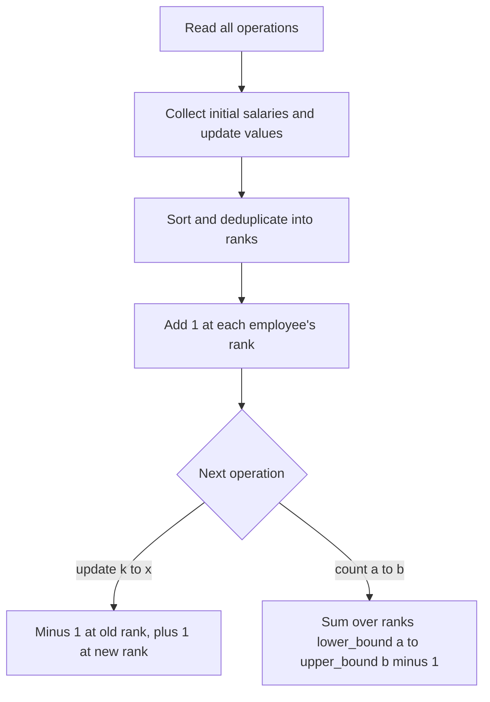

## The hook

A payroll office is asked, over and over, "how many employees earn between 40,000 and 70,000?", while salaries keep changing as people are promoted. Salaries can be any number up to a billion. Keeping a counter for every possible salary would need a billion counters; scanning all employees for every question is too slow.

The trick is to notice that only the salaries that actually appear matter. Read every operation in advance, list every salary that will ever exist, give each a small band number, and count employees per band in a Fenwick tree.

## The problem

CSES *Salary Queries*: there are n employees with salaries. Two kinds of operation arrive, q in total:

- change the salary of employee k to x;
- count employees whose salary is between a and b, inclusive.

n and q go up to 2 × 10⁵, and salaries and bounds up to 10⁹.

Example: salaries 7, 2, 9, 4, 6; operations: count [3, 7]; set employee 2 to 5; count [3, 7]; set employee 1 to 10; count [8, 12]; count [1, 3]. Answers: 3, 4, 2, 0.

## The obvious approach

Scan all n employees for each count: O(n × q) = 4 × 10¹⁰ in the worst case. A sorted array answers counts with two binary searches, but an update needs deleting and inserting in the middle, O(n).

## The key insight

:::analogy
Instead of tracking exact salaries on a ruler that runs to a billion, the payroll office prints a short list of every salary figure that will appear this year, sorts it, and numbers the figures 1, 2, 3, and so on. Each employee is a tally mark in the band of their figure. A promotion moves one tally mark from one band to another. A question "between a and b" becomes "how many tally marks lie in bands p to q", which a running-total table answers quickly.
:::

That is [[offline compression]] plus a [[value-indexed Fenwick tree]]:

- read all operations first;
- collect every initial salary and every update value, sort and deduplicate;
- for each employee, add 1 at the rank of their salary;
- an update is a [[move as delete plus insert]]: add -1 at the old rank and +1 at the new one;
- a count over [a, b] is a sum over the [[rank range]] from lower_bound(a) to upper_bound(b) - 1.

Query bounds do not need to be compressed: binary searching them in the sorted value list gives the right ranks even when a and b are not salaries anyone earns. The compression step is covered in [Renaming Huge Numbers as 1, 2, 3](article:cp-coordinate-compression), and the tree in [A Pyramid of Savings Jars](article:dsa-fenwick-tree).

An online alternative uses an ordered set of (salary, employee) pairs with order_of_key, from [A Sorted Shelf That Knows Every Book's Position](article:cp-pbds-ordered-set), which avoids reading ahead.



:::insight
Only the values that will ever appear need a place in the tree. Reading the whole input first lets you compress them all at once, and then a Fenwick tree of counts over compressed values answers "how many in [a, b]" with updates, in O(log n) each.
:::

## Walk through an example

Initial salaries 7, 2, 9, 4, 6; update values 5 and 10. Sorted distinct values and their ranks:

| Value | 2 | 4 | 5 | 6 | 7 | 9 | 10 |
|---|---|---|---|---|---|---|---|
| Rank | 1 | 2 | 3 | 4 | 5 | 6 | 7 |

Initial counts by rank: 1, 1, 0, 1, 1, 1, 0.

| Operation | Rank range or move | Counts by rank afterwards | Answer |
|---|---|---|---|
| count [3, 7] | lower_bound(3) = rank 2, upper_bound(7) = rank 6, so ranks 2 to 5 | 1, 1, 0, 1, 1, 1, 0 | 1 + 0 + 1 + 1 = 3 |
| employee 2: 2 → 5 | rank 1 minus 1, rank 3 plus 1 | 0, 1, 1, 1, 1, 1, 0 | |
| count [3, 7] | ranks 2 to 5 | | 1 + 1 + 1 + 1 = 4 |
| employee 1: 7 → 10 | rank 5 minus 1, rank 7 plus 1 | 0, 1, 1, 1, 0, 1, 1 | |
| count [8, 12] | lower_bound(8) = rank 6, upper_bound(12) is past the end, so ranks 6 to 7 | | 2 |
| count [1, 3] | lower_bound(1) = rank 1, upper_bound(3) = rank 2, so rank 1 only | | 0 |

Neither 3, 8, 12 nor 1 is anyone's salary; the binary searches still produce exactly the right band ranges.

:::try-this
After these operations, what does count [5, 9] return, and which ranks does it sum? (lower_bound(5) is rank 3 and upper_bound(9) is rank 7, so ranks 3 to 6. Counts there are 1, 1, 0, 1: the salaries 5, 6 and 9, so the answer is 3.)
:::

:::warning
Common misconception: "Compress the salaries as you read them, one operation at a time." A value first seen in a later update would get a rank larger than values already placed, breaking the sorted order the counts rely on. Compression only works when every value is known before the first rank is assigned, which is why this solution reads all operations first.
:::

## The code

```pseudo
read salaries and all operations
vals = sorted unique(salaries + update values)
rank(v) = index of v in vals, 1-based
for each salary: bit.add(rank(salary), 1)
for each operation:
    update k to x: bit.add(rank(cur[k]), -1); bit.add(rank(x), 1); cur[k] = x
    count a to b:  lo = lower_bound(vals, a) + 1; hi = upper_bound(vals, b)
                   print bit.sum(hi) - bit.sum(lo - 1)
```

```cpp
#include <bits/stdc++.h>
using namespace std;

struct BIT {
    int n;
    vector<int> t;
    explicit BIT(int n) : n(n), t(n + 1, 0) {}
    void add(int i, int d) { for (; i <= n; i += i & -i) t[i] += d; }
    int sum(int i) const { int s = 0; for (; i > 0; i -= i & -i) s += t[i]; return s; }
};

struct Op { char type; int x, y; };                       // '!' employee x gets y; '?' count [x, y]

vector<int> salaryQueries(vector<int> cur, const vector<Op>& ops) {
    vector<int> vals(cur);
    for (auto& o : ops) if (o.type == '!') vals.push_back(o.y);   // every value that will be stored
    sort(vals.begin(), vals.end());
    vals.erase(unique(vals.begin(), vals.end()), vals.end());
    auto rk = [&](int v) { return int(lower_bound(vals.begin(), vals.end(), v) - vals.begin()) + 1; };

    BIT bit(vals.size());
    for (int s : cur) bit.add(rk(s), 1);
    vector<int> answers;
    for (auto& o : ops) {
        if (o.type == '!') {
            bit.add(rk(cur[o.x - 1]), -1);
            cur[o.x - 1] = o.y;
            bit.add(rk(o.y), 1);
        } else {
            int lo = lower_bound(vals.begin(), vals.end(), o.x) - vals.begin() + 1;   // first rank >= a
            int hi = upper_bound(vals.begin(), vals.end(), o.y) - vals.begin();       // last rank <= b
            answers.push_back(hi >= lo ? bit.sum(hi) - bit.sum(lo - 1) : 0);
        }
    }
    return answers;
}

int main() {
    vector<Op> ops = {{'?', 3, 7}, {'!', 2, 5}, {'?', 3, 7}, {'!', 1, 10}, {'?', 8, 12}, {'?', 1, 3}, {'?', 5, 9}};
    for (int a : salaryQueries({7, 2, 9, 4, 6}, ops)) cout << a << ' ';
    cout << '\n';                                         // 3 4 2 0 3
}
```

## Complexity

- **Compression: O((n + q) log(n + q))** to sort up to n + q values.
- **Each update and each count: O(log(n + q))** for a few Fenwick operations and binary searches.
- **Space: O(n + q)** for the value list, the tree and the stored operations.

## Common mistakes

- **Compressing only initial salaries,** so update values have no rank.
- **Compressing query bounds as if they were values,** which is harmless but unnecessary; forgetting to binary search them correctly is the real danger.
- **Using upper_bound for the lower end** or lower_bound for the upper end, which shifts the range by one band.
- **Forgetting to remove the old salary** on an update, which double-counts the employee.
- **Indexing employees from 0 while the input uses 1,** or the other way round.

## Practice problems

*Salary Queries* is this walkthrough. *Count of Range Sum* uses the same compressed Fenwick tree over prefix sums, counting earlier prefixes within a window of values. *Count of Smaller Numbers After Self* is the simplest value-indexed Fenwick counting problem, a good warm-up.

## Key takeaways

- Counting items with values in a range, while values change, is a Fenwick tree of counts indexed by value.
- Large values are compressed to ranks, and every value that will ever be stored must be included, so all operations are read first.
- An update is one decrement at the old rank and one increment at the new rank.
- A count over [a, b] sums the ranks from lower_bound(a) to upper_bound(b) - 1, even when a and b are not stored values.
- An ordered set of (value, id) pairs is an online alternative when reading ahead is not possible.
