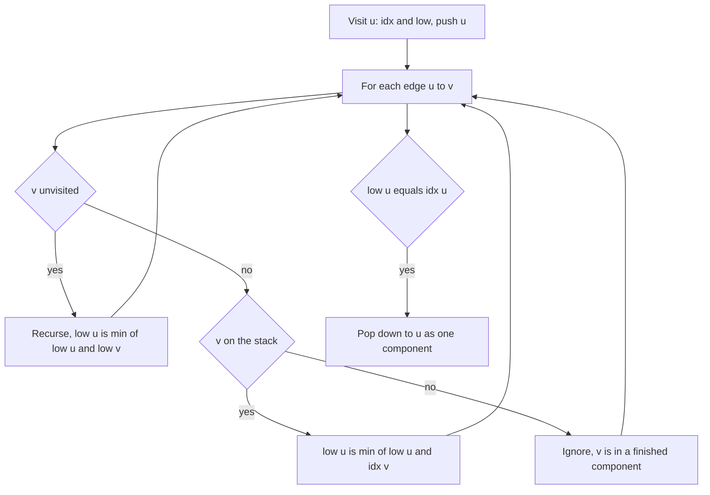

## The hook

A city of one-way streets falls apart into neighbourhoods you can drive around in loops, joined by streets you can only use in one direction. Kosaraju's algorithm, from [One-Way Streets and the Loops Between Them](article:dsa-scc-for-interviews), finds those neighbourhoods with two DFS passes and a reversed graph.

Contest code often prefers Tarjan's algorithm: one DFS, no reversed graph, and the components come out already in a useful order. It uses the same discovery times and low-links as bridge finding, plus a stack, and it is worth knowing well because it reappears in 2-SAT and many condensation problems.

## The intuition

:::analogy
A surveyor explores the city along one-way streets, numbering each corner when first reached and dropping it on a pile of "not yet assigned to a neighbourhood". Whenever the surveyor finishes a corner, they ask: "from everything I explored after arriving here, could I get back to any corner still on the pile that I reached earlier than this one?" If not, this corner is the entrance to a sealed neighbourhood, and every corner on the pile above it belongs to that neighbourhood. They lift that block off the pile and continue.
:::

The numbering is the [[discovery index]], the earliest reachable number is the [[low-link]], and the pile is the [[Tarjan stack]]. A corner that finishes with low[v] = idx[v] is a [[component root]].

## How it works

### The algorithm

```
dfs(u):
    idx[u] = low[u] = timer++; push u; onStack[u] = true
    for each edge u -> v:
        if v unvisited: dfs(v); low[u] = min(low[u], low[v])
        else if onStack[v]: low[u] = min(low[u], idx[v])
    if low[u] == idx[u]:
        pop vertices until u, assigning them one component id
```

Run dfs from every unvisited vertex. Each vertex is pushed and popped once, each edge examined once: O(n + m).

### Why only on-stack vertices count

A visited vertex that is no longer on the stack has been assigned to a finished component. Finished components cannot reach back to the current path; if they could, they would not have been finished. So an edge into them must not lower low. This is the only difference from the bridge-finding low-link in [The One Road Whose Closure Splits the City](article:dsa-critical-connections), where every visited vertex counts.

### Components come out in reverse topological order

A component is popped only after everything reachable from it has been explored and popped. So components that are reached from it are emitted first: [[reverse topological emission]]. Numbering components in emission order therefore gives a reverse topological order of the condensation DAG, which 2-SAT uses directly, and which a DP over the condensation can process from last id to first.

### Flight Routes Check

CSES *Flight Routes Check* asks whether every city can reach every other, and if not, for a pair a, b where b is unreachable from a. No component labels are needed:

- DFS from city 1 in the graph; if some city v is not reached, print 1 v;
- DFS from city 1 in the reversed graph; if some v is not reached, v cannot reach 1, so print v 1;
- otherwise the graph is strongly connected.

### Recursion depth

A chain of 10⁵ vertices makes the DFS that deep. Many judges, including CSES, give enough stack for that in C++, but not all do. If in doubt, use an iterative DFS that keeps, per vertex, the index of the next edge to examine.

| Need | Method |
|---|---|
| Component labels | Tarjan, or Kosaraju |
| Components in topological order | Tarjan's emission order, reversed |
| Is the graph strongly connected? | DFS from one vertex in G and in the reversed graph |
| Best total over a path of components | condensation DAG plus DP, as in Coin Collector |



:::insight
Tarjan's algorithm closes a component the moment its first-visited vertex finishes without any path back above it through unfinished vertices. Using only on-stack vertices for low-links keeps finished components separate, and the order in which components close is a reverse topological order for free.
:::

## Walk through an example

Edges: 0 → 1, 1 → 2, 2 → 0, 1 → 3, 3 → 4, 4 → 3, 4 → 5, 5 → 6, 6 → 5, 2 → 6. DFS starts at 0 and follows edges in the listed order.

| Event | Stack (bottom to top) | idx and low updates |
|---|---|---|
| visit 0, 1, 2 | 0 1 2 | idx 0, 1, 2 |
| 2 → 0, on stack | 0 1 2 | low[2] = 0 |
| visit 6 from 2, then 5 | 0 1 2 6 5 | idx[6] = 3, idx[5] = 4 |
| 5 → 6, on stack | | low[5] = 3 |
| 5 finishes, low 3 ≠ 4; 6 finishes, low 3 = idx 3 | 0 1 2 | pop {5, 6}: component 0 |
| back at 1: visit 3, then 4 | 0 1 2 3 4 | idx[3] = 5, idx[4] = 6 |
| 4 → 3, on stack | | low[4] = 5 |
| 4 → 5, finished component | | ignored |
| 3 finishes with low 5 = idx 5 | 0 1 2 | pop {3, 4}: component 1 |
| 0 finishes with low 0 = idx 0 | empty | pop {0, 1, 2}: component 2 |

Components in emission order: {5, 6}, {3, 4}, {0, 1, 2}. Reversed, that is the topological order of the condensation: {0, 1, 2} → {3, 4} → {5, 6}, with {0, 1, 2} also pointing directly to {5, 6} through 2 → 6.

At the edge 4 → 5, vertex 5 was visited but already popped; letting it lower low[4] to 4 would wrongly suggest 4 can return above itself.

:::try-this
Add the edge 6 → 1. How many components are there, and which vertex is the root of the merged one? (Now 5 and 6 can reach 1, and 1 reaches 3, 4, 5 and 6, so every vertex can reach every other: all seven form one component. With 6 → 1 on the stack when 6 is explored, low[6] becomes 1, then low[2] and so on, and only vertex 0 finishes with low = idx. The single root is 0.)
:::

:::warning
Common misconception: "Use the same low-link rule as for bridges: any visited vertex can lower low." In a directed graph, an edge into a finished component points away for good; that component cannot come back. Counting it merges separate components. The on-stack test is what distinguishes SCC low-links from bridge low-links.
:::

## The code

```pseudo
tarjan(u):
    idx[u] = low[u] = timer++; stack.push(u); on[u] = true
    for v in adj[u]:
        if idx[v] == -1: tarjan(v); low[u] = min(low[u], low[v])
        else if on[v]:   low[u] = min(low[u], idx[v])
    if low[u] == idx[u]:
        repeat: x = stack.pop(); on[x] = false; comp[x] = count
        until x == u
        count += 1
```

```cpp
#include <bits/stdc++.h>
using namespace std;

struct Tarjan {
    int n, timer = 0, count = 0;
    vector<vector<int>> adj;
    vector<int> idx, low, comp, st;
    vector<bool> on;
    Tarjan(int n, const vector<array<int, 2>>& edges) : n(n), adj(n), idx(n, -1), low(n), comp(n, -1), on(n, false) {
        for (auto [a, b] : edges) adj[a].push_back(b);
        for (int v = 0; v < n; v++) if (idx[v] == -1) dfs(v);
    }
    void dfs(int u) {
        idx[u] = low[u] = timer++;
        st.push_back(u), on[u] = true;
        for (int v : adj[u]) {
            if (idx[v] == -1) dfs(v), low[u] = min(low[u], low[v]);
            else if (on[v]) low[u] = min(low[u], idx[v]);       // finished components are ignored
        }
        if (low[u] == idx[u]) {                                  // u is a component root
            while (true) {
                int x = st.back(); st.pop_back();
                on[x] = false, comp[x] = count;
                if (x == u) break;
            }
            count++;
        }
    }
};

pair<int, int> flightRoutesCheck(int n, const vector<array<int, 2>>& edges) {   // {-1, -1} if strongly connected
    vector<vector<int>> g(n), rg(n);
    for (auto [a, b] : edges) g[a].push_back(b), rg[b].push_back(a);
    auto reach = [&](const vector<vector<int>>& G) {
        vector<bool> seen(n, false);
        vector<int> st = {0};
        seen[0] = true;
        while (!st.empty()) {
            int u = st.back(); st.pop_back();
            for (int v : G[u]) if (!seen[v]) seen[v] = true, st.push_back(v);
        }
        return seen;
    };
    auto f = reach(g), r = reach(rg);
    for (int v = 0; v < n; v++) if (!f[v]) return {0, v};       // v unreachable from 0
    for (int v = 0; v < n; v++) if (!r[v]) return {v, 0};       // 0 unreachable from v
    return {-1, -1};
}

int main() {
    vector<array<int, 2>> e = {{0, 1}, {1, 2}, {2, 0}, {1, 3}, {3, 4}, {4, 3}, {4, 5}, {5, 6}, {6, 5}, {2, 6}};
    Tarjan t(7, e);
    cout << t.count << ':';
    for (int c : t.comp) cout << ' ' << c;
    cout << '\n';                                                // 3: 2 2 2 1 1 0 0
    auto withBack = e;
    withBack.push_back({6, 1});
    cout << Tarjan(7, withBack).count << '\n';                   // 1
    auto [a, b] = flightRoutesCheck(7, e);
    auto [c, d] = flightRoutesCheck(7, withBack);
    cout << a << ' ' << b << ' ' << c << ' ' << d << '\n';       // 3 0 -1 -1
}
```

For the original graph, the check reports that city 3 cannot reach city 0: every city is reachable from 0, but {3, 4} and {5, 6} have no way back.

## Complexity

- **Tarjan: O(n + m) time,** O(n) for the stack and arrays, plus the adjacency list.
- **Flight Routes Check: O(n + m),** two searches.
- **Condensation DP: O(n + m)** more, using component ids in reverse emission order.

## Common mistakes

- **Lowering low through vertices not on the stack.**
- **Forgetting to clear the on-stack flag** when popping a component.
- **Assuming emission order is topological;** it is reverse topological.
- **Building the reversed graph incorrectly** in the two-search check, for example adding both directions to it.
- **Deep recursion** on judges with a small stack; use an iterative DFS there.

## Practice problems

*Planets and Kingdoms* asks for component labels. *Flight Routes Check* needs only two reachability searches and a counterexample pair. *Coin Collector* is the condensation DP, using Tarjan's order directly. The next article in this track, 2-SAT, relies on the reverse topological emission order.

## Key takeaways

- Tarjan's algorithm finds strongly connected components in one DFS using discovery indices, low-links and a stack.
- An edge to a visited vertex lowers the low-link only if that vertex is still on the stack, because finished components can never be reached back from.
- A vertex that finishes with low equal to its discovery index is a component root, and the vertices above it on the stack form its component.
- Components are emitted in reverse topological order of the condensation, which later algorithms such as 2-SAT use directly.
- Checking strong connectivity needs only a search from one vertex in the graph and another in the reversed graph.
