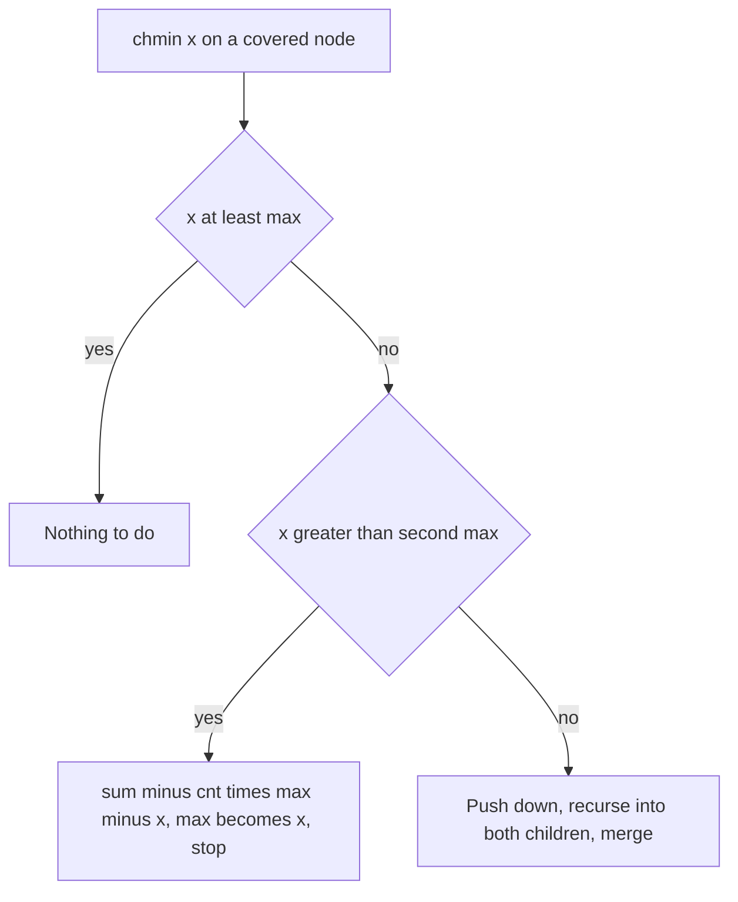

## The hook

A regional manager is asked two questions about a group of shops: total takings, and the best run of consecutive days. The first is easy to add up from each shop's report. The second is not: the best run might start in one shop's report and end in another's. Unless each report includes how the period started and ended, no amount of adding can recover it.

Many segment tree problems are like that. The trick is to decide what each node must report so that two reports can be merged. And one famous family of updates, "cap every value in a range at x", becomes possible once nodes report a little more than their maximum: that is segment tree beats.

## The intuition

:::analogy
Each manager's report to their boss is a short form, the same for everyone. If the boss only needs totals, one line suffices. If the boss needs "best stretch of consecutive days", each form must also say the best stretch at the very start, the best at the very end, and the best anywhere, because the boss's best stretch may be the end of one report glued to the start of the next. Design the form so that any two adjacent forms can be combined into one, and the whole company's answer comes from combining forms up the chain.
:::

The form is a [[node summary]], and combining two forms is the [[merge function]]. It must be associative, since the tree groups segments in a fixed way, but it need not be commutative: left comes before right. Once the summary and merge are right, build, point update and range query are the same as in [A Tournament Bracket for Your Array](article:cp-segment-tree), with the merge in place of + or min.

## How it works

### Maximum prefix sum of a range

CSES *Prefix Sum Queries* asks, with point updates, for the largest prefix sum of a[l..r]. Each node stores (sum, pref), where pref is its best prefix sum:

- merge(L, R).sum = L.sum + R.sum;
- merge(L, R).pref = max(L.pref, L.sum + R.pref).

A prefix of the merged segment either ends inside L or covers L completely and continues into R. A query combines the covering nodes left to right with the same merge. If the problem allows the empty prefix, take max with 0 at the end.

### Maximum subarray sum

CSES *Subarray Sum Queries* needs (sum, pref, suf, best): best = max(L.best, R.best, L.suf + R.pref). It has its own walkthrough in this track.

### Range chmin: segment tree beats

A [[range chmin]] caps every value in a range: a[i] = min(a[i], x). A lazy tag "min with x" composes, but a sum cannot be updated from the tag alone: how much the sum drops depends on how many elements exceed x and by how much.

[[Segment tree beats]] stores, per node: max, the strict second maximum se, cnt (how many elements equal max), and sum. For an update chmin(x) on a fully covered node, the [[break and tag conditions]]:

| Case | Action |
|---|---|
| x ≥ max | nothing changes; stop |
| se < x < max | only the cnt copies of max change: sum -= cnt × (max - x), max = x; stop and leave the cap as a tag |
| x ≤ se | the cap affects more than one distinct value; recurse into both children, then re-merge |

Push down is easy: a child whose max exceeds the parent's max must have had its maximum capped, so apply the same O(1) update to it. Merging two children's (max, se, cnt) takes a little care: the parent's max is the larger max; cnt adds when both are equal; se is the largest value that is not the parent's max.

The analysis is subtle, but the result is clean: with range chmin and range sum, the total work is amortised O(log² n) per operation, and with only chmin plus max queries, O(log n) amortised. The intuition: each recursion in the third case reduces the number of distinct values in some node, and that can only happen a limited number of times.



:::insight
A segment tree can answer any question whose answer for a segment can be built from its two halves' summaries. Choosing the summary is the real work: prefix and suffix information for subarray questions, and the maximum, second maximum and its count for range caps, which lets most updates stop at a node instead of reaching the leaves.
:::

## Walk through an example

### Maximum prefix sums on [2, -1, 3, -4, 5, -2]

| Query range | Elements | Prefix sums | Best |
|---|---|---|---|
| [1, 4] | -1, 3, -4, 5 | -1, 2, -2, 3 | 3 |
| [0, 5] | 2, -1, 3, -4, 5, -2 | 2, 1, 4, 0, 5, 3 | 5 |
| [3, 5] | -4, 5, -2 | -4, 1, -1 | 1 |

Merging for [0, 5] from its halves [0, 2] and [3, 5]: the left half has sum 4 and best prefix 4; the right half has sum -1 and best prefix 1. Merged: max(4, 4 + 1) = 5. Neither half's best prefix alone was the answer.

### Range chmin on [5, 9, 2, 7, 9, 4]

The root has max 9, cnt 2 (two 9s), second max 7, sum 36.

| Update | Root case | Effect | Array | Sum |
|---|---|---|---|---|
| chmin(0..5, 8) | 7 < 8 < 9 | sum -= 2 × (9 - 8), max = 8, stop at the root | 5, 8, 2, 7, 8, 4 | 34 |
| chmin(0..5, 6) | second max now 7, and 6 ≤ 7 | recurse: the 8s and the 7 all become 6 | 5, 6, 2, 6, 6, 4 | 29 |
| chmin(1..4, 3) | partial cover, recurse to covered nodes | values above 3 in positions 1 to 4 become 3 | 5, 3, 2, 3, 3, 4 | 20 |

The first update touched only the root: the second maximum told it that only the two 9s were affected.

:::try-this
For a node holding [4, 9, 9, 6], what are its max, second max, count and sum, and what does chmin(7) do there? (max 9, second max 6, count 2, sum 28. Since 6 < 7 < 9, only the 9s change: sum becomes 28 - 2 × 2 = 24 and max becomes 7, without visiting children. The values are now 4, 7, 7, 6.)
:::

:::warning
Common misconception: "Range chmin with sums is just lazy propagation with a 'min x' tag." The tag composes, but the sum does not follow from it: capping at x changes each element by a different amount. Without the second maximum and the count of the maximum, the node cannot update its sum in O(1), and the tree degrades to visiting every leaf.
:::

## The code

```pseudo
prefix node: (sum, pref)
merge(L, R) = (L.sum + R.sum, max(L.pref, L.sum + R.pref))

beats node: (mx, se, cnt, sum)
chmin(v, l, r, ql, qr, x):
    if outside or x >= mx[v]: return
    if inside and x > se[v]: apply_cap(v, x); return
    push(v); recurse both; pull(v)
apply_cap(v, x): sum[v] -= cnt[v] * (mx[v] - x); mx[v] = x
push(v): for each child c: if mx[c] > mx[v]: apply_cap(c, mx[v])
```

```cpp
#include <bits/stdc++.h>
using namespace std;
using ll = long long;

struct PrefixTree {                                       // max prefix sum of a range, point updates
    struct Node { ll sum, pref; };
    static Node merge(const Node& L, const Node& R) { return {L.sum + R.sum, max(L.pref, L.sum + R.pref)}; }
    int n;
    vector<Node> t;
    explicit PrefixTree(const vector<ll>& a) : n(a.size()), t(4 * a.size()) { build(1, 0, n - 1, a); }
    void build(int v, int l, int r, const vector<ll>& a) {
        if (l == r) { t[v] = {a[l], a[l]}; return; }
        int m = (l + r) / 2;
        build(2 * v, l, m, a), build(2 * v + 1, m + 1, r, a);
        t[v] = merge(t[2 * v], t[2 * v + 1]);
    }
    Node query(int v, int l, int r, int ql, int qr) const {
        if (ql <= l && r <= qr) return t[v];
        int m = (l + r) / 2;
        if (qr <= m) return query(2 * v, l, m, ql, qr);
        if (ql > m) return query(2 * v + 1, m + 1, r, ql, qr);
        return merge(query(2 * v, l, m, ql, qr), query(2 * v + 1, m + 1, r, ql, qr));   // left then right
    }
    ll bestPrefix(int l, int r) const { return query(1, 0, n - 1, l, r).pref; }
};

struct Beats {                                            // range chmin, range sum, range max
    int n;
    vector<ll> mx, se, cnt, sum;
    explicit Beats(const vector<ll>& a) : n(a.size()), mx(4 * n), se(4 * n), cnt(4 * n), sum(4 * n) { build(1, 0, n - 1, a); }
    void pull(int v) {
        int L = 2 * v, R = 2 * v + 1;
        sum[v] = sum[L] + sum[R];
        if (mx[L] == mx[R]) mx[v] = mx[L], cnt[v] = cnt[L] + cnt[R], se[v] = max(se[L], se[R]);
        else if (mx[L] > mx[R]) mx[v] = mx[L], cnt[v] = cnt[L], se[v] = max(se[L], mx[R]);
        else mx[v] = mx[R], cnt[v] = cnt[R], se[v] = max(mx[L], se[R]);
    }
    void build(int v, int l, int r, const vector<ll>& a) {
        if (l == r) { mx[v] = sum[v] = a[l], cnt[v] = 1, se[v] = LLONG_MIN; return; }
        int m = (l + r) / 2;
        build(2 * v, l, m, a), build(2 * v + 1, m + 1, r, a);
        pull(v);
    }
    void cap(int v, ll x) { if (x < mx[v]) sum[v] -= cnt[v] * (mx[v] - x), mx[v] = x; }   // only max copies change
    void push(int v) { cap(2 * v, mx[v]), cap(2 * v + 1, mx[v]); }
    void chmin(int v, int l, int r, int ql, int qr, ll x) {
        if (qr < l || r < ql || x >= mx[v]) return;
        if (ql <= l && r <= qr && x > se[v]) { cap(v, x); return; }
        push(v);
        int m = (l + r) / 2;
        chmin(2 * v, l, m, ql, qr, x), chmin(2 * v + 1, m + 1, r, ql, qr, x);
        pull(v);
    }
    ll querySum(int v, int l, int r, int ql, int qr) {
        if (qr < l || r < ql) return 0;
        if (ql <= l && r <= qr) return sum[v];
        push(v);
        int m = (l + r) / 2;
        return querySum(2 * v, l, m, ql, qr) + querySum(2 * v + 1, m + 1, r, ql, qr);
    }
    ll queryMax(int v, int l, int r, int ql, int qr) {
        if (qr < l || r < ql) return LLONG_MIN;
        if (ql <= l && r <= qr) return mx[v];
        push(v);
        int m = (l + r) / 2;
        return max(queryMax(2 * v, l, m, ql, qr), queryMax(2 * v + 1, m + 1, r, ql, qr));
    }
    void chmin(int l, int r, ll x) { chmin(1, 0, n - 1, l, r, x); }
    ll sumOf(int l, int r) { return querySum(1, 0, n - 1, l, r); }
    ll maxOf(int l, int r) { return queryMax(1, 0, n - 1, l, r); }
};

int main() {
    PrefixTree pt({2, -1, 3, -4, 5, -2});
    cout << pt.bestPrefix(1, 4) << ' ' << pt.bestPrefix(0, 5) << ' ' << pt.bestPrefix(3, 5) << '\n';   // 3 5 1

    Beats b({5, 9, 2, 7, 9, 4});
    b.chmin(0, 5, 8);
    cout << b.sumOf(0, 5) << ' ';
    b.chmin(0, 5, 6);
    cout << b.sumOf(0, 5) << ' ';
    b.chmin(1, 4, 3);
    cout << b.sumOf(0, 5) << ' ' << b.maxOf(0, 5) << ' ' << b.sumOf(1, 3) << '\n';                    // 34 29 20 5 8

    mt19937 rng(13);                                      // random check against a plain array
    vector<ll> ref(60);
    for (ll& x : ref) x = rng() % 100;
    Beats big(ref);
    int bad = 0;
    for (int it = 0; it < 4000; it++) {
        int l = rng() % 60, r = rng() % 60;
        if (l > r) swap(l, r);
        if (rng() % 2) { ll x = rng() % 100; big.chmin(l, r, x); for (int i = l; i <= r; i++) ref[i] = min(ref[i], x); }
        else bad += big.sumOf(l, r) != accumulate(ref.begin() + l, ref.begin() + r + 1, 0LL);
    }
    cout << bad << '\n';                                  // 0
}
```

## Complexity

- **Merged-summary trees: O(log n)** per point update and range query, with a constant factor equal to the merge's cost.
- **Segment tree beats with chmin and sum: amortised O(log² n)** per operation; with chmin and max only, amortised O(log n).
- **Space: O(n)** per stored field, allocated as 4n.

## Common mistakes

- **Merging children in the wrong order** for directional summaries such as prefix or suffix.
- **Forgetting the identity case** when a query range lies entirely in one child; return that child's result instead of merging with a fake empty node, or define a correct empty summary.
- **Storing the second maximum non-strictly,** which breaks the second-max < x test when several elements equal the maximum.
- **Not pushing before recursing** in beats, which leaves children with values above their parent's cap.
- **Expecting beats to support range add as easily;** adding together with chmin needs extra tags and more careful analysis.

## Practice problems

CSES *Prefix Sum Queries* is the (sum, prefix) merge with point updates. CSES *Subarray Sum Queries* extends it to the full four-field summary. HDU *Gorgeous Sequence* is the classic segment tree beats problem: range chmin, range max and range sum. Lazy propagation basics are in [A Manager Who Promises Raises to the Whole Team](article:cp-lazy-propagation).

## Key takeaways

- A segment tree can answer any range question whose answer can be merged from two halves' summaries, so the design work is choosing the summary.
- The maximum prefix sum of a range needs each node's sum and best prefix, merged as max(left prefix, left sum + right prefix).
- Directional summaries must be merged in left-to-right order.
- Segment tree beats handles range chmin by storing the maximum, the strict second maximum and the count of the maximum in each node.
- When the cap falls between the second maximum and the maximum, the node updates its sum in O(1) and stops, which makes the total work amortised logarithmic.
