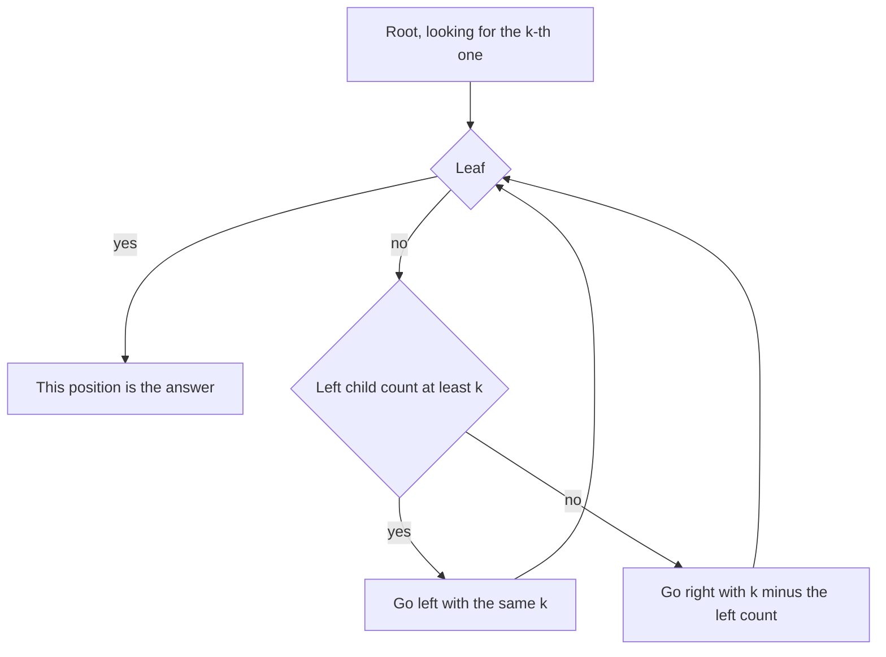

## The hook

A librarian is asked for the 500th book still on the shelves, in shelf order, after many books have been borrowed. They could walk along every shelf counting. Instead, they look at the sign on each wing of the library, "this wing holds 312 books", and know immediately the book is not in the first wing. Then the same for the aisles inside the second wing, then the shelves. Three or four glances, and they are standing in front of the right book.

A segment tree already stores those signs. Walking down it, choosing a child at each level, finds positions such as "the k-th remaining element" or "the first slot that can hold x" in O(log n), and solves a family of CSES problems that look like they need a sorted list with deletions.

## The intuition

:::analogy
The library has a sign on every wing, aisle and shelf saying how many books it currently holds. To find the k-th book, start at the entrance: if the left wing holds at least k books, walk into it; otherwise subtract its count from k and walk into the right wing. Repeat at every level until you reach a single shelf slot. When a book is borrowed, the librarian lowers the count on its shelf, aisle and wing, one sign per level.
:::

That is a [[tree descent]] on a [[count tree]]. Each node stores how many elements remain in its segment; a removal sets a leaf to 0 and updates its ancestors; and finding the [[k-th one]] reads one child's count per level.

The same walk works with any summary that tells you which side to go. With maxima stored, you can find the first index whose value reaches x, and with a lower bound on the index, a [[bounded descent]] finds the first such index at or after a position p.

## How it works

### k-th one

```
kth(v, l, r, k):
    if l == r: return l
    if cnt[left] >= k: return kth(left, l, mid, k)
    return kth(right, mid + 1, r, k - cnt[left])
```

One comparison per level: O(log n).

### List Removals

CSES *List Removals*: a list of n values; each query removes the element at a given position in the current list and prints it. Positions shift after each removal, so a plain array is O(n) per removal. With a count tree over the original positions, initially all 1:

- the current position p is the p-th one: find it with kth;
- print the value stored there, then set that leaf to 0.

O(log n) per removal.

### Josephus Problem II

Children stand in a circle and every (k + 1)-th child is removed, counting onwards from the last removal. Keep the current index among the remaining children: next = (current + k) mod remaining. That is a position in the current list, found with kth on a count tree, exactly as in List Removals. The pattern turns any "remove the j-th survivor" process into O(log n) per step.

### First index with value at least x

Store maxima. If the root's maximum is below x, there is no answer. Otherwise go left when the left child's maximum is at least x, else right. This is the move behind *Hotel Queries*, where each group takes the first hotel with enough rooms.

### First index at or after p with value at least x

Some problems restrict the answer to positions ≥ p. The bounded descent:

- if a node lies entirely before p, or its maximum is below x, return "none";
- if it is a leaf, return it;
- try the left child; if it returns an index, that is the answer; otherwise try the right child.

At most O(log n) nodes straddle p, and once a node fully after p with maximum ≥ x is entered, its answer is found by a plain descent. The total stays O(log n).

| Question | Node stores | Go left when |
|---|---|---|
| k-th remaining element | count of ones | left count ≥ k |
| First index with value ≥ x | maximum | left maximum ≥ x |
| First index ≥ p with value ≥ x | maximum | left child is not entirely before p and can contain an answer |
| Smallest prefix with sum ≥ s | sum | left sum ≥ s, else s -= left sum |



:::insight
A segment tree's stored summaries already say which half contains what you are looking for. Reading them on the way down finds the position in one O(log n) walk, where a binary search over range queries would pay O(log n) for every guess.
:::

## Walk through an example

### List Removals on [7, 3, 9, 1, 5, 8]

Removals at current positions 3, 1, 3, 2.

| Query | Ones present (by original index) | k-th one found | Value printed | List afterwards |
|---|---|---|---|---|
| 3 | 1 1 1 1 1 1 | original index 2 | 9 | 7, 3, 1, 5, 8 |
| 1 | 1 1 0 1 1 1 | original index 0 | 7 | 3, 1, 5, 8 |
| 3 | 0 1 0 1 1 1 | original index 4 | 5 | 3, 1, 8 |
| 2 | 0 1 0 1 0 1 | original index 3 | 1 | 3, 8 |

Output: 9 7 5 1. The third query, "3rd remaining", skipped two removed slots without looking at them: the count tree knew the left part held only 2 remaining elements.

### Josephus with 8 children, skipping 3

Removing every fourth child, starting after child 1 and counting on from each removal, gives the order 4, 8, 5, 2, 1, 3, 7, 6, each step one kth query and one removal.

### First index at or after p with value ≥ 5

a = [2, 7, 1, 8, 2, 8, 1, 8].

| p | Answer | Why |
|---|---|---|
| 2 | 3 | a[2] = 1 is too small, a[3] = 8 |
| 4 | 5 | a[4] = 2, then a[5] = 8 |
| 0, with x = 9 | none | the root's maximum is 8 |
| 6, with x = 8 | 7 | a[6] = 1, then a[7] = 8 |

:::try-this
In List Removals on [7, 3, 9, 1, 5, 8], after the four removals, the count tree has ones at original indices 1 and 5. Which original index does kth(2) return, and how does the descent get there in a tree over 6 leaves? (The root's left half [0, 2] holds 1 one, fewer than 2, so go right with k = 2 - 1 = 1. In [3, 5], the left part [3, 4] holds 0, so go right with k = 1 to [5, 5]. Original index 5, value 8.)
:::

:::warning
Common misconception: "To find the k-th remaining element, binary search on the position with a range-sum query." It works, but costs O(log² n) per query, which is often too slow for 2 × 10⁵ queries with a heavy constant. The descent reads the counts the tree already stores and is O(log n), and it is no harder to write.
:::

## The code

```pseudo
kth(v, l, r, k):
    if l == r: return l
    if cnt[2v] >= k: return kth(2v, l, mid, k)
    return kth(2v + 1, mid + 1, r, k - cnt[2v])

first_at_least(v, l, r, p, x):                # first index >= p with value >= x
    if r < p or mx[v] < x: return none
    if l == r: return l
    res = first_at_least(2v, l, mid, p, x)
    return res if res != none else first_at_least(2v + 1, mid + 1, r, p, x)
```

```cpp
#include <bits/stdc++.h>
using namespace std;

struct CountTree {                                        // ones mark remaining elements
    int n;
    vector<int> cnt;
    explicit CountTree(int n) : n(n), cnt(4 * n) { build(1, 0, n - 1); }
    void build(int v, int l, int r) {
        if (l == r) { cnt[v] = 1; return; }
        int m = (l + r) / 2;
        build(2 * v, l, m), build(2 * v + 1, m + 1, r);
        cnt[v] = cnt[2 * v] + cnt[2 * v + 1];
    }
    int removeKth(int v, int l, int r, int k) {           // find the k-th one, set it to 0
        cnt[v]--;
        if (l == r) return l;
        int m = (l + r) / 2;
        if (cnt[2 * v] >= k) return removeKth(2 * v, l, m, k);
        return removeKth(2 * v + 1, m + 1, r, k - cnt[2 * v]);
    }
    int removeKth(int k) { return removeKth(1, 0, n - 1, k); }
};

struct MaxTree {
    int n;
    vector<int> mx;
    explicit MaxTree(const vector<int>& a) : n(a.size()), mx(4 * a.size()) { build(1, 0, n - 1, a); }
    void build(int v, int l, int r, const vector<int>& a) {
        if (l == r) { mx[v] = a[l]; return; }
        int m = (l + r) / 2;
        build(2 * v, l, m, a), build(2 * v + 1, m + 1, r, a);
        mx[v] = max(mx[2 * v], mx[2 * v + 1]);
    }
    int firstAtLeast(int v, int l, int r, int p, int x) const {
        if (r < p || mx[v] < x) return -1;                // entirely before p, or nothing big enough
        if (l == r) return l;
        int m = (l + r) / 2;
        int res = firstAtLeast(2 * v, l, m, p, x);
        return res != -1 ? res : firstAtLeast(2 * v + 1, m + 1, r, p, x);
    }
    int firstAtLeast(int p, int x) const { return firstAtLeast(1, 0, n - 1, p, x); }
};

int main() {
    vector<int> list = {7, 3, 9, 1, 5, 8};
    CountTree ct(list.size());
    for (int pos : {3, 1, 3, 2}) cout << list[ct.removeKth(pos)] << ' ';
    cout << list[ct.removeKth(2)] << '\n';                // 9 7 5 1 8

    int n = 8, k = 3;                                     // Josephus: skip k, remove the next
    CountTree circle(n);
    for (int cur = 0, left = n; left > 0; left--) {
        cur = (cur + k) % left;
        cout << circle.removeKth(cur + 1) + 1 << ' ';
    }
    cout << '\n';                                         // 4 8 5 2 1 3 7 6

    MaxTree mt({2, 7, 1, 8, 2, 8, 1, 8});
    cout << mt.firstAtLeast(2, 5) << ' ' << mt.firstAtLeast(4, 5) << ' ' << mt.firstAtLeast(0, 9) << ' '
         << mt.firstAtLeast(6, 8) << '\n';                // 3 5 -1 7
}
```

`removeKth` lowers each count on the way down, because the element it finds is removed; that saves a separate update pass. It is only valid when k is at most the number of remaining elements, which the problems guarantee.

## Complexity

- **k-th one and removal: O(log n)** per query.
- **First index with value ≥ x: O(log n).**
- **Bounded descent from position p: O(log n),** since only O(log n) nodes straddle p.
- **Space: O(n),** allocated as 4n.

## Common mistakes

- **Descending into the wrong child** by comparing with the right child's summary instead of the left's.
- **Forgetting to subtract the left count** when going right in kth.
- **Decrementing counts before checking that k is valid,** which corrupts the tree if a query asks for more elements than remain.
- **Using a binary search over range queries,** O(log² n), where a descent is O(log n).
- **Mixing 0-based and 1-based k:** decide whether "the k-th one" counts from 1, and keep it consistent with the problem's positions.

## Practice problems

*List Removals* is the k-th one with deletion. *Josephus Problem II* is the same structure in a circle. *Hotel Queries* is the first index with value at least x, covered step by step in its own walkthrough. The underlying tree is in [A Tournament Bracket for Your Array](article:cp-segment-tree), and an ordered-set alternative for k-th element queries is in [A Sorted Shelf That Knows Every Book's Position](article:cp-pbds-ordered-set).

## Key takeaways

- Descending a segment tree reads one child's summary per level to find a position in O(log n).
- A count tree finds the k-th remaining element by going left when the left count is at least k, otherwise going right with k reduced by that count.
- Removal processes such as List Removals and Josephus become one k-th query and one leaf update per step.
- A maximum tree finds the first index whose value reaches x, and a bounded descent restricts the search to positions at or after p.
- A descent is O(log n), while binary searching with range queries is O(log² n).
