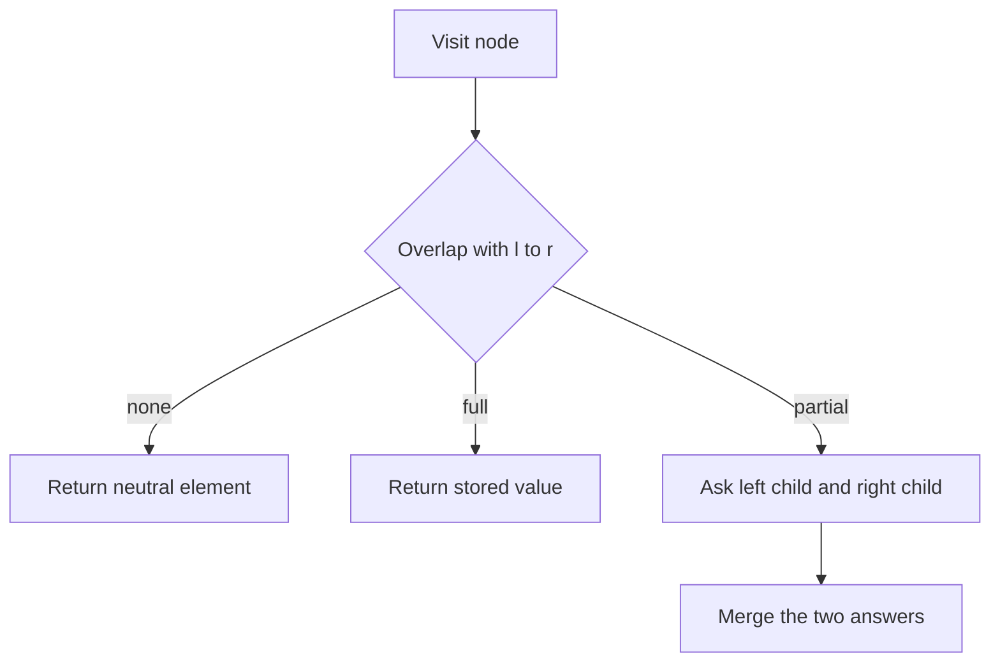

## The hook

You get an array of 200,000 numbers and 200,000 operations. Each operation either changes one element or asks for the minimum of some block a[l..r]. A loop over the block costs up to 200,000 steps per question, so the worst case is 4 × 10¹⁰ steps, far past any time limit.

Prefix sums answer range sums in O(1), but a single change forces you to rebuild up to n prefixes. You need something that is fast at both: changing one value and answering a range. That something is the segment tree, and once you can write it in five minutes, a whole band of Codeforces problems opens up.

## The intuition

:::analogy
Think of a knockout tournament bracket with eight players. In the first round players meet in pairs, the winners meet in the second round, and one champion stands at the top. Every match in the bracket remembers who won it. If one player's form suddenly changes, you do not replay the whole tournament: you replay only the matches on that player's path to the final. And if someone asks "who is the strongest among players 2 to 5?", you can answer by looking at a couple of match results whose groups sit inside that range, instead of watching every player again.
:::

A [[segment tree]] is exactly that bracket built over an array. The leaves are the array elements. Each internal node is a "match" whose result is the answer for its whole group: the minimum, the sum, the maximum, whatever the problem asks. The root holds the answer for the entire array.

The rule for deciding a match is the [[merge function]]. For a minimum tree it is `min(left, right)`. For sums it is `left + right`. Any operation that is associative, meaning (x ∘ y) ∘ z equals x ∘ (y ∘ z), works: min, max, sum, xor, gcd, even "the pair (minimum, how many times it occurs)".

## How it works

Number the nodes like a heap. Node 1 is the root and covers a[0..n−1]. Node v covering a[lo..hi] has children 2v and 2v+1, covering a[lo..mid] and a[mid+1..hi], with mid = (lo + hi) / 2. An array of size 4n is always enough for this numbering.

### Build

Recurse down to the leaves, store a[i] there, and on the way back up set each node to the merge of its two children. Every node is computed once, so building costs O(n).

### Point update

A [[point update]] changes a[i]. Walk from the root toward leaf i, set the leaf, then recompute each ancestor on the way back up. This is the tournament replaying only the matches on one player's path: one node per level, so O(log n).

### Range query

A [[range query]] for a[l..r] starts at the root and meets three cases at each node:

1. **No overlap:** the node's segment is entirely outside [l, r]. Return the [[neutral element]], which cannot change the answer.
2. **Full cover:** the node's segment lies entirely inside [l, r]. Return the stored value without going deeper.
3. **Partial overlap:** ask both children and merge their answers.



Why is this fast? On any level of the tree, a contiguous range can only cut through at most two nodes, the ones holding its left and right boundaries. Every other node on that level is fully inside or fully outside and stops at once. With about log₂ n levels and a constant number of nodes touched per level, a query costs O(log n).

:::insight
A segment tree answers any range by gluing together a few precomputed pieces that tile it exactly. Prefix sums need subtraction to "cancel" the part you do not want; the segment tree never subtracts, which is why it works for min, max and gcd, where no undo exists.
:::

### The iterative version

Contest coders often prefer a shorter bottom-up tree. Put the leaves at positions n to 2n−1, and let node i be the merge of nodes 2i and 2i+1, so the parent of i is i/2. To update, set the leaf and walk up with i /= 2. To query a half-open range [l, r), shift both ends by n and move them upward together: whenever l is a right child, take t[l] and step right; whenever r is a right child, step left and take t[r]. It is about ten lines, runs fast, and works for any n, not only powers of two. Its one restriction: if the merge is not commutative (order matters, as with matrix products), you must keep separate left and right results.

### A first look at lazy propagation

What if an operation adds 5 to every element of a[l..r]? Point updates would cost O(n log n). [[Lazy propagation]] fixes this. When a range update fully covers a node, you update that node's stored answer (for a sum tree, add 5 × its length), write a note on it saying "my children still owe +5", and stop. Later, whenever any operation needs to go inside that node, it first pushes the note down to both children. Pending work is done only when someone looks, so range updates also cost O(log n). This is all you need for now; the full treatment adds a few more rules for combining notes.

## Walk through an example

Take a = [5, 8, 6, 3, 2, 7, 4, 6], indices 0 to 7, and build a min tree.

| Level | Nodes (segment: min) |
|---|---|
| Root | 0–7: 2 |
| 2 | 0–3: 3, 4–7: 2 |
| 3 | 0–1: 5, 2–3: 3, 4–5: 2, 6–7: 4 |
| Leaves | 5, 8, 6, 3, 2, 7, 4, 6 |

**Query min of a[1..6].** The root (0–7) is partial, so it asks both halves.

| Node | Case | Returns |
|---|---|---|
| 0–3 | partial | asks 0–1 and 2–3 |
| 0–1 | partial | asks leaf 0 (none, ∞) and leaf 1 (full, 8) |
| 2–3 | full | 3 |
| 4–7 | partial | asks 4–5 and 6–7 |
| 4–5 | full | 2 |
| 6–7 | partial | asks leaf 6 (full, 4) and leaf 7 (none, ∞) |

The answer is min(8, 3, 2, 4) = **2**. Eleven nodes were visited, and only four pieces (1, 2–3, 4–5, 6) were glued together.

**Update a[4] = 9.** Replay the matches on index 4's path: leaf 4 becomes 9, node 4–5 becomes min(9, 7) = 7, node 4–7 becomes min(7, 4) = 4, and the root becomes min(3, 4) = 3. Four nodes changed; the other eleven did not move.

**Query a[1..6] again.** The same four pieces now give min(8, 3, 7, 4) = **3**, which matches a direct scan of [8, 6, 3, 9, 7, 4].

:::try-this
Using the tree after the update, which stored nodes does the query a[0..5] glue together, and what is the answer? (Node 0–3 with value 3 and node 4–5 with value 7, so the minimum is 3.)
:::

### Descending the tree

Problems like *Hotel Queries* ask for the first position whose value is at least x. With a max tree, start at the root: if the left child's max is at least x, go left, otherwise go right. If the root's max is below x, no position exists. That walk takes O(log n), while a binary search that calls a range query at every step would cost O(log² n).

## The code

```pseudo
build(node, lo, hi):
    if lo == hi: t[node] = a[lo]; return
    mid = (lo + hi) / 2
    build(2*node, lo, mid); build(2*node+1, mid+1, hi)
    t[node] = merge(t[2*node], t[2*node+1])

update(node, lo, hi, i, v):
    if lo == hi: t[node] = v; return
    go into the child whose half contains i
    t[node] = merge(t[2*node], t[2*node+1])

query(node, lo, hi, l, r):
    if [lo, hi] and [l, r] do not overlap: return NEUTRAL
    if [lo, hi] lies inside [l, r]: return t[node]
    mid = (lo + hi) / 2
    return merge(query(left child), query(right child))
```

```cpp
#include <bits/stdc++.h>
using namespace std;

const int INF = INT_MAX;  // neutral element for min

// Recursive version: node covers a[lo..hi], children are 2*node and 2*node+1.
struct SegTree {
    int n;
    vector<int> t;
    SegTree(const vector<int>& a) : n(a.size()), t(4 * a.size(), INF) { build(a, 1, 0, n - 1); }
    void build(const vector<int>& a, int node, int lo, int hi) {
        if (lo == hi) { t[node] = a[lo]; return; }
        int mid = (lo + hi) / 2;
        build(a, 2 * node, lo, mid);
        build(a, 2 * node + 1, mid + 1, hi);
        t[node] = min(t[2 * node], t[2 * node + 1]);
    }
    void update(int i, int v, int node, int lo, int hi) {
        if (lo == hi) { t[node] = v; return; }
        int mid = (lo + hi) / 2;
        if (i <= mid) update(i, v, 2 * node, lo, mid);
        else update(i, v, 2 * node + 1, mid + 1, hi);
        t[node] = min(t[2 * node], t[2 * node + 1]);
    }
    int query(int l, int r, int node, int lo, int hi) {
        if (r < lo || hi < l) return INF;          // no overlap
        if (l <= lo && hi <= r) return t[node];    // full cover
        int mid = (lo + hi) / 2;                   // partial: ask both children
        return min(query(l, r, 2 * node, lo, mid), query(l, r, 2 * node + 1, mid + 1, hi));
    }
    void update(int i, int v) { update(i, v, 1, 0, n - 1); }
    int query(int l, int r) { return query(l, r, 1, 0, n - 1); }
};

// Iterative version: leaves at n..2n-1, parent of i is i/2, query on [l, r).
struct IterSegTree {
    int n;
    vector<int> t;
    IterSegTree(const vector<int>& a) : n(a.size()), t(2 * a.size(), INF) {
        for (int i = 0; i < n; i++) t[n + i] = a[i];
        for (int i = n - 1; i >= 1; i--) t[i] = min(t[2 * i], t[2 * i + 1]);
    }
    void update(int i, int v) {
        for (t[i += n] = v; i > 1; i /= 2) t[i / 2] = min(t[i], t[i ^ 1]);
    }
    int query(int l, int r) {
        int res = INF;
        for (l += n, r += n; l < r; l /= 2, r /= 2) {
            if (l & 1) res = min(res, t[l++]);
            if (r & 1) res = min(res, t[--r]);
        }
        return res;
    }
};

int main() {
    vector<int> a = {5, 8, 6, 3, 2, 7, 4, 6};
    SegTree rec(a);
    IterSegTree it(a);
    cout << rec.query(1, 6) << ' ' << it.query(1, 7) << '\n';  // 2 2
    rec.update(4, 9);
    it.update(4, 9);
    cout << rec.query(1, 6) << ' ' << it.query(1, 7) << '\n';  // 3 3
    cout << rec.query(0, 5) << '\n';                            // 3
}
```

To switch to a sum tree, change `min` to `+`, the neutral element to 0, and the stored type to `long long`. Nothing else moves, which is the whole appeal: the bracket stays the same and only the rule for deciding a match changes.

## Complexity

- **Build:** O(n). Each of the roughly 2n nodes is computed once from its children.
- **Point update:** O(log n). Only the leaf and its ancestors change, one node per level.
- **Range query:** O(log n). At most two nodes per level are partially covered, and only they recurse.
- **Space:** O(n). The recursive layout uses an array of 4n; the iterative one uses exactly 2n.

## Common mistakes

:::warning
Common misconception: "the neutral element can be 0 for everything." For a min tree, returning 0 from a non-overlapping node makes every query on positive data answer 0. Pick the value that cannot win the merge: plus infinity for min, minus infinity for max, 0 for sum, xor and gcd, 1 for products.
:::

- **Array too small.** The recursive layout can index up to nearly 4n; allocating 2n crashes or silently corrupts memory when n is not a power of two.
- **Mixing inclusive and half-open ranges.** The recursive code above uses [l, r]; the iterative code uses [l, r). Convert once at the call site.
- **Overflow in sum trees.** n values up to 10⁹ sum past 2³¹; store `long long`.
- **Forgetting to recompute parents** after setting the leaf, so the root keeps the stale answer.
- **Using a segment tree when prefix sums suffice.** With no updates, prefix sums are simpler and faster; with no updates and min queries, a sparse table answers in O(1).

## Practice problems

Start with *Dynamic Range Sum Queries* and *Dynamic Range Minimum Queries*, which are the bare structure with sum and min merges. *Range Xor Queries* has no updates, so prefix xors solve it; solve it with a xor tree too, to practise swapping the merge and the neutral element. *Range Sum Query - Mutable* is the same idea in interview form. Finish with *Hotel Queries*, which needs the max-tree descent described above. Segment trees show up regularly from roughly 1700 rating, and they are standard tools for Div 2 D and E.

## Key takeaways

- A segment tree stores, at every node, the merged answer for one contiguous segment, with each segment split in half between two children.
- Any associative merge works, and each one needs a neutral element that cannot change the answer.
- A point update recomputes only the leaf and its ancestors, so it costs O(log n).
- A range query glues together the few nodes that tile the range exactly, touching at most two partial nodes per level, so it also costs O(log n).
- Lazy propagation extends the tree to range updates by leaving a pending note on fully covered nodes and pushing it down only when a later operation looks inside.
