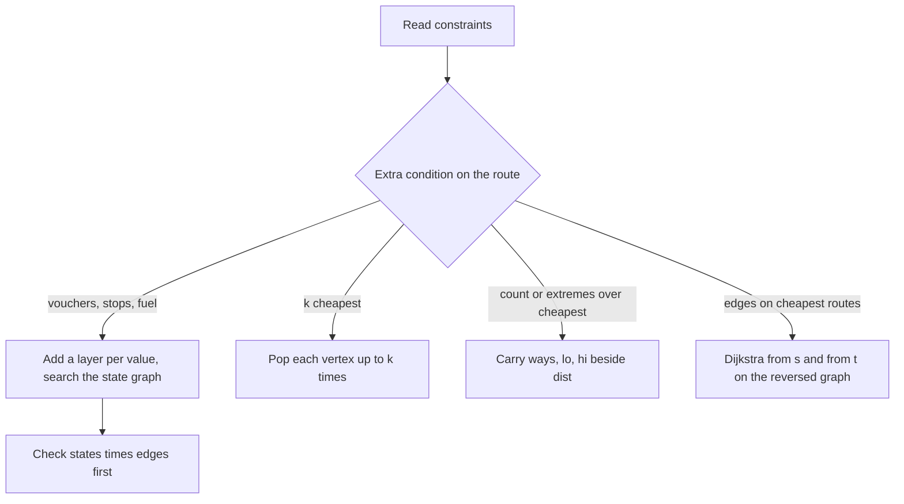
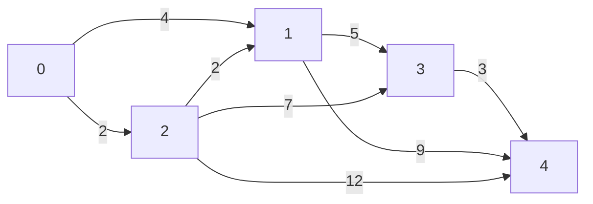

## The hook

A travel planner books the cheapest trip from city 1 to city n. Then the client adds conditions: "I have one voucher that halves one flight." "Give me the three cheapest options, not just one." "How many different cheapest trips exist, and what is the fewest and most flights among them?" "Which flights could appear on some cheapest trip?"

None of these needs a new algorithm. Each is a small change to [Water Racing Through a Network of Pipes](article:dsa-dijkstra): change what a vertex is, change how many times it may be settled, or change what is carried along with the distance. This article collects those changes into a toolkit.

## The intuition

:::analogy
The planner's trick for the voucher is to keep two copies of the world map. On the first map the client still holds the voucher; on the second they have used it. Every flight appears on both maps at full price, and there is also a special half-price flight that starts on the first map and lands on the second. Searching the two maps together, the cheapest trip simply ends on whichever copy of city n is cheaper. Every other condition is handled the same way: write the condition onto the map, then search as usual.
:::

The two maps form a [[state graph]], each map is a [[layer]], and the client's "where am I and what do I still have" is the state.

## How it works

### Step 0: choose the search from the edge weights

| Edge weights | Search | Cost |
|---|---|---|
| all equal | BFS | O(n + m) |
| only 0 and 1 | 0-1 BFS with a deque | O(n + m) |
| non-negative | Dijkstra with a heap | O((n + m) log n) |
| negative, possibly cycles | Bellman–Ford | O(n·m) |
| all pairs, n up to a few hundred | Floyd–Warshall | O(n³) |
| graph is a DAG | DP in topological order | O(n + m) |

The 0-1 BFS row is detailed in [A Robot Vacuum Mapping the Room](article:dsa-grid-graph-tricks), and Bellman–Ford and Floyd in [A Rumour Spreading Round by Round](article:dsa-bellman-ford-floyd).

### Trick 1: layered state graphs

The voucher graph has 2n states: city v in layer 0 is state v, and in layer 1 it is n + v. For a flight u → v of price w:

- u → v with cost w, inside layer 0;
- n + u → n + v with cost w, inside layer 1;
- u → n + v with cost ⌊w/2⌋, spending the voucher.

With k vouchers, use k + 1 layers. With "at most k flights", the layer is the number of flights taken. [Booking Flights With a Layover Limit](article:dsa-cheapest-flights-k-stops) uses that layer count. The method is always the same: put the constraint into the vertex.

The cost is [[state explosion]]. Always multiply before coding:

| Extra state | Layers | With n = 10⁵, m = 2·10⁵ |
|---|---|---|
| one voucher | 2 | 2·10⁵ states, 6·10⁵ edges: fine |
| k ≤ 10 vouchers | 11 | 1.1·10⁶ states: fine |
| fuel left, up to 100 | 101 | 10⁷ states: tight |
| set of 20 keys collected | 2²⁰ | far too many unless n is tiny |

### Trick 2: the k cheapest routes

CSES *Flight Routes* asks for the k cheapest routes, where a route may revisit cities, and k is at most 10. Allow each vertex to be popped from the heap up to k times instead of once:

- pop (d, u); if u has already been popped k times, skip it;
- otherwise count this pop, and if u is the target, record d;
- push (d + w, v) for every edge, as long as v has not been popped k times.

By the [[k-th pop rule]], the j-th time a vertex is popped, d is the j-th cheapest walk to it. The reason mirrors Dijkstra's proof: each of the j cheapest walks to u ends with an edge from some vertex whose relevant walk is cheaper, and those cheaper pops happen first. Each vertex is popped at most k times and pushes along each of its edges at most k times, so the heap holds O(k·m) entries.

### Trick 3: carrying statistics along with the distance

CSES *Investigation* wants, for the cheapest price, the number of cheapest routes modulo 10⁹ + 7 and the fewest and most flights among them. Carry ways[v], lo[v] and hi[v] beside dist[v]:

- **a strictly cheaper arrival** replaces all three with u's values, extended by one flight;
- **an equally cheap arrival** adds u's ways and widens lo and hi.

The counts are final when a vertex is popped, because with positive weights every equal-cost predecessor has strictly smaller distance and was popped earlier. Those edges with dist[u] + w = dist[v] form the [[shortest-path DAG]], and the three statistics are just DP over it in Dijkstra's pop order.

With zero-weight edges this breaks: two vertices at the same distance can feed each other, and a pop order no longer respects the DAG. CSES weights are positive, but watch for zeros elsewhere.

### Trick 4: which edges can lie on a cheapest route

Run Dijkstra from s on the graph, giving distS, and from t on the reversed graph, giving distT. Let D = distS[t]. The [[two-sided distance test]] says u → v with weight w can be on a cheapest route exactly when distS[u] + w + distT[v] = D.

To decide whether an edge is on **every** cheapest route, compare counts: the number of cheapest routes through it is waysS[u] · waysT[v], and it is on all of them when that equals waysS[t]. With counts taken modulo a large prime this is a hashing argument; using two moduli makes a false match very unlikely. Codeforces *President and Roads* uses exactly this.



:::insight
Shortest-path variants rarely need new theory. Either the vertex grows to remember a constraint, the settle rule relaxes from once to k times, or the distance carries passengers that obey the same "strictly better replaces, equally good merges" rule.
:::

## Walk through an example

Five cities, eight one-way flights: 0 → 1 (4), 0 → 2 (2), 2 → 1 (2), 1 → 3 (5), 2 → 3 (7), 3 → 4 (3), 1 → 4 (9), 2 → 4 (12). Start 0, target 4.



Distances from 0: 0, 4, 2, 9, 12 for cities 0 to 4. City 1 is reached for 4 in two ways, directly or through 2.

**All simple routes to 4:**

| Route | Price | Flights | Best voucher use | Price with voucher |
|---|---|---|---|---|
| 0 → 1 → 3 → 4 | 12 | 3 | halve 5 to 2 | 9 |
| 0 → 2 → 1 → 3 → 4 | 12 | 4 | halve 5 to 2 | 9 |
| 0 → 2 → 3 → 4 | 12 | 3 | halve 7 to 3 | 8 |
| 0 → 1 → 4 | 13 | 2 | halve 9 to 4 | 8 |
| 0 → 2 → 1 → 4 | 13 | 3 | halve 9 to 4 | 8 |
| 0 → 2 → 4 | 14 | 2 | halve 12 to 6 | 8 |

- **Flight Discount:** 8. Notice the cheapest full-price routes are not where the voucher helps most: a big flight is worth more to halve.
- **Flight Routes with k = 5:** 12, 12, 12, 13, 13.
- **Investigation:** price 12, 3 routes, fewest flights 3, most 4.

**Investigation, step by step.** Each row is a pop; the columns show what changes.

| Pop | dist | Effect on neighbours |
|---|---|---|
| 0 | 0 | city 1: 4, ways 1, flights 1..1; city 2: 2, ways 1, flights 1..1 |
| 2 | 2 | city 1: equal 4, ways 2, flights 1..2; city 3: 9, ways 1, flights 2..2; city 4: 14 |
| 1 | 4 | city 3: equal 9, ways 1 + 2 = 3, flights 2..3; city 4: 13 beats 14, ways 2, flights 2..3 |
| 3 | 9 | city 4: 12 beats 13, ways 3, flights 3..4 |
| 4 | 12 | final: 12, 3, 3, 4 |

**Edges on a cheapest route.** Distances to city 4 on the reversed graph are 12, 8, 10, 3, 0. Testing distS[u] + w + distT[v] = 12: 0 → 1 gives 0 + 4 + 8 = 12, yes; 1 → 4 gives 4 + 9 + 0 = 13, no; 2 → 4 gives 2 + 12 + 0 = 14, no. The first six flights pass, the last two fail. Only 3 → 4 is on every cheapest route: waysS[3] · waysT[4] = 3 · 1 = 3, the total.

:::try-this
Lower the price of 2 → 4 from 12 to 10. What do Investigation and Flight Discount report now? (A fourth cheapest route appears, 0 → 2 → 4 at 2 + 10 = 12 with 2 flights, so the answer is 12, 4 routes, fewest 2, most 4. With the voucher, halving 10 to 5 gives 2 + 5 = 7, the new discount answer.)
:::

:::warning
Common misconception: "For the voucher, find the cheapest route first and then halve its most expensive flight." In the example that gives 9 or 8 depending on which of the three cheapest routes you happen to pick, while the true answer is 8. In general it fails, because a route that is worse at full price may hold a much bigger flight to halve. One flight of 100 against five flights of 15, a total of 75: halving the 100 gives 50, while halving one 15 gives only 67. The layered graph considers every placement at once.
:::

## The code

```pseudo
flightDiscount: build 2n states; per flight add u->v (w), n+u->n+v (w), u->n+v (floor(w/2))
                answer = min(dist[t], dist[n+t])
kShortest:      heap of (d, u); pop; if popped[u] == k skip; popped[u]++
                if u == t record d; push (d + w, v) for each edge
investigation:  on strictly better: dist, ways, lo, hi copied from u plus one flight
                on equal: ways += ways[u]; lo = min; hi = max
on some cheapest route: distS[u] + w + distT[v] == distS[t]
```

```cpp
#include <bits/stdc++.h>
using namespace std;
using ll = long long;
const ll INF = LLONG_MAX / 4, MOD = 1'000'000'007;
using Graph = vector<vector<pair<int, ll>>>;                     // adj[u] = (v, w), all w >= 1

vector<ll> dijkstra(const Graph& g, int s) {
    vector<ll> d(g.size(), INF);
    priority_queue<pair<ll, int>, vector<pair<ll, int>>, greater<>> pq;
    d[s] = 0, pq.push({0, s});
    while (!pq.empty()) {
        auto [du, u] = pq.top(); pq.pop();
        if (du > d[u]) continue;                                 // stale entry
        for (auto [v, w] : g[u]) if (du + w < d[v]) d[v] = du + w, pq.push({d[v], v});
    }
    return d;
}

ll flightDiscount(const Graph& g, int s, int t) {                // state = (city, voucher used?): 2n vertices
    int n = g.size();
    Graph h(2 * n);
    for (int u = 0; u < n; u++)
        for (auto [v, w] : g[u]) {
            h[u].push_back({v, w});                              // layer 0 to layer 0: full price
            h[n + u].push_back({n + v, w});                      // layer 1 to layer 1: full price
            h[u].push_back({n + v, w / 2});                      // layer 0 to layer 1: spend the voucher here
        }
    auto d = dijkstra(h, s);
    return min(d[t], d[n + t]);
}

vector<ll> kShortest(const Graph& g, int s, int t, int k) {      // k cheapest routes, repeated cities allowed
    vector<int> popped(g.size(), 0);
    vector<ll> res;
    priority_queue<pair<ll, int>, vector<pair<ll, int>>, greater<>> pq;
    pq.push({0, s});
    while (!pq.empty() && (int)res.size() < k) {
        auto [d, u] = pq.top(); pq.pop();
        if (popped[u] == k) continue;                            // u already produced its k best arrivals
        popped[u]++;
        if (u == t) res.push_back(d);
        for (auto [v, w] : g[u]) if (popped[v] < k) pq.push({d + w, v});
    }
    return res;
}

array<ll, 4> investigation(const Graph& g, int s, int t) {       // price, #cheapest routes, min and max flights
    int n = g.size();
    vector<ll> d(n, INF), ways(n, 0), lo(n, INF), hi(n, -INF);
    priority_queue<pair<ll, int>, vector<pair<ll, int>>, greater<>> pq;
    d[s] = 0, ways[s] = 1, lo[s] = hi[s] = 0, pq.push({0, s});
    while (!pq.empty()) {
        auto [du, u] = pq.top(); pq.pop();
        if (du > d[u]) continue;                                 // when u pops, its statistics are final
        for (auto [v, w] : g[u]) {
            if (du + w < d[v]) {                                 // strictly cheaper: restart v's statistics
                d[v] = du + w, ways[v] = ways[u], lo[v] = lo[u] + 1, hi[v] = hi[u] + 1;
                pq.push({d[v], v});
            } else if (du + w == d[v]) {                         // another equally cheap way in
                ways[v] = (ways[v] + ways[u]) % MOD;
                lo[v] = min(lo[v], lo[u] + 1), hi[v] = max(hi[v], hi[u] + 1);
            }
        }
    }
    return {d[t], ways[t], lo[t], hi[t]};
}

int main() {
    vector<array<ll, 3>> E = {{0, 1, 4}, {0, 2, 2}, {2, 1, 2}, {1, 3, 5}, {2, 3, 7}, {3, 4, 3}, {1, 4, 9}, {2, 4, 12}};
    Graph g(5), rg(5);
    for (auto [a, b, w] : E) g[a].push_back({(int)b, w}), rg[b].push_back({(int)a, w});
    auto ds = dijkstra(g, 0), dt = dijkstra(rg, 4);              // from the start, and to the target
    for (ll x : ds) cout << x << ' ';
    cout << '\n';                                                // 0 4 2 9 12
    cout << flightDiscount(g, 0, 4) << '\n';                     // 8
    for (ll x : kShortest(g, 0, 4, 5)) cout << x << ' ';
    cout << '\n';                                                // 12 12 12 13 13
    auto [price, routes, fewest, most] = investigation(g, 0, 4);
    cout << price << ' ' << routes << ' ' << fewest << ' ' << most << '\n';   // 12 3 3 4
    for (auto [a, b, w] : E) cout << (ds[a] + w + dt[b] == ds[4]);
    cout << '\n';                                                // 11111100

    mt19937 rng(6);                                              // brute force over simple paths
    bool ok = true;
    for (int it = 0; it < 300; it++) {
        int n = 2 + rng() % 5;
        Graph h(n);
        for (int i = 0; i < 9; i++) {
            int a = rng() % n, b = rng() % n;
            if (a != b) h[a].push_back({b, 1 + (ll)(rng() % 6)});
        }
        ll best = INF, cnt = 0, lo = INF, hi = -INF, bestDisc = INF;
        vector<char> on(n, 0);
        function<void(int, ll, int, ll)> dfs = [&](int u, ll cost, int edges, ll maxW) {
            if (u == n - 1) {
                if (cost < best) best = cost, cnt = 0, lo = INF, hi = -INF;
                if (cost == best) cnt++, lo = min(lo, (ll)edges), hi = max(hi, (ll)edges);
                bestDisc = min(bestDisc, cost - (maxW - maxW / 2));   // halve this route's dearest flight
                return;
            }
            on[u] = 1;
            for (auto [v, w] : h[u]) if (!on[v]) dfs(v, cost + w, edges + 1, max(maxW, w));
            on[u] = 0;
        };
        dfs(0, 0, 0, 0);
        auto got = investigation(h, 0, n - 1);
        if (best == INF) ok = ok && got[0] == INF;
        else ok = ok && got[0] == best && got[1] == cnt && got[2] == lo && got[3] == hi
                     && flightDiscount(h, 0, n - 1) == bestDisc;
    }
    cout << (ok ? "stress ok" : "stress FAILED") << '\n';        // stress ok
}
```

The brute force only needs simple paths: with positive prices a cycle never helps a cheapest route, and even with a voucher, dropping a cycle saves its full cost while the voucher saves at most half of one flight on it.

## Complexity

- **Dijkstra: O((n + m) log n);** on L layers, O(L·(n + m) log(L·n)).
- **k cheapest routes: O(k·m log(k·m)),** each vertex popped at most k times.
- **Investigation:** the same as one Dijkstra; the statistics are O(1) per relaxation.
- **Edge tests:** two Dijkstras plus O(m).

## Common mistakes

- **Halving after the fact** instead of letting the state graph choose where to spend the voucher.
- **Adding a layer-1 to layer-0 edge,** which lets the voucher be reused.
- **Forgetting the stale-entry check** in plain Dijkstra, or applying it in the k-routes version, where the same vertex must come out several times.
- **Resetting ways on equal distance** instead of adding, or adding on strictly better instead of replacing.
- **Counting on graphs with zero-weight edges,** where pop order no longer follows the shortest-path DAG.
- **Not reversing the graph** for distances to t in directed problems.
- **State explosion:** multiply states by edges before choosing the layers.

## Practice problems

*Flight Discount* is the two-layer graph. *Flight Routes* is the k-pop Dijkstra with k up to 10. *Investigation* carries ways, fewest and most flights. *President and Roads* combines the two-sided distance test with counting to find edges on every cheapest route. For grids with free and paid moves, see 0-1 BFS in [A Robot Vacuum Mapping the Room](article:dsa-grid-graph-tricks).

## Key takeaways

- The edge weights decide the search: BFS for equal weights, 0-1 BFS for zeros and ones, Dijkstra for non-negative weights, and Bellman–Ford when weights can be negative.
- A constraint such as a voucher or a stop limit becomes part of the vertex, giving a layered state graph that ordinary Dijkstra solves exactly.
- Letting each vertex be popped up to k times turns Dijkstra into a search for the k cheapest routes.
- Counts, fewest flights and most flights over cheapest routes ride along with the distance, replaced on a strictly better arrival and merged on an equal one.
- An edge lies on some cheapest route exactly when the distance to its tail, its weight and the distance from its head to the target add up to the shortest distance.
