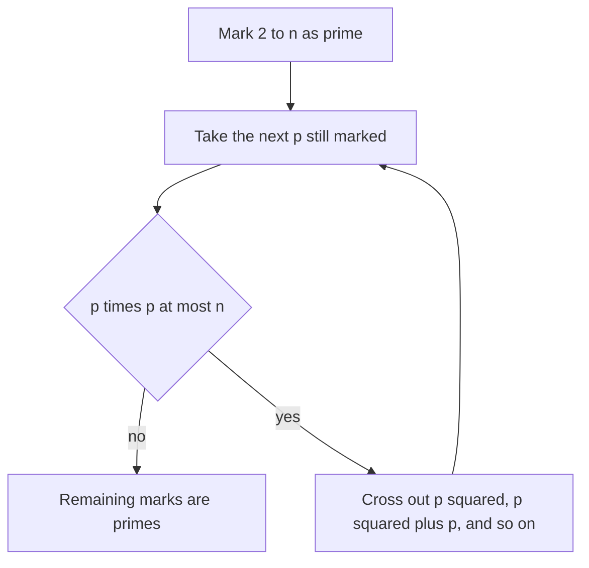

## The hook

A problem gives you 100,000 numbers up to a million and asks, for each one, how many divisors it has. Factoring each by trial division up to its square root costs about a thousand steps per number: a hundred million in total, uncomfortably slow.

More than two thousand years ago, the Greek scholar Eratosthenes described a way to find all primes up to a limit by repeatedly crossing out multiples. With one small upgrade, the same idea lets you factorise every one of those numbers in a handful of steps.

## The intuition

:::analogy
Picture panning for gold in a riverbed. You pour the gravel through a sieve and shake: everything that is a multiple of 2, apart from 2 itself, washes away. Shake again for 3, then for 5. Each shake removes a whole family of impostors at once. What stays in the pan at the end is pure gold: the primes.
:::

A [[prime]] is a number with no divisors other than 1 and itself; every other number above 1 is [[composite]]. A composite number must have a prime factor, so once you have washed away all multiples of every prime, only primes remain. That is the [[sieve]].

## How it works

### The classic sieve

1. Make a list `is_prime[0..n]`, all marked true except 0 and 1.
2. For p = 2, 3, 4, ... while p × p ≤ n: if p is still marked prime, mark p × p, p × p + p, p × p + 2p, ... up to n as composite.
3. Whatever is still marked is prime.

Two details make it fast:

- **Start at p × p.** A smaller multiple k × p with k < p has a smaller prime factor, so it was already washed away.
- **Stop at √n.** Any composite number up to n has a prime factor at most √n, so by then every composite is crossed out.



### The upgrade: smallest prime factor

Instead of a true or false mark, store for every x its [[smallest prime factor]], `spf[x]`. Build it with the same sieve: when processing prime p, for each multiple m that has no spf yet, set `spf[m] = p`.

Then [[prime factorisation]] of any x ≤ n is a short loop: divide x by `spf[x]` until x becomes 1. Every step divides by at least 2, so it takes at most about log₂ x steps.

:::insight
The sieve does all the hard work once, for every number up to n at the same time. After that, questions about any single number, is it prime, what are its factors, how many divisors does it have, cost only a few steps each.
:::

## Walk through an example

Sieve up to 30.

| Prime p | Crosses out (starting at p²) |
|---|---|
| 2 | 4, 6, 8, 10, 12, 14, 16, 18, 20, 22, 24, 26, 28, 30 |
| 3 | 9, 15, 21, 27 (12, 18, 24, 30 already gone) |
| 5 | 25 (others already gone) |
| 7 | 7 × 7 = 49 > 30, stop |

Remaining: 2, 3, 5, 7, 11, 13, 17, 19, 23, 29.

Now factorise 360 with an spf table: spf[360] = 2 → 180; spf = 2 → 90; spf = 2 → 45; spf[45] = 3 → 15; spf = 3 → 5; spf[5] = 5 → 1. So 360 = 2³ × 3² × 5. Its number of divisors is (3 + 1)(2 + 1)(1 + 1) = 24, because each divisor picks an exponent from 0 to 3 for 2, 0 to 2 for 3 and 0 to 1 for 5.

:::try-this
Factorise 84 with the spf method and count its divisors. (84 → 42 → 21 by 2, then 7 by 3, then 1 by 7: 84 = 2² × 3 × 7. Divisors: (2+1)(1+1)(1+1) = 12.)
:::

## The code

```pseudo
build_spf(n):
    spf = array of n + 1 zeros
    for i from 2 to n:
        if spf[i] == 0:                 // i is prime
            for j from i to n step i:
                if spf[j] == 0: spf[j] = i
    return spf

factorise(x, spf):
    while x > 1:
        p = spf[x]
        count how many times p divides x, dividing it out
        record (p, count)
```

```cpp
#include <bits/stdc++.h>
using namespace std;

int main() {
    const int N = 1'000'000;
    vector<int> spf(N + 1, 0);
    for (int i = 2; i <= N; i++)
        if (spf[i] == 0)
            for (int j = i; j <= N; j += i)
                if (spf[j] == 0) spf[j] = i;

    auto divisors = [&](int x) {
        long long total = 1;
        while (x > 1) {
            int p = spf[x], e = 0;
            while (x % p == 0) { x /= p; e++; }
            total *= (e + 1);
        }
        return total;
    };
    cout << divisors(360) << ' ' << divisors(84) << '\n';  // 24 12
}
```

## Complexity

- **Classic sieve:** O(n log log n) time. The total work is n/2 + n/3 + n/5 + ..., summed over primes, which grows only slightly faster than n.
- **spf sieve as written:** O(n log log n) as well, since each prime visits its multiples once.
- **Each factorisation:** O(log x) divisions.
- **Space:** O(n) integers; for n = 10⁷ that is about 40 MB as `int`, so watch the memory limit.

## Common mistakes

:::warning
Common misconception: "the sieve works for any range of numbers." It needs an array up to n, so it is practical up to around 10⁷ or 10⁸. To test a single huge number, such as 10¹⁸, use trial division up to its square root or a probabilistic test like Miller-Rabin instead.
:::

- **Using `int` for p × p** when p approaches 46,341, where p² overflows a 32-bit int.
- **Starting the inner loop at 2p** in the classic sieve: correct but slower; start at p².
- **Forgetting 0 and 1**, which are neither prime nor composite.
- **Building the sieve inside each test case**, instead of once at the start.

## Practice problems

*Count Primes* is the classic sieve. *Closest Prime Numbers in Range* sieves once and then scans. *Counting Divisors* (CSES) uses the spf table and the divisor-count formula from the example. *Common Divisors* turns things around: for each candidate d from large to small, count how many input numbers it divides, which is a sieve over divisors rather than over primes. Expect sieves from about 1300 rating onward.

## Key takeaways

- The Sieve of Eratosthenes finds all primes up to n by crossing out multiples of each prime, starting at p squared and stopping at the square root of n.
- It runs in O(n log log n) time, fast enough for n up to about 10^7.
- Storing the smallest prime factor of every number lets you factorise any number up to n in O(log x) steps.
- From a factorisation p1^e1 × p2^e2 × ..., the number of divisors is (e1 + 1)(e2 + 1)....
- For single huge numbers beyond sieve range, use trial division up to the square root or a primality test instead.
