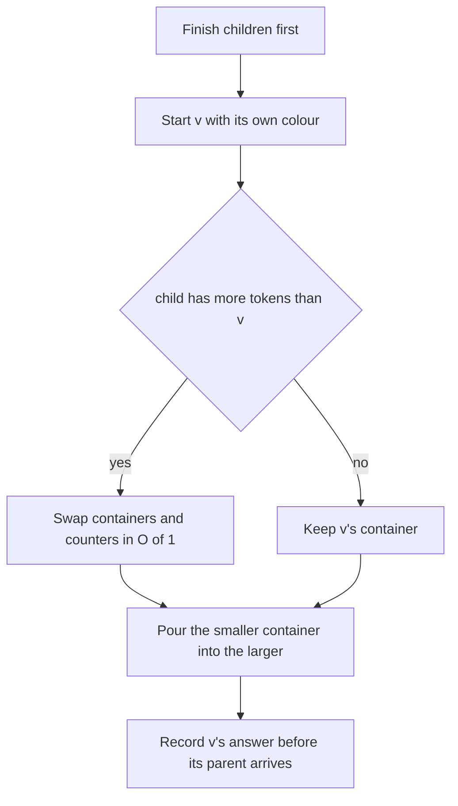
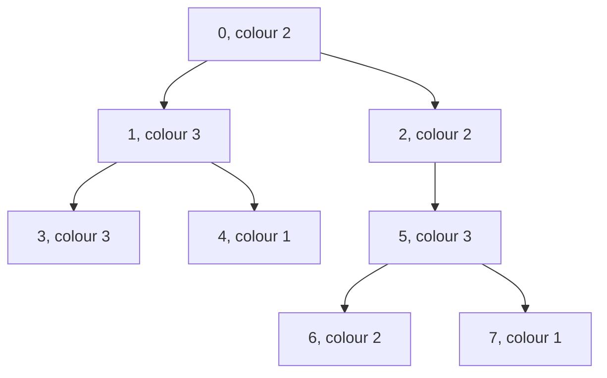

## The hook

Every vertex of a tree has a colour, and for every vertex you must report how many distinct colours appear in its subtree. Collecting the colours of each subtree separately costs the subtree's size, and on a path that adds up to n²/2: about 2·10¹⁰ steps for 2·10⁵ vertices.

Yet the subtree of a vertex is just its children's subtrees plus itself. If each child hands its collection of colours up to the parent, the only question is how to combine them cheaply. The answer is a rule simple enough to state in five words, always pour small into large, and it is the same idea that keeps union by size fast in [Friend Groups That Also Remember Who Is on Which Team](article:cp-dsu-advanced).

## The intuition

:::analogy
Families in a town keep merging households. Moving is tiring, so whenever two households combine, the smaller family packs up and moves into the bigger family's house; the big family stays put. Look at any one person: every time they have to move, the household they join is at least twice the size of the one they left. In a town of n people, nobody can move more than about log₂ n times.
:::

Combining by moving the smaller side is [[small-to-large merging]]. The people are [[token]]s, and "the household at least doubles each time you move" is the [[doubling argument]].

## How it works

### The bound

Suppose collection A holds a tokens and B holds b tokens, with a ≤ b. Pouring A into B costs O(a) insertions, and every token from A now sits in a collection of a + b ≥ 2a tokens. A token's collection size starts at 1 and can never exceed n, so it can be on the smaller side at most log₂ n times. Summed over all n tokens, the total number of insertions is at most n·log₂ n.

Comparing by tokens, the number of vertices poured into a collection, makes this argument exact even when colours repeat and a map has fewer entries than tokens. With std::map each insertion costs O(log n), giving O(n log² n) overall; a hash map brings it to O(n log n) expected.

### On a tree

Process vertices so that children are finished before their parent, for example in reverse BFS order:

```
for v in reverse BFS order:
    cnt[v] = { colour[v]: 1 }; tokens[v] = 1
    for each child c:
        if tokens[c] > tokens[v]: swap(cnt[c], cnt[v]) and the counters that describe them
        pour every (colour, k) of cnt[c] into cnt[v]
        tokens[v] += tokens[c]; clear cnt[c]
    answer[v] = number of keys in cnt[v]
```

The [[container swap]] is O(1) for std::map, std::set and std::vector: they exchange internal pointers rather than copying contents. That is what lets the parent "move into" the child's big house for free.

### Carrying more than a set

*Lomsat gelral* asks, for each subtree, for the sum of all colours that occur the maximum number of times. Keep counts instead of a set, plus two running numbers per collection: top, the highest count, and sum, the total of colours with that count. While pouring, each updated count either beats top (reset sum to this colour), ties it (add this colour), or stays below. These numbers describe a collection, so they must be swapped together with it.

### The answer-after-swap bug

The swap reuses the child's storage. After vertex v swaps with child c, the slots of c hold v's old data. If answers are read from the working arrays at the end, children report their parents' values. The fix is to keep [[working state]] separate from answer arrays and copy each vertex's answer out the moment it is finished. The first version of the program below had exactly this bug; the random test caught it immediately.

### Related techniques

| Technique | Idea | Cost |
|---|---|---|
| small-to-large with maps | pour the smaller collection into the larger | O(n log² n) |
| small-to-large with hash maps | the same, expected O(1) insertions | O(n log n) expected |
| Euler tour plus offline distinct queries | each subtree is a range, as in distinct values queries | O(n log n) |
| keep the heavy child's data | process light children, then reuse the heavy child's counts | O(n log n) |

The last row, often called DSU on tree, applies the same doubling argument to heavy children from [Highway Lanes for the Busiest Routes](article:cp-hld), and the Euler tour row is [Numbering a Family Tree So Every Branch Is a Block](article:cp-euler-tour).



:::insight
The cost of a merge is charged to the items that move, and an item moves only into something at least twice as big. That single observation turns "merge everything upwards" from quadratic into n log n, whether the collections are sets, maps or lists.
:::

## Walk through an example

Eight vertices, root 0: 0 has children 1 and 2; 1 has children 3 and 4; 2 has child 5; 5 has children 6 and 7. Colours for vertices 0 to 7: 2, 3, 2, 3, 1, 3, 2, 1.



Reverse BFS order: 7, 6, 5, 4, 3, 2, 1, 0. Counts are written colour:count.

| Vertex | Start | Merges | Final counts | Distinct | Dominant sum |
|---|---|---|---|---|---|
| 7, 6, 4, 3 | own colour | none, leaves | one colour each | 1 | own colour |
| 5 | 3:1 | pour 6, then 7, one entry each | 3:1, 2:1, 1:1 | 3 | 3 + 2 + 1 = 6 |
| 2 | 2:1, 1 token | child 5 has 3 tokens: swap, then pour 2:1 | 3:1, 2:2, 1:1 | 3 | 2 |
| 1 | 3:1 | pour 3 (count of 3 becomes 2), then pour 4 | 3:2, 1:1 | 2 | 3 |
| 0 | 2:1, 1 token | child 1 has 3 tokens: swap, pour 2:1. Child 2 has 4 tokens, v has 4: no swap, pour 3 entries | 3:3, 2:3, 1:2 | 3 | 3 + 2 = 5 |

Answers for vertices 0 to 7: distinct counts 3, 2, 3, 1, 1, 3, 1, 1, and dominant sums 5, 3, 2, 3, 1, 6, 2, 1.

At vertex 2 the swap means vertex 2 keeps vertex 5's three-colour map and pours its own single entry into it, instead of copying three entries. Vertex 5's answer, 3 distinct and sum 6, was already recorded, which is why the swap does no harm.

**Measured cost.** On a path of 2000 vertices with all colours different, small-to-large performs 1,999 insertions, one per vertex beyond the leaf. Always pouring the child into the parent performs 1,999,000, which is 1 + 2 + ... + 1999.

:::try-this
At vertex 0, suppose child 2 is processed before child 1. Do the answers change, and does the work? (The answers cannot change, since the final collection is the same multiset of colours. The work does: vertex 0 starts with 1 token, swaps with child 2's 4 tokens, pours its own 1 entry, then pours child 1's 2 entries into the 4-token collection. That is 3 entries poured instead of 4.)
:::

:::warning
Common misconception: "Compare the two maps by their number of keys; that is the same as comparing sizes." It is a reasonable heuristic and common in practice, but keys undercount when colours repeat: a subtree of a thousand vertices all coloured 7 has a one-key map. The clean doubling proof uses tokens, the number of vertices poured into each collection, which is why the code tracks them separately.
:::

## The code

```pseudo
for v in reverse BFS order:
    cnt[v] = {colour[v]: 1}; top[v] = 1; sum[v] = colour[v]; tokens[v] = 1
    for each child c:
        if tokens[c] > tokens[v]: swap cnt, top, sum between c and v
        for (col, k) in cnt[c]:
            now = cnt[v][col] += k
            if now > top[v]: top[v] = now; sum[v] = col
            else if now == top[v]: sum[v] += col
        tokens[v] += tokens[c]; clear cnt[c]
    distinct[v] = size of cnt[v]; dominantSum[v] = sum[v]      # record now
```

```cpp
#include <bits/stdc++.h>
using namespace std;
using ll = long long;

struct SmallToLarge {
    vector<int> distinct;                                        // answers, written once a vertex is finished
    vector<ll> dominantSum;
    ll moves = 0;                                                // colour entries poured from one map into another
    SmallToLarge(const vector<vector<int>>& adj, const vector<int>& colour, bool smallIntoLarge = true) {
        int n = adj.size();
        distinct.assign(n, 0), dominantSum.assign(n, 0);
        vector<map<int, int>> cnt(n);                            // working state: colour -> count in the subtree
        vector<int> top(n, 0);                                   // working state: highest count in cnt[v]
        vector<ll> sum(n, 0);                                    // working state: sum of colours with that count
        vector<int> tokens(n, 1);                                // vertices poured into cnt[v] so far
        vector<int> parent(n, -1), order = {0};
        for (int i = 0; i < (int)order.size(); i++)              // BFS; reversed, every child comes before its parent
            for (int c : adj[order[i]]) if (c != parent[order[i]]) parent[c] = order[i], order.push_back(c);
        for (int i = n - 1; i >= 0; i--) {
            int v = order[i];
            cnt[v][colour[v]] = 1, top[v] = 1, sum[v] = colour[v];
            for (int c : adj[v]) {
                if (c == parent[v]) continue;
                if (smallIntoLarge && tokens[c] > tokens[v])     // keep the container that holds more vertices
                    swap(cnt[c], cnt[v]), swap(top[c], top[v]), swap(sum[c], sum[v]);   // O(1) for std::map
                for (auto [col, k] : cnt[c]) {                   // pour the smaller map into the larger
                    int now = cnt[v][col] += k;
                    moves++;
                    if (now > top[v]) top[v] = now, sum[v] = col;
                    else if (now == top[v]) sum[v] += col;
                }
                tokens[v] += tokens[c];
                map<int, int>().swap(cnt[c]);                    // the child's map is no longer needed
            }
            distinct[v] = cnt[v].size(), dominantSum[v] = sum[v];   // record before a parent swaps it away
        }
    }
};

int main() {
    vector<array<int, 2>> edges = {{0, 1}, {0, 2}, {1, 3}, {1, 4}, {2, 5}, {5, 6}, {5, 7}};
    vector<int> colour = {2, 3, 2, 3, 1, 3, 2, 1};
    vector<vector<int>> adj(8);
    for (auto [a, b] : edges) adj[a].push_back(b), adj[b].push_back(a);
    SmallToLarge s(adj, colour);
    for (int x : s.distinct) cout << x << ' ';
    cout << '\n';                                                // 3 2 3 1 1 3 1 1
    for (ll x : s.dominantSum) cout << x << ' ';
    cout << '\n';                                                // 5 3 2 3 1 6 2 1

    int n = 2000;                                                // a path with all colours different
    vector<vector<int>> path(n);
    for (int v = 1; v < n; v++) path[v - 1].push_back(v), path[v].push_back(v - 1);
    vector<int> col(n);
    iota(col.begin(), col.end(), 0);
    SmallToLarge good(path, col, true), bad(path, col, false);
    cout << good.moves << ' ' << bad.moves << '\n';              // 1999 1999000

    mt19937 rng(17);                                             // brute force per subtree
    bool ok = true;
    for (int t = 0; t < 200; t++) {
        int m = 1 + rng() % 30;
        vector<vector<int>> g(m);
        vector<int> par(m, -1), cl(m);
        for (int v = 1; v < m; v++) par[v] = rng() % v, g[par[v]].push_back(v), g[v].push_back(par[v]);
        for (auto& x : cl) x = 1 + rng() % 4;
        SmallToLarge S(g, cl);
        for (int v = 0; v < m; v++) {
            map<int, int> c;
            for (int u = 0; u < m; u++) {                        // u is in v's subtree if v is on u's root path
                int x = u;
                while (x != -1 && x != v) x = par[x];
                if (x == v) c[cl[u]]++;
            }
            int top = 0; ll sm = 0;
            for (auto [k, f] : c) top = max(top, f);
            for (auto [k, f] : c) if (f == top) sm += k;
            ok = ok && S.distinct[v] == (int)c.size() && S.dominantSum[v] == sm;
        }
    }
    cout << (ok ? "stress ok" : "stress FAILED") << '\n';        // stress ok
}
```

The random test builds 200 trees of up to 30 vertices with four colours and recomputes every subtree's distinct count and dominant sum by brute force. For CSES *Distinct Colors*, print `distinct` for vertices 1 to n; for *Lomsat gelral*, print `dominantSum`.

## Complexity

- **Insertions: at most n·log₂ n** in total, by the doubling argument on tokens.
- **Time: O(n log² n)** with std::map, O(n log n) expected with a hash map.
- **Space: O(n)** live entries at any moment, since every poured map is cleared.

## Common mistakes

- **Pouring large into small,** which is quadratic on a path.
- **Copying containers instead of swapping them,** which turns an O(1) step into O(size).
- **Swapping the container but not its counters,** so top and sum describe the wrong collection.
- **Reading answers from the working arrays at the end,** after parents have swapped them away.
- **Recursing on a 2·10⁵-vertex path;** reverse BFS order avoids recursion entirely.
- **Not clearing the child's map,** which keeps O(n log n) dead entries alive and can exhaust memory.

## Practice problems

*Distinct Colors* is the set version above. *Lomsat gelral* is the counting version with running maximum and sum. *Dominant Indices* merges, for each subtree, the count of vertices at each depth and asks for the depth with the most vertices, the smallest such depth on ties; merging depth arrays small-to-large works with care, and a faster linear method exists that reuses the deepest child's array. The tree recursion background is in [Managers Summarising Their Teams' Reports](article:dsa-tree-recursion).

## Key takeaways

- Always inserting the smaller collection into the larger means each item moves only when its collection at least doubles, so it moves at most about log₂ n times.
- On a tree, a vertex combines its children's collections by swapping in the largest child's container in O(1) and pouring the rest into it.
- Running summaries such as the highest count and the sum of colours with that count travel with their collection and must be swapped together with it.
- Each vertex's answer must be copied out as soon as it is finished, because a parent's swap reuses the child's storage.
- Comparing collections by the number of vertices poured into them gives a clean O(n log n) bound on moves even when colours repeat.
