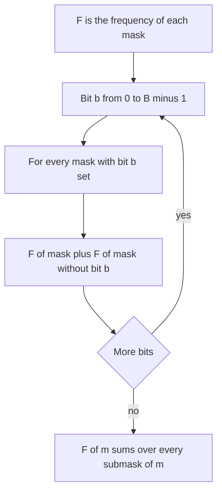

## The hook

A locksmith has a combination lock with 20 switches and a box of numbers, each a switch pattern. For every possible pattern, they want to know how many numbers in the box fit inside it: patterns whose switches are all among the pattern's switches. Enumerating submasks of every mask is 3²⁰, about 3.5 × 10⁹ steps: too slow.

Sum over subsets DP answers all 2²⁰ questions in about 2 × 10⁷ steps, by summarising one switch at a time. It is the bitmask version of a 2D prefix sum, and it shows up whenever a problem involves AND, OR or "is a subset of" across many numbers.

## The intuition

:::analogy
Think of every pattern of 20 switches as a corner of a 20-dimensional cube with sides of length 2. "Submasks of m" are exactly the corners you can reach from m by turning some of its switches off: a box below m in every dimension. In two dimensions, a sum over a box is a 2D prefix sum, computed one dimension at a time: first along rows, then along columns. Here, do the same 20 times, once per switch: after handling switch b, every corner has absorbed the corners that differ from it only by switch b being off.
:::

That is the [[subset sum transform]], computed [[dimension-by-dimension]]:

```
F = f
for b in 0 .. B-1:
    for m in 0 .. 2^B - 1:
        if m has bit b: F[m] += F[m with bit b cleared]
```

After all B passes, F[m] = Σ f[s] over every submask s of m. Each submask is counted once, because it is reached by switching off its missing bits in increasing order of bit, one pass each.

The [[superset sum transform]] is the mirror: add F[m with bit b set] when m lacks bit b.

## How it works

### Why it is correct

After processing bits 0 to b, F[m] holds the sum of f[s] over all s that agree with m on bits b + 1 and above, and are submasks of m on bits 0 to b. Processing bit b + 1 extends that to one more bit: if m has bit b + 1, the submasks with that bit off are exactly F[m without the bit], from the same pass. By induction, after the last bit, F[m] covers all submasks.

### Loop order matters

The bit loop must be outside the mask loop. Swapping them interleaves dimensions and adds some submasks several times. Within one bit's pass, the mask order does not matter, because F[m ^ (1 << b)] has bit b clear and is not modified in that pass.

### CSES Bit Problem

Given n numbers below 2²⁰, for each x count the y with:

- x | y = x, meaning y is a submask of x: subset transform at x;
- x & y = x, meaning x is a submask of y: superset transform at x;
- x & y ≠ 0: n minus the count of y with x & y = 0, which by the [[complement trick]] is the subset transform at ~x (within 20 bits).

Two transforms of a frequency array answer all three for every x, in O(20 × 2²⁰).

### Other uses

| Problem | Transform | Idea |
|---|---|---|
| Count y ⊆ x | subset sums of frequencies | direct |
| Count y ⊇ x | superset sums of frequencies | direct |
| Count y with x & y = 0 | subset sums at ~x | complement |
| Find any y with x & y = 0 | subset "any element" at ~x | Compatible Numbers |
| Subsets with AND = 0 | superset counts plus inclusion-exclusion over popcount | Jzzhu and Numbers |

The submask enumeration of [Visited Cities as a Row of Switches](article:cp-bitmask-dp) costs 3^B; SOS gets the same sums in B × 2^B whenever the per-subset contribution is a simple sum.



:::insight
Summing over all submasks is a prefix sum over a cube with one dimension per bit. Taking the prefix sum along one dimension at a time costs O(2^B) per bit, so every mask's subset sum is ready in O(B × 2^B) instead of O(3^B).
:::

## Walk through an example

Numbers 3, 5, 6, 1, 7 with B = 3 bits. Frequencies by mask 0 to 7: 0, 1, 0, 1, 0, 1, 1, 1.

| Mask | 000 | 001 | 010 | 011 | 100 | 101 | 110 | 111 |
|---|---|---|---|---|---|---|---|---|
| frequency | 0 | 1 | 0 | 1 | 0 | 1 | 1 | 1 |
| subset sums | 0 | 1 | 0 | 2 | 0 | 2 | 1 | 5 |
| superset sums | 5 | 4 | 3 | 2 | 3 | 2 | 2 | 1 |

For example, the subset sum at 011 (3) counts 001 (1) and 011 (3): 2 numbers fit inside 3. The superset sum at 001 counts every odd number: 3, 5, 1, 7.

### Bit Problem answers

| x | y ⊆ x | x ⊆ y | x & y ≠ 0 |
|---|---|---|---|
| 3 | 2 | 2 | 5 - subset[100] = 5 - 0 = 5 |
| 5 | 2 | 2 | 5 - subset[010] = 5 |
| 6 | 1 | 2 | 5 - subset[001] = 4 |
| 1 | 1 | 4 | 5 - subset[110] = 4 |
| 7 | 5 | 1 | 5 - subset[000] = 5 |

All fifteen values match a brute-force check over every pair.

:::try-this
After only the first pass (bit 0) of the subset transform on these frequencies, what is F[011], and what does it mean? (Bit 0 pass: F[011] += F[010], so 1 + 0 = 1. It counts masks that agree with 011 on bits 1 and 2 and are submasks of it on bit 0: just 010 and 011, of which only 011 is present. The bit 1 pass then adds F[001], giving the final 2.)
:::

:::warning
Common misconception: "Swap the loops for better cache behaviour; the result is the same." With masks outer and bits inner, F[m] can absorb a value that has already absorbed another dimension in the same sweep, so some submasks are counted twice. On the example, subset[111] comes out as 6 instead of 5. Keep the bit loop outside.
:::

## The code

```pseudo
subset(F):   for b in 0..B-1: for m: if m has bit b: F[m] += F[m ^ (1 << b)]
superset(G): for b in 0..B-1: for m: if m lacks bit b: G[m] += G[m | (1 << b)]
for each x:
    answer1 = F[x]; answer2 = G[x]; answer3 = n - F[full ^ x]
```

```cpp
#include <bits/stdc++.h>
using namespace std;

int main() {
    const int B = 20, N = 1 << B, full = N - 1;
    vector<int> a = {3, 5, 6, 1, 7};
    vector<int> sub(N, 0), sup(N, 0);
    for (int x : a) sub[x]++, sup[x]++;
    for (int b = 0; b < B; b++)                          // bits outside, masks inside
        for (int m = 0; m < N; m++) {
            if (m >> b & 1) sub[m] += sub[m ^ (1 << b)];
            else sup[m] += sup[m | (1 << b)];
        }
    int n = a.size();
    for (int x : a) cout << sub[x] << ' ' << sup[x] << ' ' << n - sub[full ^ x] << " | ";
    cout << '\n';                                        // 2 2 5 | 2 2 5 | 1 2 4 | 1 4 4 | 5 1 5 |

    mt19937 rng(31);                                     // brute-force check on random values
    vector<int> v(300);
    for (int& x : v) x = rng() % 1024;
    vector<int> F(1024, 0);
    for (int x : v) F[x]++;
    for (int b = 0; b < 10; b++)
        for (int m = 0; m < 1024; m++) if (m >> b & 1) F[m] += F[m ^ (1 << b)];
    int bad = 0;
    for (int x = 0; x < 1024; x++) {
        int c = 0;
        for (int y : v) c += (x | y) == x;
        bad += c != F[x];
    }
    cout << bad << '\n';                                 // 0
}
```

The main transform runs over all 2²⁰ masks even for five numbers, which is what Bit Problem needs for up to 2 × 10⁵ numbers; it takes about 2 × 10⁷ simple additions.

## Complexity

- **Each transform: O(B × 2^B),** about 2 × 10⁷ for B = 20.
- **Answering each query: O(1)** after the transforms.
- **Space: O(2^B)** per transform, 4 MB each for B = 20 with 32-bit counts.
- **Compared with submask enumeration:** O(3^B), about 3.5 × 10⁹ for B = 20.

## Common mistakes

- **Swapping the loop order,** which double-counts.
- **Forgetting to restrict the complement to B bits:** use full ^ x, not ~x, which sets bits beyond B.
- **Using too few bits** when values reach 10⁶, which needs B = 20 since 2²⁰ > 10⁶.
- **Overflow** when sums grow large in variants that add values instead of counts; use 64-bit where needed.
- **Running the subset transform when the question is about supersets,** or the other way round.

## Practice problems

CSES *Bit Problem* is the three-count application above. Codeforces *Compatible Numbers* stores "any element" instead of a count, to find a y with x & y = 0. Codeforces *Jzzhu and Numbers* counts subsets whose AND is 0, combining the superset transform with inclusion-exclusion over the number of set bits.

## Key takeaways

- Sum over subsets DP computes, for every mask, the sum of a value over all of its submasks in O(B × 2^B).
- It processes one bit at a time, like a prefix sum along one dimension of a 2^B cube.
- The bit loop must be the outer loop, or some submasks are counted more than once.
- The superset version mirrors it, adding the value of the mask with the bit set.
- Counting values that share no bit with x uses the subset transform at the complement of x within B bits.
