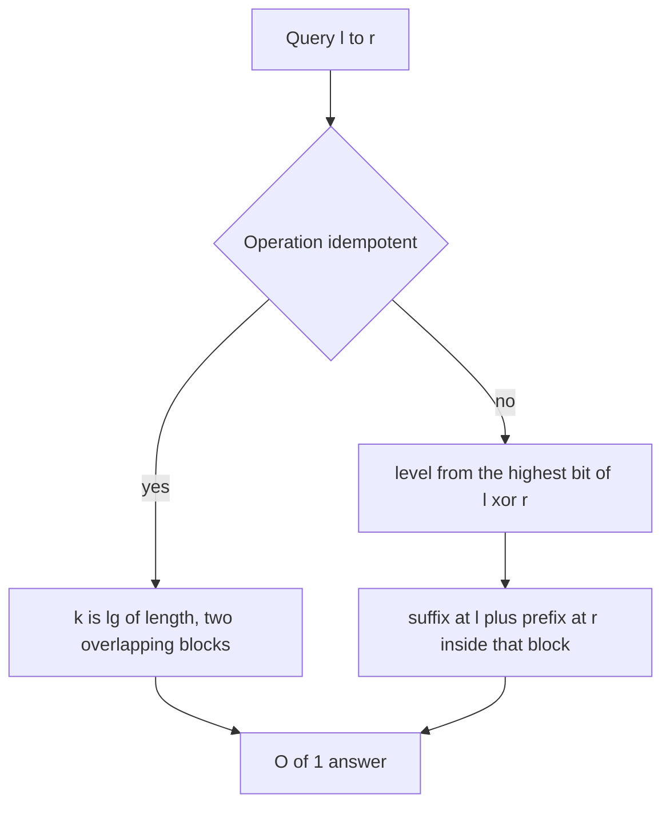

## The hook

In a contest, a problem with 2 × 10⁵ elements and 2 × 10⁵ range-minimum queries is a warm-up, if your template is ready. The idea behind sparse tables, two overlapping power-of-two blocks, is covered in [Two Overlapping Lookouts, One Answer](article:dsa-sparse-table-rmq). This article is about what contest problems ask on top of it: gcd instead of min, sums in O(1) where overlap is not allowed, and lowest common ancestors in O(1).

All three use the same table-building loop, so one template covers a surprising share of static range problems.

## The intuition

:::analogy
Picture lookout towers along a coastline, each reporting on a stretch whose length is a power of two. For "lowest cliff" questions, two towers whose stretches overlap are fine, since the lowest cliff is reported twice at worst. For "total rainfall", overlap would count some miles twice, so the towers are arranged differently: at each scale, the coast is cut into blocks, and each block's midpoint tower knows the rainfall from the midpoint outwards in both directions. Any stretch that crosses a midpoint is answered by that one tower, adding its left report and its right report, with no overlap.
:::

The first arrangement is the [[idempotent sparse table]]; the second is the [[disjoint sparse table]]. A third use turns trees into arrays: an [[Euler tour]] lists the vertices of a DFS walk, and the lowest common ancestor of two vertices becomes the shallowest vertex between their first appearances, a [[range minimum to LCA]] reduction.

## How it works

### The contest template

```
lg = __lg(len)                       # floor(log2(len)) in one instruction
st[0] = a
st[k][i] = op(st[k-1][i], st[k-1][i + 2^(k-1)])
query(l, r) = op(st[k][l], st[k][r - 2^k + 1]),  k = __lg(r - l + 1)
```

`__lg` is a GCC builtin that returns the index of the highest set bit, so no log table is needed. Storing st[k] as contiguous rows keeps queries cache-friendly. The same template works for min, max, gcd, bitwise AND and OR.

### Range gcd

gcd is idempotent, so the template applies unchanged. A typical use is counting subarrays with a given gcd: for each left end, the gcd of a[l..r] only decreases as r grows and changes at most about log(max value) times, so binary search with O(1) range gcd queries finds each change point.

### Disjoint sparse table: any associative operation

For sums, products, or matrix products, overlap is not allowed. Build log₂ n levels. At level k, cut the array into blocks of size 2^k. For each block with midpoint m, store:

- suffix aggregates leftwards from m - 1 to the block start: op(a[i..m-1]);
- prefix aggregates rightwards from m to the block end: op(a[m..j]).

A query [l, r] with l ≠ r finds its [[level of a query]] as the highest differing bit of l and r, plus one, which identifies the one block whose midpoint separates them. The answer is suffix[level][l] ⊕ prefix[level][r]: two non-overlapping parts. O(n log n) build, O(1) query, for any associative operation.

### LCA in O(1) through an Euler tour

DFS from the root, appending a vertex to the tour every time the walk arrives at it, including on returns. Record each vertex's depth and its first position in the tour. For vertices u and v with first positions i ≤ j, their LCA is the vertex of minimum depth in tour positions i to j. A sparse table over (depth, vertex) pairs answers that in O(1), after O(n log n) preprocessing. Binary lifting, in its own article in this track, gives O(log n) per query with less memory and also supports k-th ancestor queries.

| Need | Table | Query |
|---|---|---|
| Range min, max, gcd, AND, OR | idempotent sparse table | two overlapping blocks |
| Range sum, product, any associative op | disjoint sparse table | suffix plus prefix at one level |
| LCA of two tree vertices | sparse table over the Euler tour's depths | min depth between first occurrences |
| Updates mixed with queries | not a sparse table | segment tree |



:::insight
A sparse table is one doubling loop and two lookups. With overlapping blocks it answers idempotent operations; with blocks split at midpoints it answers any associative operation; and run over an Euler tour's depths it answers lowest common ancestors, all in O(1) after O(n log n) preprocessing.
:::

## Walk through an example

### Range gcd on [12, 18, 24, 6, 9, 15, 30, 45]

| k | Block length | st[k] |
|---|---|---|
| 0 | 1 | 12, 18, 24, 6, 9, 15, 30, 45 |
| 1 | 2 | 6, 6, 6, 3, 3, 15, 15 |
| 2 | 4 | 6, 3, 3, 3, 3 |
| 3 | 8 | 3 |

gcd(a[0..2]) uses k = 1: gcd(st[1][0], st[1][1]) = gcd(6, 6) = 6. gcd(a[4..7]) uses k = 2: st[2][4] = gcd(9, 15, 30, 45) = 3.

### Disjoint sparse table for sums on [3, 1, 4, 1, 5, 9, 2, 6]

| Query | l ^ r | Level (block size) | Midpoint | Suffix part | Prefix part | Sum |
|---|---|---|---|---|---|---|
| [2, 5] | 7 | 3 (8) | 4 | a[2..3] = 5 | a[4..5] = 14 | 19 |
| [5, 6] | 3 | 2 (4) | 6 | a[5] = 9 | a[6] = 2 | 11 |
| [1, 2] | 3 | 2 (4) | 2 | a[1] = 1 | a[2] = 4 | 5 |
| [0, 7] | 7 | 3 (8) | 4 | a[0..3] = 9 | a[4..7] = 22 | 31 |

No element is counted twice: the midpoint splits each query into a left piece ending just before it and a right piece starting at it.

### LCA through an Euler tour

Tree: 0 has children 1 and 2; 1 has children 3 and 4; 2 has child 5.

| Tour position | 0 | 1 | 2 | 3 | 4 | 5 | 6 | 7 | 8 | 9 | 10 |
|---|---|---|---|---|---|---|---|---|---|---|---|
| Vertex | 0 | 1 | 3 | 1 | 4 | 1 | 0 | 2 | 5 | 2 | 0 |
| Depth | 0 | 1 | 2 | 1 | 2 | 1 | 0 | 1 | 2 | 1 | 0 |

LCA(3, 4): first positions 2 and 4; the minimum depth between them is 1, at vertex 1. LCA(4, 5): positions 4 and 8; the minimum depth is 0, at vertex 0.

:::try-this
With the disjoint table on [3, 1, 4, 1, 5, 9, 2, 6], which level answers [3, 4], and what are the two parts? (3 ^ 4 = 7, so level 3, block size 8, midpoint 4. The suffix part is a[3] = 1 and the prefix part is a[4] = 5, so the sum is 6. The two elements sit on opposite sides of the midpoint, even though they are neighbours.)
:::

:::warning
Common misconception: "A plain sparse table can answer sums if you subtract the overlap." The overlap's sum is itself a range query, so subtracting it needs another query of the same kind, and the overlap's length varies. Either use prefix sums, which are simpler for static sums, or a disjoint sparse table, which handles operations that have no inverse, such as products modulo a composite or matrix products.
:::

## The code

```pseudo
build_idempotent(a): st[0] = a; st[k][i] = op(st[k-1][i], st[k-1][i + 2^(k-1)])
query(l, r): k = lg(r - l + 1); return op(st[k][l], st[k][r - 2^k + 1])

build_disjoint(a):                            # n rounded up to a power of two
    for level in 1..LOG: for each block of size 2^level with midpoint m:
        suf[level][m-1] = a[m-1]; go left: suf[level][i] = op(a[i], suf[level][i+1])
        pre[level][m] = a[m]; go right: pre[level][j] = op(pre[level][j-1], a[j])
query_disjoint(l, r): if l == r: return a[l]
    lev = highest_bit(l xor r) + 1; return op(suf[lev][l], pre[lev][r])
```

```cpp
#include <bits/stdc++.h>
using namespace std;
using ll = long long;

template <class T, class Op> struct Sparse {                    // idempotent operations
    vector<vector<T>> st;
    Op op;
    Sparse(const vector<T>& a, Op o) : op(o) {
        int n = a.size(), LOG = __lg(n) + 1;
        st.assign(LOG, a);
        for (int k = 1; k < LOG; k++)
            for (int i = 0; i + (1 << k) <= n; i++) st[k][i] = op(st[k - 1][i], st[k - 1][i + (1 << (k - 1))]);
    }
    T query(int l, int r) const { int k = __lg(r - l + 1); return op(st[k][l], st[k][r - (1 << k) + 1]); }
};

struct DisjointSum {                                            // any associative op; here +
    int n, LOG;
    vector<ll> a;
    vector<vector<ll>> t;
    explicit DisjointSum(vector<ll> v) {
        n = 1;
        while (n < (int)v.size()) n <<= 1;
        v.resize(n, 0), a = v, LOG = __lg(n);
        t.assign(LOG + 1, vector<ll>(n, 0));
        for (int lev = 1; lev <= LOG; lev++) {
            int half = 1 << (lev - 1);
            for (int m = half; m < n; m += 2 * half) {          // m is each block's midpoint
                t[lev][m - 1] = a[m - 1];
                for (int i = m - 2; i >= m - half; i--) t[lev][i] = a[i] + t[lev][i + 1];   // suffixes
                t[lev][m] = a[m];
                for (int j = m + 1; j < m + half; j++) t[lev][j] = t[lev][j - 1] + a[j];    // prefixes
            }
        }
    }
    ll query(int l, int r) const {
        if (l == r) return a[l];
        int lev = __lg(l ^ r) + 1;
        return t[lev][l] + t[lev][r];
    }
};

struct EulerLCA {
    vector<int> first, tourVertex;
    vector<pair<int, int>> tour;                                // (depth, vertex)
    Sparse<pair<int, int>, function<pair<int, int>(pair<int, int>, pair<int, int>)>>* sp = nullptr;
    EulerLCA(const vector<vector<int>>& ch, int root) : first(ch.size()) {
        dfs(ch, root, 0);
        sp = new Sparse<pair<int, int>, function<pair<int, int>(pair<int, int>, pair<int, int>)>>(
            tour, [](pair<int, int> x, pair<int, int> y) { return min(x, y); });
    }
    void dfs(const vector<vector<int>>& ch, int v, int d) {
        first[v] = tour.size(), tour.push_back({d, v});
        for (int c : ch[v]) dfs(ch, c, d + 1), tour.push_back({d, v});   // back at v after each child
    }
    int lca(int u, int v) const {
        int i = first[u], j = first[v];
        if (i > j) swap(i, j);
        return sp->query(i, j).second;
    }
    ~EulerLCA() { delete sp; }
};

int main() {
    auto g = [](ll x, ll y) { return __gcd(x, y); };
    Sparse<ll, decltype(g)> sg({12, 18, 24, 6, 9, 15, 30, 45}, g);
    cout << sg.query(0, 2) << ' ' << sg.query(1, 4) << ' ' << sg.query(4, 7) << '\n';     // 6 3 3
    DisjointSum ds({3, 1, 4, 1, 5, 9, 2, 6});
    cout << ds.query(2, 5) << ' ' << ds.query(5, 6) << ' ' << ds.query(1, 2) << ' ' << ds.query(0, 7) << ' '
         << ds.query(3, 4) << '\n';                                                       // 19 11 5 31 6
    vector<vector<int>> ch = {{1, 2}, {3, 4}, {5}, {}, {}, {}};
    EulerLCA e(ch, 0);
    cout << e.lca(3, 4) << ' ' << e.lca(4, 5) << ' ' << e.lca(5, 2) << '\n';              // 1 0 2
}
```

In contests, the LCA structure is usually written with plain arrays instead of `std::function`, which is slower; the version here favours readability.

## Complexity

- **Idempotent table: O(n log n) build, O(1) query,** O(n log n) memory.
- **Disjoint table: O(n log n) build, O(1) query** for any associative operation.
- **Euler tour LCA: O(n log n) build** over a tour of 2n - 1 entries, **O(1) per LCA.**
- **Memory:** about 18 rows for n = 2 × 10⁵, around 14 MB for 32-bit values; 64-bit doubles it.

## Common mistakes

- **Using the overlapping query for sums,** which double-counts.
- **Forgetting that __lg(0) is undefined;** queries must have l ≤ r.
- **Not padding the disjoint table to a power of two,** which leaves blocks without a midpoint.
- **Using last occurrences instead of first occurrences** in the Euler tour; first occurrences are the convention that guarantees the LCA lies between them.
- **Building a sparse table when there are updates,** which forces O(n log n) rebuilds.

## Practice problems

*Static Range Minimum Queries* is the idempotent template. *Company Queries II* is LCA, solvable with the Euler tour and a sparse table or with binary lifting. *Number of Subarrays With GCD Equal to K* is small enough for a direct scan, but it is a good place to try range gcd with a sparse table, which scales to the larger versions that appear in contests. For ranges with updates, see [A Tournament Bracket for Your Array](article:cp-segment-tree).

## Key takeaways

- The contest sparse table is one doubling loop and an O(1) query using __lg for the block size.
- Overlapping blocks work for idempotent operations such as min, max, gcd, AND and OR.
- A disjoint sparse table splits each level at block midpoints and answers any associative operation in O(1) with a suffix part and a prefix part.
- The lowest common ancestor of two vertices is the shallowest vertex in the Euler tour between their first occurrences, so a sparse table gives O(1) LCA.
- Sparse tables are static; any updates call for a segment tree instead.
