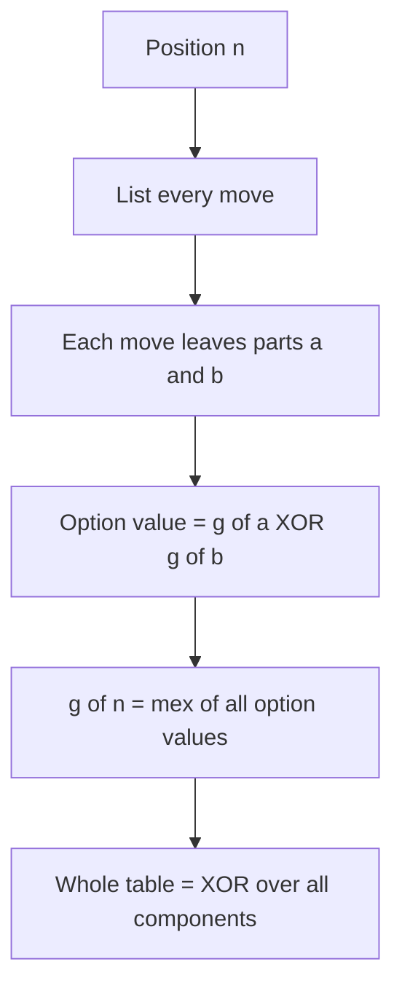

## The hook

A contest problem puts three things on one table: a row of five bowling pins, a heap of eight stones, and a Nim pile of three matchsticks. On your turn you knock down pins, or split the heap into two unequal heaps, or take matchsticks. The rules of the three games have nothing in common. Who wins?

If you read [Counting Backwards From the Last Move](article:cp-game-theory), you already know the recipe: compute a Grundy number for each part and XOR them. But a recipe you do not understand breaks the moment a problem bends it. Why should a bowling row "be" a number at all? And what do you do when one move turns one game into two?

## The intuition

:::analogy
Picture a currency exchange counter at an airport. Travellers arrive with dollars, euros and yen, but the counter only thinks in one house currency. Each note is converted at a fixed rate, and after that the counter never cares what the note looked like. In impartial games, the house currency is the Nim pile. Every position of every game can be exchanged for a Nim pile of some size, its [[Grundy value]], and after the exchange, nobody can tell the difference.
:::

"Nobody can tell the difference" is the precise claim. Put a position with Grundy value 4 next to any other games, and the winner is the same as if a Nim pile of 4 sat there instead. So a table with three strange games becomes a table with three Nim piles, and Nim is solved by XOR.

:::history
Roland Sprague published this result in 1935, and Patrick Grundy found it independently in 1939. It is why the numbers carry Grundy's name and the theorem carries both.
:::

## How it works

### Why the exchange rate is fair

Recall the definition: g(p) is the [[mex]] of the values of the positions p can move to. Suppose g(p) = 4. Then by the meaning of mex:

1. **p can reach every value below 4**: some move leads to value 0, some to 1, some to 2, some to 3. A Nim pile of 4 can also shrink to 0, 1, 2 or 3.
2. **p cannot reach value 4 itself.** A Nim pile of 4 cannot stay at 4 either.
3. **p might reach values above 4**, say 7. A Nim pile cannot grow, so this looks like a difference. But a position of value 7 can, again by mex, move to a position of value 4. The opponent simply moves straight back down.

Moves of the third kind are [[reversible move]]s. A player winning with the Nim strategy ignores them: whenever the opponent raises a component from 4 to 7, they lower it back to 4, and the table is exactly as it was before. Since the game is finite, this cannot go on forever. So a position of value g plays exactly like a pile of g in every sum, which is the whole exchange counter promise.

### Adding games: the XOR

In a [[sum of games]], each turn moves in exactly one component. After the exchange, the table is plain Nim, so:

$$g(G_1 + G_2 + \dots + G_k) = g(G_1) \oplus g(G_2) \oplus \dots \oplus g(G_k)$$

Here Gᵢ are the independent components and ⊕ is bitwise XOR. The player to move loses exactly when this XOR is 0.

### Moves that split a game

In many games a move breaks one game into several. Knocking a pin out of the middle of a row leaves two separate rows. Splitting a heap into two unequal heaps leaves two heaps. This is a [[splitting move]], and the theorem handles it neatly: the position after the move is itself a sum, so its value is the XOR of the parts.

$$g(n) = \operatorname{mex}\{\, g(a) \oplus g(b) \;:\; \text{some move turns } n \text{ into parts } a \text{ and } b \,\}$$

The XOR goes *inside* the mex, once per move. You do not take the mex of the parts separately.



:::insight
A Grundy value g means "this position can reach every value below g and cannot reach g". Any higher values it reaches can be undone at once. That is exactly how a Nim pile of size g behaves, so every impartial game exchanges into Nim at a fixed rate.
:::

### Spotting periodicity by printing values

Real constraints go up to 10⁹ or more, far beyond any table. The standard move is to compute g for small n, print it, and stare.

- **Subtraction games** with a finite move set S are always [[eventually periodic]]. Each value is at most |S|, so the window of the last max(S) values can only take finitely many forms; once a window repeats, everything after it repeats.
- **Kayles** (knock out one pin or two adjacent pins from a row) starts 0, 1, 2, 3, 1, 4, 3, 2, 1, 4, 2, 6, 4. Printing about a thousand values shows that from n = 71 onward they repeat with period 12, and that pattern is known to continue for every n.
- **Grundy's game** (split a heap into two unequal non-empty heaps) has no known period. Yet its zeros stop early: a table up to 100,000 shows the last zero at n = 1222.

Treat a printed pattern as a strong hint, and test it as far as your time limit allows. It is evidence, not a proof.

## Walk through an example

Back to the table: a Kayles row of 5 pins, a Grundy's-game heap of 8, and a Nim pile of 3.

**Kayles row of 4.** Knocking out one pin leaves rows (0, 3), (1, 2), (2, 1) or (3, 0); knocking out two adjacent pins leaves (0, 2), (1, 1) or (2, 0). With g(0..3) = 0, 1, 2, 3:

| Move | Parts left | XOR of parts |
|---|---|---|
| one pin at the end | 0 and 3 | 0 ⊕ 3 = 3 |
| one pin, second place | 1 and 2 | 1 ⊕ 2 = 3 |
| two pins at the end | 0 and 2 | 0 ⊕ 2 = 2 |
| two middle pins | 1 and 1 | 1 ⊕ 1 = 0 |

The options are {0, 2, 3}, so g(4) = mex = **1**. The same work for a row of 5 gives options {0, 1, 2, 3} and g(5) = **4**.

**Grundy's heap of 8.** It can split into (1, 7), (2, 6) or (3, 5); (4, 4) is not allowed because the parts must differ. From the table g(1) = 0, g(2) = 0, g(3) = 1, g(5) = 2, g(6) = 1, g(7) = 0:

| Split | g of parts | XOR |
|---|---|---|
| 1 + 7 | 0, 0 | 0 |
| 2 + 6 | 0, 1 | 1 |
| 3 + 5 | 1, 2 | 3 |

The options are {0, 1, 3}, so g(8) = **2**.

**The whole table** exchanges into Nim piles 4, 2 and 3. Their XOR is 4 ⊕ 2 ⊕ 3 = 5, which is non-zero, so the first player wins.

To find the move, use the Nim rule on the exchanged piles: the Kayles component has value 4, and 4 ⊕ 5 = 1 is smaller than 4, so move Kayles to value 1. Knocking out an end pin leaves a row of 4, and g(4) = 1. The table is now 1 ⊕ 2 ⊕ 3 = 0, a loss for the opponent. A brute-force search over the full three-game position agrees: the original table is a win, and the table after this move is a loss.

:::try-this
A Kayles row of 4 sits next to a Nim pile of 4. Who wins? (g = 1 for the row and 4 for the pile, XOR 5, so the first player wins. One winning move: take three matchsticks, leaving a pile of 1, so the XOR is 1 ⊕ 1 = 0.)
:::

## The code

```pseudo
grundy_split(N, moves_of):              // moves_of(n) yields lists of parts
    for n in 0 .. N:
        seen = {}
        for parts in moves_of(n):
            seen.add(XOR of g[p] for p in parts)
        g[n] = mex(seen)

winning_move(components):               // components: list of (game, size)
    X = XOR of g[size] over components
    if X == 0: return none              // every move loses
    for each component c with value v:
        if v XOR X < v: return a move in c to a position of value v XOR X
```

```cpp
#include <bits/stdc++.h>
using namespace std;

int mex(set<int>& s) { int x = 0; while (s.count(x)) x++; return x; }

int main() {
    int N = 12;
    vector<int> kay(N + 1, 0), grun(N + 1, 0);
    for (int n = 1; n <= N; n++) {
        set<int> s;                                   // Kayles: remove 1 or 2 adjacent pins
        for (int take = 1; take <= 2; take++)
            for (int left = 0; left + take <= n; left++)
                s.insert(kay[left] ^ kay[n - take - left]);
        kay[n] = mex(s);
        set<int> t;                                   // Grundy's game: split into a != b
        for (int a = 1; 2 * a < n; a++) t.insert(grun[a] ^ grun[n - a]);
        grun[n] = mex(t);
    }
    for (int n = 0; n <= N; n++) cout << kay[n] << ' ';   // 0 1 2 3 1 4 3 2 1 4 2 6 4
    cout << '\n';
    for (int n = 0; n <= N; n++) cout << grun[n] << ' ';  // 0 0 0 1 0 2 1 0 2 1 0 2 1
    cout << '\n';
    int X = kay[5] ^ grun[8] ^ 3;
    cout << X << ' ' << (kay[5] ^ X) << '\n';             // 5 1: move Kayles to value 1
}
```

## Complexity

- **Time:** O(P × M) for P positions and M options each. Kayles has O(n) options per row, so a table to n costs O(n²). Grundy's game is also O(n²), which is why its table up to 100,000 takes a couple of seconds.
- **Space:** O(P) for the table.
- **Mex:** Grundy values are at most the number of options, so a boolean array of that size (or a reused "last seen" stamp array) replaces the `set` when speed matters.

## Common mistakes

:::warning
Common misconception: "any game made of piles is a sum, so XOR always works." The theorem needs independence: every move must touch exactly one component. In Wythoff's game you may also take the same number from both piles, and (1, 2) is a losing position although 1 ⊕ 2 = 3. Shared limits break it too, such as a total move budget or a token that blocks another. For those, search the joint state directly or find a different invariant.
:::

- **XOR outside the mex.** For a splitting move, compute g(a) ⊕ g(b) for each move and take the mex of those, never mex of the parts.
- **Forgetting the empty part.** Knocking an end pin leaves one row and an empty row of value 0. Include it, or loop only over non-empty parts consistently.
- **Allowing illegal splits.** In Grundy's game equal halves are forbidden; a single wrong option changes every value after it.
- **Trusting a pattern too early.** Kayles looks irregular until n = 71. Print a long table and check the period across many cycles.
- **Using Sprague-Grundy for misère play.** The XOR rule is for normal play only; misère sums need special handling.

## Practice problems

*Nim Game II* turns each heap into a subtraction game, so print its Grundy values and find the period. *Stick Game* is the single-game table, a warm-up for computing g with the same loop. *Grundy's Game* is the splitting game from this article: compute values with a fast mex and use what the table reveals about large heaps. *Stair Game* looks like a single game, but it turns into Nim once you see which stairs matter, the subject of [Why XOR Decides Who Takes the Last Matchstick](article:cp-nim-games).

Sprague-Grundy problems appear on Codeforces from roughly the 1800 rating range, often disguised as games on graphs or grids.

## Key takeaways

- A position with Grundy value g can reach every smaller value, cannot reach g, and any move to a higher value can be reversed at once, so it behaves exactly like a Nim pile of size g.
- A sum of independent games has a Grundy value equal to the XOR of its parts, and the player to move loses exactly when that XOR is 0.
- When a move splits a game into parts, the option's value is the XOR of the parts, and the position's value is the mex over all such options.
- Printing a table of small Grundy values reveals periods and other patterns, but a pattern is evidence until you have checked it far enough.
- The theorem only applies when every move touches exactly one independent component and the game uses normal play.
